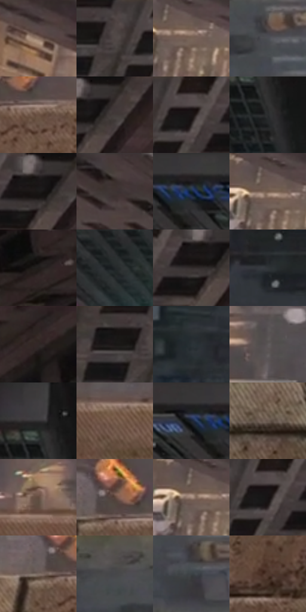

# 电影参考 202

- 状态：常规／活跃；来源世界：miles-home。
- 视角：overhead；景别：detail；场景：city。
- 时段：daylight-time-unspecified（外观依据，中置信度；具体时间／晨昏未知）；光照：neutral-day。
- 材质候选：fabric, brick, glass, stone, metal, sky（帧级，不是像素分割）。
- 明暗组：dark；L* P5/P50/P95：9.6348 / 27.17808 / 49.01101。
- 资格门禁：无附加门禁。
- 原截图 SHA-256：`505fab93624b846df9279cb76631eb581171e9568f2c8ae4aaa096f7c302e5d0`；尺寸：2880 × 1208。
- sRGB 像素 SHA-256：`1e72c0e23df487e47341031734bb647c4064b54cf6ade53e24faf28aa0273396`。

## 观察与迁移

灰日光楼群、屋顶与街谷；楼体受光面和远处空气层清楚。

202  /  白天／俯视与降雪  /  近处石沿和鞋，街道远在下方，白色悬浮片点  /  纹理按距离递减；雪片是空间颗粒，不是建筑表面的印刷点

本公开版保存32个128×128原像素色卡上下文；图集格子并非原场景相邻位置。原rect、图集tile和像素SHA见 `data/palette-crops.json`。上下文不足时不得批准替色，不能以小样推断完整构图。

## 实测色卡

颜色比例分母为保留采样像素，不是材料面积；全部 32 色参与全库匹配。表内四舍五入仅用于阅读，原精度在 JSON。

| ID | HEX | Lab | 原图 xy | 像素数 | 比例 | 明度角色 |
| --- | --- | --- | --- | ---: | ---: | --- |
| 202-S01 | #887060 | [49.090738, 6.881242, 12.441949] | [80, 204] | 9648 | 4.990018% | midtone |
| 202-S02 | #4C4241 | [28.940108, 4.072902, 2.178612] | [1720, 32] | 9072 | 4.692106% | shadow |
| 202-S03 | #776356 | [43.533638, 5.86224, 10.389308] | [352, 356] | 7829 | 4.049217% | midtone |
| 202-S04 | #4C4D52 | [32.817578, 0.717406, -3.088202] | [2500, 580] | 7696 | 3.980429% | shadow |
| 202-S05 | #6A5142 | [36.636291, 8.133502, 12.843136] | [204, 844] | 7533 | 3.896124% | shadow |
| 202-S06 | #403837 | [24.303527, 3.299604, 1.908617] | [1964, 48] | 7484 | 3.870781% | shadow |
| 202-S07 | #564C4C | [33.284377, 4.163785, 1.525473] | [1804, 32] | 7198 | 3.722860% | shadow |
| 202-S08 | #292B2D | [17.407182, -0.391231, -1.60502] | [1240, 152] | 6820 | 3.527355% | deep-shadow |
| 202-S09 | #1C1818 | [8.705869, 1.97736, 0.723049] | [1916, 40] | 6595 | 3.410983% | deep-shadow |
| 202-S10 | #3B302E | [20.984611, 4.578901, 3.139655] | [316, 52] | 6558 | 3.391847% | shadow |
| 202-S11 | #3A393B | [24.13403, 0.886693, -1.086881] | [772, 28] | 6369 | 3.294095% | shadow |
| 202-S12 | #725B4B | [40.521341, 6.862025, 12.792218] | [324, 340] | 6190 | 3.201514% | midtone |
| 202-S13 | #27201F | [13.005143, 3.135073, 1.921894] | [2796, 36] | 6185 | 3.198928% | deep-shadow |
| 202-S14 | #222629 | [14.879267, -0.997873, -2.593625] | [1040, 340] | 6037 | 3.122382% | deep-shadow |
| 202-S15 | #322C2C | [18.633239, 2.725012, 0.995859] | [1888, 80] | 5949 | 3.076867% | deep-shadow |
| 202-S16 | #313539 | [21.924593, -0.715529, -3.096909] | [1656, 580] | 5846 | 3.023595% | shadow |
| 202-S17 | #322826 | [17.158736, 4.249916, 3.059565] | [2484, 64] | 5802 | 3.000838% | deep-shadow |
| 202-S18 | #2A2524 | [15.184088, 2.107798, 1.513891] | [1660, 36] | 5616 | 2.904637% | deep-shadow |
| 202-S19 | #2A3135 | [19.825669, -1.943318, -3.554793] | [1300, 652] | 5536 | 2.863261% | deep-shadow |
| 202-S20 | #5D5859 | [37.892545, 2.216514, 0.145688] | [652, 560] | 5519 | 2.854468% | shadow |
| 202-S21 | #323132 | [20.459711, 0.672568, -0.478224] | [1216, 64] | 5386 | 2.785680% | shadow |
| 202-S22 | #7A5F4F | [42.592772, 8.512922, 13.356137] | [720, 860] | 5299 | 2.740683% | midtone |
| 202-S23 | #1E1F20 | [11.690638, -0.211069, -0.842601] | [716, 44] | 5251 | 2.715857% | deep-shadow |
| 202-S24 | #69584F | [38.807801, 5.3864, 7.809913] | [2764, 1080] | 5120 | 2.648102% | shadow |
| 202-S25 | #614B3E | [33.819406, 7.226975, 11.310143] | [484, 800] | 4991 | 2.581383% | shadow |
| 202-S26 | #594438 | [30.745352, 7.100557, 10.737793] | [152, 792] | 4824 | 2.495009% | shadow |
| 202-S27 | #A38B7D | [59.647085, 6.779623, 10.846073] | [312, 348] | 4819 | 2.492423% | midtone |
| 202-S28 | #161212 | [5.843145, 1.700635, 0.599993] | [1800, 72] | 4666 | 2.413290% | deep-shadow |
| 202-S29 | #7A6A61 | [46.054742, 4.735963, 7.377738] | [108, 824] | 4508 | 2.331571% | midtone |
| 202-S30 | #464649 | [29.8211, 0.672857, -1.797108] | [2376, 524] | 4410 | 2.280885% | shadow |
| 202-S31 | #3B4346 | [27.807895, -2.535939, -2.927386] | [2512, 704] | 4319 | 2.233819% | shadow |
| 202-S32 | #4F392E | [26.116415, 8.042898, 10.670503] | [180, 1048] | 4271 | 2.208993% | shadow |

## 色阶与空间分布

- 采样 ROI：`[0.01, 0.02, 0.98, 0.94]`；步长：4；样本数：193346。
- 排除区：`[]`。
- 深暗、暗、中、亮、高光五段计数：`[60074, 95965, 35680, 1562, 65]`。
- RGB 各 256 箱、L* 100 箱、13×5 色相明度表和 3×3 空间统计全部保存在 [总数据](../film-library.json)。
- [可视化档案](../../references/library.html)按需绘制直方图，不存 2,094 张重复图表图片。

## 纹理特征占比

**这是分块图像特征的面积占比，不是波点／排线／丝网／错版的精确语义覆盖率。** 窗格、发丝、织物也会产生方向或周期特征。
原图 ROI 像素 3104134；已测块覆盖 3104134（100.0000%）；未测 0。

| 特征 | 块覆盖像素 | 占已测面积 | 阈值敏感范围 |
| --- | ---: | ---: | --- |
| low-contrast | 0 | 0.0000% | 0.0000% ~ 0.0000% |
| directional-structure | 256896 | 8.2759% | 1.5834% ~ 30.3739% |
| periodic-structure | 2555142 | 82.3142% | 66.9870% ~ 84.9532% |
| mixed-detail | 292096 | 9.4099% | 2.6391% ~ 13.4633% |

阈值敏感范围不是统计置信区间。逐块坐标、尺度、对比、方向一致性、频谱集中度、频率与角度见 [全量特征记录](../texture-features.jsonl)，以帧号定位。
四种印刷层的真实像素覆盖仍标为 `null`，不能填 0，也不能拿上表代替。不得据这些代理测量删除唯一证据。

[测量方法与保留策略](../../references/library-retention.md) · [分类索引](../archive/README.md)
