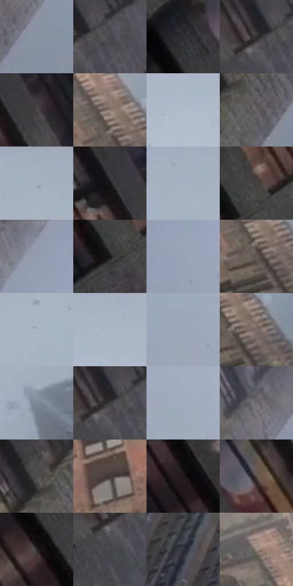

# 电影参考 203

- 状态：常规／活跃；来源世界：miles-home。
- 视角：low-angle；景别：environment-wide；场景：city。
- 时段：daylight-time-unspecified（外观依据，中置信度；具体时间／晨昏未知）；光照：neutral-day。
- 材质候选：fabric, brick, glass, stone, metal, sky（帧级，不是像素分割）。
- 明暗组：dark；L* P5/P50/P95：9.26323 / 39.5343 / 74.12646。
- 资格门禁：无附加门禁。
- 原截图 SHA-256：`0f34bdabcf60ab662c53a18a7c4a385b7162d857a9a93c82ba8dc433b7ba4cad`；尺寸：2880 × 1204。
- sRGB 像素 SHA-256：`9206abba41514f93851e432759401a87d4acf4eb0164beb575143e17706197f8`。

## 观察与迁移

灰日光楼群、屋顶与街谷；楼体受光面和远处空气层清楚。

203  /  白天／仰视与降雪  /  暖窗、深楼体、灰亮天和雪点，建筑向上收束  /  透视结构与空气层次优先；亮窗可为反射或室内亮面，单帧不强判发光

本公开版保存32个128×128原像素色卡上下文；图集格子并非原场景相邻位置。原rect、图集tile和像素SHA见 `data/palette-crops.json`。上下文不足时不得批准替色，不能以小样推断完整构图。

## 实测色卡

颜色比例分母为保留采样像素，不是材料面积；全部 32 色参与全库匹配。表内四舍五入仅用于阅读，原精度在 JSON。

| ID | HEX | Lab | 原图 xy | 像素数 | 比例 | 明度角色 |
| --- | --- | --- | --- | ---: | ---: | --- |
| 203-S01 | #8691A3 | [59.855205, -0.050221, -10.81045] | [1080, 336] | 8705 | 4.518604% | midtone |
| 203-S02 | #545358 | [35.549179, 1.492237, -2.765421] | [804, 40] | 8065 | 4.186392% | shadow |
| 203-S03 | #2D2D31 | [18.611654, 0.977901, -2.5675] | [376, 620] | 7463 | 3.873905% | deep-shadow |
| 203-S04 | #383636 | [22.811391, 0.869917, 0.311374] | [744, 60] | 7261 | 3.769050% | shadow |
| 203-S05 | #464446 | [29.103955, 1.276202, -0.906441] | [544, 92] | 6949 | 3.607097% | shadow |
| 203-S06 | #8C7971 | [52.33446, 5.954853, 7.090305] | [2524, 664] | 6851 | 3.556227% | midtone |
| 203-S07 | #B1BCCD | [75.897413, -0.355536, -9.833088] | [2172, 224] | 6772 | 3.515219% | light |
| 203-S08 | #635F60 | [40.70563, 1.788948, -0.001921] | [900, 472] | 6765 | 3.511586% | midtone |
| 203-S09 | #A5AFBF | [71.159671, -0.220704, -9.336754] | [1952, 56] | 6737 | 3.497052% | light |
| 203-S10 | #3C3C40 | [25.450172, 0.928545, -2.455669] | [472, 48] | 6724 | 3.490304% | shadow |
| 203-S11 | #A7B2C3 | [72.22561, -0.34148, -9.928798] | [1876, 84] | 6617 | 3.434762% | light |
| 203-S12 | #45403F | [27.548087, 1.918629, 1.378569] | [432, 244] | 6317 | 3.279037% | shadow |
| 203-S13 | #919CAF | [64.072695, 0.142897, -11.189153] | [1264, 60] | 6200 | 3.218305% | light |
| 203-S14 | #1B1719 | [8.27116, 2.472119, -0.683573] | [400, 300] | 6160 | 3.197542% | deep-shadow |
| 203-S15 | #9AA4B7 | [67.156203, 0.44956, -10.97469] | [1336, 148] | 6068 | 3.149786% | light |
| 203-S16 | #635853 | [38.299532, 3.52862, 4.53024] | [2528, 724] | 6014 | 3.121756% | shadow |
| 203-S17 | #AAB4C3 | [72.976118, -0.437657, -8.787339] | [2792, 80] | 5989 | 3.108779% | light |
| 203-S18 | #ACB7C8 | [74.066151, -0.34875, -9.880256] | [2256, 156] | 5920 | 3.072962% | light |
| 203-S19 | #9EA8BB | [68.650851, 0.438391, -10.928494] | [1504, 184] | 5900 | 3.062580% | light |
| 203-S20 | #796760 | [45.095928, 5.932457, 6.600734] | [2568, 704] | 5876 | 3.050123% | midtone |
| 203-S21 | #7E8797 | [56.085275, 0.197042, -9.64653] | [2768, 268] | 5745 | 2.982123% | midtone |
| 203-S22 | #1F2026 | [12.378955, 1.149531, -4.193805] | [756, 36] | 5655 | 2.935406% | deep-shadow |
| 203-S23 | #A2ACBE | [70.108228, 0.21213, -10.377822] | [1636, 184] | 5612 | 2.913085% | light |
| 203-S24 | #6A6970 | [44.712586, 1.85779, -3.770056] | [1060, 212] | 5579 | 2.895955% | midtone |
| 203-S25 | #4E4B4A | [32.137704, 1.02712, 1.037602] | [848, 404] | 5372 | 2.788505% | shadow |
| 203-S26 | #403635 | [23.623347, 4.222687, 2.266533] | [1956, 824] | 5337 | 2.770338% | shadow |
| 203-S27 | #0D0A0B | [2.952103, 0.994859, -0.087386] | [212, 44] | 5178 | 2.687804% | deep-shadow |
| 203-S28 | #584C47 | [33.34741, 4.075736, 4.818657] | [504, 616] | 5101 | 2.647834% | shadow |
| 203-S29 | #2C2527 | [15.514163, 3.713228, -0.11449] | [392, 760] | 5024 | 2.607865% | deep-shadow |
| 203-S30 | #484950 | [31.165321, 1.197761, -4.298534] | [736, 124] | 4744 | 2.462522% | shadow |
| 203-S31 | #31333B | [21.343469, 1.151383, -5.320727] | [1104, 708] | 4260 | 2.211287% | shadow |
| 203-S32 | #A29189 | [61.428351, 4.942395, 6.550417] | [2428, 544] | 1688 | 0.876209% | light |

## 色阶与空间分布

- 采样 ROI：`[0.01, 0.02, 0.98, 0.94]`；步长：4；样本数：192648。
- 排除区：`[]`。
- 深暗、暗、中、亮、高光五段计数：`[28478, 69036, 34616, 60510, 8]`。
- RGB 各 256 箱、L* 100 箱、13×5 色相明度表和 3×3 空间统计全部保存在 [总数据](../film-library.json)。
- [可视化档案](../../references/library.html)按需绘制直方图，不存 2,094 张重复图表图片。

## 纹理特征占比

**这是分块图像特征的面积占比，不是波点／排线／丝网／错版的精确语义覆盖率。** 窗格、发丝、织物也会产生方向或周期特征。
原图 ROI 像素 3092958；已测块覆盖 3092958（100.0000%）；未测 0。

| 特征 | 块覆盖像素 | 占已测面积 | 阈值敏感范围 |
| --- | ---: | ---: | --- |
| low-contrast | 505088 | 16.3303% | 10.5033% ~ 21.0977% |
| directional-structure | 496512 | 16.0530% | 4.1467% ~ 33.3847% |
| periodic-structure | 1854174 | 59.9482% | 49.4118% ~ 64.8109% |
| mixed-detail | 237184 | 7.6685% | 6.7001% ~ 9.9447% |

阈值敏感范围不是统计置信区间。逐块坐标、尺度、对比、方向一致性、频谱集中度、频率与角度见 [全量特征记录](../texture-features.jsonl)，以帧号定位。
四种印刷层的真实像素覆盖仍标为 `null`，不能填 0，也不能拿上表代替。不得据这些代理测量删除唯一证据。

[测量方法与保留策略](../../references/library-retention.md) · [分类索引](../archive/README.md)
