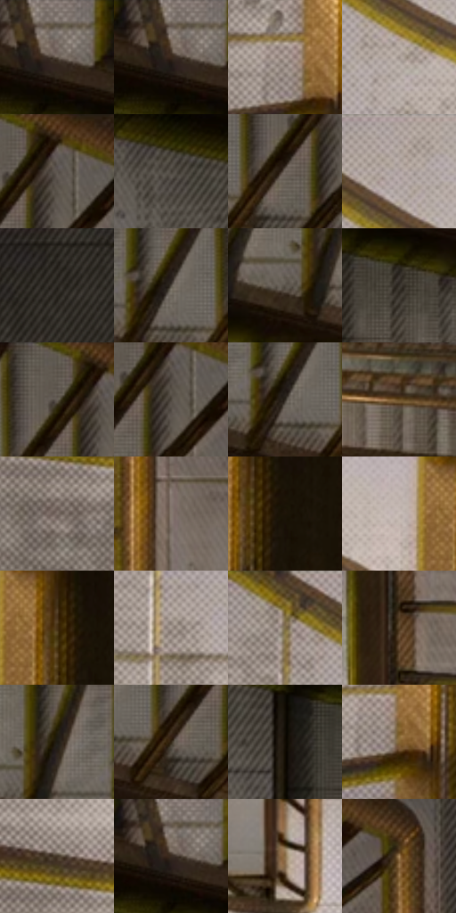

# 电影参考 204

- 状态：常规／活跃；来源世界：miles-home。
- 视角：overhead；景别：environment-wide；场景：interior。
- 时段：daylight-time-unspecified（外观依据，中置信度；具体时间／晨昏未知）；光照：neutral-day。
- 材质候选：fabric, painted-metal, stone（帧级，不是像素分割）。
- 明暗组：dark；L* P5/P50/P95：8.33599 / 37.28312 / 69.47581。
- 资格门禁：无附加门禁。
- 原截图 SHA-256：`df2553592ca040099e17e8b3e017e6f235f16dad823e9551c20bc526885f8d46`；尺寸：2880 × 1204。
- sRGB 像素 SHA-256：`b68605bde1ef4db2a682e4b58ec2914ba1ab34d86acf6ebbcc2bb5c5b64f7804`。

## 观察与迁移

暖灰楼梯与黄栏杆，不能与蓝暗楼梯共用固定色板。

204  /  常规室内／动作  /  暖黄栏杆、灰浅地砖、栏杆投影和楼梯重复  /  与198比较色温及亮带关系；不据此断言是同一资产、同一油漆或只改灯光

本公开版保存32个128×128原像素色卡上下文；图集格子并非原场景相邻位置。原rect、图集tile和像素SHA见 `data/palette-crops.json`。上下文不足时不得批准替色，不能以小样推断完整构图。

## 实测色卡

颜色比例分母为保留采样像素，不是材料面积；全部 32 色参与全库匹配。表内四舍五入仅用于阅读，原精度在 JSON。

| ID | HEX | Lab | 原图 xy | 像素数 | 比例 | 明度角色 |
| --- | --- | --- | --- | ---: | ---: | --- |
| 204-S01 | #6F655D | [43.474012, 2.476422, 5.964934] | [1348, 32] | 10059 | 5.221440% | midtone |
| 204-S02 | #786D65 | [46.803801, 2.834573, 6.027909] | [1328, 32] | 9079 | 4.712740% | midtone |
| 204-S03 | #92847D | [56.182456, 4.046498, 5.699496] | [460, 760] | 8402 | 4.361322% | midtone |
| 204-S04 | #9B8F88 | [60.240819, 3.207766, 5.331731] | [228, 168] | 8259 | 4.287094% | light |
| 204-S05 | #291C0B | [11.457412, 3.92682, 12.612776] | [1956, 28] | 8150 | 4.230514% | deep-shadow |
| 204-S06 | #423C34 | [25.677494, 1.001136, 5.891203] | [1060, 108] | 7773 | 4.034820% | shadow |
| 204-S07 | #695F57 | [41.018432, 2.515561, 6.032865] | [1892, 128] | 7694 | 3.993813% | midtone |
| 204-S08 | #B4A8A2 | [69.695251, 3.263303, 4.651709] | [240, 36] | 7352 | 3.816287% | light |
| 204-S09 | #26221C | [13.471763, 0.599306, 4.734976] | [2532, 28] | 7340 | 3.810058% | deep-shadow |
| 204-S10 | #534C43 | [32.729821, 1.172122, 6.408077] | [1792, 108] | 7172 | 3.722852% | shadow |
| 204-S11 | #5A5249 | [35.379401, 1.571969, 6.475937] | [1624, 128] | 7140 | 3.706241% | shadow |
| 204-S12 | #36312A | [20.627634, 0.792819, 5.282783] | [1432, 188] | 7126 | 3.698974% | shadow |
| 204-S13 | #615850 | [38.021722, 2.141496, 5.964846] | [1904, 40] | 6933 | 3.598792% | shadow |
| 204-S14 | #4C453C | [29.711034, 1.213189, 6.516967] | [1952, 96] | 6820 | 3.540135% | shadow |
| 204-S15 | #2F2921 | [16.989265, 1.152071, 6.267248] | [1780, 128] | 6573 | 3.411922% | deep-shadow |
| 204-S16 | #694E25 | [35.175152, 6.334803, 28.237819] | [1368, 780] | 6093 | 3.162763% | shadow |
| 204-S17 | #80736B | [49.389916, 3.601126, 6.260493] | [160, 648] | 5839 | 3.030916% | midtone |
| 204-S18 | #84776E | [50.949867, 3.399969, 6.770651] | [2220, 532] | 5813 | 3.017420% | midtone |
| 204-S19 | #1D1407 | [7.017815, 2.326804, 7.67951] | [588, 180] | 5730 | 2.974337% | deep-shadow |
| 204-S20 | #C7BBB5 | [76.690875, 3.187391, 4.555618] | [464, 140] | 5715 | 2.966550% | light |
| 204-S21 | #453015 | [21.702655, 6.128044, 20.74616] | [552, 148] | 5465 | 2.836780% | shadow |
| 204-S22 | #A89B93 | [64.862968, 3.354446, 5.910632] | [80, 220] | 5441 | 2.824322% | light |
| 204-S23 | #897D76 | [53.269765, 3.308891, 5.471355] | [32, 56] | 5420 | 2.813421% | midtone |
| 204-S24 | #533E24 | [27.87768, 5.531074, 19.436443] | [1992, 576] | 4610 | 2.392965% | shadow |
| 204-S25 | #1E1A14 | [9.524347, 0.665925, 4.79334] | [1680, 72] | 4581 | 2.377912% | deep-shadow |
| 204-S26 | #312415 | [15.323647, 3.776266, 12.372197] | [1864, 160] | 4525 | 2.348843% | deep-shadow |
| 204-S27 | #120C03 | [3.596383, 0.776579, 4.168972] | [1160, 160] | 4037 | 2.095532% | deep-shadow |
| 204-S28 | #856633 | [45.261229, 6.279431, 33.140213] | [484, 796] | 3934 | 2.042066% | midtone |
| 204-S29 | #433628 | [23.621829, 3.379575, 10.984058] | [164, 556] | 3412 | 1.771106% | shadow |
| 204-S30 | #675B4F | [39.463253, 2.704792, 8.703066] | [1332, 28] | 2939 | 1.525580% | shadow |
| 204-S31 | #8A704A | [48.867852, 4.910026, 24.947508] | [1720, 748] | 1790 | 0.929156% | midtone |
| 204-S32 | #AB8A5F | [59.582712, 6.704545, 27.736414] | [2172, 132] | 1432 | 0.743325% | midtone |

## 色阶与空间分布

- 采样 ROI：`[0.01, 0.02, 0.98, 0.94]`；步长：4；样本数：192648。
- 排除区：`[]`。
- 深暗、暗、中、亮、高光五段计数：`[45037, 61458, 62417, 22854, 882]`。
- RGB 各 256 箱、L* 100 箱、13×5 色相明度表和 3×3 空间统计全部保存在 [总数据](../film-library.json)。
- [可视化档案](../../references/library.html)按需绘制直方图，不存 2,094 张重复图表图片。

## 纹理特征占比

**这是分块图像特征的面积占比，不是波点／排线／丝网／错版的精确语义覆盖率。** 窗格、发丝、织物也会产生方向或周期特征。
原图 ROI 像素 3092958；已测块覆盖 3092958（100.0000%）；未测 0。

| 特征 | 块覆盖像素 | 占已测面积 | 阈值敏感范围 |
| --- | ---: | ---: | --- |
| low-contrast | 0 | 0.0000% | 0.0000% ~ 0.0000% |
| directional-structure | 529280 | 17.1124% | 6.7953% ~ 27.7730% |
| periodic-structure | 2342878 | 75.7488% | 70.6378% ~ 82.2006% |
| mixed-detail | 220800 | 7.1388% | 1.5892% ~ 11.0041% |

阈值敏感范围不是统计置信区间。逐块坐标、尺度、对比、方向一致性、频谱集中度、频率与角度见 [全量特征记录](../texture-features.jsonl)，以帧号定位。
四种印刷层的真实像素覆盖仍标为 `null`，不能填 0，也不能拿上表代替。不得据这些代理测量删除唯一证据。

[测量方法与保留策略](../../references/library-retention.md) · [分类索引](../archive/README.md)
