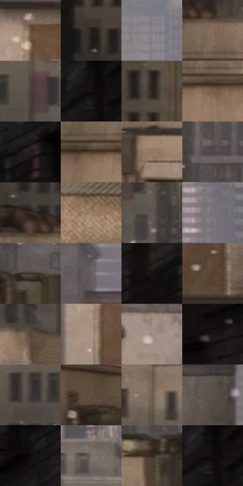

# 电影参考 205

- 状态：常规／活跃；来源世界：miles-home。
- 视角：near-level；景别：environment-wide；场景：city。
- 时段：daylight-time-unspecified（外观依据，中置信度；具体时间／晨昏未知）；光照：neutral-day。
- 材质候选：fabric, brick, glass, stone, metal, sky（帧级，不是像素分割）。
- 明暗组：dark；L* P5/P50/P95：4.90966 / 31.50785 / 59.91285。
- 资格门禁：无附加门禁。
- 原截图 SHA-256：`d481fa16c8f6edc1b8683d0fd10753b3d4894f89b401ada10f585ee2616e30da`；尺寸：2880 × 1202。
- sRGB 像素 SHA-256：`f4a28d610270806d12d57bed8c6cd8e650bdf96d8eb49a5ebb0b910b89e8e73d`。

## 观察与迁移

灰日光楼群、屋顶与街谷；楼体受光面和远处空气层清楚。

205  /  白天／稳定屋顶  /  小人物、设备门、宽大近景石沿、雪片  /  用前中后景比例和遮挡表达空间，不全景均匀锐化

本公开版保存32个128×128原像素色卡上下文；图集格子并非原场景相邻位置。原rect、图集tile和像素SHA见 `data/palette-crops.json`。上下文不足时不得批准替色，不能以小样推断完整构图。

## 实测色卡

颜色比例分母为保留采样像素，不是材料面积；全部 32 色参与全库匹配。表内四舍五入仅用于阅读，原精度在 JSON。

| ID | HEX | Lab | 原图 xy | 像素数 | 比例 | 明度角色 |
| --- | --- | --- | --- | ---: | ---: | --- |
| 205-S01 | #68513D | [36.300714, 6.557102, 15.43246] | [1136, 448] | 7857 | 4.078423% | shadow |
| 205-S02 | #251F1D | [12.364635, 2.445421, 2.425702] | [64, 284] | 7039 | 3.653814% | deep-shadow |
| 205-S03 | #878086 | [54.355004, 3.800927, -2.290195] | [1444, 88] | 6964 | 3.614883% | midtone |
| 205-S04 | #836E5C | [47.944138, 5.359745, 13.131126] | [308, 448] | 6798 | 3.528716% | midtone |
| 205-S05 | #4A423D | [28.614716, 2.42228, 4.285247] | [528, 208] | 6699 | 3.477327% | shadow |
| 205-S06 | #120F0F | [4.559317, 1.095496, 0.38661] | [2216, 28] | 6687 | 3.471098% | deep-shadow |
| 205-S07 | #292421 | [14.640857, 1.689181, 2.858393] | [116, 128] | 6667 | 3.460716% | deep-shadow |
| 205-S08 | #7A624D | [43.373781, 6.450555, 15.623065] | [324, 544] | 6626 | 3.439434% | midtone |
| 205-S09 | #1F1A1A | [9.834864, 2.452385, 0.902575] | [2608, 44] | 6564 | 3.407251% | deep-shadow |
| 205-S10 | #493727 | [24.625504, 5.50573, 13.108028] | [256, 532] | 6527 | 3.388045% | shadow |
| 205-S11 | #8E755E | [51.01595, 6.221529, 16.361978] | [388, 716] | 6522 | 3.385449% | midtone |
| 205-S12 | #504947 | [31.636934, 2.520242, 2.254899] | [784, 404] | 6514 | 3.381296% | shadow |
| 205-S13 | #382E26 | [19.780845, 3.041474, 6.858054] | [236, 380] | 6387 | 3.315373% | deep-shadow |
| 205-S14 | #9D8269 | [56.241998, 6.549531, 17.421601] | [1816, 900] | 6298 | 3.269175% | midtone |
| 205-S15 | #5E5654 | [37.253622, 2.856094, 2.339873] | [604, 280] | 6075 | 3.153420% | shadow |
| 205-S16 | #797379 | [49.138749, 3.494934, -2.472778] | [1740, 140] | 6054 | 3.142519% | midtone |
| 205-S17 | #3D332B | [22.067899, 2.959986, 6.739707] | [960, 628] | 6017 | 3.123313% | shadow |
| 205-S18 | #675E5C | [40.673577, 3.2149, 2.45105] | [1076, 284] | 5887 | 3.055832% | midtone |
| 205-S19 | #181515 | [7.087911, 1.408204, 0.497143] | [2500, 96] | 5848 | 3.035588% | deep-shadow |
| 205-S20 | #543F2E | [28.478672, 6.556602, 13.955411] | [1244, 728] | 5834 | 3.028321% | shadow |
| 205-S21 | #574536 | [30.757673, 5.255728, 11.990078] | [468, 436] | 5759 | 2.989390% | shadow |
| 205-S22 | #AF9785 | [64.113685, 6.030512, 12.779493] | [1116, 552] | 5725 | 2.971741% | light |
| 205-S23 | #A28D81 | [60.173994, 5.883433, 9.303344] | [1380, 396] | 5718 | 2.968108% | light |
| 205-S24 | #1B1717 | [8.197436, 1.988642, 0.724295] | [2756, 252] | 5661 | 2.938520% | deep-shadow |
| 205-S25 | #413934 | [24.633465, 2.502733, 4.396701] | [420, 220] | 5591 | 2.902184% | shadow |
| 205-S26 | #5D4B3A | [33.275585, 4.831714, 13.001511] | [628, 600] | 5445 | 2.826398% | shadow |
| 205-S27 | #6C5A4A | [39.572603, 4.689364, 11.993485] | [532, 92] | 5306 | 2.754246% | shadow |
| 205-S28 | #5A504B | [34.841034, 3.174168, 4.45336] | [1672, 392] | 4815 | 2.499377% | shadow |
| 205-S29 | #151212 | [5.742452, 1.249051, 0.440879] | [2384, 28] | 4782 | 2.482247% | deep-shadow |
| 205-S30 | #746862 | [44.93571, 3.630629, 5.102603] | [800, 44] | 4762 | 2.471866% | midtone |
| 205-S31 | #34271D | [16.844487, 4.369621, 8.943918] | [788, 672] | 4747 | 2.464080% | deep-shadow |
| 205-S32 | #0C0909 | [2.649055, 0.813792, 0.287089] | [2224, 36] | 4473 | 2.321851% | deep-shadow |

## 色阶与空间分布

- 采样 ROI：`[0.01, 0.02, 0.98, 0.94]`；步长：4；样本数：192648。
- 排除区：`[]`。
- 深暗、暗、中、亮、高光五段计数：`[57299, 73848, 52040, 9450, 11]`。
- RGB 各 256 箱、L* 100 箱、13×5 色相明度表和 3×3 空间统计全部保存在 [总数据](../film-library.json)。
- [可视化档案](../../references/library.html)按需绘制直方图，不存 2,094 张重复图表图片。

## 纹理特征占比

**这是分块图像特征的面积占比，不是波点／排线／丝网／错版的精确语义覆盖率。** 窗格、发丝、织物也会产生方向或周期特征。
原图 ROI 像素 3087370；已测块覆盖 3087370（100.0000%）；未测 0。

| 特征 | 块覆盖像素 | 占已测面积 | 阈值敏感范围 |
| --- | ---: | ---: | --- |
| low-contrast | 0 | 0.0000% | 0.0000% ~ 0.0000% |
| directional-structure | 196608 | 6.3681% | 1.0614% ~ 29.6268% |
| periodic-structure | 2841610 | 92.0398% | 70.3732% ~ 95.5100% |
| mixed-detail | 49152 | 1.5920% | 0.0000% ~ 3.4287% |

阈值敏感范围不是统计置信区间。逐块坐标、尺度、对比、方向一致性、频谱集中度、频率与角度见 [全量特征记录](../texture-features.jsonl)，以帧号定位。
四种印刷层的真实像素覆盖仍标为 `null`，不能填 0，也不能拿上表代替。不得据这些代理测量删除唯一证据。

[测量方法与保留策略](../../references/library-retention.md) · [分类索引](../archive/README.md)
