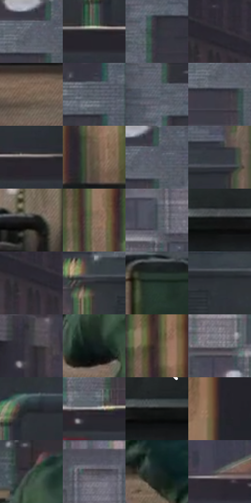

# 电影参考 206

- 状态：常规／活跃；来源世界：miles-home。
- 视角：near-level；景别：medium；场景：city。
- 时段：daylight-time-unspecified（外观依据，中置信度；具体时间／晨昏未知）；光照：neutral-day。
- 材质候选：fabric, brick, glass, stone, metal, sky（帧级，不是像素分割）。
- 明暗组：dark；L* P5/P50/P95：8.24473 / 24.36479 / 51.29304。
- 资格门禁：无附加门禁。
- 原截图 SHA-256：`b872d240af6ff49b62fb8475496778da64ae709a98d78ee66d01458fa1b67677`；尺寸：2880 × 1204。
- sRGB 像素 SHA-256：`b8786f2d670531efbda20d1d30e466450bb095d41de8366d0580891ca9ec4eda`。

## 观察与迁移

灰日光楼群、屋顶与街谷；楼体受光面和远处空气层清楚。

206  /  动作／屋顶材质  /  人物前倾奔跑，管线和设备箱，窗沿有局部异色色边  /  保留原动作方向；局部彩边归印刷错位观察，不自动称结构故障

本公开版保存32个128×128原像素色卡上下文；图集格子并非原场景相邻位置。原rect、图集tile和像素SHA见 `data/palette-crops.json`。上下文不足时不得批准替色，不能以小样推断完整构图。

## 实测色卡

颜色比例分母为保留采样像素，不是材料面积；全部 32 色参与全库匹配。表内四舍五入仅用于阅读，原精度在 JSON。

| ID | HEX | Lab | 原图 xy | 像素数 | 比例 | 明度角色 |
| --- | --- | --- | --- | ---: | ---: | --- |
| 206-S01 | #656E7A | [46.073996, -0.674943, -7.79702] | [1656, 48] | 10291 | 5.341867% | midtone |
| 206-S02 | #242428 | [14.344259, 1.016512, -2.651937] | [1804, 608] | 8727 | 4.530024% | deep-shadow |
| 206-S03 | #30343C | [21.618282, 0.343617, -5.596792] | [2068, 140] | 8530 | 4.427765% | shadow |
| 206-S04 | #29292F | [16.808633, 1.51563, -3.895469] | [208, 200] | 8310 | 4.313567% | deep-shadow |
| 206-S05 | #766452 | [43.618045, 4.233135, 12.895917] | [832, 1040] | 7981 | 4.142789% | midtone |
| 206-S06 | #3D3F4A | [26.852519, 1.855767, -6.953862] | [1896, 32] | 7625 | 3.957996% | shadow |
| 206-S07 | #5B616C | [40.986405, 0.190206, -7.015582] | [2036, 40] | 7488 | 3.886882% | midtone |
| 206-S08 | #3D3A45 | [25.099989, 3.879307, -6.285867] | [1648, 120] | 7108 | 3.689631% | shadow |
| 206-S09 | #494448 | [29.459424, 2.965554, -1.648783] | [1944, 604] | 7100 | 3.685478% | shadow |
| 206-S10 | #615544 | [36.847917, 1.959743, 11.741114] | [2568, 508] | 7046 | 3.657448% | shadow |
| 206-S11 | #515B64 | [38.112746, -1.742674, -6.469293] | [1692, 44] | 6885 | 3.573876% | shadow |
| 206-S12 | #373B40 | [24.671705, -0.459408, -3.659569] | [2144, 348] | 6796 | 3.527677% | shadow |
| 206-S13 | #201F20 | [11.899862, 0.719435, -0.511156] | [2364, 832] | 6663 | 3.458640% | deep-shadow |
| 206-S14 | #8A7361 | [50.131015, 6.120172, 13.329857] | [2336, 92] | 6582 | 3.416594% | midtone |
| 206-S15 | #484F56 | [33.224669, -1.128692, -5.063254] | [1356, 388] | 6285 | 3.262427% | shadow |
| 206-S16 | #151617 | [7.182117, -0.202413, -0.837639] | [2568, 684] | 6206 | 3.221419% | deep-shadow |
| 206-S17 | #322E35 | [19.594366, 3.438193, -3.818239] | [192, 228] | 5986 | 3.107221% | deep-shadow |
| 206-S18 | #2C2D32 | [18.551228, 0.806494, -3.361505] | [1692, 380] | 5829 | 3.025726% | deep-shadow |
| 206-S19 | #22332C | [19.595754, -8.85113, 2.206756] | [1968, 868] | 5763 | 2.991466% | deep-shadow |
| 206-S20 | #2D3337 | [20.832738, -1.534338, -3.397509] | [1808, 392] | 5622 | 2.918276% | shadow |
| 206-S21 | #37343D | [22.320502, 3.447444, -5.153487] | [252, 488] | 5400 | 2.803040% | shadow |
| 206-S22 | #141E1F | [10.380273, -4.147054, -2.142711] | [1248, 996] | 5123 | 2.659254% | deep-shadow |
| 206-S23 | #443330 | [23.033719, 7.12396, 4.849266] | [2452, 168] | 4918 | 2.552842% | shadow |
| 206-S24 | #7C7B81 | [51.877823, 1.594266, -3.125166] | [1212, 412] | 4863 | 2.524293% | midtone |
| 206-S25 | #24282B | [15.835178, -0.994292, -2.575356] | [1860, 516] | 4767 | 2.474461% | deep-shadow |
| 206-S26 | #918D91 | [59.079603, 2.247256, -1.595792] | [1496, 604] | 4386 | 2.276691% | midtone |
| 206-S27 | #0E0F0F | [4.240926, -0.332406, -0.116506] | [2816, 680] | 4333 | 2.249180% | deep-shadow |
| 206-S28 | #2C2529 | [15.585283, 4.168223, -1.43329] | [2708, 204] | 4042 | 2.098127% | deep-shadow |
| 206-S29 | #3E4C48 | [31.02177, -6.508116, 0.525345] | [1268, 844] | 3750 | 1.946555% | shadow |
| 206-S30 | #535157 | [34.826539, 2.118953, -3.21393] | [1304, 88] | 3654 | 1.896724% | shadow |
| 206-S31 | #1B2727 | [14.571162, -5.152764, -1.689169] | [1764, 992] | 3262 | 1.693244% | deep-shadow |
| 206-S32 | #676360 | [42.233954, 0.977387, 2.265047] | [664, 592] | 1327 | 0.688821% | midtone |

## 色阶与空间分布

- 采样 ROI：`[0.01, 0.02, 0.98, 0.94]`；步长：4；样本数：192648。
- 排除区：`[]`。
- 深暗、暗、中、亮、高光五段计数：`[66975, 83352, 40649, 1668, 4]`。
- RGB 各 256 箱、L* 100 箱、13×5 色相明度表和 3×3 空间统计全部保存在 [总数据](../film-library.json)。
- [可视化档案](../../references/library.html)按需绘制直方图，不存 2,094 张重复图表图片。

## 纹理特征占比

**这是分块图像特征的面积占比，不是波点／排线／丝网／错版的精确语义覆盖率。** 窗格、发丝、织物也会产生方向或周期特征。
原图 ROI 像素 3092958；已测块覆盖 3092958（100.0000%）；未测 0。

| 特征 | 块覆盖像素 | 占已测面积 | 阈值敏感范围 |
| --- | ---: | ---: | --- |
| low-contrast | 57088 | 1.8457% | 1.3160% ~ 3.2487% |
| directional-structure | 927454 | 29.9860% | 17.9887% ~ 41.0853% |
| periodic-structure | 2026496 | 65.5197% | 57.5987% ~ 71.1893% |
| mixed-detail | 81920 | 2.6486% | 0.0000% ~ 7.5733% |

阈值敏感范围不是统计置信区间。逐块坐标、尺度、对比、方向一致性、频谱集中度、频率与角度见 [全量特征记录](../texture-features.jsonl)，以帧号定位。
四种印刷层的真实像素覆盖仍标为 `null`，不能填 0，也不能拿上表代替。不得据这些代理测量删除唯一证据。

[测量方法与保留策略](../../references/library-retention.md) · [分类索引](../archive/README.md)
