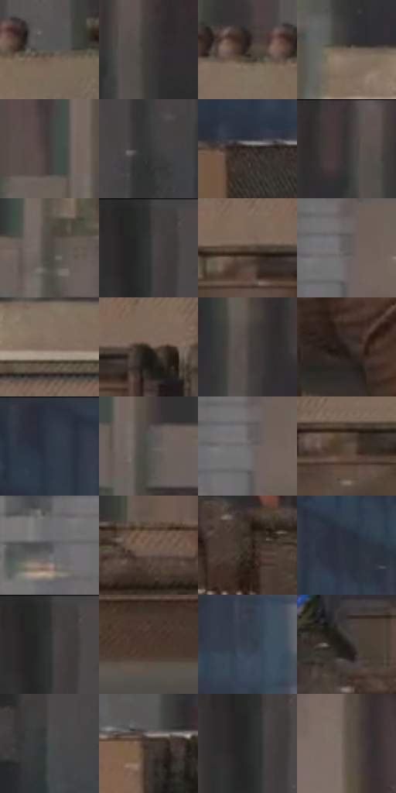

# 电影参考 207

- 状态：常规／活跃；来源世界：miles-home。
- 视角：near-level；景别：environment-wide；场景：city。
- 时段：daylight-time-unspecified（外观依据，中置信度；具体时间／晨昏未知）；光照：neutral-day。
- 材质候选：fabric, brick, glass, stone, metal, sky（帧级，不是像素分割）。
- 明暗组：dark；L* P5/P50/P95：15.53094 / 26.49483 / 43.91552。
- 资格门禁：无附加门禁。
- 原截图 SHA-256：`389591e8964dedb96d3ef63ea4a0b2521a11cc05fbd665faffbc4dff1cacd28e`；尺寸：2878 × 1206。
- sRGB 像素 SHA-256：`adda937cc2dba0cecab257a056d74745ddd095340abfec6b618ce6d789a0bab2`。

## 观察与迁移

灰日光楼群、屋顶与街谷；楼体受光面和远处空气层清楚。

207  /  动作／跨越  /  人物位于屋顶边缘上方，肢体展开，设备呈稳定块面  /  轮廓和受力姿态先于速度图形；没有接触点不能随意加撞击爆点

本公开版保存32个128×128原像素色卡上下文；图集格子并非原场景相邻位置。原rect、图集tile和像素SHA见 `data/palette-crops.json`。上下文不足时不得批准替色，不能以小样推断完整构图。

## 实测色卡

颜色比例分母为保留采样像素，不是材料面积；全部 32 色参与全库匹配。表内四舍五入仅用于阅读，原精度在 JSON。

| ID | HEX | Lab | 原图 xy | 像素数 | 比例 | 明度角色 |
| --- | --- | --- | --- | ---: | ---: | --- |
| 207-S01 | #595550 | [36.366794, 0.614161, 3.494685] | [1264, 372] | 11362 | 5.876512% | shadow |
| 207-S02 | #3D3A37 | [24.620794, 0.649329, 2.326869] | [2208, 84] | 10366 | 5.361373% | shadow |
| 207-S03 | #383029 | [20.498098, 2.226517, 5.813168] | [1168, 364] | 7666 | 3.964913% | shadow |
| 207-S04 | #706055 | [41.948551, 4.522088, 8.666136] | [856, 376] | 7564 | 3.912157% | midtone |
| 207-S05 | #42403E | [27.221715, 0.41357, 1.523977] | [1532, 120] | 7473 | 3.865092% | shadow |
| 207-S06 | #373837 | [23.393122, -0.66068, 0.474684] | [2592, 116] | 7351 | 3.801992% | shadow |
| 207-S07 | #312922 | [17.246999, 2.320679, 5.964673] | [176, 596] | 7165 | 3.705792% | deep-shadow |
| 207-S08 | #373332 | [21.617065, 1.547419, 1.26973] | [2152, 32] | 6993 | 3.616832% | shadow |
| 207-S09 | #4F4A44 | [31.755132, 0.873175, 4.330893] | [1728, 172] | 6843 | 3.539251% | shadow |
| 207-S10 | #313232 | [20.69083, -0.437924, -0.151751] | [2440, 52] | 6754 | 3.493219% | shadow |
| 207-S11 | #514238 | [29.239052, 4.700899, 8.512531] | [992, 552] | 6739 | 3.485461% | shadow |
| 207-S12 | #615D5A | [39.762393, 0.990252, 2.290446] | [600, 68] | 6190 | 3.201514% | shadow |
| 207-S13 | #7F6E61 | [47.65904, 4.451593, 9.71449] | [992, 432] | 6182 | 3.197377% | midtone |
| 207-S14 | #382C24 | [19.096563, 4.058262, 7.278822] | [1088, 548] | 6131 | 3.170999% | deep-shadow |
| 207-S15 | #494440 | [29.212172, 1.288167, 3.180427] | [2064, 80] | 6083 | 3.146173% | shadow |
| 207-S16 | #2C241E | [14.904675, 2.582061, 5.41759] | [2796, 712] | 5983 | 3.094452% | deep-shadow |
| 207-S17 | #2F3845 | [23.210597, -0.163829, -9.261683] | [188, 44] | 5982 | 3.093935% | shadow |
| 207-S18 | #514F4B | [33.667144, -0.014454, 2.652224] | [1604, 184] | 5982 | 3.093935% | shadow |
| 207-S19 | #6C6868 | [44.359345, 1.559629, 0.558646] | [592, 80] | 5973 | 3.089280% | midtone |
| 207-S20 | #5C4B40 | [33.30297, 5.279297, 9.24888] | [1468, 580] | 5459 | 2.823436% | shadow |
| 207-S21 | #505254 | [34.762294, -0.363928, -1.448502] | [520, 116] | 5317 | 2.749992% | shadow |
| 207-S22 | #6A5547 | [37.872148, 6.401911, 11.453414] | [2440, 616] | 5227 | 2.703444% | shadow |
| 207-S23 | #3E332B | [22.182602, 3.436246, 6.916908] | [2008, 664] | 5022 | 2.597416% | shadow |
| 207-S24 | #2B313C | [20.188969, 0.429859, -7.795368] | [312, 88] | 4998 | 2.585003% | shadow |
| 207-S25 | #2F2E2E | [19.037221, 0.444698, 0.159222] | [2440, 32] | 4516 | 2.335709% | deep-shadow |
| 207-S26 | #4D382E | [25.5744, 7.746503, 9.889561] | [2552, 872] | 4374 | 2.262266% | shadow |
| 207-S27 | #38414C | [27.138331, -0.80257, -7.876518] | [384, 508] | 4328 | 2.238474% | shadow |
| 207-S28 | #201C19 | [10.614765, 1.26478, 2.782457] | [2220, 592] | 4272 | 2.209510% | deep-shadow |
| 207-S29 | #47494A | [30.876161, -0.596952, -0.881517] | [2480, 212] | 4197 | 2.170720% | shadow |
| 207-S30 | #423832 | [24.376291, 3.245983, 5.378003] | [672, 600] | 4081 | 2.110724% | shadow |
| 207-S31 | #282929 | [16.489275, -0.45106, -0.156421] | [2424, 88] | 3618 | 1.871257% | deep-shadow |
| 207-S32 | #5D5249 | [35.68027, 2.869141, 6.944] | [1296, 76] | 3155 | 1.631790% | shadow |

## 色阶与空间分布

- 采样 ROI：`[0.01, 0.02, 0.98, 0.94]`；步长：4；样本数：193346。
- 排除区：`[]`。
- 深暗、暗、中、亮、高光五段计数：`[36365, 135124, 21634, 223, 0]`。
- RGB 各 256 箱、L* 100 箱、13×5 色相明度表和 3×3 空间统计全部保存在 [总数据](../film-library.json)。
- [可视化档案](../../references/library.html)按需绘制直方图，不存 2,094 张重复图表图片。

## 纹理特征占比

**这是分块图像特征的面积占比，不是波点／排线／丝网／错版的精确语义覆盖率。** 窗格、发丝、织物也会产生方向或周期特征。
原图 ROI 像素 3096328；已测块覆盖 3096328（100.0000%）；未测 0。

| 特征 | 块覆盖像素 | 占已测面积 | 阈值敏感范围 |
| --- | ---: | ---: | --- |
| low-contrast | 215560 | 6.9618% | 4.8535% ~ 8.1937% |
| directional-structure | 944128 | 30.4919% | 25.7296% ~ 38.8589% |
| periodic-structure | 1887488 | 60.9589% | 55.7584% ~ 62.9019% |
| mixed-detail | 49152 | 1.5874% | 0.5291% ~ 3.1749% |

阈值敏感范围不是统计置信区间。逐块坐标、尺度、对比、方向一致性、频谱集中度、频率与角度见 [全量特征记录](../texture-features.jsonl)，以帧号定位。
四种印刷层的真实像素覆盖仍标为 `null`，不能填 0，也不能拿上表代替。不得据这些代理测量删除唯一证据。

[测量方法与保留策略](../../references/library-retention.md) · [分类索引](../archive/README.md)
