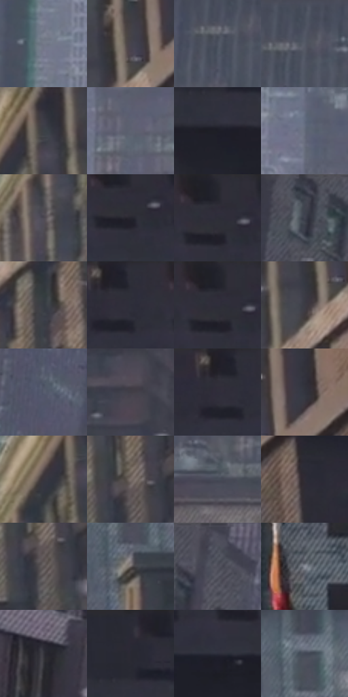

# 电影参考 208

- 状态：常规／活跃；来源世界：miles-home。
- 视角：high-angle；景别：environment-wide；场景：city。
- 时段：daylight-time-unspecified（外观依据，中置信度；具体时间／晨昏未知）；光照：neutral-day。
- 材质候选：fabric, brick, glass, stone, metal, sky（帧级，不是像素分割）。
- 明暗组：dark；L* P5/P50/P95：13.48238 / 27.90958 / 50.76906。
- 资格门禁：无附加门禁。
- 原截图 SHA-256：`e0eaddc0f048732e214198232b509bfc6dfa7a3224e6750bc4dd1ad53c2f6fd6`；尺寸：2880 × 1206。
- sRGB 像素 SHA-256：`071831acbcd9e782fdd4f7a521208b268789d5f3aab8ed95cb1556eba5a0cfb6`。

## 观察与迁移

灰日光楼群、屋顶与街谷；楼体受光面和远处空气层清楚。

208  /  动作／局部身体  /  楼群占主体，画面下缘只有倒向上方的腿鞋  /  尊重裁切，不自动补全身体；单帧不量化速度和运动周期

本公开版保存32个128×128原像素色卡上下文；图集格子并非原场景相邻位置。原rect、图集tile和像素SHA见 `data/palette-crops.json`。上下文不足时不得批准替色，不能以小样推断完整构图。

## 实测色卡

颜色比例分母为保留采样像素，不是材料面积；全部 32 色参与全库匹配。表内四舍五入仅用于阅读，原精度在 JSON。

| ID | HEX | Lab | 原图 xy | 像素数 | 比例 | 明度角色 |
| --- | --- | --- | --- | ---: | ---: | --- |
| 208-S01 | #747988 | [50.879731, 1.399677, -8.788001] | [1124, 316] | 9375 | 4.848820% | midtone |
| 208-S02 | #46444D | [29.342044, 2.892432, -5.097442] | [2132, 196] | 8770 | 4.535910% | shadow |
| 208-S03 | #4B515E | [34.372806, 0.747867, -8.376965] | [784, 88] | 8450 | 4.370403% | shadow |
| 208-S04 | #535865 | [37.404281, 1.076113, -8.13373] | [812, 60] | 7797 | 4.032667% | shadow |
| 208-S05 | #302F3A | [19.910692, 3.208563, -6.802878] | [1996, 32] | 7740 | 4.003186% | deep-shadow |
| 208-S06 | #5E6271 | [41.700095, 1.870817, -8.973666] | [1380, 136] | 7426 | 3.840783% | midtone |
| 208-S07 | #1D1E26 | [11.481448, 1.751526, -5.565792] | [2444, 160] | 7371 | 3.812336% | deep-shadow |
| 208-S08 | #656C7B | [45.526624, 0.751299, -9.215936] | [1324, 464] | 7355 | 3.804061% | midtone |
| 208-S09 | #4D4952 | [31.697529, 3.647682, -4.739583] | [1892, 260] | 7195 | 3.721308% | shadow |
| 208-S10 | #25252E | [15.027569, 2.374559, -5.903206] | [2744, 88] | 7137 | 3.691310% | deep-shadow |
| 208-S11 | #282831 | [16.456415, 2.338228, -5.84048] | [2740, 40] | 6863 | 3.549595% | deep-shadow |
| 208-S12 | #3E424D | [27.997044, 1.065705, -7.186521] | [80, 56] | 6859 | 3.547526% | shadow |
| 208-S13 | #373B43 | [24.781706, 0.3146, -5.491199] | [2020, 476] | 6773 | 3.503046% | shadow |
| 208-S14 | #2C2C36 | [18.378793, 2.567205, -6.394593] | [2628, 36] | 6538 | 3.381503% | deep-shadow |
| 208-S15 | #22222B | [13.582327, 2.414195, -5.970114] | [2732, 36] | 6513 | 3.368572% | deep-shadow |
| 208-S16 | #3C3B44 | [25.278017, 2.563638, -5.365123] | [2092, 256] | 6386 | 3.302887% | shadow |
| 208-S17 | #575D6E | [39.547579, 1.684018, -10.435748] | [392, 168] | 6222 | 3.218065% | shadow |
| 208-S18 | #423E47 | [26.900589, 3.750823, -4.862168] | [888, 488] | 5989 | 3.097556% | shadow |
| 208-S19 | #2B2A32 | [17.459211, 2.462771, -5.003471] | [2596, 40] | 5654 | 2.924291% | deep-shadow |
| 208-S20 | #33343E | [21.971595, 2.078942, -6.392961] | [2204, 152] | 5486 | 2.837400% | shadow |
| 208-S21 | #39353D | [22.837423, 3.604759, -4.36001] | [1940, 108] | 5423 | 2.804816% | shadow |
| 208-S22 | #7C716C | [48.483983, 3.342474, 4.32014] | [2064, 616] | 4851 | 2.508974% | midtone |
| 208-S23 | #484C59 | [32.408793, 1.517087, -8.191316] | [744, 216] | 4781 | 2.472769% | shadow |
| 208-S24 | #302C35 | [18.743122, 3.96643, -5.112779] | [2308, 244] | 4752 | 2.457770% | deep-shadow |
| 208-S25 | #5A5353 | [35.955047, 2.856248, 1.033539] | [2068, 660] | 4632 | 2.395705% | shadow |
| 208-S26 | #6B6261 | [42.345041, 3.379808, 1.863497] | [1688, 660] | 4619 | 2.388981% | midtone |
| 208-S27 | #50505C | [34.427552, 2.745331, -6.990279] | [228, 28] | 4346 | 2.247784% | shadow |
| 208-S28 | #8D919B | [60.140699, 0.591123, -5.774048] | [1404, 1112] | 4161 | 2.152100% | light |
| 208-S29 | #323239 | [21.036337, 1.715686, -4.409] | [608, 724] | 3879 | 2.006248% | shadow |
| 208-S30 | #2A2935 | [17.155935, 3.574266, -7.56828] | [2448, 36] | 3507 | 1.813847% | deep-shadow |
| 208-S31 | #2C2D3A | [18.875776, 2.99524, -8.407865] | [2692, 152] | 3402 | 1.759540% | deep-shadow |
| 208-S32 | #434856 | [30.63984, 1.437182, -8.982801] | [1684, 488] | 3094 | 1.600240% | shadow |

## 色阶与空间分布

- 采样 ROI：`[0.01, 0.02, 0.98, 0.94]`；步长：4；样本数：193346。
- 排除区：`[]`。
- 深暗、暗、中、亮、高光五段计数：`[56328, 98040, 37610, 1068, 300]`。
- RGB 各 256 箱、L* 100 箱、13×5 色相明度表和 3×3 空间统计全部保存在 [总数据](../film-library.json)。
- [可视化档案](../../references/library.html)按需绘制直方图，不存 2,094 张重复图表图片。

## 纹理特征占比

**这是分块图像特征的面积占比，不是波点／排线／丝网／错版的精确语义覆盖率。** 窗格、发丝、织物也会产生方向或周期特征。
原图 ROI 像素 3098546；已测块覆盖 3098546（100.0000%）；未测 0。

| 特征 | 块覆盖像素 | 占已测面积 | 阈值敏感范围 |
| --- | ---: | ---: | --- |
| low-contrast | 60032 | 1.9374% | 1.0575% ~ 2.4662% |
| directional-structure | 283904 | 9.1625% | 3.5237% ~ 22.5551% |
| periodic-structure | 2618290 | 84.5006% | 75.8586% ~ 84.9467% |
| mixed-detail | 136320 | 4.3995% | 0.5288% ~ 9.0633% |

阈值敏感范围不是统计置信区间。逐块坐标、尺度、对比、方向一致性、频谱集中度、频率与角度见 [全量特征记录](../texture-features.jsonl)，以帧号定位。
四种印刷层的真实像素覆盖仍标为 `null`，不能填 0，也不能拿上表代替。不得据这些代理测量删除唯一证据。

[测量方法与保留策略](../../references/library-retention.md) · [分类索引](../archive/README.md)
