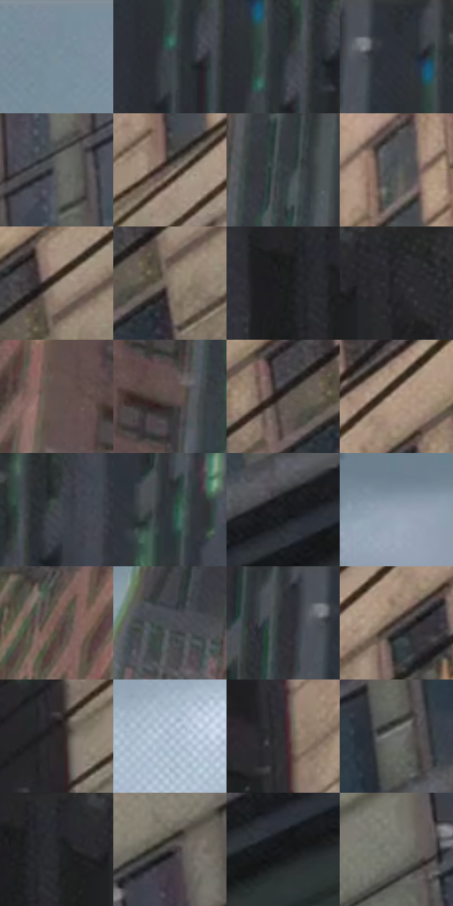

# 电影参考 209

- 状态：常规／活跃；来源世界：miles-home。
- 视角：low-angle；景别：environment-wide；场景：city。
- 时段：daylight-time-unspecified（外观依据，中置信度；具体时间／晨昏未知）；光照：neutral-day。
- 材质候选：fabric, brick, glass, stone, metal, sky（帧级，不是像素分割）。
- 明暗组：dark；L* P5/P50/P95：11.57066 / 30.59578 / 64.08968。
- 资格门禁：无附加门禁。
- 原截图 SHA-256：`1dc4825d1856ee51698dda6dc79125cf458be996f9c1b4b37d19eaf130109b58`；尺寸：2880 × 1204。
- sRGB 像素 SHA-256：`71092e8d055976f2e696199b040da75ca581c61280831c0bcef51aff7ea07c1a`。

## 观察与迁移

灰日光楼群、屋顶与街谷；楼体受光面和远处空气层清楚。

209  /  白天／倾斜街区  /  石砌立面、暗色竖向高楼、前景电线和雪片  /  几何线服从透视，图形排线可有另一方向；不能混为同一织纹

本公开版保存32个128×128原像素色卡上下文；图集格子并非原场景相邻位置。原rect、图集tile和像素SHA见 `data/palette-crops.json`。上下文不足时不得批准替色，不能以小样推断完整构图。

## 实测色卡

颜色比例分母为保留采样像素，不是材料面积；全部 32 色参与全库匹配。表内四舍五入仅用于阅读，原精度在 JSON。

| ID | HEX | Lab | 原图 xy | 像素数 | 比例 | 明度角色 |
| --- | --- | --- | --- | ---: | ---: | --- |
| 209-S01 | #778B98 | [56.736219, -4.18771, -9.301094] | [400, 28] | 9546 | 4.955151% | midtone |
| 209-S02 | #3C4248 | [27.640962, -0.997702, -4.472772] | [1416, 180] | 8392 | 4.356131% | shadow |
| 209-S03 | #2B3237 | [20.324281, -1.66737, -4.173131] | [1444, 132] | 7996 | 4.150575% | shadow |
| 209-S04 | #282C31 | [17.801459, -0.44916, -3.82324] | [1380, 28] | 7420 | 3.851584% | deep-shadow |
| 209-S05 | #5D5E5C | [39.757206, -0.81501, 1.007856] | [2112, 812] | 7408 | 3.845355% | shadow |
| 209-S06 | #6F615A | [42.257787, 4.342694, 6.050104] | [2024, 312] | 7261 | 3.769050% | midtone |
| 209-S07 | #353D42 | [25.222078, -2.041758, -4.187928] | [1128, 68] | 7108 | 3.689631% | shadow |
| 209-S08 | #515557 | [35.857636, -1.148241, -1.713869] | [2032, 156] | 6924 | 3.594120% | shadow |
| 209-S09 | #8A7F71 | [53.787154, 1.708617, 9.127514] | [2576, 76] | 6832 | 3.546364% | midtone |
| 209-S10 | #807065 | [48.407874, 4.34139, 8.413833] | [2576, 140] | 6604 | 3.428014% | midtone |
| 209-S11 | #202123 | [12.710226, 0.050827, -1.507641] | [1664, 72] | 6558 | 3.404136% | deep-shadow |
| 209-S12 | #252529 | [14.825503, 1.011769, -2.641714] | [1816, 28] | 6331 | 3.286305% | deep-shadow |
| 209-S13 | #61524E | [36.226351, 5.469893, 4.648348] | [912, 364] | 6282 | 3.260870% | shadow |
| 209-S14 | #5A4E4A | [34.225495, 4.23525, 4.202715] | [1036, 188] | 6151 | 3.192870% | shadow |
| 209-S15 | #4E4543 | [30.111402, 3.411948, 2.599512] | [2500, 132] | 6099 | 3.165878% | shadow |
| 209-S16 | #A7917F | [61.653831, 5.310022, 12.590244] | [2404, 72] | 6017 | 3.123313% | light |
| 209-S17 | #43484D | [30.312236, -0.85404, -3.683533] | [1508, 80] | 5993 | 3.110855% | shadow |
| 209-S18 | #30373B | [22.571567, -1.926597, -3.497181] | [1260, 256] | 5882 | 3.053237% | shadow |
| 209-S19 | #1B1D1F | [10.635752, -0.40327, -1.695351] | [2696, 696] | 5822 | 3.022092% | deep-shadow |
| 209-S20 | #8D9EAD | [64.268293, -2.731624, -9.803939] | [36, 1004] | 5792 | 3.006520% | light |
| 209-S21 | #524B48 | [32.467024, 2.310147, 2.839334] | [836, 28] | 5630 | 2.922428% | shadow |
| 209-S22 | #484E52 | [32.778644, -1.476965, -3.184473] | [520, 188] | 5410 | 2.808231% | shadow |
| 209-S23 | #313339 | [21.267387, 0.626206, -4.074281] | [1300, 40] | 5304 | 2.753208% | shadow |
| 209-S24 | #483E3C | [27.15606, 3.924221, 2.819744] | [2372, 156] | 5155 | 2.675865% | shadow |
| 209-S25 | #2C2829 | [16.568421, 2.062766, 0.008848] | [1900, 492] | 5150 | 2.673269% | deep-shadow |
| 209-S26 | #A5B6C7 | [73.270722, -2.293007, -10.57371] | [268, 388] | 4963 | 2.576201% | light |
| 209-S27 | #302E31 | [19.241721, 1.596591, -1.602818] | [1892, 256] | 4487 | 2.329118% | deep-shadow |
| 209-S28 | #676C68 | [45.092687, -2.749787, 1.572853] | [2528, 656] | 4357 | 2.261638% | midtone |
| 209-S29 | #222528 | [14.492604, -0.567936, -2.453237] | [1712, 52] | 4208 | 2.184295% | deep-shadow |
| 209-S30 | #3D393A | [24.398183, 1.951334, 0.003228] | [2464, 484] | 4159 | 2.158860% | shadow |
| 209-S31 | #161718 | [7.671729, -0.21072, -0.867926] | [2732, 744] | 3732 | 1.937212% | deep-shadow |
| 209-S32 | #74756E | [48.959775, -1.766949, 3.728653] | [2372, 608] | 3675 | 1.907624% | midtone |

## 色阶与空间分布

- 采样 ROI：`[0.01, 0.02, 0.98, 0.94]`；步长：4；样本数：192648。
- 排除区：`[]`。
- 深暗、暗、中、亮、高光五段计数：`[45727, 90335, 41149, 15006, 431]`。
- RGB 各 256 箱、L* 100 箱、13×5 色相明度表和 3×3 空间统计全部保存在 [总数据](../film-library.json)。
- [可视化档案](../../references/library.html)按需绘制直方图，不存 2,094 张重复图表图片。

## 纹理特征占比

**这是分块图像特征的面积占比，不是波点／排线／丝网／错版的精确语义覆盖率。** 窗格、发丝、织物也会产生方向或周期特征。
原图 ROI 像素 3092958；已测块覆盖 3092958（100.0000%）；未测 0。

| 特征 | 块覆盖像素 | 占已测面积 | 阈值敏感范围 |
| --- | ---: | ---: | --- |
| low-contrast | 65536 | 2.1189% | 1.5892% ~ 2.1189% |
| directional-structure | 826112 | 26.7094% | 7.5733% ~ 43.9242% |
| periodic-structure | 2111582 | 68.2706% | 52.8975% ~ 83.3552% |
| mixed-detail | 89728 | 2.9010% | 1.5892% ~ 6.9526% |

阈值敏感范围不是统计置信区间。逐块坐标、尺度、对比、方向一致性、频谱集中度、频率与角度见 [全量特征记录](../texture-features.jsonl)，以帧号定位。
四种印刷层的真实像素覆盖仍标为 `null`，不能填 0，也不能拿上表代替。不得据这些代理测量删除唯一证据。

[测量方法与保留策略](../../references/library-retention.md) · [分类索引](../archive/README.md)
