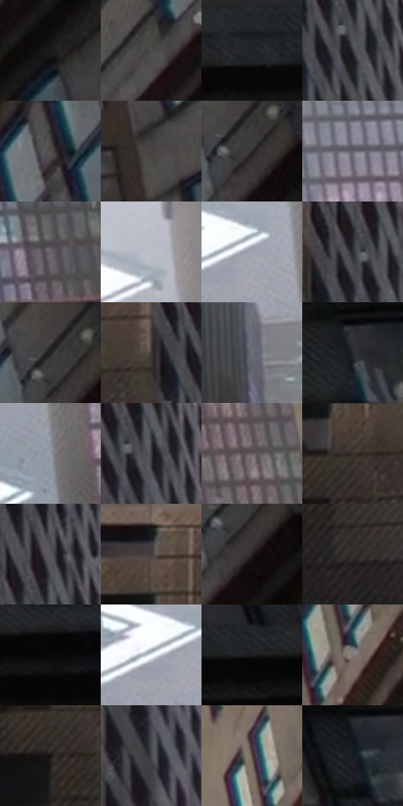

# 电影参考 210

- 状态：条件／活跃；来源世界：miles-home。
- 视角：low-angle；景别：environment-wide；场景：city。
- 时段：daylight-time-unspecified（外观依据，中置信度；具体时间／晨昏未知）；光照：neutral-day。
- 材质候选：brick, glass, stone, painted-metal（帧级，不是像素分割）。
- 明暗组：dark；L* P5/P50/P95：6.03951 / 25.70475 / 74.30592。
- 资格门禁：caption。
- 原截图 SHA-256：`69edfe69232f6b22486edff2e98e55e00c2f6887decc0d4161c14bdf219899f0`；尺寸：2878 × 1204。
- sRGB 像素 SHA-256：`6c56f384bfb9753e3f7e6863681b2453ce27b01f1d41a08d37baba70754c6922`。

## 观察与迁移

实体建筑、车和漂浮字形分开；巨字不自动入图。

210  /  动作／叙事文字  /  街区上方大号白色字母，楼体局部套色，雪点  /  文字是事件表达，不是建筑材质；不向普通照片自动添加拟声字

本公开版保存32个128×128原像素色卡上下文；图集格子并非原场景相邻位置。原rect、图集tile和像素SHA见 `data/palette-crops.json`。上下文不足时不得批准替色，不能以小样推断完整构图。

## 实测色卡

颜色比例分母为保留采样像素，不是材料面积；全部 32 色参与全库匹配。表内四舍五入仅用于阅读，原精度在 JSON。

| ID | HEX | Lab | 原图 xy | 像素数 | 比例 | 明度角色 |
| --- | --- | --- | --- | ---: | ---: | --- |
| 210-S01 | #1B1A1A | [9.372037, 0.483196, 0.17288] | [2124, 288] | 8890 | 4.614634% | deep-shadow |
| 210-S02 | #4B4A4A | [31.550199, 0.411217, 0.147697] | [1948, 308] | 8618 | 4.473444% | shadow |
| 210-S03 | #222528 | [14.492604, -0.567936, -2.453237] | [2284, 32] | 8557 | 4.441780% | deep-shadow |
| 210-S04 | #343538 | [22.166301, 0.283532, -2.031379] | [316, 164] | 8391 | 4.355612% | shadow |
| 210-S05 | #555051 | [34.524243, 2.253696, 0.149449] | [1992, 92] | 7645 | 3.968378% | shadow |
| 210-S06 | #464240 | [28.297281, 1.269905, 1.822859] | [1684, 964] | 7522 | 3.904531% | shadow |
| 210-S07 | #2B2726 | [16.026872, 1.619035, 1.32687] | [2136, 96] | 7407 | 3.844836% | deep-shadow |
| 210-S08 | #83838D | [55.052617, 2.04359, -5.362152] | [1088, 28] | 7334 | 3.806943% | midtone |
| 210-S09 | #68646A | [42.910587, 2.80867, -2.818641] | [1352, 432] | 7294 | 3.786180% | midtone |
| 210-S10 | #B9BDC8 | [76.605795, 0.737195, -6.004325] | [912, 80] | 7250 | 3.763340% | light |
| 210-S11 | #9FA4AF | [67.289513, 0.428007, -6.283584] | [916, 360] | 6733 | 3.494975% | light |
| 210-S12 | #2C2E31 | [18.848002, -0.13578, -2.228395] | [288, 132] | 6292 | 3.266060% | deep-shadow |
| 210-S13 | #212021 | [12.391323, 0.716281, -0.50895] | [2116, 68] | 6272 | 3.255679% | deep-shadow |
| 210-S14 | #403936 | [24.584753, 2.439631, 2.981117] | [224, 156] | 6187 | 3.211557% | shadow |
| 210-S15 | #6B707B | [47.162826, 0.515253, -6.719197] | [568, 600] | 5938 | 3.082306% | midtone |
| 210-S16 | #262B30 | [17.24114, -0.861169, -3.980423] | [2448, 240] | 5722 | 2.970184% | deep-shadow |
| 210-S17 | #9296A1 | [62.080367, 0.793414, -6.26055] | [984, 520] | 5715 | 2.966550% | light |
| 210-S18 | #3D3E42 | [26.246784, 0.511375, -2.590954] | [332, 144] | 5691 | 2.954092% | shadow |
| 210-S19 | #635C5E | [39.77383, 3.203821, -0.133375] | [1456, 212] | 5595 | 2.904261% | shadow |
| 210-S20 | #372E2B | [19.804908, 3.481968, 3.446539] | [96, 180] | 5395 | 2.800444% | deep-shadow |
| 210-S21 | #56565C | [36.755777, 1.315168, -3.46719] | [324, 64] | 5260 | 2.730368% | shadow |
| 210-S22 | #111113 | [5.122413, 0.415032, -1.129822] | [56, 36] | 5249 | 2.724658% | deep-shadow |
| 210-S23 | #282221 | [13.856174, 2.620052, 1.716874] | [2144, 136] | 5054 | 2.623438% | deep-shadow |
| 210-S24 | #312D2C | [18.849869, 1.58086, 1.296418] | [144, 440] | 4950 | 2.569453% | deep-shadow |
| 210-S25 | #09090A | [2.487348, 0.138887, -0.378127] | [2564, 104] | 4885 | 2.535713% | deep-shadow |
| 210-S26 | #F1F5F9 | [96.346102, -0.604197, -2.376281] | [868, 368] | 4841 | 2.512873% | highlight |
| 210-S27 | #1E1E1F | [11.299886, 0.253454, -0.681841] | [2468, 76] | 4683 | 2.430858% | deep-shadow |
| 210-S28 | #7E7574 | [50.000872, 3.267511, 1.799381] | [1756, 108] | 4604 | 2.389851% | midtone |
| 210-S29 | #181516 | [7.122081, 1.648319, -0.156357] | [56, 240] | 4594 | 2.384660% | deep-shadow |
| 210-S30 | #43474B | [29.930532, -0.702906, -2.95862] | [328, 384] | 4038 | 2.096051% | shadow |
| 210-S31 | #564743 | [31.556072, 5.633444, 4.783746] | [1604, 236] | 3431 | 1.780968% | shadow |
| 210-S32 | #181D23 | [10.514756, -0.531452, -4.864875] | [2600, 248] | 2611 | 1.355322% | deep-shadow |

## 色阶与空间分布

- 采样 ROI：`[0.01, 0.02, 0.98, 0.94]`；步长：4；样本数：192648。
- 排除区：`[]`。
- 深暗、暗、中、亮、高光五段计数：`[76189, 64649, 28419, 17058, 6333]`。
- RGB 各 256 箱、L* 100 箱、13×5 色相明度表和 3×3 空间统计全部保存在 [总数据](../film-library.json)。
- [可视化档案](../../references/library.html)按需绘制直方图，不存 2,094 张重复图表图片。

## 纹理特征占比

**这是分块图像特征的面积占比，不是波点／排线／丝网／错版的精确语义覆盖率。** 窗格、发丝、织物也会产生方向或周期特征。
原图 ROI 像素 3090744；已测块覆盖 3090744（100.0000%）；未测 0。

| 特征 | 块覆盖像素 | 占已测面积 | 阈值敏感范围 |
| --- | ---: | ---: | --- |
| low-contrast | 16384 | 0.5301% | 0.0000% ~ 0.8738% |
| directional-structure | 480000 | 15.5302% | 7.9515% ~ 34.1417% |
| periodic-structure | 2534584 | 82.0056% | 65.5146% ~ 83.5959% |
| mixed-detail | 59776 | 1.9340% | 0.3437% ~ 7.5788% |

阈值敏感范围不是统计置信区间。逐块坐标、尺度、对比、方向一致性、频谱集中度、频率与角度见 [全量特征记录](../texture-features.jsonl)，以帧号定位。
四种印刷层的真实像素覆盖仍标为 `null`，不能填 0，也不能拿上表代替。不得据这些代理测量删除唯一证据。

[测量方法与保留策略](../../references/library-retention.md) · [分类索引](../archive/README.md)
