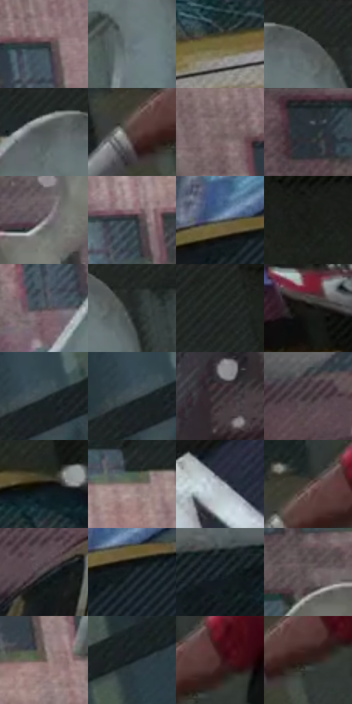

# 电影参考 211

- 状态：条件／活跃；来源世界：miles-home。
- 视角：low-angle；景别：full-body；场景：city。
- 时段：daylight-time-unspecified（外观依据，中置信度；具体时间／晨昏未知）；光照：neutral-day。
- 材质候选：brick, glass, stone, painted-metal（帧级，不是像素分割）。
- 明暗组：dark；L* P5/P50/P95：6.37226 / 24.7235 / 52.85904。
- 资格门禁：caption。
- 原截图 SHA-256：`66181cdd1c147bba51410aaeb62b5f5a9ad826d200a369052c34f0fea8809749`；尺寸：2880 × 1206。
- sRGB 像素 SHA-256：`a9c7d4bee6921bf0665c59ad5e312f2a6e9a5373b4d897e95c383dca6fe21625`。

## 观察与迁移

实体建筑、车和漂浮字形分开；巨字不自动入图。

211  /  冲击／车体与数字  /  黄色车体、深色裂纹玻璃、红色尾灯、空间化大数字  /  分开车漆宽亮带、玻璃裂纹和灯罩亮点；数字和损伤不是默认配件

本公开版保存32个128×128原像素色卡上下文；图集格子并非原场景相邻位置。原rect、图集tile和像素SHA见 `data/palette-crops.json`。上下文不足时不得批准替色，不能以小样推断完整构图。

## 实测色卡

颜色比例分母为保留采样像素，不是材料面积；全部 32 色参与全库匹配。表内四舍五入仅用于阅读，原精度在 JSON。

| ID | HEX | Lab | 原图 xy | 像素数 | 比例 | 明度角色 |
| --- | --- | --- | --- | ---: | ---: | --- |
| 211-S01 | #313638 | [22.219804, -1.635215, -1.983504] | [800, 180] | 9703 | 5.018464% | shadow |
| 211-S02 | #67737A | [47.687761, -2.905217, -5.376789] | [1368, 196] | 8897 | 4.601595% | midtone |
| 211-S03 | #71623D | [42.128917, 0.418536, 23.239902] | [1516, 860] | 8779 | 4.540565% | midtone |
| 211-S04 | #232825 | [15.531564, -2.989468, 1.216263] | [1380, 28] | 8628 | 4.462466% | deep-shadow |
| 211-S05 | #1F2523 | [14.03457, -3.21454, 0.422344] | [1280, 28] | 8071 | 4.174382% | deep-shadow |
| 211-S06 | #54413C | [29.392105, 7.357252, 6.1908] | [2708, 824] | 7657 | 3.960258% | shadow |
| 211-S07 | #766565 | [44.374376, 6.76829, 2.510039] | [552, 168] | 7527 | 3.893021% | midtone |
| 211-S08 | #273035 | [19.233641, -2.460619, -4.464428] | [252, 32] | 7505 | 3.881642% | deep-shadow |
| 211-S09 | #868084 | [54.209799, 3.033344, -1.350428] | [480, 520] | 7384 | 3.819060% | midtone |
| 211-S10 | #313C40 | [24.496295, -3.4701, -3.974658] | [980, 344] | 7355 | 3.804061% | shadow |
| 211-S11 | #565F66 | [39.785114, -1.861422, -5.169594] | [944, 732] | 7222 | 3.735273% | shadow |
| 211-S12 | #191A18 | [9.086128, -0.990881, 1.231175] | [2104, 28] | 6975 | 3.607522% | deep-shadow |
| 211-S13 | #514D51 | [33.245642, 2.498575, -1.768649] | [1200, 400] | 6952 | 3.595626% | shadow |
| 211-S14 | #272C2B | [17.493086, -2.451081, -0.10302] | [1432, 96] | 6656 | 3.442533% | deep-shadow |
| 211-S15 | #1D211E | [12.238701, -2.611053, 1.404822] | [1956, 36] | 6285 | 3.250649% | deep-shadow |
| 211-S16 | #141312 | [5.944967, 0.203808, 0.724993] | [2524, 968] | 6166 | 3.189101% | deep-shadow |
| 211-S17 | #37454A | [28.281255, -4.282039, -4.865468] | [2596, 268] | 5885 | 3.043766% | shadow |
| 211-S18 | #424E53 | [32.327943, -3.506135, -4.54238] | [2568, 276] | 5612 | 2.902568% | shadow |
| 211-S19 | #31292E | [17.627331, 4.788021, -1.885078] | [136, 876] | 5585 | 2.888604% | deep-shadow |
| 211-S20 | #3F3739 | [23.949239, 3.933394, 0.0419] | [452, 824] | 5520 | 2.854985% | shadow |
| 211-S21 | #0F0C0A | [3.490558, 0.654116, 1.133916] | [1632, 720] | 5340 | 2.761888% | deep-shadow |
| 211-S22 | #84756D | [50.372991, 4.389358, 6.535555] | [1052, 92] | 4952 | 2.561212% | midtone |
| 211-S23 | #A4A9B1 | [69.070564, -0.187447, -4.716964] | [1628, 416] | 4528 | 2.341916% | light |
| 211-S24 | #5B4E48 | [34.274912, 4.306611, 5.550398] | [2736, 772] | 4520 | 2.337778% | shadow |
| 211-S25 | #434144 | [27.821553, 1.510881, -1.519152] | [660, 852] | 4236 | 2.190891% | shadow |
| 211-S26 | #162024 | [11.49001, -3.185072, -4.149613] | [980, 768] | 4122 | 2.131929% | deep-shadow |
| 211-S27 | #1E272E | [15.084539, -1.85793, -5.878808] | [1180, 788] | 3993 | 2.065210% | deep-shadow |
| 211-S28 | #665C5C | [40.001641, 4.021076, 1.465203] | [396, 332] | 3865 | 1.999007% | midtone |
| 211-S29 | #64534C | [36.776896, 5.795555, 6.724934] | [1100, 248] | 3723 | 1.925563% | shadow |
| 211-S30 | #12191D | [8.240469, -1.979062, -3.859505] | [2724, 260] | 3423 | 1.770401% | deep-shadow |
| 211-S31 | #432425 | [18.315921, 14.866275, 5.728967] | [2804, 792] | 3267 | 1.689717% | deep-shadow |
| 211-S32 | #2E1F1E | [13.559257, 7.112696, 3.560225] | [2776, 832] | 3013 | 1.558346% | deep-shadow |

## 色阶与空间分布

- 采样 ROI：`[0.01, 0.02, 0.98, 0.94]`；步长：4；样本数：193346。
- 排除区：`[]`。
- 深暗、暗、中、亮、高光五段计数：`[74913, 72603, 41838, 3138, 854]`。
- RGB 各 256 箱、L* 100 箱、13×5 色相明度表和 3×3 空间统计全部保存在 [总数据](../film-library.json)。
- [可视化档案](../../references/library.html)按需绘制直方图，不存 2,094 张重复图表图片。

## 纹理特征占比

**这是分块图像特征的面积占比，不是波点／排线／丝网／错版的精确语义覆盖率。** 窗格、发丝、织物也会产生方向或周期特征。
原图 ROI 像素 3098546；已测块覆盖 3098546（100.0000%）；未测 0。

| 特征 | 块覆盖像素 | 占已测面积 | 阈值敏感范围 |
| --- | ---: | ---: | --- |
| low-contrast | 49152 | 1.5863% | 0.0000% ~ 2.6438% |
| directional-structure | 660608 | 21.3199% | 8.9849% ~ 32.5066% |
| periodic-structure | 2323250 | 74.9787% | 66.9646% ~ 83.0878% |
| mixed-detail | 65536 | 2.1151% | 0.5288% ~ 5.2835% |

阈值敏感范围不是统计置信区间。逐块坐标、尺度、对比、方向一致性、频谱集中度、频率与角度见 [全量特征记录](../texture-features.jsonl)，以帧号定位。
四种印刷层的真实像素覆盖仍标为 `null`，不能填 0，也不能拿上表代替。不得据这些代理测量删除唯一证据。

[测量方法与保留策略](../../references/library-retention.md) · [分类索引](../archive/README.md)
