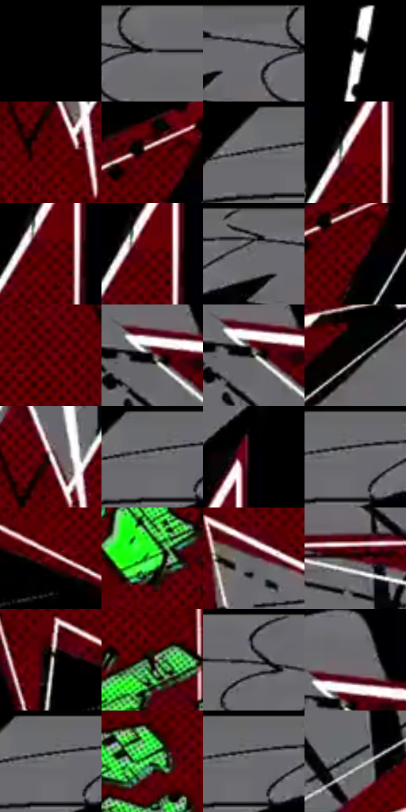

# 电影参考 212

- 状态：条件／活跃；来源世界：miles-home。
- 视角：graphic-nonphysical；景别：graphic-or-multipanel；场景：graphic。
- 时段：graphic-no-physical-time（外观依据，中置信度；具体时间／晨昏未知）；光照：graphic-field。
- 材质候选：fabric, paper（帧级，不是像素分割）。
- 明暗组：very-dark；L* P5/P50/P95：0.0 / 11.65648 / 48.64376。
- 资格门禁：impact。
- 原截图 SHA-256：`2f6eaf063ce4e38ec1015af0366de32ac28881a5944b44f03e44ceea4d6a67f4`；尺寸：2878 × 1216。
- sRGB 像素 SHA-256：`c538787c4a14f7d5a6ad4a0b12dfafdda8371d288734a2fcf72a99fa0962032e`。

## 观察与迁移

黑白底爆点图形与文字，是条件插帧而非现实照明。

212  /  冲击／图形插帧  /  黑灰大块、红色锯齿爆点、绿色文字、白色偏移线与网点  /  可研究接触事件的对比集中；不当成日常皮肤、石头或雪的材质模板

本公开版保存32个128×128原像素色卡上下文；图集格子并非原场景相邻位置。原rect、图集tile和像素SHA见 `data/palette-crops.json`。上下文不足时不得批准替色，不能以小样推断完整构图。

## 实测色卡

颜色比例分母为保留采样像素，不是材料面积；全部 32 色参与全库匹配。表内四舍五入仅用于阅读，原精度在 JSON。

| ID | HEX | Lab | 原图 xy | 像素数 | 比例 | 明度角色 |
| --- | --- | --- | --- | ---: | ---: | --- |
| 212-S01 | #000000 | [0.0, 0.0, 0.0] | [32, 28] | 73778 | 37.884997% | deep-shadow |
| 212-S02 | #6C6C70 | [45.747783, 0.831374, -2.224043] | [1300, 28] | 13047 | 6.699633% | midtone |
| 212-S03 | #717074 | [47.443284, 1.203093, -2.074364] | [1216, 48] | 7583 | 3.893870% | midtone |
| 212-S04 | #030303 | [0.82252, -5.2e-05, 9.9e-05] | [1832, 36] | 6590 | 3.383964% | deep-shadow |
| 212-S05 | #3D0101 | [9.126734, 28.363822, 13.980974] | [1344, 488] | 6250 | 3.209374% | deep-shadow |
| 212-S06 | #5A0002 | [16.398746, 37.510746, 24.621204] | [2024, 232] | 5973 | 3.067135% | deep-shadow |
| 212-S07 | #6D6D70 | [46.121102, 0.619693, -1.66552] | [968, 28] | 5875 | 3.016812% | midtone |
| 212-S08 | #690109 | [20.225928, 41.677492, 27.201164] | [1548, 200] | 5774 | 2.964948% | shadow |
| 212-S09 | #520002 | [14.393946, 35.196419, 21.658711] | [1552, 232] | 5696 | 2.924896% | deep-shadow |
| 212-S10 | #4C0002 | [12.86883, 33.436505, 19.363937] | [1556, 220] | 5176 | 2.657876% | deep-shadow |
| 212-S11 | #69686B | [44.183295, 1.00896, -1.542123] | [1148, 28] | 5159 | 2.649146% | midtone |
| 212-S12 | #610005 | [18.157463, 39.587942, 25.937532] | [2044, 268] | 4821 | 2.475583% | deep-shadow |
| 212-S13 | #59010A | [16.34613, 37.149319, 21.243225] | [1252, 528] | 4788 | 2.458638% | deep-shadow |
| 212-S14 | #22231F | [13.478205, -1.422629, 2.52795] | [720, 536] | 3859 | 1.981596% | deep-shadow |
| 212-S15 | #42463E | [29.123935, -3.403391, 4.261145] | [724, 544] | 3810 | 1.956435% | shadow |
| 212-S16 | #0B0A09 | [2.781744, 0.128949, 0.473241] | [2276, 560] | 3754 | 1.927679% | deep-shadow |
| 212-S17 | #EEE5E5 | [91.628034, 3.038922, 1.089188] | [1352, 420] | 3321 | 1.705333% | highlight |
| 212-S18 | #6C6C6E | [45.687622, 0.411788, -1.111877] | [1008, 28] | 3220 | 1.653470% | midtone |
| 212-S19 | #000003 | [0.05936, 0.417131, -1.135271] | [1604, 96] | 3184 | 1.634984% | deep-shadow |
| 212-S20 | #6B6A70 | [45.086533, 1.639785, -3.208046] | [1044, 28] | 2962 | 1.520987% | midtone |
| 212-S21 | #610410 | [18.655294, 38.807737, 21.609106] | [1752, 1108] | 2910 | 1.494285% | deep-shadow |
| 212-S22 | #41E649 | [80.847355, -70.782232, 61.736212] | [1520, 784] | 2799 | 1.437286% | highlight |
| 212-S23 | #675B5F | [39.902232, 5.621147, -0.516069] | [1932, 952] | 2623 | 1.346910% | shadow |
| 212-S24 | #46050E | [12.239395, 30.07549, 13.181326] | [820, 764] | 2323 | 1.192860% | deep-shadow |
| 212-S25 | #988F8A | [60.029092, 2.418476, 3.854278] | [1596, 1076] | 2119 | 1.088106% | light |
| 212-S26 | #200303 | [3.422315, 11.659336, 4.10825] | [1516, 572] | 1887 | 0.968974% | deep-shadow |
| 212-S27 | #6C6B73 | [45.553673, 2.06689, -4.312025] | [1428, 40] | 1487 | 0.763574% | midtone |
| 212-S28 | #706B70 | [45.811803, 2.950532, -2.089571] | [740, 484] | 1153 | 0.592065% | midtone |
| 212-S29 | #6A6B6F | [45.25827, 0.453696, -2.363088] | [1020, 44] | 969 | 0.497581% | midtone |
| 212-S30 | #4B8F53 | [53.776178, -34.923721, 25.41159] | [1800, 648] | 749 | 0.384611% | midtone |
| 212-S31 | #6C6B70 | [45.460257, 1.424255, -2.647261] | [1044, 32] | 662 | 0.339937% | midtone |
| 212-S32 | #696D6D | [45.695196, -1.530669, -0.530594] | [832, 956] | 441 | 0.226453% | midtone |

## 色阶与空间分布

- 采样 ROI：`[0.01, 0.02, 0.98, 0.94]`；步长：4；样本数：194742。
- 排除区：`[]`。
- 深暗、暗、中、亮、高光五段计数：`[133186, 8485, 45735, 2649, 4687]`。
- RGB 各 256 箱、L* 100 箱、13×5 色相明度表和 3×3 空间统计全部保存在 [总数据](../film-library.json)。
- [可视化档案](../../references/library.html)按需绘制直方图，不存 2,094 张重复图表图片。

## 纹理特征占比

**这是分块图像特征的面积占比，不是波点／排线／丝网／错版的精确语义覆盖率。** 窗格、发丝、织物也会产生方向或周期特征。
原图 ROI 像素 3124248；已测块覆盖 3124248（100.0000%）；未测 0。

| 特征 | 块覆盖像素 | 占已测面积 | 阈值敏感范围 |
| --- | ---: | ---: | --- |
| low-contrast | 830872 | 26.5943% | 26.0699% ~ 28.1675% |
| directional-structure | 1080960 | 34.5990% | 21.1159% ~ 44.1573% |
| periodic-structure | 1024256 | 32.7841% | 29.7728% ~ 41.0231% |
| mixed-detail | 188160 | 6.0226% | 0.0000% ~ 9.6935% |

阈值敏感范围不是统计置信区间。逐块坐标、尺度、对比、方向一致性、频谱集中度、频率与角度见 [全量特征记录](../texture-features.jsonl)，以帧号定位。
四种印刷层的真实像素覆盖仍标为 `null`，不能填 0，也不能拿上表代替。不得据这些代理测量删除唯一证据。

[测量方法与保留策略](../../references/library-retention.md) · [分类索引](../archive/README.md)
