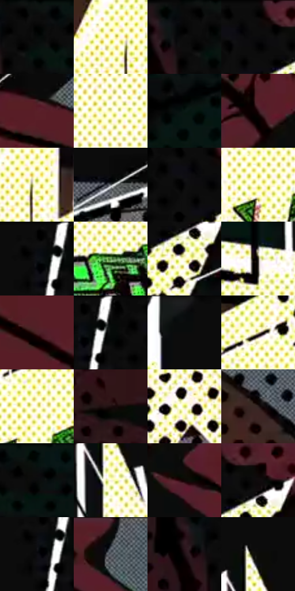

# 电影参考 213

- 状态：条件／活跃；来源世界：miles-home。
- 视角：graphic-nonphysical；景别：graphic-or-multipanel；场景：graphic。
- 时段：graphic-no-physical-time（外观依据，中置信度；具体时间／晨昏未知）；光照：graphic-field。
- 材质候选：fabric, paper（帧级，不是像素分割）。
- 明暗组：very-dark；L* P5/P50/P95：1.25047 / 9.26903 / 98.98987。
- 资格门禁：impact。
- 原截图 SHA-256：`2ddb73725c77fd5c501335c34b79997caa2716770e25931f0c329b33a2f23d87`；尺寸：2880 × 1210。
- sRGB 像素 SHA-256：`a4d306df7ea460129c0b1c72bca5e633115aac94973ba0193aef6bdcf645c654`。

## 观察与迁移

黑白底爆点图形与文字，是条件插帧而非现实照明。

213  /  冲击／图形插帧  /  浅亮爆点替代红色区域，外围黑色大点，绿色字形  /  与212比较亮暗翻转，不声称测得闪烁率；不照搬文字或强制两帧分镜

本公开版保存32个128×128原像素色卡上下文；图集格子并非原场景相邻位置。原rect、图集tile和像素SHA见 `data/palette-crops.json`。上下文不足时不得批准替色，不能以小样推断完整构图。

## 实测色卡

颜色比例分母为保留采样像素，不是材料面积；全部 32 色参与全库匹配。表内四舍五入仅用于阅读，原精度在 JSON。

| ID | HEX | Lab | 原图 xy | 像素数 | 比例 | 明度角色 |
| --- | --- | --- | --- | ---: | ---: | --- |
| 213-S01 | #0C0C0C | [3.32096, -0.000211, 0.0004] | [164, 28] | 27876 | 14.365814% | deep-shadow |
| 213-S02 | #FFFCF5 | [99.014842, -0.210071, 3.700272] | [1524, 260] | 11895 | 6.130053% | highlight |
| 213-S03 | #0A0A0A | [2.741735, -0.000174, 0.00033] | [116, 28] | 11187 | 5.765187% | deep-shadow |
| 213-S04 | #030202 | [0.606656, 0.261464, 0.092205] | [1976, 28] | 9297 | 4.791181% | deep-shadow |
| 213-S05 | #591F28 | [21.047395, 27.574577, 8.01142] | [2324, 660] | 9117 | 4.698419% | shadow |
| 213-S06 | #EFED9B | [92.25942, -11.269649, 40.0227] | [1312, 564] | 9070 | 4.674198% | highlight |
| 213-S07 | #081813 | [6.791578, -6.978954, 1.23432] | [364, 720] | 8401 | 4.329430% | deep-shadow |
| 213-S08 | #2F1317 | [10.046662, 14.793671, 3.780135] | [2328, 112] | 7391 | 3.808930% | deep-shadow |
| 213-S09 | #FEFDDF | [98.689896, -4.612875, 14.499331] | [1560, 276] | 7041 | 3.628558% | highlight |
| 213-S10 | #55595D | [37.601344, -0.689289, -2.850464] | [576, 1104] | 7018 | 3.616705% | shadow |
| 213-S11 | #080809 | [2.213175, 0.138905, -0.37816] | [1932, 80] | 6239 | 3.215250% | deep-shadow |
| 213-S12 | #F6F2BD | [94.641717, -6.907631, 26.139389] | [1636, 476] | 6029 | 3.107027% | highlight |
| 213-S13 | #060606 | [1.645041, -0.000104, 0.000198] | [1804, 28] | 5852 | 3.015811% | deep-shadow |
| 213-S14 | #699C5B | [59.466175, -29.877204, 28.746029] | [1244, 688] | 5836 | 3.007565% | midtone |
| 213-S15 | #FEFDD0 | [98.383192, -6.85027, 21.720301] | [2044, 152] | 5553 | 2.861722% | highlight |
| 213-S16 | #3B3526 | [22.359234, -0.166286, 10.447085] | [1020, 532] | 5511 | 2.840078% | shadow |
| 213-S17 | #4C2125 | [19.04818, 20.772344, 6.972563] | [2336, 844] | 4950 | 2.550968% | deep-shadow |
| 213-S18 | #0A0B0B | [2.963104, -0.268359, -0.094124] | [1856, 40] | 4697 | 2.420585% | deep-shadow |
| 213-S19 | #0E0F11 | [4.294931, 0.047097, -1.149365] | [1640, 28] | 4676 | 2.409763% | deep-shadow |
| 213-S20 | #CDC78A | [79.421193, -7.166117, 31.356555] | [1768, 312] | 4538 | 2.338645% | light |
| 213-S21 | #FBF9C8 | [96.996614, -7.06971, 23.834428] | [1668, 444] | 4202 | 2.165488% | highlight |
| 213-S22 | #1C0D0E | [5.116996, 6.704689, 1.846488] | [460, 264] | 3656 | 1.884109% | deep-shadow |
| 213-S23 | #D4DE63 | [85.575513, -19.845381, 58.063885] | [1232, 1040] | 3619 | 1.865041% | highlight |
| 213-S24 | #2B1F1D | [13.122297, 5.43785, 3.60834] | [2736, 240] | 3214 | 1.656325% | deep-shadow |
| 213-S25 | #08110F | [4.398952, -3.117074, 0.069006] | [256, 40] | 2993 | 1.542434% | deep-shadow |
| 213-S26 | #F8F1E3 | [95.334933, -0.010668, 7.592013] | [1120, 224] | 2856 | 1.471831% | highlight |
| 213-S27 | #0F0705 | [2.389151, 2.006811, 1.562198] | [2412, 204] | 2726 | 1.404836% | deep-shadow |
| 213-S28 | #100B0C | [3.396917, 1.731867, 0.145996] | [2056, 72] | 2111 | 1.087898% | deep-shadow |
| 213-S29 | #0C0C10 | [3.419071, 0.689225, -1.875977] | [1800, 84] | 2065 | 1.064192% | deep-shadow |
| 213-S30 | #060B0A | [2.709577, -1.456945, -0.074606] | [2584, 36] | 1705 | 0.878667% | deep-shadow |
| 213-S31 | #0D080A | [2.539656, 1.653391, -0.27195] | [32, 84] | 1523 | 0.784874% | deep-shadow |
| 213-S32 | #0D0D09 | [3.551206, -0.592534, 1.612459] | [1128, 124] | 1200 | 0.618416% | deep-shadow |

## 色阶与空间分布

- 采样 ROI：`[0.01, 0.02, 0.98, 0.94]`；步长：4；样本数：194044。
- 排除区：`[]`。
- 深暗、暗、中、亮、高光五段计数：`[114281, 16398, 6421, 3888, 53056]`。
- RGB 各 256 箱、L* 100 箱、13×5 色相明度表和 3×3 空间统计全部保存在 [总数据](../film-library.json)。
- [可视化档案](../../references/library.html)按需绘制直方图，不存 2,094 张重复图表图片。

## 纹理特征占比

**这是分块图像特征的面积占比，不是波点／排线／丝网／错版的精确语义覆盖率。** 窗格、发丝、织物也会产生方向或周期特征。
原图 ROI 像素 3109722；已测块覆盖 3109722（100.0000%）；未测 0。

| 特征 | 块覆盖像素 | 占已测面积 | 阈值敏感范围 |
| --- | ---: | ---: | --- |
| low-contrast | 191616 | 6.1618% | 4.5812% ~ 13.3568% |
| directional-structure | 809216 | 26.0221% | 14.2253% ~ 32.7108% |
| periodic-structure | 2010586 | 64.6548% | 61.6542% ~ 66.7829% |
| mixed-detail | 98304 | 3.1612% | 1.0537% ~ 5.6350% |

阈值敏感范围不是统计置信区间。逐块坐标、尺度、对比、方向一致性、频谱集中度、频率与角度见 [全量特征记录](../texture-features.jsonl)，以帧号定位。
四种印刷层的真实像素覆盖仍标为 `null`，不能填 0，也不能拿上表代替。不得据这些代理测量删除唯一证据。

[测量方法与保留策略](../../references/library-retention.md) · [分类索引](../archive/README.md)
