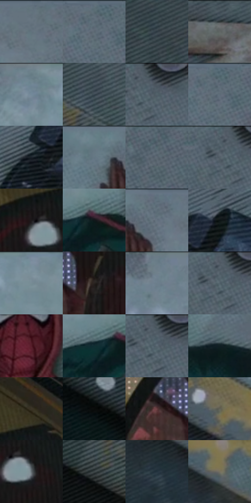

# 电影参考 214

- 状态：常规／活跃；来源世界：miles-home。
- 视角：overhead；景别：full-body；场景：street。
- 时段：daylight-time-unspecified（外观依据，中置信度；具体时间／晨昏未知）；光照：neutral-day。
- 材质候选：fabric, stone, painted-metal（帧级，不是像素分割）。
- 明暗组：dark；L* P5/P50/P95：6.0322 / 33.28045 / 54.17214。
- 资格门禁：无附加门禁。
- 原截图 SHA-256：`23514c43ba2c196bef2660d18d87f579c1e34a68da3e35bf6b16519d98dc53d1`；尺寸：2880 × 1208。
- sRGB 像素 SHA-256：`c2150408bdcd42e80653a6c01294a87fc7f8bac8eb08b3db9c5c1e1c6ca7ca53`。

## 观察与迁移

俯视人物与地面设施，深浅大面承托局部服色。

214  /  动作后状态／材料基准  /  人物仰躺地砖，黄路缘、深色消防栓及漆面磨损  /  分开路面磨耗、金属掉漆和印刷排线；冲击后画面不必持续爆点覆盖

本公开版保存32个128×128原像素色卡上下文；图集格子并非原场景相邻位置。原rect、图集tile和像素SHA见 `data/palette-crops.json`。上下文不足时不得批准替色，不能以小样推断完整构图。

## 实测色卡

颜色比例分母为保留采样像素，不是材料面积；全部 32 色参与全库匹配。表内四舍五入仅用于阅读，原精度在 JSON。

| ID | HEX | Lab | 原图 xy | 像素数 | 比例 | 明度角色 |
| --- | --- | --- | --- | ---: | ---: | --- |
| 214-S01 | #62717C | [46.792575, -3.008232, -7.941236] | [2132, 28] | 8789 | 4.545737% | midtone |
| 214-S02 | #5B6A74 | [43.934295, -3.258994, -7.469213] | [2292, 28] | 8586 | 4.440744% | midtone |
| 214-S03 | #2F3A43 | [23.788642, -2.075471, -7.050172] | [340, 160] | 8583 | 4.439192% | shadow |
| 214-S04 | #43505A | [33.282861, -2.561698, -7.552427] | [748, 28] | 8565 | 4.429882% | shadow |
| 214-S05 | #6F848E | [53.850854, -5.242739, -7.892537] | [1388, 36] | 8372 | 4.330061% | midtone |
| 214-S06 | #38454F | [28.541377, -2.544534, -7.716648] | [596, 472] | 8366 | 4.326958% | shadow |
| 214-S07 | #262E34 | [18.426149, -1.783423, -4.991297] | [2744, 28] | 8153 | 4.216793% | deep-shadow |
| 214-S08 | #566771 | [42.56791, -3.952954, -7.735737] | [2312, 36] | 7943 | 4.108179% | midtone |
| 214-S09 | #1B222A | [12.886189, -0.73689, -6.365579] | [2344, 448] | 7572 | 3.916295% | deep-shadow |
| 214-S10 | #667883 | [49.369607, -4.023118, -8.21156] | [1916, 56] | 7203 | 3.725446% | midtone |
| 214-S11 | #51606A | [39.840897, -3.267718, -7.584168] | [2572, 32] | 7049 | 3.645796% | shadow |
| 214-S12 | #4E5C65 | [38.222539, -3.174776, -6.948088] | [2692, 28] | 6744 | 3.488047% | shadow |
| 214-S13 | #1C181A | [8.779212, 2.459205, -0.680988] | [260, 948] | 6721 | 3.476152% | deep-shadow |
| 214-S14 | #12181A | [7.735989, -2.110783, -2.33936] | [1428, 412] | 6709 | 3.469945% | deep-shadow |
| 214-S15 | #5D6D78 | [45.109389, -3.35414, -8.103673] | [2020, 48] | 6156 | 3.183929% | midtone |
| 214-S16 | #0D1316 | [5.502993, -1.451108, -2.638331] | [2432, 368] | 6124 | 3.167379% | deep-shadow |
| 214-S17 | #7A8F9A | [58.145925, -4.979292, -8.320745] | [1532, 44] | 5949 | 3.076867% | midtone |
| 214-S18 | #2A2422 | [14.787105, 2.383701, 2.368841] | [188, 1120] | 5736 | 2.966702% | deep-shadow |
| 214-S19 | #6D7E89 | [51.812937, -3.676994, -8.034769] | [1164, 28] | 5445 | 2.816195% | midtone |
| 214-S20 | #56626C | [40.890387, -2.211706, -7.200241] | [2708, 32] | 5392 | 2.788783% | midtone |
| 214-S21 | #541B27 | [19.290103, 27.617517, 6.125828] | [1636, 348] | 5379 | 2.782059% | deep-shadow |
| 214-S22 | #102E33 | [17.003148, -9.278471, -6.576515] | [1372, 420] | 5249 | 2.714822% | deep-shadow |
| 214-S23 | #4B575F | [36.249089, -2.719948, -6.192009] | [2724, 28] | 5249 | 2.714822% | shadow |
| 214-S24 | #0F1F23 | [10.578064, -5.357298, -4.836475] | [1804, 416] | 5212 | 2.695685% | deep-shadow |
| 214-S25 | #3B3426 | [22.037532, 0.492347, 10.011423] | [336, 844] | 5205 | 2.692065% | shadow |
| 214-S26 | #090D0E | [3.411016, -0.94618, -0.849273] | [44, 380] | 4676 | 2.418462% | deep-shadow |
| 214-S27 | #633A3D | [29.453437, 18.550149, 5.899775] | [76, 1112] | 4483 | 2.318641% | shadow |
| 214-S28 | #626156 | [40.925458, -1.771901, 6.421787] | [916, 772] | 3796 | 1.963320% | midtone |
| 214-S29 | #5F686E | [43.446992, -2.081521, -4.53623] | [312, 980] | 2849 | 1.473524% | midtone |
| 214-S30 | #3F4648 | [29.17117, -2.376346, -2.177493] | [520, 596] | 2726 | 1.409908% | shadow |
| 214-S31 | #23343F | [20.720041, -3.524162, -9.088977] | [948, 932] | 2358 | 1.219575% | shadow |
| 214-S32 | #757061 | [47.279434, -0.838467, 9.044473] | [1092, 904] | 2007 | 1.038035% | midtone |

## 色阶与空间分布

- 采样 ROI：`[0.01, 0.02, 0.98, 0.94]`；步长：4；样本数：193346。
- 排除区：`[]`。
- 深暗、暗、中、亮、高光五段计数：`[58568, 61351, 72567, 854, 6]`。
- RGB 各 256 箱、L* 100 箱、13×5 色相明度表和 3×3 空间统计全部保存在 [总数据](../film-library.json)。
- [可视化档案](../../references/library.html)按需绘制直方图，不存 2,094 张重复图表图片。

## 纹理特征占比

**这是分块图像特征的面积占比，不是波点／排线／丝网／错版的精确语义覆盖率。** 窗格、发丝、织物也会产生方向或周期特征。
原图 ROI 像素 3104134；已测块覆盖 3104134（100.0000%）；未测 0。

| 特征 | 块覆盖像素 | 占已测面积 | 阈值敏感范围 |
| --- | ---: | ---: | --- |
| low-contrast | 85632 | 2.7586% | 0.7958% ~ 4.0040% |
| directional-structure | 928640 | 29.9162% | 13.0262% ~ 44.6249% |
| periodic-structure | 2051206 | 66.0798% | 54.5793% ~ 75.6215% |
| mixed-detail | 38656 | 1.2453% | 0.0000% ~ 7.3483% |

阈值敏感范围不是统计置信区间。逐块坐标、尺度、对比、方向一致性、频谱集中度、频率与角度见 [全量特征记录](../texture-features.jsonl)，以帧号定位。
四种印刷层的真实像素覆盖仍标为 `null`，不能填 0，也不能拿上表代替。不得据这些代理测量删除唯一证据。

[测量方法与保留策略](../../references/library-retention.md) · [分类索引](../archive/README.md)
