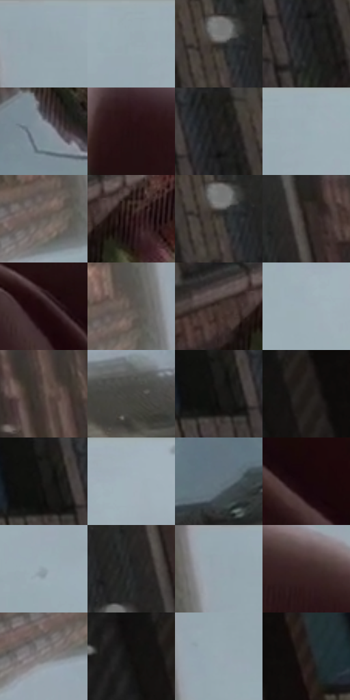

# 电影参考 215

- 状态：条件／活跃；来源世界：miles-home。
- 视角：low-angle；景别：detail；场景：detail。
- 时段：daylight-time-unspecified（外观依据，中置信度；具体时间／晨昏未知）；光照：neutral-day。
- 材质候选：skin, paper, brick, sky（帧级，不是像素分割）。
- 明暗组：dark；L* P5/P50/P95：4.91832 / 24.57704 / 69.67595。
- 资格门禁：secondary-image。
- 原截图 SHA-256：`ef9517b660ffd116abd0a4d3b06a4df3ce1e03fd5e3236ccd103b35009d2aefd`；尺寸：2880 × 1204。
- sRGB 像素 SHA-256：`80ae8384429b4f441073fe3d15fe1c8fe22b61926f0eff3d2f50c05821d28f4c`。

## 观察与迁移

手持小纸片，印刷颜色与街谷、手部受光分离。

215  /  稳定近景／实体损伤  /  手指与指甲、绿色电子小物及破损边缘，背景仰视楼体  /  肤色软体积对比小物硬边；物理断裂不是数字故障，不能凭颜色判信号异常

本公开版保存32个128×128原像素色卡上下文；图集格子并非原场景相邻位置。原rect、图集tile和像素SHA见 `data/palette-crops.json`。上下文不足时不得批准替色，不能以小样推断完整构图。

## 实测色卡

颜色比例分母为保留采样像素，不是材料面积；全部 32 色参与全库匹配。表内四舍五入仅用于阅读，原精度在 JSON。

| ID | HEX | Lab | 原图 xy | 像素数 | 比例 | 明度角色 |
| --- | --- | --- | --- | ---: | ---: | --- |
| 215-S01 | #96A8B0 | [67.741934, -4.58476, -6.242121] | [1800, 28] | 9366 | 4.861717% | light |
| 215-S02 | #9AA9B2 | [68.358022, -3.369923, -6.407652] | [2120, 28] | 8646 | 4.487978% | light |
| 215-S03 | #34322E | [20.860502, 0.003275, 2.860996] | [812, 88] | 8228 | 4.271002% | shadow |
| 215-S04 | #1D1E1E | [11.159522, -0.471074, -0.163437] | [700, 140] | 7952 | 4.127736% | deep-shadow |
| 215-S05 | #7F8E98 | [58.155015, -3.20501, -7.124887] | [1148, 640] | 7693 | 3.993293% | midtone |
| 215-S06 | #241012 | [7.130663, 10.660078, 2.701718] | [1600, 552] | 7622 | 3.956439% | deep-shadow |
| 215-S07 | #232220 | [13.264685, -0.008952, 1.513481] | [704, 40] | 7445 | 3.864561% | deep-shadow |
| 215-S08 | #9CABB5 | [69.132906, -3.153246, -6.904448] | [2180, 56] | 7397 | 3.839645% | light |
| 215-S09 | #645D58 | [39.986389, 1.831256, 3.879268] | [1668, 212] | 7294 | 3.786180% | shadow |
| 215-S10 | #2D1819 | [11.145219, 10.718873, 3.785914] | [1168, 432] | 7104 | 3.687555% | deep-shadow |
| 215-S11 | #3F3B35 | [25.081314, 0.482028, 4.342078] | [812, 100] | 6741 | 3.499128% | shadow |
| 215-S12 | #302723 | [16.507803, 3.399332, 4.208519] | [960, 48] | 6696 | 3.475769% | deep-shadow |
| 215-S13 | #1F0B0E | [5.080358, 9.400146, 1.841148] | [1916, 792] | 6658 | 3.456044% | deep-shadow |
| 215-S14 | #574F4A | [34.216637, 2.326976, 4.149738] | [1696, 164] | 6579 | 3.415037% | shadow |
| 215-S15 | #42342F | [23.065956, 5.353709, 5.533853] | [1080, 424] | 6556 | 3.403098% | shadow |
| 215-S16 | #9EAEB7 | [70.147446, -3.691214, -6.489305] | [2376, 112] | 5866 | 3.044932% | light |
| 215-S17 | #51433D | [29.665306, 4.902511, 5.882159] | [1368, 96] | 5805 | 3.013268% | shadow |
| 215-S18 | #44433F | [28.385725, -0.439663, 2.577351] | [2700, 780] | 5682 | 2.949421% | shadow |
| 215-S19 | #161514 | [6.841678, 0.220447, 0.787822] | [600, 80] | 5550 | 2.880902% | deep-shadow |
| 215-S20 | #231F1C | [12.097844, 1.240105, 2.742062] | [172, 48] | 5314 | 2.758399% | deep-shadow |
| 215-S21 | #1B1A19 | [9.336488, 0.236024, 0.870769] | [596, 64] | 5293 | 2.747498% | deep-shadow |
| 215-S22 | #A1B0B9 | [70.960324, -3.354837, -6.363204] | [2436, 28] | 5248 | 2.724139% | light |
| 215-S23 | #65737C | [47.601922, -3.139914, -6.710009] | [624, 996] | 5040 | 2.616170% | midtone |
| 215-S24 | #17070A | [3.216385, 5.96826, 0.820927] | [2200, 1012] | 4877 | 2.531560% | deep-shadow |
| 215-S25 | #909FA8 | [64.605477, -3.39177, -6.474478] | [2464, 364] | 4571 | 2.372721% | light |
| 215-S26 | #262929 | [16.295588, -1.341761, -0.462788] | [920, 140] | 4492 | 2.331714% | deep-shadow |
| 215-S27 | #98A4AE | [66.734638, -2.159587, -6.606893] | [1760, 48] | 4362 | 2.264233% | light |
| 215-S28 | #3A2726 | [17.876397, 8.776094, 4.221344] | [2160, 676] | 4344 | 2.254890% | deep-shadow |
| 215-S29 | #797575 | [49.583291, 1.526394, 0.546437] | [1616, 264] | 3904 | 2.026494% | midtone |
| 215-S30 | #120F0E | [4.534186, 0.918895, 0.867249] | [100, 52] | 3605 | 1.871289% | deep-shadow |
| 215-S31 | #98A6B0 | [67.338343, -2.828325, -6.824832] | [1808, 164] | 3387 | 1.758129% | light |
| 215-S32 | #221917 | [9.776673, 4.076832, 3.111259] | [276, 72] | 3331 | 1.729060% | deep-shadow |

## 色阶与空间分布

- 采样 ROI：`[0.01, 0.02, 0.98, 0.94]`；步长：4；样本数：192648。
- 排除区：`[]`。
- 深暗、暗、中、亮、高光五段计数：`[82535, 40889, 18515, 50709, 0]`。
- RGB 各 256 箱、L* 100 箱、13×5 色相明度表和 3×3 空间统计全部保存在 [总数据](../film-library.json)。
- [可视化档案](../../references/library.html)按需绘制直方图，不存 2,094 张重复图表图片。

## 纹理特征占比

**这是分块图像特征的面积占比，不是波点／排线／丝网／错版的精确语义覆盖率。** 窗格、发丝、织物也会产生方向或周期特征。
原图 ROI 像素 3092958；已测块覆盖 3092958（100.0000%）；未测 0。

| 特征 | 块覆盖像素 | 占已测面积 | 阈值敏感范围 |
| --- | ---: | ---: | --- |
| low-contrast | 665344 | 21.5116% | 15.8709% ~ 22.8235% |
| directional-structure | 700800 | 22.6579% | 11.1241% ~ 35.0649% |
| periodic-structure | 1629406 | 52.6812% | 49.0642% ~ 61.5002% |
| mixed-detail | 97408 | 3.1493% | 0.0000% ~ 4.5523% |

阈值敏感范围不是统计置信区间。逐块坐标、尺度、对比、方向一致性、频谱集中度、频率与角度见 [全量特征记录](../texture-features.jsonl)，以帧号定位。
四种印刷层的真实像素覆盖仍标为 `null`，不能填 0，也不能拿上表代替。不得据这些代理测量删除唯一证据。

[测量方法与保留策略](../../references/library-retention.md) · [分类索引](../archive/README.md)
