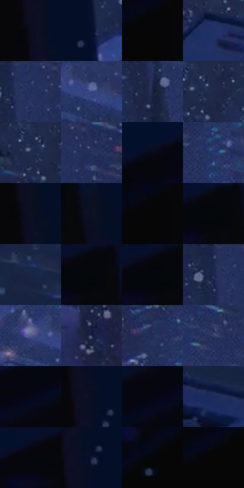

# 电影参考 216

- 状态：常规／活跃；来源世界：miles-home。
- 视角：high-angle；景别：environment-wide；场景：city。
- 时段：night-appearance（外观依据，中置信度；具体时间／晨昏未知）；光照：night-mixed。
- 材质候选：snow, stone, brick, foliage, sky, fabric（帧级，不是像素分割）。
- 明暗组：very-dark；L* P5/P50/P95：1.64504 / 12.97418 / 30.85117。
- 资格门禁：无附加门禁。
- 原截图 SHA-256：`323dafa053dc1354b5f5d08a2ff44f186e5147e573981250ac2c319fb095435d`；尺寸：2880 × 1206。
- sRGB 像素 SHA-256：`86b9afaa3eb0b8d5e02afb41e41e81800a2d99a82cc8d1b30db9207a0d64d4dd`。

## 观察与迁移

雪夜城市和墓园，冷蓝积雪承接局部红粉灯照。

216  /  夜晚／俯视雪景  /  大暗楼体框住蓝色墓园，远窗小亮点，局部粉色照明  /  用前景深暗、远处弱对比与雪片大小形成层次，不全局提亮

本公开版保存32个128×128原像素色卡上下文；图集格子并非原场景相邻位置。原rect、图集tile和像素SHA见 `data/palette-crops.json`。上下文不足时不得批准替色，不能以小样推断完整构图。

## 实测色卡

颜色比例分母为保留采样像素，不是材料面积；全部 32 色参与全库匹配。表内四舍五入仅用于阅读，原精度在 JSON。

| ID | HEX | Lab | 原图 xy | 像素数 | 比例 | 明度角色 |
| --- | --- | --- | --- | ---: | ---: | --- |
| 216-S01 | #0B0E1E | [4.326107, 3.035278, -10.578253] | [788, 372] | 11916 | 6.163044% | deep-shadow |
| 216-S02 | #05102A | [5.148155, 5.07593, -18.540606] | [940, 628] | 11008 | 5.693420% | deep-shadow |
| 216-S03 | #060606 | [1.645041, -0.000104, 0.000198] | [660, 400] | 9988 | 5.165868% | deep-shadow |
| 216-S04 | #1F3063 | [21.228643, 11.5921, -32.323791] | [2300, 296] | 9689 | 5.011223% | shadow |
| 216-S05 | #26335D | [22.194598, 8.676922, -26.822754] | [1144, 32] | 8945 | 4.626421% | shadow |
| 216-S06 | #354580 | [30.80959, 12.607805, -35.376441] | [1512, 520] | 8631 | 4.464018% | shadow |
| 216-S07 | #19213E | [13.483999, 6.53105, -19.706766] | [1124, 236] | 7993 | 4.134039% | deep-shadow |
| 216-S08 | #1F2747 | [16.489355, 7.205117, -21.157439] | [2344, 28] | 7871 | 4.070940% | deep-shadow |
| 216-S09 | #212C50 | [18.815644, 7.511778, -23.573336] | [2304, 28] | 7601 | 3.931294% | deep-shadow |
| 216-S10 | #2D365F | [23.744466, 9.113983, -25.6406] | [1212, 56] | 7422 | 3.838714% | shadow |
| 216-S11 | #080B19 | [3.262049, 2.128845, -8.226049] | [404, 136] | 7093 | 3.668553% | deep-shadow |
| 216-S12 | #2A3A6E | [25.694419, 11.078285, -32.239313] | [1428, 172] | 6912 | 3.574938% | shadow |
| 216-S13 | #0F1224 | [5.975281, 4.21462, -12.658328] | [804, 392] | 6227 | 3.220651% | deep-shadow |
| 216-S14 | #0D1122 | [5.437031, 3.397878, -11.971754] | [772, 112] | 6045 | 3.126519% | deep-shadow |
| 216-S15 | #060507 | [1.46875, 0.5395, -0.664544] | [660, 392] | 6019 | 3.113072% | deep-shadow |
| 216-S16 | #04070C | [1.845451, -0.073741, -2.210921] | [680, 28] | 5990 | 3.098073% | deep-shadow |
| 216-S17 | #182545 | [15.205563, 6.061647, -21.849979] | [2680, 64] | 5641 | 2.917567% | deep-shadow |
| 216-S18 | #07070B | [1.998866, 0.559599, -1.523112] | [688, 28] | 5511 | 2.850330% | deep-shadow |
| 216-S19 | #070712 | [2.175028, 1.797504, -4.892212] | [660, 28] | 5445 | 2.816195% | deep-shadow |
| 216-S20 | #1A264E | [16.28379, 9.418105, -26.28731] | [1104, 32] | 5289 | 2.735510% | deep-shadow |
| 216-S21 | #535991 | [39.626627, 12.782943, -31.672842] | [1428, 504] | 5193 | 2.685859% | shadow |
| 216-S22 | #2A2F52 | [20.57375, 8.602044, -22.086535] | [1592, 1084] | 5043 | 2.608277% | shadow |
| 216-S23 | #212C56 | [19.208917, 9.804462, -26.96877] | [1376, 32] | 4763 | 2.463459% | deep-shadow |
| 216-S24 | #393F6A | [28.020804, 10.06173, -25.921922] | [1272, 264] | 4671 | 2.415876% | shadow |
| 216-S25 | #04081B | [2.516343, 2.862264, -10.950767] | [264, 276] | 4452 | 2.302608% | deep-shadow |
| 216-S26 | #080F25 | [4.758397, 4.262748, -15.342491] | [828, 436] | 4054 | 2.096759% | deep-shadow |
| 216-S27 | #040712 | [2.000102, 1.013006, -5.168628] | [424, 188] | 3676 | 1.901255% | deep-shadow |
| 216-S28 | #1B2C5C | [19.252622, 10.894309, -30.908342] | [2672, 376] | 3376 | 1.746092% | deep-shadow |
| 216-S29 | #06060D | [1.78869, 1.00933, -2.747094] | [624, 52] | 3158 | 1.633341% | deep-shadow |
| 216-S30 | #121935 | [9.647148, 7.139582, -19.435832] | [852, 488] | 3000 | 1.551622% | deep-shadow |
| 216-S31 | #040606 | [1.528423, -0.523103, -0.184079] | [564, 948] | 590 | 0.305152% | deep-shadow |
| 216-S32 | #060605 | [1.625254, -0.139148, 0.378622] | [468, 480] | 134 | 0.069306% | deep-shadow |

## 色阶与空间分布

- 采样 ROI：`[0.01, 0.02, 0.98, 0.94]`；步长：4；样本数：193346。
- 排除区：`[]`。
- 深暗、暗、中、亮、高光五段计数：`[136467, 54887, 1964, 28, 0]`。
- RGB 各 256 箱、L* 100 箱、13×5 色相明度表和 3×3 空间统计全部保存在 [总数据](../film-library.json)。
- [可视化档案](../../references/library.html)按需绘制直方图，不存 2,094 张重复图表图片。

## 纹理特征占比

**这是分块图像特征的面积占比，不是波点／排线／丝网／错版的精确语义覆盖率。** 窗格、发丝、织物也会产生方向或周期特征。
原图 ROI 像素 3098546；已测块覆盖 3098546（100.0000%）；未测 0。

| 特征 | 块覆盖像素 | 占已测面积 | 阈值敏感范围 |
| --- | ---: | ---: | --- |
| low-contrast | 516658 | 16.6742% | 13.5058% ~ 20.1979% |
| directional-structure | 109056 | 3.5196% | 1.0575% ~ 7.5679% |
| periodic-structure | 1560960 | 50.3772% | 42.2681% ~ 64.6538% |
| mixed-detail | 911872 | 29.4290% | 14.2725% ~ 36.4765% |

阈值敏感范围不是统计置信区间。逐块坐标、尺度、对比、方向一致性、频谱集中度、频率与角度见 [全量特征记录](../texture-features.jsonl)，以帧号定位。
四种印刷层的真实像素覆盖仍标为 `null`，不能填 0，也不能拿上表代替。不得据这些代理测量删除唯一证据。

[测量方法与保留策略](../../references/library-retention.md) · [分类索引](../archive/README.md)
