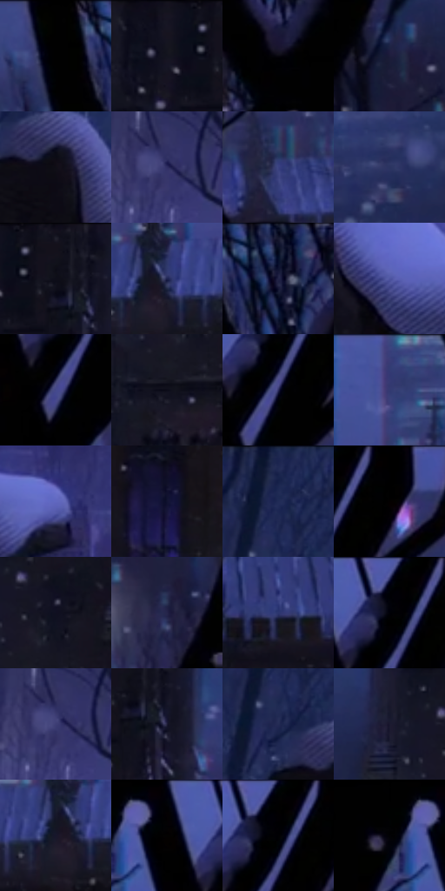

# 电影参考 217

- 状态：常规／活跃；来源世界：miles-home。
- 视角：near-level；景别：environment-wide；场景：city。
- 时段：night-appearance（外观依据，中置信度；具体时间／晨昏未知）；光照：night-mixed。
- 材质候选：snow, stone, brick, foliage, sky, fabric（帧级，不是像素分割）。
- 明暗组：very-dark；L* P5/P50/P95：0.27417 / 12.25601 / 38.48891。
- 资格门禁：无附加门禁。
- 原截图 SHA-256：`0064a6f61d361bbb3bfc56c01bf4620da2c381a732b02eea955ebffaf2aac811`；尺寸：2880 × 1206。
- sRGB 像素 SHA-256：`e25ba5c079fa77be7040861d4ebb5b5cd32d8e79aa02bd411ddaf856fed46acf`。

## 观察与迁移

雪夜城市和墓园，冷蓝积雪承接局部红粉灯照。

217  /  夜晚／雪与石材  /  近处石碑顶部厚雪，暗树剪影，教堂及远楼  /  雪冠有厚度、弧边与接触暗部；不是给所有石头边缘加白色描边

本公开版保存32个128×128原像素色卡上下文；图集格子并非原场景相邻位置。原rect、图集tile和像素SHA见 `data/palette-crops.json`。上下文不足时不得批准替色，不能以小样推断完整构图。

## 实测色卡

颜色比例分母为保留采样像素，不是材料面积；全部 32 色参与全库匹配。表内四舍五入仅用于阅读，原精度在 JSON。

| ID | HEX | Lab | 原图 xy | 像素数 | 比例 | 明度角色 |
| --- | --- | --- | --- | ---: | ---: | --- |
| 217-S01 | #010101 | [0.274173, -1.7e-05, 3.3e-05] | [2164, 28] | 12109 | 6.262866% | deep-shadow |
| 217-S02 | #161523 | [7.481317, 4.658249, -9.521637] | [1032, 28] | 10333 | 5.344305% | deep-shadow |
| 217-S03 | #08070F | [2.150424, 1.476363, -3.214353] | [2268, 208] | 9410 | 4.866923% | deep-shadow |
| 217-S04 | #1C1C3B | [11.91132, 10.021593, -20.073203] | [2416, 340] | 8514 | 4.403505% | deep-shadow |
| 217-S05 | #100E16 | [4.355284, 2.344108, -4.287589] | [452, 208] | 8031 | 4.153693% | deep-shadow |
| 217-S06 | #2F2E62 | [21.725868, 16.279407, -30.808942] | [72, 700] | 7232 | 3.740445% | shadow |
| 217-S07 | #3A4281 | [30.352466, 16.121906, -36.709693] | [2056, 172] | 7184 | 3.715619% | shadow |
| 217-S08 | #2B3461 | [23.109118, 10.700058, -27.964188] | [772, 188] | 7099 | 3.671656% | shadow |
| 217-S09 | #13121C | [5.915533, 2.947331, -6.57507] | [1108, 40] | 6897 | 3.567180% | deep-shadow |
| 217-S10 | #1F2451 | [16.240075, 13.228628, -28.373981] | [1572, 220] | 6579 | 3.402708% | deep-shadow |
| 217-S11 | #202143 | [14.400062, 10.421352, -21.708579] | [2268, 60] | 6487 | 3.355125% | deep-shadow |
| 217-S12 | #4E54A0 | [38.720925, 19.449149, -42.143443] | [752, 856] | 6473 | 3.347884% | shadow |
| 217-S13 | #45498C | [33.822192, 17.847333, -37.906784] | [2632, 160] | 6408 | 3.314266% | shadow |
| 217-S14 | #0B0B18 | [3.400186, 2.651036, -7.215255] | [1004, 312] | 6395 | 3.307542% | deep-shadow |
| 217-S15 | #292A59 | [19.426107, 14.355731, -28.58523] | [2660, 124] | 6241 | 3.227892% | deep-shadow |
| 217-S16 | #343870 | [25.944895, 15.52834, -33.076282] | [1660, 60] | 6233 | 3.223754% | shadow |
| 217-S17 | #6168C0 | [47.296175, 21.516085, -47.16837] | [944, 868] | 6195 | 3.204100% | midtone |
| 217-S18 | #101330 | [7.12899, 9.126342, -19.824109] | [1492, 432] | 5837 | 3.018940% | deep-shadow |
| 217-S19 | #202B56 | [18.827617, 10.292032, -27.582365] | [384, 64] | 5742 | 2.969805% | deep-shadow |
| 217-S20 | #000000 | [0.0, 0.0, 0.0] | [2736, 28] | 5623 | 2.908258% | deep-shadow |
| 217-S21 | #0F0F21 | [4.995014, 4.778359, -11.866764] | [1036, 220] | 5449 | 2.818264% | deep-shadow |
| 217-S22 | #25254A | [16.556305, 11.477071, -23.075148] | [2480, 540] | 5420 | 2.803265% | deep-shadow |
| 217-S23 | #2D366F | [24.775889, 14.8956, -34.339232] | [1940, 436] | 5369 | 2.776887% | shadow |
| 217-S24 | #010106 | [0.373108, 0.695202, -1.892085] | [2652, 48] | 5329 | 2.756199% | deep-shadow |
| 217-S25 | #3D3D74 | [28.353952, 15.819854, -31.73044] | [64, 700] | 5129 | 2.652757% | shadow |
| 217-S26 | #1D1B34 | [11.226066, 8.568962, -16.146125] | [1152, 104] | 4916 | 2.542592% | deep-shadow |
| 217-S27 | #252B55 | [19.126449, 11.144073, -26.41535] | [376, 148] | 4748 | 2.455701% | deep-shadow |
| 217-S28 | #1A192E | [9.892263, 6.936891, -13.90913] | [936, 192] | 4597 | 2.377603% | deep-shadow |
| 217-S29 | #17172A | [8.67141, 5.979717, -12.89973] | [1548, 236] | 3887 | 2.010386% | deep-shadow |
| 217-S30 | #010103 | [0.313747, 0.27807, -0.756814] | [2560, 32] | 2140 | 1.106824% | deep-shadow |
| 217-S31 | #020101 | [0.332482, 0.261482, 0.092172] | [2668, 36] | 979 | 0.506346% | deep-shadow |
| 217-S32 | #000201 | [0.411943, -0.662077, 0.194212] | [2484, 36] | 361 | 0.186712% | deep-shadow |

## 色阶与空间分布

- 采样 ROI：`[0.01, 0.02, 0.98, 0.94]`；步长：4；样本数：193346。
- 排除区：`[]`。
- 深暗、暗、中、亮、高光五段计数：`[132954, 52184, 8174, 30, 4]`。
- RGB 各 256 箱、L* 100 箱、13×5 色相明度表和 3×3 空间统计全部保存在 [总数据](../film-library.json)。
- [可视化档案](../../references/library.html)按需绘制直方图，不存 2,094 张重复图表图片。

## 纹理特征占比

**这是分块图像特征的面积占比，不是波点／排线／丝网／错版的精确语义覆盖率。** 窗格、发丝、织物也会产生方向或周期特征。
原图 ROI 像素 3098546；已测块覆盖 3098546（100.0000%）；未测 0。

| 特征 | 块覆盖像素 | 占已测面积 | 阈值敏感范围 |
| --- | ---: | ---: | --- |
| low-contrast | 32768 | 1.0575% | 0.5288% ~ 2.2886% |
| directional-structure | 163712 | 5.2835% | 1.9374% ~ 13.2372% |
| periodic-structure | 2366898 | 76.3874% | 70.5710% ~ 76.7162% |
| mixed-detail | 535168 | 17.2716% | 9.5178% ~ 25.2030% |

阈值敏感范围不是统计置信区间。逐块坐标、尺度、对比、方向一致性、频谱集中度、频率与角度见 [全量特征记录](../texture-features.jsonl)，以帧号定位。
四种印刷层的真实像素覆盖仍标为 `null`，不能填 0，也不能拿上表代替。不得据这些代理测量删除唯一证据。

[测量方法与保留策略](../../references/library-retention.md) · [分类索引](../archive/README.md)
