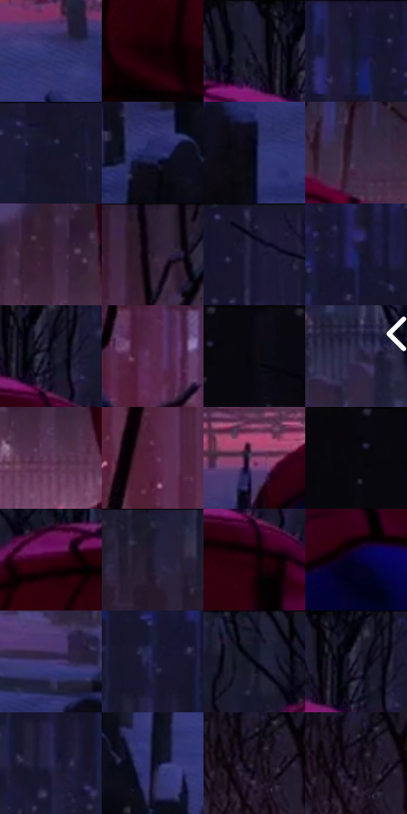

# 电影参考 218

- 状态：常规／活跃；来源世界：miles-home。
- 视角：near-level；景别：medium；场景：city。
- 时段：night-appearance（外观依据，中置信度；具体时间／晨昏未知）；光照：night-mixed。
- 材质候选：snow, stone, brick, foliage, sky, fabric（帧级，不是像素分割）。
- 明暗组：very-dark；L* P5/P50/P95：0.91056 / 10.80886 / 28.61014。
- 资格门禁：无附加门禁。
- 原截图 SHA-256：`7278b7e5ca17a046a8586d273e146088d7632231f18ac87e457d4fadee62a610`；尺寸：2880 × 1208。
- sRGB 像素 SHA-256：`06bda8ad0b570173f924b5a55e658f0e0781453843dd87a9547bc0e90b646a06`。

## 观察与迁移

雪夜城市和墓园，冷蓝积雪承接局部红粉灯照。

218  /  夜晚／人物与彩光  /  近处人物背面深暗，蓝雪与局部粉光区、远灯并存  /  固有色在照明下偏色，布料不因饱和而变发光材质

本公开版保存32个128×128原像素色卡上下文；图集格子并非原场景相邻位置。原rect、图集tile和像素SHA见 `data/palette-crops.json`。上下文不足时不得批准替色，不能以小样推断完整构图。

## 实测色卡

颜色比例分母为保留采样像素，不是材料面积；全部 32 色参与全库匹配。表内四舍五入仅用于阅读，原精度在 JSON。

| ID | HEX | Lab | 原图 xy | 像素数 | 比例 | 明度角色 |
| --- | --- | --- | --- | ---: | ---: | --- |
| 218-S01 | #303472 | [24.635691, 18.041137, -36.471312] | [2264, 772] | 10761 | 5.565670% | shadow |
| 218-S02 | #0E0104 | [1.118839, 3.938999, 0.105688] | [1420, 284] | 9400 | 4.861750% | deep-shadow |
| 218-S03 | #1D1C36 | [11.675141, 8.521341, -16.874446] | [1472, 28] | 9341 | 4.831235% | deep-shadow |
| 218-S04 | #14152F | [8.04126, 8.418446, -17.610993] | [1956, 44] | 9270 | 4.794513% | deep-shadow |
| 218-S05 | #151427 | [7.282222, 6.415389, -12.853714] | [1700, 28] | 9261 | 4.789859% | deep-shadow |
| 218-S06 | #262A63 | [19.917333, 17.322881, -34.412551] | [708, 892] | 9075 | 4.693658% | deep-shadow |
| 218-S07 | #02031B | [1.419336, 4.342068, -12.583975] | [2620, 864] | 8382 | 4.335233% | deep-shadow |
| 218-S08 | #3B2C4B | [20.977331, 14.154373, -16.634651] | [1664, 560] | 7885 | 4.078181% | shadow |
| 218-S09 | #382138 | [16.572885, 15.630681, -10.411715] | [1096, 492] | 7720 | 3.992842% | deep-shadow |
| 218-S10 | #291C30 | [12.705278, 11.083976, -10.846453] | [552, 48] | 7390 | 3.822163% | deep-shadow |
| 218-S11 | #181730 | [9.159598, 8.507362, -16.543147] | [2696, 32] | 7009 | 3.625107% | deep-shadow |
| 218-S12 | #1B2156 | [15.446988, 16.539522, -33.04785] | [2088, 104] | 6631 | 3.429603% | deep-shadow |
| 218-S13 | #0D0E1E | [4.456388, 3.619555, -10.369053] | [1548, 92] | 6477 | 3.349953% | deep-shadow |
| 218-S14 | #582A49 | [24.360494, 25.725177, -9.745796] | [440, 188] | 6377 | 3.298232% | shadow |
| 218-S15 | #0A0913 | [2.77231, 1.993096, -4.620729] | [132, 28] | 6161 | 3.186515% | deep-shadow |
| 218-S16 | #292442 | [16.137248, 10.73509, -18.207753] | [2796, 632] | 6094 | 3.151862% | deep-shadow |
| 218-S17 | #5C3355 | [27.570687, 24.117195, -12.74649] | [1112, 588] | 5937 | 3.070661% | shadow |
| 218-S18 | #501F3B | [20.050273, 26.660529, -6.860331] | [548, 352] | 5397 | 2.791369% | shadow |
| 218-S19 | #88446D | [38.679441, 34.398797, -10.593321] | [976, 736] | 5218 | 2.698789% | shadow |
| 218-S20 | #07060D | [1.846999, 1.27083, -2.654955] | [32, 28] | 5024 | 2.598450% | deep-shadow |
| 218-S21 | #340014 | [7.052843, 27.226043, 1.70262] | [1344, 148] | 4912 | 2.540523% | deep-shadow |
| 218-S22 | #1B192E | [9.995876, 7.295783, -13.739192] | [776, 40] | 4860 | 2.513628% | deep-shadow |
| 218-S23 | #24020D | [4.043616, 16.241749, 0.910187] | [1540, 188] | 4823 | 2.494492% | deep-shadow |
| 218-S24 | #05022F | [2.536784, 13.528167, -26.443038] | [1208, 724] | 4680 | 2.420531% | deep-shadow |
| 218-S25 | #463C74 | [28.887908, 18.984419, -30.831921] | [2728, 756] | 4505 | 2.330020% | shadow |
| 218-S26 | #1A1A44 | [11.794337, 14.412043, -26.614545] | [2032, 172] | 4358 | 2.253990% | deep-shadow |
| 218-S27 | #020313 | [1.129372, 2.304465, -7.075746] | [1256, 64] | 3392 | 1.754368% | deep-shadow |
| 218-S28 | #03030D | [1.02553, 1.426514, -3.882463] | [1536, 28] | 3156 | 1.632307% | deep-shadow |
| 218-S29 | #2A2752 | [18.153485, 14.284477, -25.930468] | [2028, 268] | 2933 | 1.516970% | deep-shadow |
| 218-S30 | #060620 | [2.46791, 5.782267, -14.987983] | [820, 912] | 2688 | 1.390254% | deep-shadow |
| 218-S31 | #120B18 | [3.919308, 4.979162, -6.394947] | [1708, 396] | 2285 | 1.181819% | deep-shadow |
| 218-S32 | #191221 | [6.766459, 7.320651, -9.073182] | [1708, 388] | 1944 | 1.005451% | deep-shadow |

## 色阶与空间分布

- 采样 ROI：`[0.01, 0.02, 0.98, 0.94]`；步长：4；样本数：193346。
- 排除区：`[]`。
- 深暗、暗、中、亮、高光五段计数：`[148011, 43578, 1718, 33, 6]`。
- RGB 各 256 箱、L* 100 箱、13×5 色相明度表和 3×3 空间统计全部保存在 [总数据](../film-library.json)。
- [可视化档案](../../references/library.html)按需绘制直方图，不存 2,094 张重复图表图片。

## 纹理特征占比

**这是分块图像特征的面积占比，不是波点／排线／丝网／错版的精确语义覆盖率。** 窗格、发丝、织物也会产生方向或周期特征。
原图 ROI 像素 3104134；已测块覆盖 3104134（100.0000%）；未测 0。

| 特征 | 块覆盖像素 | 占已测面积 | 阈值敏感范围 |
| --- | ---: | ---: | --- |
| low-contrast | 334208 | 10.7665% | 7.5997% ~ 13.2365% |
| directional-structure | 320896 | 10.3377% | 1.5834% ~ 24.9474% |
| periodic-structure | 1993094 | 64.2077% | 60.5914% ~ 67.5066% |
| mixed-detail | 455936 | 14.6880% | 6.8616% ~ 17.6735% |

阈值敏感范围不是统计置信区间。逐块坐标、尺度、对比、方向一致性、频谱集中度、频率与角度见 [全量特征记录](../texture-features.jsonl)，以帧号定位。
四种印刷层的真实像素覆盖仍标为 `null`，不能填 0，也不能拿上表代替。不得据这些代理测量删除唯一证据。

[测量方法与保留策略](../../references/library-retention.md) · [分类索引](../archive/README.md)
