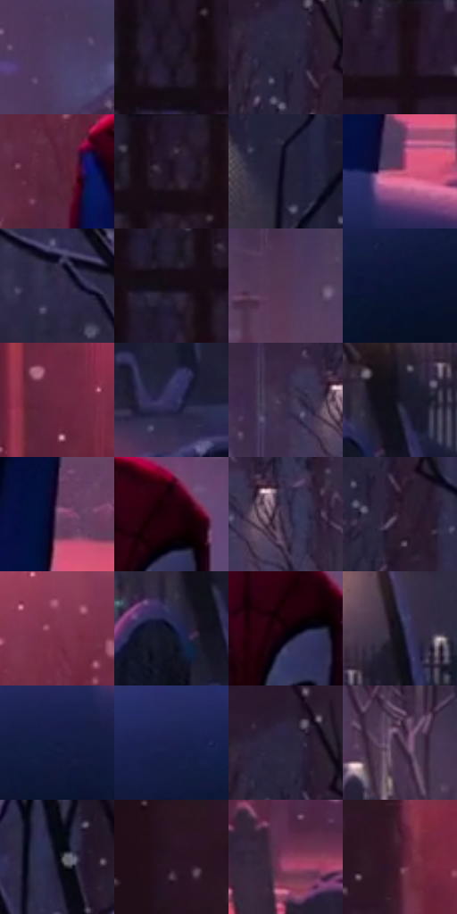

# 电影参考 219

- 状态：常规／活跃；来源世界：miles-home。
- 视角：low-angle；景别：medium；场景：city。
- 时段：night-appearance（外观依据，中置信度；具体时间／晨昏未知）；光照：night-mixed。
- 材质候选：snow, stone, brick, foliage, sky, fabric（帧级，不是像素分割）。
- 明暗组：very-dark；L* P5/P50/P95：2.83009 / 14.86363 / 39.11066。
- 资格门禁：无附加门禁。
- 原截图 SHA-256：`20dfb99051bc68f222498a48f4e37a536ec322d07716d4af193efe62d1c5e60e`；尺寸：2878 × 1206。
- sRGB 像素 SHA-256：`21031f76d986d513afe4673b3ce83367704c8ab7bbc8f10b0e84af18a6a34ea0`。

## 观察与迁移

雪夜城市和墓园，冷蓝积雪承接局部红粉灯照。

219  /  夜晚／局部光照  /  上方粉红亮源区域、人物深暗、近处蓝雪上粉色受光边  /  分开雪的宽受光面和局部边缘亮形；不是镜面反射或塑料镀层

本公开版保存32个128×128原像素色卡上下文；图集格子并非原场景相邻位置。原rect、图集tile和像素SHA见 `data/palette-crops.json`。上下文不足时不得批准替色，不能以小样推断完整构图。

## 实测色卡

颜色比例分母为保留采样像素，不是材料面积；全部 32 色参与全库匹配。表内四舍五入仅用于阅读，原精度在 JSON。

| ID | HEX | Lab | 原图 xy | 像素数 | 比例 | 明度角色 |
| --- | --- | --- | --- | ---: | ---: | --- |
| 219-S01 | #4E3D64 | [29.100634, 16.278123, -20.247957] | [1764, 140] | 10997 | 5.687731% | shadow |
| 219-S02 | #201727 | [9.532435, 8.536908, -9.253121] | [232, 244] | 10930 | 5.653078% | deep-shadow |
| 219-S03 | #2C243B | [16.069246, 9.645909, -13.417183] | [2168, 236] | 10787 | 5.579117% | deep-shadow |
| 219-S04 | #1C0F1B | [6.031148, 8.720666, -5.522221] | [364, 28] | 8773 | 4.537461% | deep-shadow |
| 219-S05 | #57253D | [22.607586, 26.211536, -4.278004] | [1176, 492] | 8688 | 4.493499% | shadow |
| 219-S06 | #271C31 | [12.503392, 10.567694, -11.901033] | [220, 36] | 8133 | 4.206449% | deep-shadow |
| 219-S07 | #1F1D34 | [12.076372, 7.763856, -14.794001] | [2720, 96] | 7885 | 4.078181% | deep-shadow |
| 219-S08 | #B7597C | [50.298404, 41.855129, -1.718407] | [1660, 840] | 7236 | 3.742513% | midtone |
| 219-S09 | #2F2947 | [18.562359, 10.813061, -17.792198] | [2340, 336] | 6905 | 3.571318% | deep-shadow |
| 219-S10 | #130B17 | [3.971409, 5.119024, -5.548741] | [148, 104] | 6451 | 3.336506% | deep-shadow |
| 219-S11 | #513654 | [26.814159, 17.939476, -13.378136] | [1904, 480] | 6184 | 3.198411% | shadow |
| 219-S12 | #0B1334 | [7.088284, 9.693224, -22.844633] | [1140, 1084] | 6172 | 3.192205% | deep-shadow |
| 219-S13 | #6A2942 | [26.86021, 31.797826, -1.006919] | [936, 164] | 6097 | 3.153414% | shadow |
| 219-S14 | #2F2D5C | [21.032119, 14.899052, -27.975034] | [2664, 844] | 6093 | 3.151345% | shadow |
| 219-S15 | #392C47 | [20.542184, 12.32827, -14.623573] | [1908, 328] | 6040 | 3.123933% | shadow |
| 219-S16 | #151526 | [7.548486, 5.331441, -11.686667] | [2548, 668] | 5857 | 3.029284% | deep-shadow |
| 219-S17 | #6F4C6E | [37.251849, 20.977716, -13.694064] | [1652, 708] | 5636 | 2.914981% | shadow |
| 219-S18 | #23000C | [3.468435, 16.164338, 0.518339] | [1524, 192] | 5546 | 2.868433% | deep-shadow |
| 219-S19 | #40324F | [23.457721, 13.000675, -15.417271] | [1988, 340] | 5344 | 2.763957% | shadow |
| 219-S20 | #2C1A2D | [12.375914, 12.950632, -9.14716] | [2204, 296] | 5231 | 2.705512% | deep-shadow |
| 219-S21 | #7F324F | [32.61033, 36.364528, -0.717375] | [1204, 188] | 5007 | 2.589658% | shadow |
| 219-S22 | #070D27 | [4.330727, 5.813194, -17.540068] | [2500, 720] | 4877 | 2.522421% | deep-shadow |
| 219-S23 | #120006 | [1.280726, 6.045548, -0.43436] | [1500, 232] | 4577 | 2.367259% | deep-shadow |
| 219-S24 | #10101E | [5.189001, 3.573529, -9.242545] | [2648, 580] | 4537 | 2.346570% | deep-shadow |
| 219-S25 | #131A40 | [10.90144, 11.193327, -25.273722] | [1588, 944] | 4492 | 2.323296% | deep-shadow |
| 219-S26 | #1C214D | [14.790794, 13.185707, -27.996655] | [1440, 928] | 4146 | 2.144342% | deep-shadow |
| 219-S27 | #28233F | [15.550043, 10.144244, -17.053827] | [2172, 196] | 3928 | 2.031591% | deep-shadow |
| 219-S28 | #3B253B | [18.226987, 14.831818, -9.935222] | [2076, 556] | 3885 | 2.009351% | deep-shadow |
| 219-S29 | #070814 | [2.432813, 1.830565, -5.786043] | [2420, 152] | 3743 | 1.935908% | deep-shadow |
| 219-S30 | #281423 | [9.584132, 13.116718, -6.086447] | [608, 72] | 3511 | 1.815916% | deep-shadow |
| 219-S31 | #863D5F | [36.429451, 35.312714, -5.202777] | [1036, 752] | 3267 | 1.689717% | shadow |
| 219-S32 | #45192C | [16.218604, 23.523942, -2.221944] | [776, 68] | 2391 | 1.236643% | deep-shadow |

## 色阶与空间分布

- 采样 ROI：`[0.01, 0.02, 0.98, 0.94]`；步长：4；样本数：193346。
- 排除区：`[]`。
- 深暗、暗、中、亮、高光五段计数：`[125725, 58610, 8211, 758, 42]`。
- RGB 各 256 箱、L* 100 箱、13×5 色相明度表和 3×3 空间统计全部保存在 [总数据](../film-library.json)。
- [可视化档案](../../references/library.html)按需绘制直方图，不存 2,094 张重复图表图片。

## 纹理特征占比

**这是分块图像特征的面积占比，不是波点／排线／丝网／错版的精确语义覆盖率。** 窗格、发丝、织物也会产生方向或周期特征。
原图 ROI 像素 3096328；已测块覆盖 3096328（100.0000%）；未测 0。

| 特征 | 块覆盖像素 | 占已测面积 | 阈值敏感范围 |
| --- | ---: | ---: | --- |
| low-contrast | 168960 | 5.4568% | 2.8152% ~ 6.3373% |
| directional-structure | 409472 | 13.2244% | 6.7011% ~ 22.2157% |
| periodic-structure | 2092680 | 67.5859% | 62.6458% ~ 67.5859% |
| mixed-detail | 425216 | 13.7329% | 8.4415% ~ 24.3158% |

阈值敏感范围不是统计置信区间。逐块坐标、尺度、对比、方向一致性、频谱集中度、频率与角度见 [全量特征记录](../texture-features.jsonl)，以帧号定位。
四种印刷层的真实像素覆盖仍标为 `null`，不能填 0，也不能拿上表代替。不得据这些代理测量删除唯一证据。

[测量方法与保留策略](../../references/library-retention.md) · [分类索引](../archive/README.md)
