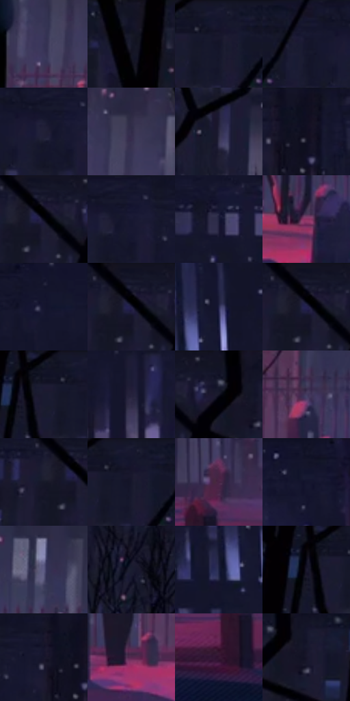

# 电影参考 220

- 状态：常规／活跃；来源世界：miles-home。
- 视角：near-level；景别：environment-wide；场景：city。
- 时段：night-appearance（外观依据，中置信度；具体时间／晨昏未知）；光照：night-mixed。
- 材质候选：snow, stone, brick, foliage, sky, fabric（帧级，不是像素分割）。
- 明暗组：very-dark；L* P5/P50/P95：1.31713 / 11.17038 / 29.82296。
- 资格门禁：无附加门禁。
- 原截图 SHA-256：`aa0bb9e5e985e517716de3325eec48cb58cca9393fb9ebfb2ba2eb4aa3e94a0d`；尺寸：2880 × 1216。
- sRGB 像素 SHA-256：`07f570989e5adc2dadb4c9129ffa5639b5d1c6c46cd5dcf09a24153ecf5628bf`。

## 观察与迁移

雪夜城市和墓园，冷蓝积雪承接局部红粉灯照。

220  /  夜晚／光区构图  /  深色树干、蓝底雪地、横向粉色照明区与小主体  /  强色受光区域有空间边界；不把粉蓝平均铺满每个表面

本公开版保存32个128×128原像素色卡上下文；图集格子并非原场景相邻位置。原rect、图集tile和像素SHA见 `data/palette-crops.json`。上下文不足时不得批准替色，不能以小样推断完整构图。

## 实测色卡

颜色比例分母为保留采样像素，不是材料面积；全部 32 色参与全库匹配。表内四舍五入仅用于阅读，原精度在 JSON。

| ID | HEX | Lab | 原图 xy | 像素数 | 比例 | 明度角色 |
| --- | --- | --- | --- | ---: | ---: | --- |
| 220-S01 | #353355 | [22.931243, 10.231768, -20.305307] | [212, 820] | 13742 | 7.056516% | shadow |
| 220-S02 | #020104 | [0.391843, 0.678613, -1.043099] | [36, 60] | 9502 | 4.879276% | deep-shadow |
| 220-S03 | #14152B | [7.763037, 6.861206, -15.093462] | [692, 28] | 9449 | 4.852061% | deep-shadow |
| 220-S04 | #15162E | [8.398007, 7.560188, -16.301167] | [804, 28] | 9092 | 4.668741% | deep-shadow |
| 220-S05 | #212036 | [13.367358, 6.92131, -14.187304] | [888, 72] | 9002 | 4.622526% | deep-shadow |
| 220-S06 | #312B49 | [19.481187, 10.71632, -17.699191] | [252, 772] | 8840 | 4.539339% | deep-shadow |
| 220-S07 | #282740 | [16.855552, 7.586254, -15.703071] | [676, 208] | 8464 | 4.346263% | deep-shadow |
| 220-S08 | #0F0F20 | [4.945165, 4.428068, -11.16974] | [1080, 28] | 8455 | 4.341642% | deep-shadow |
| 220-S09 | #080815 | [2.523953, 2.32277, -6.321797] | [316, 68] | 7495 | 3.848682% | deep-shadow |
| 220-S10 | #171831 | [9.458387, 7.786007, -16.806036] | [924, 32] | 7285 | 3.740847% | deep-shadow |
| 220-S11 | #1B1C38 | [11.613629, 8.604458, -18.415371] | [1352, 72] | 6986 | 3.587310% | deep-shadow |
| 220-S12 | #8D3261 | [35.61272, 43.358367, -7.573776] | [728, 972] | 6982 | 3.585256% | shadow |
| 220-S13 | #1C1D32 | [11.66048, 6.016268, -14.027977] | [1756, 32] | 6925 | 3.555987% | deep-shadow |
| 220-S14 | #17192C | [9.475286, 5.159518, -13.116362] | [308, 28] | 6649 | 3.414261% | deep-shadow |
| 220-S15 | #27284A | [17.659656, 9.906438, -21.312575] | [2504, 244] | 6623 | 3.400910% | deep-shadow |
| 220-S16 | #202140 | [14.20134, 9.330577, -19.933059] | [304, 60] | 6277 | 3.223239% | deep-shadow |
| 220-S17 | #1B1A32 | [10.572319, 7.938748, -15.745653] | [632, 56] | 5828 | 2.992677% | deep-shadow |
| 220-S18 | #26223D | [14.915262, 9.527182, -16.667934] | [1704, 204] | 5523 | 2.836060% | deep-shadow |
| 220-S19 | #121325 | [6.574828, 5.092201, -12.468709] | [408, 28] | 5165 | 2.652227% | deep-shadow |
| 220-S20 | #453B5F | [27.350504, 13.145536, -19.824609] | [1096, 892] | 5126 | 2.632201% | shadow |
| 220-S21 | #161727 | [8.392474, 4.543553, -11.111235] | [264, 76] | 4542 | 2.332317% | deep-shadow |
| 220-S22 | #15162C | [8.262641, 6.799348, -15.038718] | [696, 28] | 4520 | 2.321020% | deep-shadow |
| 220-S23 | #462244 | [19.489521, 22.966352, -14.07163] | [2092, 976] | 4156 | 2.134106% | deep-shadow |
| 220-S24 | #12142C | [7.322952, 7.3271, -16.544647] | [2112, 48] | 3704 | 1.902004% | deep-shadow |
| 220-S25 | #5A5981 | [39.416685, 10.213107, -22.253289] | [508, 796] | 3659 | 1.878896% | shadow |
| 220-S26 | #191C30 | [10.924891, 5.016431, -13.753689] | [700, 368] | 3530 | 1.812655% | deep-shadow |
| 220-S27 | #1B1F3E | [12.988605, 8.59834, -20.484226] | [2444, 300] | 3491 | 1.792628% | deep-shadow |
| 220-S28 | #1A182D | [9.499988, 7.351339, -13.791837] | [596, 68] | 3204 | 1.645254% | deep-shadow |
| 220-S29 | #141328 | [6.933906, 7.092574, -14.15716] | [1028, 48] | 3182 | 1.633957% | deep-shadow |
| 220-S30 | #54284E | [23.514677, 26.413177, -14.447549] | [1000, 992] | 3134 | 1.609309% | shadow |
| 220-S31 | #341833 | [13.366265, 18.881771, -11.856738] | [2040, 1088] | 2365 | 1.214427% | deep-shadow |
| 220-S32 | #17142A | [7.674355, 8.288262, -14.468997] | [464, 88] | 1845 | 0.947407% | deep-shadow |

## 色阶与空间分布

- 采样 ROI：`[0.01, 0.02, 0.98, 0.94]`；步长：4；样本数：194742。
- 排除区：`[]`。
- 深暗、暗、中、亮、高光五段计数：`[157988, 33818, 2836, 81, 19]`。
- RGB 各 256 箱、L* 100 箱、13×5 色相明度表和 3×3 空间统计全部保存在 [总数据](../film-library.json)。
- [可视化档案](../../references/library.html)按需绘制直方图，不存 2,094 张重复图表图片。

## 纹理特征占比

**这是分块图像特征的面积占比，不是波点／排线／丝网／错版的精确语义覆盖率。** 窗格、发丝、织物也会产生方向或周期特征。
原图 ROI 像素 3126486；已测块覆盖 3126486（100.0000%）；未测 0。

| 特征 | 块覆盖像素 | 占已测面积 | 阈值敏感范围 |
| --- | ---: | ---: | --- |
| low-contrast | 16384 | 0.5240% | 0.0000% ~ 4.1923% |
| directional-structure | 441344 | 14.1163% | 3.7870% ~ 30.7341% |
| periodic-structure | 1880704 | 60.1539% | 55.8429% ~ 63.1467% |
| mixed-detail | 788054 | 25.2057% | 13.4231% ~ 28.8740% |

阈值敏感范围不是统计置信区间。逐块坐标、尺度、对比、方向一致性、频谱集中度、频率与角度见 [全量特征记录](../texture-features.jsonl)，以帧号定位。
四种印刷层的真实像素覆盖仍标为 `null`，不能填 0，也不能拿上表代替。不得据这些代理测量删除唯一证据。

[测量方法与保留策略](../../references/library-retention.md) · [分类索引](../archive/README.md)
