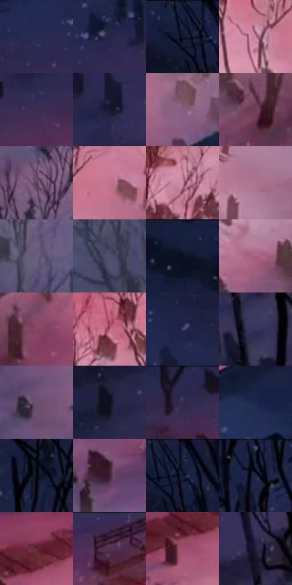

# 电影参考 221

- 状态：常规／活跃；来源世界：miles-home。
- 视角：high-angle；景别：environment-wide；场景：city。
- 时段：night-appearance（外观依据，中置信度；具体时间／晨昏未知）；光照：night-mixed。
- 材质候选：snow, stone, brick, foliage, sky, fabric（帧级，不是像素分割）。
- 明暗组：dark；L* P5/P50/P95：4.90549 / 24.76516 / 61.29662。
- 资格门禁：无附加门禁。
- 原截图 SHA-256：`7073538f5d3c5c9ad3029fa961be9154c4c33e3a42a1165b4261a7305f82c387`；尺寸：2880 × 1210。
- sRGB 像素 SHA-256：`fa4639f8bb449480f6c93269b79b0d5d2aac43250732e9e72ee3c3fcb241e5a7`。

## 观察与迁移

雪夜城市和墓园，冷蓝积雪承接局部红粉灯照。

221  /  夜晚／俯视投影  /  粉光覆盖部分雪地，左侧偏冷，碑与树投影，列车在前景  /  投影随空间和光向；粉雪不等于粉色固有色或雪自发光，不虚构画外灯具

本公开版保存32个128×128原像素色卡上下文；图集格子并非原场景相邻位置。原rect、图集tile和像素SHA见 `data/palette-crops.json`。上下文不足时不得批准替色，不能以小样推断完整构图。

## 实测色卡

颜色比例分母为保留采样像素，不是材料面积；全部 32 色参与全库匹配。表内四舍五入仅用于阅读，原精度在 JSON。

| ID | HEX | Lab | 原图 xy | 像素数 | 比例 | 明度角色 |
| --- | --- | --- | --- | ---: | ---: | --- |
| 221-S01 | #282C54 | [19.607505, 10.867289, -24.965767] | [1036, 100] | 8969 | 4.622148% | deep-shadow |
| 221-S02 | #232648 | [16.559073, 9.44905, -21.712298] | [1140, 76] | 7348 | 3.786770% | deep-shadow |
| 221-S03 | #161D37 | [11.449407, 5.962447, -17.987786] | [292, 44] | 7099 | 3.658449% | deep-shadow |
| 221-S04 | #BE809A | [60.534051, 27.765387, -4.095155] | [2420, 320] | 6928 | 3.570324% | light |
| 221-S05 | #3B2E52 | [21.918813, 14.761568, -19.857295] | [1584, 68] | 6877 | 3.544042% | shadow |
| 221-S06 | #17192E | [9.598163, 5.892967, -14.391855] | [460, 572] | 6874 | 3.542496% | deep-shadow |
| 221-S07 | #885F81 | [45.640013, 22.540649, -12.31511] | [2744, 440] | 6572 | 3.386861% | midtone |
| 221-S08 | #713D57 | [32.999424, 26.394851, -5.548131] | [1996, 752] | 6563 | 3.382223% | shadow |
| 221-S09 | #553755 | [27.626996, 19.029911, -12.742877] | [1148, 876] | 6516 | 3.358001% | shadow |
| 221-S10 | #C3748F | [58.111372, 34.47649, -1.251371] | [2528, 300] | 6509 | 3.354394% | midtone |
| 221-S11 | #CD92AA | [66.855607, 25.838739, -3.656266] | [2536, 76] | 6392 | 3.294098% | light |
| 221-S12 | #AA7390 | [54.888968, 26.111678, -6.931527] | [2780, 168] | 6329 | 3.261631% | midtone |
| 221-S13 | #6A6081 | [42.785488, 11.224824, -16.944946] | [1304, 1064] | 6306 | 3.249778% | midtone |
| 221-S14 | #514D6E | [34.360474, 9.644442, -18.403229] | [1160, 1128] | 6305 | 3.249263% | shadow |
| 221-S15 | #17203F | [13.070434, 7.144189, -21.075631] | [120, 28] | 6204 | 3.197213% | deep-shadow |
| 221-S16 | #A46180 | [49.498415, 31.413555, -5.582961] | [1880, 680] | 6110 | 3.148770% | midtone |
| 221-S17 | #844663 | [38.177237, 30.27238, -5.154614] | [2120, 708] | 6052 | 3.118880% | shadow |
| 221-S18 | #BA6480 | [53.074326, 37.723096, 0.017082] | [2300, 220] | 6007 | 3.095690% | midtone |
| 221-S19 | #3B4166 | [28.562574, 8.010834, -22.501675] | [276, 316] | 5978 | 3.080745% | shadow |
| 221-S20 | #343558 | [23.607368, 9.489071, -21.230492] | [620, 736] | 5937 | 3.059615% | shadow |
| 221-S21 | #6D4C6E | [37.015325, 20.246314, -14.076189] | [944, 780] | 5845 | 3.012203% | shadow |
| 221-S22 | #0B0E1C | [4.236746, 2.407329, -9.145131] | [248, 840] | 5785 | 2.981283% | deep-shadow |
| 221-S23 | #292A4B | [18.519308, 9.434059, -20.622] | [1460, 40] | 5608 | 2.890066% | deep-shadow |
| 221-S24 | #1A274C | [16.465301, 7.873077, -24.635827] | [2536, 704] | 5499 | 2.833893% | deep-shadow |
| 221-S25 | #02030A | [0.90272, 0.711755, -2.741004] | [572, 72] | 5374 | 2.769475% | deep-shadow |
| 221-S26 | #3D1E31 | [16.218385, 18.137078, -5.935244] | [1784, 900] | 5360 | 2.762260% | deep-shadow |
| 221-S27 | #1D2340 | [14.586931, 6.948376, -19.338499] | [332, 28] | 5299 | 2.730824% | deep-shadow |
| 221-S28 | #0F1527 | [7.084639, 3.513207, -13.200827] | [744, 32] | 5203 | 2.681351% | deep-shadow |
| 221-S29 | #642737 | [25.066214, 29.237177, 3.667705] | [1416, 296] | 5181 | 2.670013% | shadow |
| 221-S30 | #4A2A42 | [21.963682, 19.039745, -8.857043] | [1848, 56] | 5060 | 2.607656% | shadow |
| 221-S31 | #9C4E6C | [43.655193, 35.94522, -2.245449] | [1372, 364] | 4662 | 2.402548% | midtone |
| 221-S32 | #251F35 | [13.413503, 8.805035, -13.371514] | [580, 612] | 3293 | 1.697038% | deep-shadow |

## 色阶与空间分布

- 采样 ROI：`[0.01, 0.02, 0.98, 0.94]`；步长：4；样本数：194044。
- 排除区：`[]`。
- 深暗、暗、中、亮、高光五段计数：`[75973, 62406, 43532, 12114, 19]`。
- RGB 各 256 箱、L* 100 箱、13×5 色相明度表和 3×3 空间统计全部保存在 [总数据](../film-library.json)。
- [可视化档案](../../references/library.html)按需绘制直方图，不存 2,094 张重复图表图片。

## 纹理特征占比

**这是分块图像特征的面积占比，不是波点／排线／丝网／错版的精确语义覆盖率。** 窗格、发丝、织物也会产生方向或周期特征。
原图 ROI 像素 3109722；已测块覆盖 3109722（100.0000%）；未测 0。

| 特征 | 块覆盖像素 | 占已测面积 | 阈值敏感范围 |
| --- | ---: | ---: | --- |
| low-contrast | 27776 | 0.8932% | 0.8932% ~ 1.9469% |
| directional-structure | 455168 | 14.6369% | 2.4738% ~ 33.1019% |
| periodic-structure | 2274138 | 73.1299% | 59.9337% ~ 73.1299% |
| mixed-detail | 352640 | 11.3399% | 6.0713% ~ 24.0999% |

阈值敏感范围不是统计置信区间。逐块坐标、尺度、对比、方向一致性、频谱集中度、频率与角度见 [全量特征记录](../texture-features.jsonl)，以帧号定位。
四种印刷层的真实像素覆盖仍标为 `null`，不能填 0，也不能拿上表代替。不得据这些代理测量删除唯一证据。

[测量方法与保留策略](../../references/library-retention.md) · [分类索引](../archive/README.md)
