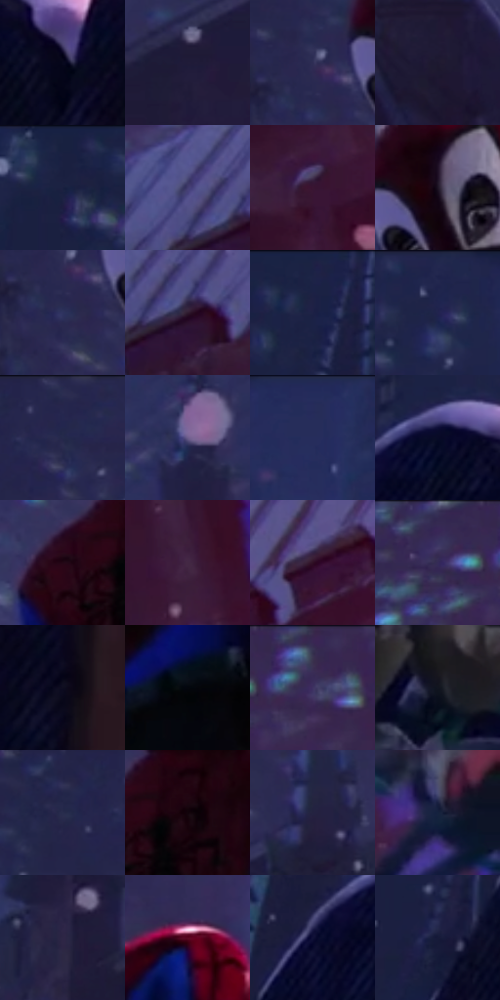

# 电影参考 222

- 状态：常规／活跃；来源世界：miles-home。
- 视角：low-angle；景别：full-body；场景：city。
- 时段：night-appearance（外观依据，中置信度；具体时间／晨昏未知）；光照：night-mixed。
- 材质候选：snow, stone, brick, foliage, sky, fabric（帧级，不是像素分割）。
- 明暗组：very-dark；L* P5/P50/P95：2.34768 / 13.91887 / 29.57587。
- 资格门禁：无附加门禁。
- 原截图 SHA-256：`30ff87c50347bdc235b73f128ab06c4eab4a40bd53631fa2f15c9476ac5f8284`；尺寸：2880 × 1210。
- sRGB 像素 SHA-256：`b8841f2eadbe570c93d34dbe46eec4544d85824263b9eaf914b3dbb16ea06857`。

## 观察与迁移

雪夜城市和墓园，冷蓝积雪承接局部红粉灯照。

222  /  夜晚／多材料近景  /  石碑、柔厚雪冠、薄花瓣、人物衣物同处冷暖照明  /  同光下仍有硬石／柔雪／薄瓣／布褶差别；白花不必全部纯白

本公开版保存32个128×128原像素色卡上下文；图集格子并非原场景相邻位置。原rect、图集tile和像素SHA见 `data/palette-crops.json`。上下文不足时不得批准替色，不能以小样推断完整构图。

## 实测色卡

颜色比例分母为保留采样像素，不是材料面积；全部 32 色参与全库匹配。表内四舍五入仅用于阅读，原精度在 JSON。

| ID | HEX | Lab | 原图 xy | 像素数 | 比例 | 明度角色 |
| --- | --- | --- | --- | ---: | ---: | --- |
| 222-S01 | #07081C | [2.733783, 3.945508, -11.408639] | [804, 408] | 9503 | 4.897343% | deep-shadow |
| 222-S02 | #201B38 | [11.799677, 10.963034, -18.088768] | [1520, 584] | 9097 | 4.688112% | deep-shadow |
| 222-S03 | #2F2D55 | [20.58365, 12.524562, -24.045227] | [1724, 224] | 8800 | 4.535054% | shadow |
| 222-S04 | #1D1830 | [10.013986, 9.454681, -15.15752] | [1684, 648] | 8745 | 4.506710% | deep-shadow |
| 222-S05 | #1B2041 | [13.51688, 8.998528, -21.746931] | [344, 40] | 8671 | 4.468574% | deep-shadow |
| 222-S06 | #423D70 | [28.551806, 15.931203, -28.853839] | [2424, 344] | 8396 | 4.326854% | shadow |
| 222-S07 | #391531 | [13.40032, 22.167108, -10.29443] | [2628, 656] | 8179 | 4.215023% | deep-shadow |
| 222-S08 | #1E1424 | [8.16213, 9.085455, -9.146803] | [1836, 196] | 8107 | 4.177918% | deep-shadow |
| 222-S09 | #2E335F | [22.911228, 11.47438, -26.958236] | [1724, 276] | 7907 | 4.074849% | shadow |
| 222-S10 | #2F1B2F | [13.190589, 13.97132, -9.307774] | [2472, 384] | 7839 | 4.039805% | deep-shadow |
| 222-S11 | #1D2346 | [14.982219, 9.225791, -22.874777] | [572, 28] | 7691 | 3.963534% | deep-shadow |
| 222-S12 | #1E234C | [15.485599, 11.793373, -26.18768] | [920, 28] | 7254 | 3.738327% | deep-shadow |
| 222-S13 | #24274F | [17.415614, 11.553635, -25.113219] | [1708, 44] | 7028 | 3.621859% | deep-shadow |
| 222-S14 | #6B5C8B | [42.221851, 16.51155, -23.845277] | [1264, 380] | 6556 | 3.378615% | midtone |
| 222-S15 | #262C5B | [19.917206, 12.906935, -29.139512] | [1068, 32] | 6483 | 3.340995% | deep-shadow |
| 222-S16 | #080A26 | [3.690779, 6.965328, -17.767245] | [676, 332] | 6006 | 3.095174% | deep-shadow |
| 222-S17 | #230715 | [5.090169, 15.05037, -2.243184] | [1868, 468] | 5827 | 3.002927% | deep-shadow |
| 222-S18 | #442844 | [20.68919, 18.428178, -12.242875] | [2652, 840] | 5799 | 2.988497% | shadow |
| 222-S19 | #2F0F24 | [9.589222, 19.468016, -6.718682] | [2712, 272] | 5382 | 2.773598% | deep-shadow |
| 222-S20 | #3A3461 | [24.380653, 14.900224, -25.866255] | [2476, 44] | 5188 | 2.673620% | shadow |
| 222-S21 | #0E0D20 | [4.385164, 5.088653, -12.02863] | [856, 724] | 4783 | 2.464905% | deep-shadow |
| 222-S22 | #04060D | [1.672073, 0.486332, -2.931371] | [2040, 876] | 4760 | 2.453052% | deep-shadow |
| 222-S23 | #3A2C56 | [21.478652, 16.956905, -23.222074] | [2580, 48] | 4676 | 2.409763% | shadow |
| 222-S24 | #121520 | [6.947957, 1.931547, -8.09598] | [620, 1032] | 4622 | 2.381934% | deep-shadow |
| 222-S25 | #282C4D | [19.174553, 8.390676, -20.947478] | [1608, 68] | 4381 | 2.257735% | deep-shadow |
| 222-S26 | #12040B | [2.164476, 5.14207, -1.190854] | [1956, 456] | 4112 | 2.119107% | deep-shadow |
| 222-S27 | #242340 | [15.207661, 9.12805, -18.317058] | [1652, 468] | 3883 | 2.001093% | deep-shadow |
| 222-S28 | #18223C | [13.616897, 4.721158, -18.095018] | [2820, 1052] | 3468 | 1.787224% | deep-shadow |
| 222-S29 | #2D2645 | [17.337566, 11.623638, -18.36018] | [1252, 628] | 3401 | 1.752695% | deep-shadow |
| 222-S30 | #580820 | [17.241721, 35.873014, 8.427168] | [2108, 316] | 3012 | 1.552225% | deep-shadow |
| 222-S31 | #101137 | [7.106994, 13.616806, -24.982277] | [584, 384] | 2547 | 1.312589% | deep-shadow |
| 222-S32 | #161A39 | [10.591692, 9.058942, -20.784766] | [468, 500] | 1941 | 1.000289% | deep-shadow |

## 色阶与空间分布

- 采样 ROI：`[0.01, 0.02, 0.98, 0.94]`；步长：4；样本数：194044。
- 排除区：`[]`。
- 深暗、暗、中、亮、高光五段计数：`[147751, 44061, 1965, 263, 4]`。
- RGB 各 256 箱、L* 100 箱、13×5 色相明度表和 3×3 空间统计全部保存在 [总数据](../film-library.json)。
- [可视化档案](../../references/library.html)按需绘制直方图，不存 2,094 张重复图表图片。

## 纹理特征占比

**这是分块图像特征的面积占比，不是波点／排线／丝网／错版的精确语义覆盖率。** 窗格、发丝、织物也会产生方向或周期特征。
原图 ROI 像素 3109722；已测块覆盖 3109722（100.0000%）；未测 0。

| 特征 | 块覆盖像素 | 占已测面积 | 阈值敏感范围 |
| --- | ---: | ---: | --- |
| low-contrast | 131072 | 4.2149% | 2.1075% ~ 12.4842% |
| directional-structure | 394624 | 12.6900% | 3.6880% ~ 23.1367% |
| periodic-structure | 2305498 | 74.1384% | 69.4872% ~ 74.1384% |
| mixed-detail | 278528 | 8.9567% | 5.2686% ~ 13.3774% |

阈值敏感范围不是统计置信区间。逐块坐标、尺度、对比、方向一致性、频谱集中度、频率与角度见 [全量特征记录](../texture-features.jsonl)，以帧号定位。
四种印刷层的真实像素覆盖仍标为 `null`，不能填 0，也不能拿上表代替。不得据这些代理测量删除唯一证据。

[测量方法与保留策略](../../references/library-retention.md) · [分类索引](../archive/README.md)
