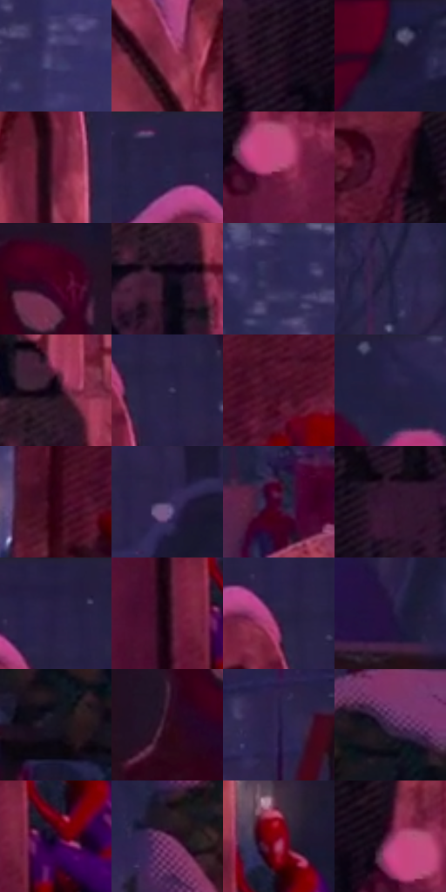

# 电影参考 223

- 状态：常规／活跃；来源世界：miles-home。
- 视角：near-level；景别：medium；场景：city。
- 时段：night-appearance（外观依据，中置信度；具体时间／晨昏未知）；光照：night-mixed。
- 材质候选：snow, stone, brick, foliage, sky, fabric（帧级，不是像素分割）。
- 明暗组：very-dark；L* P5/P50/P95：3.37818 / 14.78981 / 38.03384。
- 资格门禁：无附加门禁。
- 原截图 SHA-256：`ddb6e0c57f320a509e5f272caa541eed37b1d146777b74f9c6e0cc240f2cf27a`；尺寸：2880 × 1206。
- sRGB 像素 SHA-256：`f5bc7ce0c9106fdfc4f0e37763576a23b15d7894093fa864885b041e28c87335`。

## 观察与迁移

雪夜城市和墓园，冷蓝积雪承接局部红粉灯照。

223  /  夜晚／投影与表面文字  /  粉色受光石碑、深色人物形投影、刻字、磨损及前方雪片  /  四种深浅来源分别处理；投影不是石纹，刻字不是故障，不移植姓名与悼念场景

本公开版保存32个128×128原像素色卡上下文；图集格子并非原场景相邻位置。原rect、图集tile和像素SHA见 `data/palette-crops.json`。上下文不足时不得批准替色，不能以小样推断完整构图。

## 实测色卡

颜色比例分母为保留采样像素，不是材料面积；全部 32 色参与全库匹配。表内四舍五入仅用于阅读，原精度在 JSON。

| ID | HEX | Lab | 原图 xy | 像素数 | 比例 | 明度角色 |
| --- | --- | --- | --- | ---: | ---: | --- |
| 223-S01 | #3D3666 | [25.53175, 16.018018, -27.266661] | [816, 112] | 11518 | 5.957196% | shadow |
| 223-S02 | #8B2C4B | [33.562514, 42.782041, 3.522379] | [1768, 244] | 10484 | 5.422403% | shadow |
| 223-S03 | #241323 | [8.672574, 12.105227, -7.53458] | [1464, 708] | 9593 | 4.961571% | deep-shadow |
| 223-S04 | #1C1832 | [10.03352, 9.795882, -16.590541] | [2484, 64] | 9439 | 4.881922% | deep-shadow |
| 223-S05 | #6C203D | [25.439359, 36.255518, 0.325762] | [1884, 268] | 8899 | 4.602629% | shadow |
| 223-S06 | #242145 | [14.911762, 12.32234, -22.258901] | [1824, 56] | 8235 | 4.259204% | deep-shadow |
| 223-S07 | #AB4770 | [44.711545, 45.18287, -2.881554] | [1664, 768] | 8031 | 4.153693% | midtone |
| 223-S08 | #58162F | [19.450819, 32.327453, 0.813577] | [1228, 516] | 7879 | 4.075078% | deep-shadow |
| 223-S09 | #47011C | [12.257639, 32.974832, 3.85809] | [204, 516] | 7741 | 4.003703% | deep-shadow |
| 223-S10 | #130819 | [3.453345, 6.859143, -7.852678] | [1584, 488] | 7208 | 3.728032% | deep-shadow |
| 223-S11 | #2D2852 | [18.733315, 14.441179, -24.988805] | [716, 44] | 6826 | 3.530458% | deep-shadow |
| 223-S12 | #1E1D3C | [12.486092, 10.244945, -19.855851] | [2280, 472] | 6603 | 3.415121% | deep-shadow |
| 223-S13 | #0E0613 | [2.444602, 4.363169, -5.068004] | [1588, 396] | 6360 | 3.289440% | deep-shadow |
| 223-S14 | #2C264A | [17.534384, 12.895852, -21.480214] | [1952, 144] | 6129 | 3.169965% | deep-shadow |
| 223-S15 | #48102A | [15.039209, 28.926922, -2.460265] | [1104, 700] | 6032 | 3.119796% | deep-shadow |
| 223-S16 | #28234A | [16.242836, 13.803611, -23.557321] | [480, 44] | 6008 | 3.107383% | deep-shadow |
| 223-S17 | #330415 | [7.63273, 24.769219, 1.845091] | [1004, 756] | 5700 | 2.948083% | deep-shadow |
| 223-S18 | #372C57 | [21.213351, 16.310116, -24.327665] | [2016, 488] | 5596 | 2.894293% | shadow |
| 223-S19 | #370328 | [9.245046, 29.01986, -10.117797] | [688, 936] | 5595 | 2.893776% | deep-shadow |
| 223-S20 | #351532 | [12.757489, 20.918294, -12.06782] | [1324, 612] | 5169 | 2.673446% | deep-shadow |
| 223-S21 | #241F3F | [13.907582, 11.710505, -19.674292] | [1928, 28] | 4941 | 2.555522% | deep-shadow |
| 223-S22 | #200413 | [3.983553, 13.824792, -2.589138] | [1884, 892] | 4897 | 2.532765% | deep-shadow |
| 223-S23 | #282041 | [14.766188, 12.953987, -19.684901] | [1900, 116] | 4758 | 2.460873% | deep-shadow |
| 223-S24 | #21123C | [9.657734, 19.101879, -24.369789] | [180, 360] | 4614 | 2.386395% | deep-shadow |
| 223-S25 | #16131F | [6.641322, 4.595186, -7.763609] | [2616, 884] | 4133 | 2.137619% | deep-shadow |
| 223-S26 | #320F22 | [10.07206, 20.274979, -4.42643] | [112, 624] | 4115 | 2.128309% | deep-shadow |
| 223-S27 | #291E49 | [14.849397, 17.313005, -25.091221] | [2708, 256] | 3583 | 1.853154% | deep-shadow |
| 223-S28 | #3B1F44 | [17.118445, 20.967102, -17.894128] | [2816, 400] | 3559 | 1.840741% | deep-shadow |
| 223-S29 | #220727 | [5.768103, 19.331547, -15.098751] | [1964, 892] | 2956 | 1.528865% | deep-shadow |
| 223-S30 | #753F69 | [34.716535, 29.857918, -14.359996] | [2496, 636] | 2723 | 1.408356% | shadow |
| 223-S31 | #7C021A | [24.965936, 47.205287, 24.017457] | [1980, 788] | 2122 | 1.097514% | shadow |
| 223-S32 | #753056 | [30.803816, 34.874697, -8.130429] | [1628, 724] | 1900 | 0.982694% | shadow |

## 色阶与空间分布

- 采样 ROI：`[0.01, 0.02, 0.98, 0.94]`；步长：4；样本数：193346。
- 排除区：`[]`。
- 深暗、暗、中、亮、高光五段计数：`[138506, 47152, 7645, 43, 0]`。
- RGB 各 256 箱、L* 100 箱、13×5 色相明度表和 3×3 空间统计全部保存在 [总数据](../film-library.json)。
- [可视化档案](../../references/library.html)按需绘制直方图，不存 2,094 张重复图表图片。

## 纹理特征占比

**这是分块图像特征的面积占比，不是波点／排线／丝网／错版的精确语义覆盖率。** 窗格、发丝、织物也会产生方向或周期特征。
原图 ROI 像素 3098546；已测块覆盖 3098546（100.0000%）；未测 0。

| 特征 | 块覆盖像素 | 占已测面积 | 阈值敏感范围 |
| --- | ---: | ---: | --- |
| low-contrast | 109056 | 3.5196% | 3.5196% ~ 5.8949% |
| directional-structure | 223872 | 7.2251% | 3.1726% ~ 14.9789% |
| periodic-structure | 2596402 | 83.7942% | 79.0353% ~ 83.7942% |
| mixed-detail | 169216 | 5.4611% | 2.4662% ~ 10.5712% |

阈值敏感范围不是统计置信区间。逐块坐标、尺度、对比、方向一致性、频谱集中度、频率与角度见 [全量特征记录](../texture-features.jsonl)，以帧号定位。
四种印刷层的真实像素覆盖仍标为 `null`，不能填 0，也不能拿上表代替。不得据这些代理测量删除唯一证据。

[测量方法与保留策略](../../references/library-retention.md) · [分类索引](../archive/README.md)
