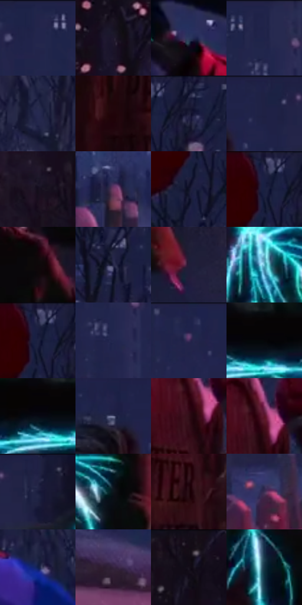

# 电影参考 224

- 状态：条件／活跃；来源世界：miles-home。
- 视角：near-level；景别：full-body；场景：street。
- 时段：event-time-unknown（外观依据，中置信度；具体时间／晨昏未知）；光照：event-light。
- 材质候选：skin, fabric, snow, stone（帧级，不是像素分割）。
- 明暗组：very-dark；L* P5/P50/P95：2.23296 / 14.47519 / 39.71271。
- 资格门禁：energy。
- 原截图 SHA-256：`fb9405289d0ed41fca271c84f922d31ef822bf49853e0d05281298500cb07570`；尺寸：2880 × 1202。
- sRGB 像素 SHA-256：`a5f0f7aa823246a45967f4862df6d2fcf7bfd8213309137765b935aca6294744`。

## 观察与迁移

身体青色能量边与雪夜场景分开，不能当常规轮廓光。

224／1  /  能量事件；雪夜  /  暗衣人物上的青白分叉线亮于环境，红粉侧光与远城冷暗仍分开；事件光有局部焦点。  /  电流不是衣服错版、轮廓光或蜘蛛感应，不默认加到照片。

本公开版保存32个128×128原像素色卡上下文；图集格子并非原场景相邻位置。原rect、图集tile和像素SHA见 `data/palette-crops.json`。上下文不足时不得批准替色，不能以小样推断完整构图。

## 实测色卡

颜色比例分母为保留采样像素，不是材料面积；全部 32 色参与全库匹配。表内四舍五入仅用于阅读，原精度在 JSON。

| ID | HEX | Lab | 原图 xy | 像素数 | 比例 | 明度角色 |
| --- | --- | --- | --- | ---: | ---: | --- |
| 224-S01 | #22244A | [15.983579, 11.353319, -24.003729] | [1192, 28] | 11746 | 6.097131% | deep-shadow |
| 224-S02 | #1D162A | [9.009591, 8.993602, -12.322187] | [2768, 320] | 10765 | 5.587912% | deep-shadow |
| 224-S03 | #2C375F | [23.978965, 8.150754, -25.273934] | [1932, 904] | 10100 | 5.242722% | shadow |
| 224-S04 | #202449 | [15.745899, 10.433855, -23.707405] | [1404, 28] | 9432 | 4.895976% | deep-shadow |
| 224-S05 | #262A51 | [18.6354, 10.665266, -24.509656] | [952, 664] | 9291 | 4.822786% | deep-shadow |
| 224-S06 | #20040A | [3.7569, 12.232082, 1.745604] | [204, 896] | 9276 | 4.814999% | deep-shadow |
| 224-S07 | #191C38 | [11.432665, 7.994216, -18.713918] | [316, 44] | 8484 | 4.403887% | deep-shadow |
| 224-S08 | #1E2246 | [14.746312, 10.236749, -23.246486] | [1976, 28] | 7581 | 3.935156% | deep-shadow |
| 224-S09 | #150E1D | [5.078411, 6.293719, -8.586338] | [2648, 108] | 7424 | 3.853661% | deep-shadow |
| 224-S10 | #703964 | [32.461934, 30.607664, -14.700417] | [1668, 980] | 7008 | 3.637723% | shadow |
| 224-S11 | #101428 | [6.897674, 4.952382, -14.238767] | [228, 156] | 6517 | 3.382854% | deep-shadow |
| 224-S12 | #1B1F41 | [13.196622, 9.749482, -22.258037] | [240, 40] | 6465 | 3.355861% | deep-shadow |
| 224-S13 | #0D0709 | [2.323791, 1.914908, -0.179844] | [2340, 440] | 6122 | 3.177817% | deep-shadow |
| 224-S14 | #242545 | [16.14383, 9.407317, -20.302601] | [236, 280] | 5916 | 3.070886% | deep-shadow |
| 224-S15 | #231E38 | [13.054587, 9.76874, -16.085904] | [2580, 816] | 5803 | 3.012230% | deep-shadow |
| 224-S16 | #66BCD0 | [71.786658, -20.54611, -18.064968] | [1984, 368] | 5661 | 2.938520% | light |
| 224-S17 | #1D2141 | [14.00384, 8.810867, -20.961513] | [244, 64] | 5536 | 2.873635% | deep-shadow |
| 224-S18 | #22264F | [16.943924, 11.749147, -25.876408] | [1420, 136] | 5446 | 2.826917% | deep-shadow |
| 224-S19 | #1E234A | [15.341243, 11.023457, -25.049489] | [1696, 36] | 5394 | 2.799925% | deep-shadow |
| 224-S20 | #050508 | [1.430228, 0.417044, -1.135106] | [1872, 664] | 5314 | 2.758399% | deep-shadow |
| 224-S21 | #060A14 | [2.76666, 0.767944, -5.305546] | [1816, 672] | 5138 | 2.667040% | deep-shadow |
| 224-S22 | #5B6081 | [41.492066, 6.175798, -19.041143] | [1880, 68] | 5024 | 2.607865% | midtone |
| 224-S23 | #310D17 | [9.015185, 19.386176, 2.362535] | [344, 772] | 4812 | 2.497820% | deep-shadow |
| 224-S24 | #5A1326 | [19.140298, 33.342624, 6.80671] | [360, 736] | 4490 | 2.330676% | deep-shadow |
| 224-S25 | #202345 | [15.162, 9.680777, -21.882649] | [2096, 44] | 4166 | 2.162493% | deep-shadow |
| 224-S26 | #0E151C | [6.444974, -0.793492, -5.825736] | [2128, 396] | 3661 | 1.900357% | deep-shadow |
| 224-S27 | #250A13 | [5.939267, 14.595068, 0.360122] | [336, 880] | 3585 | 1.860907% | deep-shadow |
| 224-S28 | #3B3053 | [22.542608, 13.690811, -19.545243] | [2732, 1048] | 3042 | 1.579046% | shadow |
| 224-S29 | #0F1E4C | [12.932813, 12.523453, -30.355968] | [748, 708] | 3021 | 1.568145% | deep-shadow |
| 224-S30 | #35233F | [17.074027, 14.858712, -14.559419] | [1140, 1108] | 2663 | 1.382314% | deep-shadow |
| 224-S31 | #110B14 | [3.694703, 3.61742, -3.863188] | [2776, 48] | 2322 | 1.205307% | deep-shadow |
| 224-S32 | #153243 | [19.414759, -4.698985, -13.88029] | [2112, 532] | 1443 | 0.749035% | deep-shadow |

## 色阶与空间分布

- 采样 ROI：`[0.01, 0.02, 0.98, 0.94]`；步长：4；样本数：192648。
- 排除区：`[]`。
- 深暗、暗、中、亮、高光五段计数：`[159673, 23475, 5033, 2810, 1657]`。
- RGB 各 256 箱、L* 100 箱、13×5 色相明度表和 3×3 空间统计全部保存在 [总数据](../film-library.json)。
- [可视化档案](../../references/library.html)按需绘制直方图，不存 2,094 张重复图表图片。

## 纹理特征占比

**这是分块图像特征的面积占比，不是波点／排线／丝网／错版的精确语义覆盖率。** 窗格、发丝、织物也会产生方向或周期特征。
原图 ROI 像素 3087370；已测块覆盖 3087370（100.0000%）；未测 0。

| 特征 | 块覆盖像素 | 占已测面积 | 阈值敏感范围 |
| --- | ---: | ---: | --- |
| low-contrast | 92288 | 2.9892% | 1.9279% ~ 3.5199% |
| directional-structure | 239744 | 7.7653% | 2.1227% ~ 19.9709% |
| periodic-structure | 1920650 | 62.2099% | 58.5864% ~ 62.8940% |
| mixed-detail | 834688 | 27.0356% | 15.2072% ~ 35.7710% |

阈值敏感范围不是统计置信区间。逐块坐标、尺度、对比、方向一致性、频谱集中度、频率与角度见 [全量特征记录](../texture-features.jsonl)，以帧号定位。
四种印刷层的真实像素覆盖仍标为 `null`，不能填 0，也不能拿上表代替。不得据这些代理测量删除唯一证据。

[测量方法与保留策略](../../references/library-retention.md) · [分类索引](../archive/README.md)
