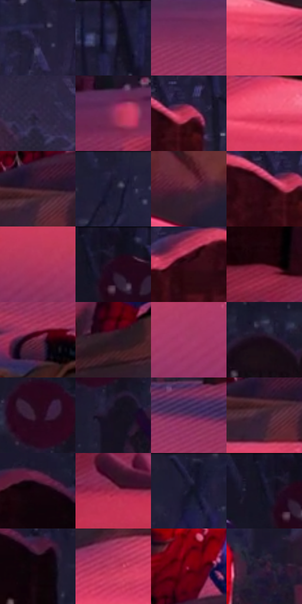

# 电影参考 225

- 状态：常规／活跃；来源世界：miles-home。
- 视角：low-angle；景别：full-body；场景：street。
- 时段：night-appearance（外观依据，中置信度；具体时间／晨昏未知）；光照：night-mixed。
- 材质候选：skin, fabric, snow, stone（帧级，不是像素分割）。
- 明暗组：very-dark；L* P5/P50/P95：3.51711 / 15.86088 / 50.42296。
- 资格门禁：无附加门禁。
- 原截图 SHA-256：`79a1c0116ead52da40623cfec2d0ff610b080ee216011094e1e33c3f9c645084`；尺寸：2880 × 1204。
- sRGB 像素 SHA-256：`7893475351c3fc3c83647d174c3f58a942f1dfd0ceef85e6d4e4da10d55233d7`。

## 观察与迁移

地面人物与粉色雪光，身体不因风格而改变姿态。

225／2  /  夜间材质；稳定体块  /  积雪厚边圆缓，衣物有大褶和遮挡暗部，石件边缘硬；同一彩光没有抹平材料差异。  /  雪粒不是半调；不凭躺姿编造受伤或添加雪。

本公开版保存32个128×128原像素色卡上下文；图集格子并非原场景相邻位置。原rect、图集tile和像素SHA见 `data/palette-crops.json`。上下文不足时不得批准替色，不能以小样推断完整构图。

## 实测色卡

颜色比例分母为保留采样像素，不是材料面积；全部 32 色参与全库匹配。表内四舍五入仅用于阅读，原精度在 JSON。

| ID | HEX | Lab | 原图 xy | 像素数 | 比例 | 明度角色 |
| --- | --- | --- | --- | ---: | ---: | --- |
| 225-S01 | #26213D | [14.605468, 10.254188, -17.155059] | [1752, 132] | 9325 | 4.840434% | deep-shadow |
| 225-S02 | #1F1B31 | [11.253655, 8.255075, -13.920675] | [2236, 28] | 8683 | 4.507184% | deep-shadow |
| 225-S03 | #802C57 | [31.987923, 40.622777, -6.812356] | [752, 556] | 8668 | 4.499398% | shadow |
| 225-S04 | #D33B60 | [49.283684, 61.074145, 14.340243] | [744, 852] | 8392 | 4.356131% | midtone |
| 225-S05 | #34294A | [19.267553, 13.451115, -18.69001] | [1868, 332] | 8252 | 4.283460% | deep-shadow |
| 225-S06 | #923363 | [36.707773, 44.745984, -7.11561] | [336, 548] | 8153 | 4.232071% | shadow |
| 225-S07 | #C33457 | [45.289375, 58.117163, 13.896] | [2340, 244] | 7890 | 4.095553% | midtone |
| 225-S08 | #E74D70 | [55.554621, 61.642201, 13.958908] | [556, 804] | 7465 | 3.874943% | midtone |
| 225-S09 | #381729 | [13.314077, 19.050466, -4.629443] | [1152, 708] | 7376 | 3.828745% | deep-shadow |
| 225-S10 | #221E36 | [12.828338, 8.757294, -15.023904] | [1312, 28] | 7092 | 3.681326% | deep-shadow |
| 225-S11 | #562738 | [22.707509, 23.904924, -0.729074] | [1812, 848] | 7091 | 3.680806% | shadow |
| 225-S12 | #270611 | [5.439396, 17.261871, 0.88815] | [2288, 256] | 6731 | 3.493937% | deep-shadow |
| 225-S13 | #B0345B | [41.913321, 52.75163, 6.170167] | [744, 1072] | 6505 | 3.376625% | midtone |
| 225-S14 | #1C172A | [9.212835, 7.849433, -12.0131] | [104, 36] | 6504 | 3.376106% | deep-shadow |
| 225-S15 | #370817 | [9.384974, 24.279171, 3.065129] | [2168, 256] | 6327 | 3.284228% | deep-shadow |
| 225-S16 | #4C1020 | [15.54912, 29.190166, 5.674727] | [64, 644] | 6054 | 3.142519% | deep-shadow |
| 225-S17 | #682640 | [25.86296, 32.360648, -1.169028] | [648, 676] | 5636 | 2.925543% | shadow |
| 225-S18 | #2A1724 | [10.794871, 12.1029, -4.969445] | [868, 716] | 5617 | 2.915680% | deep-shadow |
| 225-S19 | #A23865 | [40.33044, 47.8177, -2.695656] | [1312, 1084] | 5567 | 2.889726% | midtone |
| 225-S20 | #170A17 | [4.165304, 7.301145, -5.21823] | [548, 144] | 5181 | 2.689361% | deep-shadow |
| 225-S21 | #270A1D | [6.659246, 17.680566, -5.964411] | [716, 112] | 4995 | 2.592812% | deep-shadow |
| 225-S22 | #16101E | [5.734898, 6.021734, -8.365468] | [756, 216] | 4772 | 2.477057% | deep-shadow |
| 225-S23 | #66325C | [29.105566, 29.627385, -14.831048] | [1496, 508] | 4759 | 2.470309% | shadow |
| 225-S24 | #372031 | [15.835603, 14.322357, -6.602041] | [1144, 736] | 4720 | 2.450064% | deep-shadow |
| 225-S25 | #14040D | [2.390528, 6.268251, -1.749037] | [2700, 224] | 4543 | 2.358187% | deep-shadow |
| 225-S26 | #9E2C4F | [37.183006, 49.19918, 6.585234] | [76, 772] | 4434 | 2.301607% | shadow |
| 225-S27 | #191731 | [9.329693, 9.201665, -16.997888] | [1548, 28] | 4371 | 2.268905% | deep-shadow |
| 225-S28 | #161326 | [7.011617, 7.117804, -12.515824] | [36, 52] | 3853 | 2.000021% | deep-shadow |
| 225-S29 | #120208 | [1.712456, 5.522515, -0.618571] | [2772, 268] | 3825 | 1.985486% | deep-shadow |
| 225-S30 | #C33E65 | [46.961648, 55.580441, 7.620838] | [980, 832] | 3571 | 1.853640% | midtone |
| 225-S31 | #7E021B | [25.441359, 47.781165, 24.022124] | [1184, 592] | 3329 | 1.728022% | shadow |
| 225-S32 | #281930 | [11.68744, 12.839203, -12.436854] | [1264, 380] | 2967 | 1.540115% | deep-shadow |

## 色阶与空间分布

- 采样 ROI：`[0.01, 0.02, 0.98, 0.94]`；步长：4；样本数：192648。
- 排除区：`[]`。
- 深暗、暗、中、亮、高光五段计数：`[110403, 45594, 35754, 891, 6]`。
- RGB 各 256 箱、L* 100 箱、13×5 色相明度表和 3×3 空间统计全部保存在 [总数据](../film-library.json)。
- [可视化档案](../../references/library.html)按需绘制直方图，不存 2,094 张重复图表图片。

## 纹理特征占比

**这是分块图像特征的面积占比，不是波点／排线／丝网／错版的精确语义覆盖率。** 窗格、发丝、织物也会产生方向或周期特征。
原图 ROI 像素 3092958；已测块覆盖 3092958（100.0000%）；未测 0。

| 特征 | 块覆盖像素 | 占已测面积 | 阈值敏感范围 |
| --- | ---: | ---: | --- |
| low-contrast | 183296 | 5.9262% | 2.9341% ~ 7.8589% |
| directional-structure | 745182 | 24.0929% | 8.2013% ~ 39.1816% |
| periodic-structure | 1823232 | 58.9478% | 53.1168% ~ 63.9926% |
| mixed-detail | 341248 | 11.0331% | 4.7675% ~ 19.9472% |

阈值敏感范围不是统计置信区间。逐块坐标、尺度、对比、方向一致性、频谱集中度、频率与角度见 [全量特征记录](../texture-features.jsonl)，以帧号定位。
四种印刷层的真实像素覆盖仍标为 `null`，不能填 0，也不能拿上表代替。不得据这些代理测量删除唯一证据。

[测量方法与保留策略](../../references/library-retention.md) · [分类索引](../archive/README.md)
