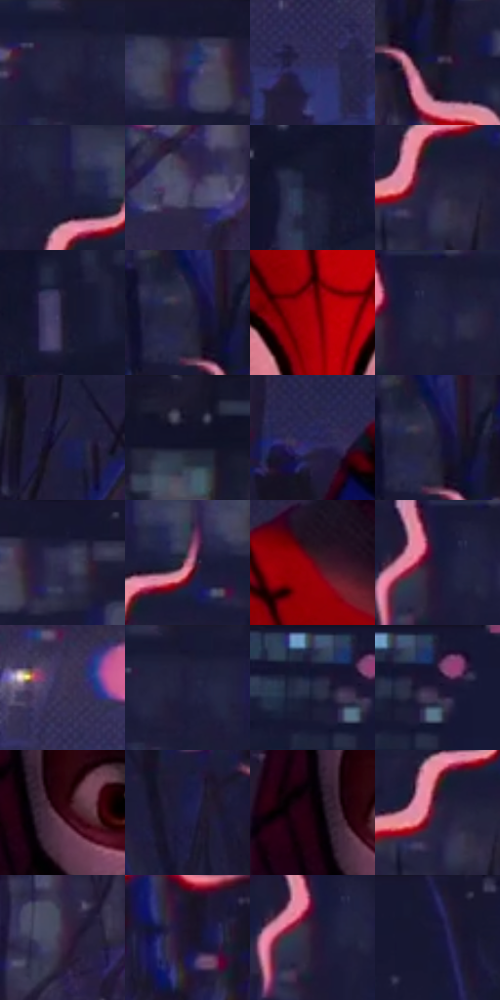

# 电影参考 226

- 状态：条件／活跃；来源世界：miles-home。
- 视角：near-level；景别：medium；场景：portrait。
- 时段：night-appearance（外观依据，中置信度；具体时间／晨昏未知）；光照：night-mixed。
- 材质候选：fabric, snow, foliage（帧级，不是像素分割）。
- 明暗组：very-dark；L* P5/P50/P95：7.13135 / 13.47257 / 34.90498。
- 资格门禁：sense。
- 原截图 SHA-256：`31bc4d5a30f7236c6aa8e1bba31aaa78da478537aeb1798c9f25fac43c934efd`；尺寸：2880 × 1204。
- sRGB 像素 SHA-256：`eb6fb807de3badb06c5ab437c564ddf09108ce2adc9285c68776c462e9698af8`。

## 观察与迁移

头周感应波形清楚，单人参考不覆盖定制触发条件。

226／3  /  蜘蛛感应形态；暗城层次  /  分段粉红波浪线绕头放射，有起伏、长短差、头外空隙及局部彩边，城市与雪仍可辨。  /  只供学习线形，不借入人物或场景；按2026-10-01最新规则，当次有蜘蛛感应口令时单人也可应用一组头周短线。

本公开版保存32个128×128原像素色卡上下文；图集格子并非原场景相邻位置。原rect、图集tile和像素SHA见 `data/palette-crops.json`。上下文不足时不得批准替色，不能以小样推断完整构图。

## 实测色卡

颜色比例分母为保留采样像素，不是材料面积；全部 32 色参与全库匹配。表内四舍五入仅用于阅读，原精度在 JSON。

| ID | HEX | Lab | 原图 xy | 像素数 | 比例 | 明度角色 |
| --- | --- | --- | --- | ---: | ---: | --- |
| 226-S01 | #191934 | [10.181692, 8.775865, -17.825151] | [1692, 28] | 12846 | 6.668120% | deep-shadow |
| 226-S02 | #2C2849 | [18.071602, 11.148672, -19.949141] | [1928, 44] | 11201 | 5.814231% | deep-shadow |
| 226-S03 | #2F2E5A | [21.193445, 13.514985, -26.396213] | [2404, 1084] | 9701 | 5.035609% | shadow |
| 226-S04 | #25203B | [14.070753, 9.984052, -16.597011] | [756, 144] | 9505 | 4.933869% | deep-shadow |
| 226-S05 | #1D1C3C | [12.076059, 10.690339, -20.51446] | [1776, 100] | 8506 | 4.415307% | deep-shadow |
| 226-S06 | #4E4568 | [31.521313, 12.14959, -19.037863] | [2048, 904] | 8112 | 4.210789% | shadow |
| 226-S07 | #1A1830 | [9.690032, 8.409061, -15.690322] | [2616, 84] | 7816 | 4.057140% | deep-shadow |
| 226-S08 | #272241 | [15.259735, 11.180284, -18.911221] | [1796, 204] | 7797 | 4.047278% | deep-shadow |
| 226-S09 | #1F1B33 | [11.374013, 8.921595, -15.177697] | [2704, 68] | 6781 | 3.519891% | deep-shadow |
| 226-S10 | #272641 | [16.499311, 8.288665, -16.960014] | [692, 80] | 6739 | 3.498090% | deep-shadow |
| 226-S11 | #A4000A | [33.80954, 57.688511, 43.909014] | [1316, 436] | 6568 | 3.409327% | shadow |
| 226-S12 | #201F3D | [13.374835, 9.737813, -19.138795] | [1508, 36] | 6516 | 3.382335% | deep-shadow |
| 226-S13 | #232042 | [14.307927, 11.698184, -21.141945] | [1952, 300] | 5889 | 3.056871% | deep-shadow |
| 226-S14 | #141328 | [6.933906, 7.092574, -14.15716] | [2404, 48] | 5819 | 3.020535% | deep-shadow |
| 226-S15 | #262451 | [16.833773, 14.980344, -27.388501] | [828, 1084] | 5802 | 3.011710% | deep-shadow |
| 226-S16 | #211D37 | [12.466473, 9.477431, -16.313882] | [700, 76] | 5626 | 2.920352% | deep-shadow |
| 226-S17 | #15152E | [8.065854, 8.341506, -16.828894] | [2012, 28] | 5375 | 2.790063% | deep-shadow |
| 226-S18 | #BE6F88 | [56.183642, 34.37957, -0.076901] | [1840, 120] | 5346 | 2.775009% | midtone |
| 226-S19 | #6F0314 | [21.930785, 43.206287, 23.754325] | [1152, 1020] | 5106 | 2.650430% | shadow |
| 226-S20 | #191A3A | [10.927294, 10.283392, -20.947805] | [1464, 48] | 5032 | 2.612018% | deep-shadow |
| 226-S21 | #3D3657 | [24.697432, 11.468665, -18.805413] | [1804, 1004] | 4898 | 2.542461% | shadow |
| 226-S22 | #201E3B | [12.930571, 9.774254, -18.430551] | [1720, 44] | 4740 | 2.460446% | deep-shadow |
| 226-S23 | #1C1D38 | [12.03095, 8.163899, -17.748045] | [56, 36] | 4664 | 2.420996% | deep-shadow |
| 226-S24 | #1E1936 | [10.831622, 11.104906, -18.204135] | [108, 28] | 4569 | 2.371683% | deep-shadow |
| 226-S25 | #320513 | [7.532267, 23.629867, 2.99496] | [1176, 628] | 4107 | 2.131867% | deep-shadow |
| 226-S26 | #1E1D4B | [13.606356, 15.830713, -28.526904] | [448, 536] | 4079 | 2.117333% | deep-shadow |
| 226-S27 | #16010C | [1.977036, 8.195891, -1.861866] | [1128, 608] | 3835 | 1.990677% | deep-shadow |
| 226-S28 | #32223D | [16.300992, 13.886804, -14.399564] | [1780, 196] | 3586 | 1.861426% | deep-shadow |
| 226-S29 | #3D2B45 | [20.633238, 13.996252, -13.086299] | [2176, 708] | 3270 | 1.697396% | shadow |
| 226-S30 | #1E1429 | [8.450168, 10.573247, -12.445567] | [760, 596] | 3130 | 1.624725% | deep-shadow |
| 226-S31 | #281934 | [11.919765, 13.968472, -14.965494] | [1456, 84] | 3049 | 1.582679% | deep-shadow |
| 226-S32 | #17163A | [9.492513, 12.790896, -23.260817] | [440, 48] | 2638 | 1.369337% | deep-shadow |

## 色阶与空间分布

- 采样 ROI：`[0.01, 0.02, 0.98, 0.94]`；步长：4；样本数：192648。
- 排除区：`[]`。
- 深暗、暗、中、亮、高光五段计数：`[154660, 32121, 3955, 1887, 25]`。
- RGB 各 256 箱、L* 100 箱、13×5 色相明度表和 3×3 空间统计全部保存在 [总数据](../film-library.json)。
- [可视化档案](../../references/library.html)按需绘制直方图，不存 2,094 张重复图表图片。

## 纹理特征占比

**这是分块图像特征的面积占比，不是波点／排线／丝网／错版的精确语义覆盖率。** 窗格、发丝、织物也会产生方向或周期特征。
原图 ROI 像素 3092958；已测块覆盖 3092958（100.0000%）；未测 0。

| 特征 | 块覆盖像素 | 占已测面积 | 阈值敏感范围 |
| --- | ---: | ---: | --- |
| low-contrast | 114688 | 3.7080% | 1.5892% ~ 5.2972% |
| directional-structure | 163840 | 5.2972% | 1.5892% ~ 16.0488% |
| periodic-structure | 2585054 | 83.5787% | 78.3063% ~ 83.5787% |
| mixed-detail | 229376 | 7.4161% | 2.1189% ~ 14.8073% |

阈值敏感范围不是统计置信区间。逐块坐标、尺度、对比、方向一致性、频谱集中度、频率与角度见 [全量特征记录](../texture-features.jsonl)，以帧号定位。
四种印刷层的真实像素覆盖仍标为 `null`，不能填 0，也不能拿上表代替。不得据这些代理测量删除唯一证据。

[测量方法与保留策略](../../references/library-retention.md) · [分类索引](../archive/README.md)
