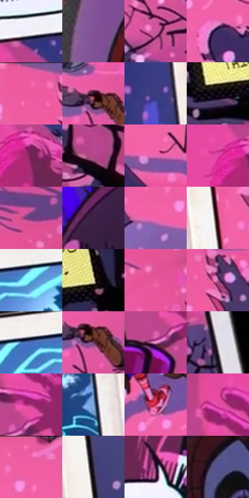

# 电影参考 227

- 状态：条件／仅归档；来源世界：archive-only。
- 视角：mixed-panels；景别：graphic-or-multipanel；场景：graphic。
- 时段：graphic-no-physical-time（外观依据，中置信度；具体时间／晨昏未知）；光照：graphic-field。
- 材质候选：paper, paint（帧级，不是像素分割）。
- 明暗组：middle；L* P5/P50/P95：5.63167 / 47.60051 / 94.61909。
- 资格门禁：archive。
- 原截图 SHA-256：`4b6aeb53a58a8f7f166ce90320f8aeb98352debe1cf2cefaae314c0b93093faa`；尺寸：2880 × 1210。
- sRGB 像素 SHA-256：`8d00a83b00c5204d0c8c5eb44c8652e526be1235beb5a57cddb6be9c12737cec`。

## 观察与迁移

漫画书页归档，不恢复为原生世界日常色板。

本公开版保存32个128×128原像素色卡上下文；图集格子并非原场景相邻位置。原rect、图集tile和像素SHA见 `data/palette-crops.json`。上下文不足时不得批准替色，不能以小样推断完整构图。

## 实测色卡

颜色比例分母为保留采样像素，不是材料面积；全部 32 色参与全库匹配。表内四舍五入仅用于阅读，原精度在 JSON。

| ID | HEX | Lab | 原图 xy | 像素数 | 比例 | 明度角色 |
| --- | --- | --- | --- | ---: | ---: | --- |
| 227-S01 | #F0F0F8 | [95.00178, 1.434987, -3.841511] | [1000, 164] | 13913 | 7.170023% | highlight |
| 227-S02 | #82579B | [44.130882, 30.732621, -30.279634] | [48, 568] | 11356 | 5.852281% | midtone |
| 227-S03 | #CE5397 | [53.541701, 55.651277, -12.559222] | [2348, 780] | 9373 | 4.830348% | midtone |
| 227-S04 | #443261 | [24.8685, 19.341692, -25.027364] | [2128, 720] | 9229 | 4.756138% | shadow |
| 227-S05 | #F05FA2 | [61.065576, 61.944214, -7.170998] | [1692, 40] | 8972 | 4.623694% | light |
| 227-S06 | #25121D | [8.259674, 11.891606, -3.593736] | [2384, 556] | 8700 | 4.483519% | deep-shadow |
| 227-S07 | #373E80 | [28.941865, 17.776046, -38.359671] | [1252, 340] | 8585 | 4.424254% | shadow |
| 227-S08 | #0F0910 | [3.020155, 2.884091, -2.433126] | [2356, 1084] | 8245 | 4.249036% | deep-shadow |
| 227-S09 | #742258 | [28.280753, 41.469253, -13.287673] | [1008, 292] | 7927 | 4.085156% | shadow |
| 227-S10 | #B44788 | [46.960807, 51.182178, -13.961067] | [2688, 796] | 7880 | 4.060935% | midtone |
| 227-S11 | #E96AB6 | [62.518492, 57.512207, -16.566441] | [1820, 820] | 6748 | 3.477562% | light |
| 227-S12 | #E344A3 | [55.189125, 68.958213, -16.795739] | [940, 276] | 6610 | 3.406444% | midtone |
| 227-S13 | #6A4083 | [34.741408, 31.231095, -30.680591] | [2496, 200] | 6502 | 3.350786% | shadow |
| 227-S14 | #3F2245 | [18.499211, 20.689865, -16.378665] | [200, 108] | 6462 | 3.330173% | deep-shadow |
| 227-S15 | #F262A8 | [62.035754, 61.963116, -9.148367] | [1468, 128] | 6021 | 3.102904% | light |
| 227-S16 | #63172E | [21.811879, 35.499935, 5.195454] | [1420, 540] | 5239 | 2.699903% | shadow |
| 227-S17 | #75DEF5 | [83.238099, -24.308135, -20.55567] | [1176, 892] | 5005 | 2.579312% | highlight |
| 227-S18 | #EEE8BA | [91.431592, -5.218156, 23.166633] | [2768, 1004] | 4932 | 2.541692% | highlight |
| 227-S19 | #E7579B | [58.203872, 61.841505, -7.518607] | [2472, 324] | 4891 | 2.520562% | midtone |
| 227-S20 | #AD6297 | [51.673426, 37.744232, -15.835381] | [1772, 92] | 4779 | 2.462843% | midtone |
| 227-S21 | #5272BB | [48.778375, 10.355341, -41.981995] | [1076, 884] | 4552 | 2.345860% | midtone |
| 227-S22 | #653A55 | [30.51851, 23.255618, -8.151176] | [2404, 588] | 4498 | 2.318031% | shadow |
| 227-S23 | #E791CE | [70.662607, 41.131406, -17.738525] | [508, 592] | 4439 | 2.287625% | light |
| 227-S24 | #E0DCE4 | [88.273418, 2.795609, -3.42384] | [2788, 472] | 4234 | 2.181979% | highlight |
| 227-S25 | #AA3179 | [41.414555, 55.406091, -13.379454] | [548, 528] | 3732 | 1.923275% | midtone |
| 227-S26 | #79A3D1 | [65.640067, -2.308061, -27.920498] | [1356, 984] | 3406 | 1.755272% | light |
| 227-S27 | #B52451 | [40.707063, 58.676483, 10.900706] | [2044, 624] | 3263 | 1.681577% | midtone |
| 227-S28 | #EC50AC | [58.558371, 68.060512, -16.783334] | [516, 420] | 3204 | 1.651172% | midtone |
| 227-S29 | #EA5FA5 | [60.246324, 60.519968, -10.221616] | [1540, 36] | 3153 | 1.624889% | light |
| 227-S30 | #2C2440 | [16.34201, 11.146679, -16.476615] | [1484, 1036] | 3131 | 1.613552% | deep-shadow |
| 227-S31 | #341336 | [12.366056, 22.663349, -15.576472] | [1096, 620] | 2981 | 1.536250% | deep-shadow |
| 227-S32 | #545391 | [38.048166, 16.875777, -34.159876] | [116, 1096] | 2082 | 1.072953% | shadow |

## 色阶与空间分布

- 采样 ROI：`[0.01, 0.02, 0.98, 0.94]`；步长：4；样本数：194044。
- 排除区：`[]`。
- 深暗、暗、中、亮、高光五段计数：`[29228, 46171, 60199, 31403, 27043]`。
- RGB 各 256 箱、L* 100 箱、13×5 色相明度表和 3×3 空间统计全部保存在 [总数据](../film-library.json)。
- [可视化档案](../../references/library.html)按需绘制直方图，不存 2,094 张重复图表图片。

## 纹理特征占比

**这是分块图像特征的面积占比，不是波点／排线／丝网／错版的精确语义覆盖率。** 窗格、发丝、织物也会产生方向或周期特征。
原图 ROI 像素 3109722；已测块覆盖 3109722（100.0000%）；未测 0。

| 特征 | 块覆盖像素 | 占已测面积 | 阈值敏感范围 |
| --- | ---: | ---: | --- |
| low-contrast | 0 | 0.0000% | 0.0000% ~ 0.5269% |
| directional-structure | 894848 | 28.7758% | 21.2845% ~ 42.1985% |
| periodic-structure | 2056026 | 66.1161% | 57.2746% ~ 66.1161% |
| mixed-detail | 158848 | 5.1081% | 0.5269% ~ 17.7528% |

阈值敏感范围不是统计置信区间。逐块坐标、尺度、对比、方向一致性、频谱集中度、频率与角度见 [全量特征记录](../texture-features.jsonl)，以帧号定位。
四种印刷层的真实像素覆盖仍标为 `null`，不能填 0，也不能拿上表代替。不得据这些代理测量删除唯一证据。

[测量方法与保留策略](../../references/library-retention.md) · [分类索引](../archive/README.md)
