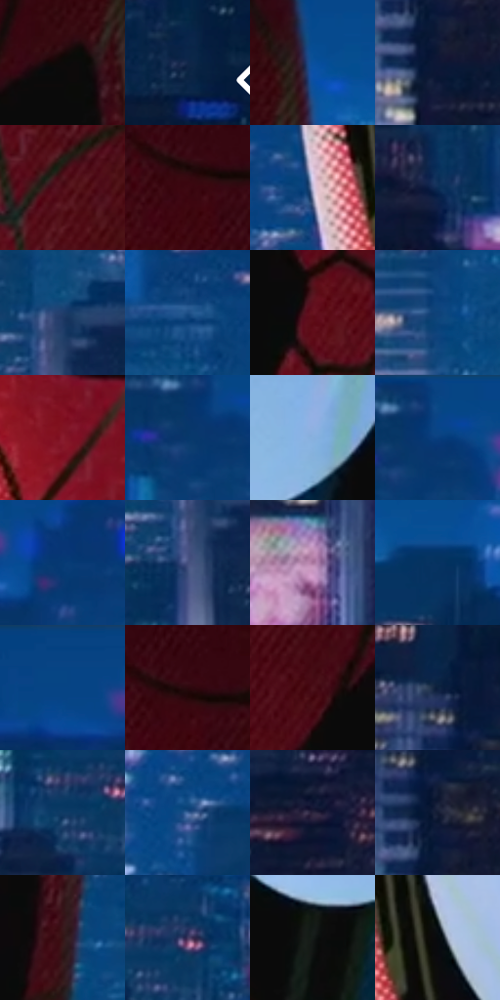

# 电影参考 228

- 状态：常规／活跃；来源世界：peter-b-home。
- 视角：near-level；景别：close-up；场景：city。
- 时段：night-appearance（外观依据，中置信度；具体时间／晨昏未知）；光照：night-mixed。
- 材质候选：fabric, glass, screen, metal, sky（帧级，不是像素分割）。
- 明暗组：dark；L* P5/P50/P95：3.1762 / 22.50964 / 71.55736。
- 资格门禁：无附加门禁。
- 原截图 SHA-256：`3a428aecdcb0cc4b70df75ec2ff21a02b12bdba151447ef1bdcd850df0b6ce2b`；尺寸：2880 × 1206。
- sRGB 像素 SHA-256：`9754d45e6a4598bbb78f5d43c6283cb7a28b89288ea6aa1d788559f4ec57a95e`。

## 观察与迁移

夜城与广告显示，红服和蓝楼体有明度差。

228／5  /  夜城近景；材料对比  /  眼片大亮形、黑眼框反射、红布细纹和远景点窗分层，结构蛛网线清楚。  /  不把服装图案当通用排线，不移植面罩或字幕。

本公开版保存32个128×128原像素色卡上下文；图集格子并非原场景相邻位置。原rect、图集tile和像素SHA见 `data/palette-crops.json`。上下文不足时不得批准替色，不能以小样推断完整构图。

## 实测色卡

颜色比例分母为保留采样像素，不是材料面积；全部 32 色参与全库匹配。表内四舍五入仅用于阅读，原精度在 JSON。

| ID | HEX | Lab | 原图 xy | 像素数 | 比例 | 明度角色 |
| --- | --- | --- | --- | ---: | ---: | --- |
| 228-S01 | #0D0A09 | [2.912025, 0.713226, 0.67911] | [1940, 176] | 11255 | 5.821170% | deep-shadow |
| 228-S02 | #112649 | [15.414615, 5.47861, -24.293134] | [2784, 584] | 9939 | 5.140525% | deep-shadow |
| 228-S03 | #0A509C | [34.397668, 10.596824, -46.84028] | [2020, 80] | 8580 | 4.437640% | shadow |
| 228-S04 | #0D1735 | [8.613236, 7.508312, -21.111533] | [2704, 912] | 8127 | 4.203345% | deep-shadow |
| 228-S05 | #4D0A14 | [14.656634, 30.904092, 13.192452] | [1588, 920] | 7792 | 4.030081% | deep-shadow |
| 228-S06 | #3C0811 | [10.372317, 25.543711, 8.601167] | [1520, 168] | 7698 | 3.981463% | deep-shadow |
| 228-S07 | #BDB9D9 | [76.391001, 7.680563, -15.510611] | [888, 564] | 7522 | 3.890435% | light |
| 228-S08 | #0D2C54 | [18.038821, 5.202893, -27.561084] | [256, 960] | 7219 | 3.733721% | deep-shadow |
| 228-S09 | #203E6B | [26.196145, 5.104088, -29.552172] | [2308, 552] | 7141 | 3.693379% | shadow |
| 228-S10 | #1C4E85 | [32.674717, 4.033031, -35.564679] | [624, 596] | 6984 | 3.612177% | shadow |
| 228-S11 | #66121E | [21.401849, 37.102142, 15.882667] | [1412, 608] | 6918 | 3.578041% | shadow |
| 228-S12 | #0F4279 | [27.784779, 5.772698, -35.931049] | [460, 732] | 6915 | 3.576490% | shadow |
| 228-S13 | #881C2C | [30.030261, 45.435208, 18.904115] | [1132, 908] | 6736 | 3.483910% | shadow |
| 228-S14 | #07376B | [23.130148, 6.782685, -34.503536] | [500, 88] | 6645 | 3.436844% | shadow |
| 228-S15 | #88B0DD | [70.526996, -2.291975, -26.939369] | [1796, 632] | 6584 | 3.405294% | light |
| 228-S16 | #094885 | [30.364435, 6.304749, -39.285167] | [532, 32] | 5888 | 3.045318% | shadow |
| 228-S17 | #063A74 | [24.718295, 8.520676, -37.708116] | [736, 84] | 5886 | 3.044283% | shadow |
| 228-S18 | #465180 | [35.488424, 8.987462, -27.889998] | [2292, 624] | 5781 | 2.989977% | shadow |
| 228-S19 | #A9769E | [55.948895, 26.52614, -13.494742] | [2260, 912] | 5501 | 2.845158% | midtone |
| 228-S20 | #063260 | [20.688976, 5.401798, -31.27784] | [2152, 148] | 5402 | 2.793955% | shadow |
| 228-S21 | #074383 | [28.635462, 8.767881, -40.826885] | [32, 28] | 5365 | 2.774818% | shadow |
| 228-S22 | #2B090D | [6.667849, 17.632478, 4.89231] | [1532, 144] | 5041 | 2.607243% | deep-shadow |
| 228-S23 | #4D131A | [16.097605, 27.68021, 10.799796] | [1536, 432] | 4858 | 2.512594% | deep-shadow |
| 228-S24 | #0C213D | [12.624694, 3.068169, -20.417746] | [2660, 744] | 4720 | 2.441219% | deep-shadow |
| 228-S25 | #0F3B65 | [24.220942, 2.115303, -28.873561] | [216, 836] | 4660 | 2.410187% | shadow |
| 228-S26 | #40689F | [43.496224, 3.262716, -34.02353] | [800, 740] | 4649 | 2.404498% | midtone |
| 228-S27 | #2D263F | [17.002959, 9.782434, -14.742097] | [124, 1088] | 4535 | 2.345536% | deep-shadow |
| 228-S28 | #121B33 | [10.19372, 4.760126, -17.119401] | [2700, 828] | 3930 | 2.032625% | deep-shadow |
| 228-S29 | #341416 | [11.194777, 16.333118, 6.254349] | [2004, 448] | 3843 | 1.987628% | deep-shadow |
| 228-S30 | #443960 | [26.733656, 14.419997, -21.443553] | [268, 808] | 3449 | 1.783849% | shadow |
| 228-S31 | #141A18 | [8.597389, -3.356631, 0.461745] | [1680, 744] | 2459 | 1.271813% | deep-shadow |
| 228-S32 | #070B0E | [2.856294, -0.574191, -1.673281] | [1000, 580] | 1324 | 0.684783% | deep-shadow |

## 色阶与空间分布

- 采样 ROI：`[0.01, 0.02, 0.98, 0.94]`；步长：4；样本数：193346。
- 排除区：`[]`。
- 深暗、暗、中、亮、高光五段计数：`[84603, 83802, 9509, 14353, 1079]`。
- RGB 各 256 箱、L* 100 箱、13×5 色相明度表和 3×3 空间统计全部保存在 [总数据](../film-library.json)。
- [可视化档案](../../references/library.html)按需绘制直方图，不存 2,094 张重复图表图片。

## 纹理特征占比

**这是分块图像特征的面积占比，不是波点／排线／丝网／错版的精确语义覆盖率。** 窗格、发丝、织物也会产生方向或周期特征。
原图 ROI 像素 3098546；已测块覆盖 3098546（100.0000%）；未测 0。

| 特征 | 块覆盖像素 | 占已测面积 | 阈值敏感范围 |
| --- | ---: | ---: | --- |
| low-contrast | 109184 | 3.5237% | 1.5863% ~ 4.9324% |
| directional-structure | 278528 | 8.9890% | 7.4027% ~ 16.7428% |
| periodic-structure | 2514226 | 81.1421% | 73.3057% ~ 81.1421% |
| mixed-detail | 196608 | 6.3452% | 0.5288% ~ 14.3593% |

阈值敏感范围不是统计置信区间。逐块坐标、尺度、对比、方向一致性、频谱集中度、频率与角度见 [全量特征记录](../texture-features.jsonl)，以帧号定位。
四种印刷层的真实像素覆盖仍标为 `null`，不能填 0，也不能拿上表代替。不得据这些代理测量删除唯一证据。

[测量方法与保留策略](../../references/library-retention.md) · [分类索引](../archive/README.md)
