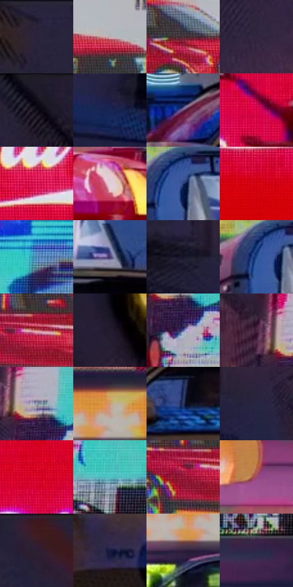

# 电影参考 229

- 状态：常规／活跃；来源世界：peter-b-home。
- 视角：low-angle；景别：environment-wide；场景：city。
- 时段：night-appearance（外观依据，中置信度；具体时间／晨昏未知）；光照：night-mixed。
- 材质候选：fabric, glass, screen, metal, sky（帧级，不是像素分割）。
- 明暗组：dark；L* P5/P50/P95：6.45832 / 28.87498 / 75.10241。
- 资格门禁：无附加门禁。
- 原截图 SHA-256：`9a3e54c7abddabc25be674b6c07ad2a40c611632f9f00c83fa9d0260a8e1631c`；尺寸：2878 × 1208。
- sRGB 像素 SHA-256：`923d115c51dafcc6d6fe2e5c38f331d276d57574c5f815f4fb20e8cb345fc015`。

## 观察与迁移

夜城与广告显示，红服和蓝楼体有明度差。

229／6  /  夜城；屏幕／车漆  /  大红屏和青广告为高纯源，近车有曲面亮带，左侧建筑大暗体量平衡亮屏。  /  不抄品牌，不让所有墙面发光。

本公开版保存32个128×128原像素色卡上下文；图集格子并非原场景相邻位置。原rect、图集tile和像素SHA见 `data/palette-crops.json`。上下文不足时不得批准替色，不能以小样推断完整构图。

## 实测色卡

颜色比例分母为保留采样像素，不是材料面积；全部 32 色参与全库匹配。表内四舍五入仅用于阅读，原精度在 JSON。

| ID | HEX | Lab | 原图 xy | 像素数 | 比例 | 明度角色 |
| --- | --- | --- | --- | ---: | ---: | --- |
| 229-S01 | #282239 | [14.901994, 8.979988, -13.862603] | [68, 48] | 12599 | 6.516297% | deep-shadow |
| 229-S02 | #BBB0B6 | [72.887419, 4.998869, -1.646192] | [2504, 528] | 12190 | 6.304759% | light |
| 229-S03 | #49353C | [24.605076, 10.258028, -0.872356] | [2332, 520] | 8505 | 4.398850% | shadow |
| 229-S04 | #30263D | [17.23333, 10.326684, -12.970286] | [448, 400] | 8002 | 4.138694% | deep-shadow |
| 229-S05 | #0C0812 | [2.669217, 2.73389, -4.134825] | [520, 56] | 7701 | 3.983015% | deep-shadow |
| 229-S06 | #192453 | [15.966339, 12.722676, -30.189985] | [612, 1040] | 7683 | 3.973705% | deep-shadow |
| 229-S07 | #614166 | [32.43938, 20.930331, -16.179973] | [2220, 980] | 7466 | 3.861471% | shadow |
| 229-S08 | #D30241 | [44.62959, 70.734653, 27.220951] | [1504, 280] | 7271 | 3.760616% | midtone |
| 229-S09 | #DE1A59 | [48.25309, 71.965551, 17.553956] | [1804, 540] | 7177 | 3.711998% | midtone |
| 229-S10 | #DDCFD7 | [84.434566, 6.236701, -2.207222] | [1052, 1092] | 6842 | 3.538734% | highlight |
| 229-S11 | #203671 | [24.119629, 13.086885, -36.716408] | [2396, 784] | 6824 | 3.529424% | shadow |
| 229-S12 | #D30011 | [44.080476, 69.588703, 52.713163] | [1464, 668] | 6773 | 3.503046% | midtone |
| 229-S13 | #4E8CBA | [56.006613, -6.294431, -30.080186] | [956, 444] | 6242 | 3.228409% | midtone |
| 229-S14 | #443A6B | [27.617751, 16.983581, -27.133838] | [2800, 860] | 6228 | 3.221168% | shadow |
| 229-S15 | #151427 | [7.282222, 6.415389, -12.853714] | [68, 772] | 6167 | 3.189619% | deep-shadow |
| 229-S16 | #22498C | [31.801564, 10.996262, -41.256055] | [2360, 788] | 6159 | 3.185481% | shadow |
| 229-S17 | #BF7769 | [57.359274, 26.609362, 19.575647] | [2180, 556] | 5922 | 3.062903% | midtone |
| 229-S18 | #221B2D | [11.368858, 8.143814, -10.808878] | [692, 92] | 5798 | 2.998769% | deep-shadow |
| 229-S19 | #515892 | [39.247358, 13.180211, -32.884261] | [828, 628] | 5591 | 2.891707% | shadow |
| 229-S20 | #492443 | [20.37602, 22.623418, -11.979762] | [740, 528] | 5174 | 2.676032% | shadow |
| 229-S21 | #969FB6 | [65.480768, 1.68419, -12.959908] | [812, 548] | 4767 | 2.465528% | light |
| 229-S22 | #CC9D74 | [68.178529, 12.206473, 28.165623] | [1500, 912] | 4716 | 2.439151% | light |
| 229-S23 | #2C375A | [23.690421, 6.383463, -22.458583] | [2452, 988] | 4695 | 2.428289% | shadow |
| 229-S24 | #262440 | [15.715936, 9.064696, -17.503345] | [180, 788] | 4663 | 2.411739% | deep-shadow |
| 229-S25 | #D90727 | [45.709449, 70.853791, 44.072375] | [1804, 268] | 4406 | 2.278816% | midtone |
| 229-S26 | #52BFC4 | [71.580597, -29.415701, -11.891565] | [960, 664] | 4175 | 2.159341% | light |
| 229-S27 | #941835 | [32.276179, 50.733185, 16.394146] | [2124, 576] | 4114 | 2.127792% | shadow |
| 229-S28 | #9F496E | [43.157645, 39.883845, -4.158227] | [988, 956] | 3692 | 1.909530% | midtone |
| 229-S29 | #351E2A | [14.694586, 13.365553, -3.338525] | [252, 48] | 3607 | 1.865567% | deep-shadow |
| 229-S30 | #181C41 | [11.998902, 11.2359, -24.190671] | [2424, 1120] | 3147 | 1.627652% | deep-shadow |
| 229-S31 | #31203D | [15.607116, 14.902198, -15.492103] | [1456, 988] | 2982 | 1.542313% | deep-shadow |
| 229-S32 | #2E284A | [18.332917, 12.126424, -20.204637] | [1088, 776] | 2068 | 1.069585% | deep-shadow |

## 色阶与空间分布

- 采样 ROI：`[0.01, 0.02, 0.98, 0.94]`；步长：4；样本数：193346。
- 排除区：`[]`。
- 深暗、暗、中、亮、高光五段计数：`[67246, 49732, 41718, 28725, 5925]`。
- RGB 各 256 箱、L* 100 箱、13×5 色相明度表和 3×3 空间统计全部保存在 [总数据](../film-library.json)。
- [可视化档案](../../references/library.html)按需绘制直方图，不存 2,094 张重复图表图片。

## 纹理特征占比

**这是分块图像特征的面积占比，不是波点／排线／丝网／错版的精确语义覆盖率。** 窗格、发丝、织物也会产生方向或周期特征。
原图 ROI 像素 3101912；已测块覆盖 3101912（100.0000%）；未测 0。

| 特征 | 块覆盖像素 | 占已测面积 | 阈值敏感范围 |
| --- | ---: | ---: | --- |
| low-contrast | 185216 | 5.9710% | 4.0275% ~ 8.4428% |
| directional-structure | 395224 | 12.7413% | 3.3590% ~ 24.4523% |
| periodic-structure | 2377088 | 76.6330% | 69.9357% ~ 76.6330% |
| mixed-detail | 144384 | 4.6547% | 1.5846% ~ 13.2955% |

阈值敏感范围不是统计置信区间。逐块坐标、尺度、对比、方向一致性、频谱集中度、频率与角度见 [全量特征记录](../texture-features.jsonl)，以帧号定位。
四种印刷层的真实像素覆盖仍标为 `null`，不能填 0，也不能拿上表代替。不得据这些代理测量删除唯一证据。

[测量方法与保留策略](../../references/library-retention.md) · [分类索引](../archive/README.md)
