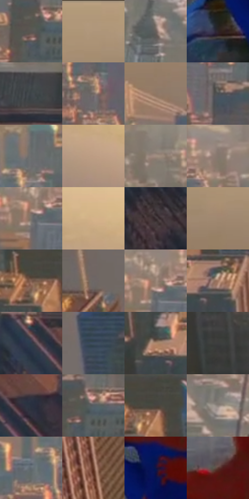

# 电影参考 230

- 状态：常规／活跃；来源世界：peter-b-home。
- 视角：high-angle；景别：environment-wide；场景：city。
- 时段：daylight-time-unspecified（外观依据，中置信度；具体时间／晨昏未知）；光照：warm-day。
- 材质候选：fabric, glass, stone, sky（帧级，不是像素分割）。
- 明暗组：middle；L* P5/P50/P95：16.74728 / 44.65931 / 67.25265。
- 资格门禁：无附加门禁。
- 原截图 SHA-256：`a054aaa4007698b84aaa24559900124aa6329f4a724cce5fb2beed8211112995`；尺寸：2880 × 1206。
- sRGB 像素 SHA-256：`e01c04d8fa2cd74154e632e787ee97ea42d8de0a5fba3b1ce6569d8a7930831b`。

## 观察与迁移

高处俯视暖色城市，空气层与近处金属尖顶分开。

230／7  /  暖日光城市；纵深  /  近檐口折面、楼体冷暗面与暖日照分开；远楼空气层次更浅，窗组更细。  /  不移植天际线、报纸、杯子，不将空气透视变成全图模糊。

本公开版保存32个128×128原像素色卡上下文；图集格子并非原场景相邻位置。原rect、图集tile和像素SHA见 `data/palette-crops.json`。上下文不足时不得批准替色，不能以小样推断完整构图。

## 实测色卡

颜色比例分母为保留采样像素，不是材料面积；全部 32 色参与全库匹配。表内四舍五入仅用于阅读，原精度在 JSON。

| ID | HEX | Lab | 原图 xy | 像素数 | 比例 | 明度角色 |
| --- | --- | --- | --- | ---: | ---: | --- |
| 230-S01 | #5A5653 | [36.843832, 1.006585, 2.322399] | [1836, 540] | 8646 | 4.471776% | shadow |
| 230-S02 | #AE957A | [63.260069, 5.165165, 17.727829] | [812, 64] | 8189 | 4.235412% | light |
| 230-S03 | #675F5B | [40.934207, 2.420831, 3.440119] | [2424, 452] | 8110 | 4.194553% | midtone |
| 230-S04 | #2D252A | [15.738352, 4.857282, -1.905344] | [1280, 952] | 8068 | 4.172830% | deep-shadow |
| 230-S05 | #40464A | [29.323042, -1.493533, -3.239509] | [2744, 516] | 7910 | 4.091111% | shadow |
| 230-S06 | #746964 | [45.271208, 3.396066, 4.381116] | [1464, 372] | 7896 | 4.083870% | midtone |
| 230-S07 | #907865 | [52.177676, 6.310735, 13.924954] | [868, 260] | 7492 | 3.874919% | midtone |
| 230-S08 | #4C5052 | [33.737911, -1.158328, -1.731102] | [1640, 424] | 7478 | 3.867678% | shadow |
| 230-S09 | #6B6C6D | [45.572529, -0.178824, -0.690172] | [1232, 296] | 7378 | 3.815957% | midtone |
| 230-S10 | #BD9D84 | [66.976035, 8.111212, 17.523059] | [2756, 228] | 7203 | 3.725446% | light |
| 230-S11 | #A18E81 | [60.345665, 4.930395, 9.533767] | [1656, 184] | 7034 | 3.638038% | light |
| 230-S12 | #84776E | [50.949867, 3.399969, 6.770651] | [2072, 212] | 6670 | 3.449774% | midtone |
| 230-S13 | #77726E | [48.363829, 1.148967, 2.901366] | [1960, 280] | 6449 | 3.335471% | midtone |
| 230-S14 | #D5B28A | [74.713821, 7.023544, 25.195388] | [2492, 80] | 6426 | 3.323575% | light |
| 230-S15 | #3B3133 | [21.452082, 4.905461, 0.402799] | [2672, 872] | 6240 | 3.227375% | shadow |
| 230-S16 | #A08770 | [58.010848, 5.919877, 15.913566] | [740, 140] | 6182 | 3.197377% | midtone |
| 230-S17 | #7E5E50 | [42.794869, 10.978267, 13.101991] | [608, 620] | 6053 | 3.130657% | midtone |
| 230-S18 | #866F60 | [48.61395, 6.627979, 11.74714] | [52, 660] | 5969 | 3.087212% | midtone |
| 230-S19 | #978374 | [56.161419, 5.125011, 10.91841] | [1968, 248] | 5878 | 3.040146% | midtone |
| 230-S20 | #A07761 | [53.526552, 13.029393, 18.360874] | [716, 868] | 5859 | 3.030319% | midtone |
| 230-S21 | #303A49 | [24.113993, 0.052742, -10.545786] | [2616, 608] | 5536 | 2.863261% | shadow |
| 230-S22 | #3D4D60 | [32.132628, -1.037345, -13.140301] | [284, 584] | 5220 | 2.699823% | shadow |
| 230-S23 | #AE896E | [59.904366, 10.267601, 19.864349] | [592, 868] | 5121 | 2.648620% | midtone |
| 230-S24 | #3D3D3E | [25.795124, 0.226429, -0.612535] | [600, 1024] | 4830 | 2.498112% | shadow |
| 230-S25 | #29303F | [19.818571, 1.277069, -10.424684] | [2752, 648] | 4690 | 2.425703% | deep-shadow |
| 230-S26 | #565D63 | [39.083948, -1.360226, -4.363005] | [1872, 524] | 4540 | 2.348122% | shadow |
| 230-S27 | #494440 | [29.212172, 1.288167, 3.180427] | [652, 608] | 4386 | 2.268472% | shadow |
| 230-S28 | #8B817B | [54.678627, 2.68164, 4.612794] | [2576, 412] | 4057 | 2.098311% | midtone |
| 230-S29 | #606A71 | [44.214083, -2.208537, -5.202274] | [1164, 364] | 3935 | 2.035211% | midtone |
| 230-S30 | #744738 | [35.014961, 17.480685, 17.077592] | [32, 1036] | 3675 | 1.900738% | shadow |
| 230-S31 | #0F1445 | [9.250021, 17.159572, -31.490106] | [1380, 876] | 3121 | 1.614205% | deep-shadow |
| 230-S32 | #5A3933 | [27.680595, 13.828883, 9.77492] | [1376, 752] | 3105 | 1.605929% | shadow |

## 色阶与空间分布

- 采样 ROI：`[0.01, 0.02, 0.98, 0.94]`；步长：4；样本数：193346。
- 排除区：`[]`。
- 深暗、暗、中、亮、高光五段计数：`[16064, 61656, 86384, 28442, 800]`。
- RGB 各 256 箱、L* 100 箱、13×5 色相明度表和 3×3 空间统计全部保存在 [总数据](../film-library.json)。
- [可视化档案](../../references/library.html)按需绘制直方图，不存 2,094 张重复图表图片。

## 纹理特征占比

**这是分块图像特征的面积占比，不是波点／排线／丝网／错版的精确语义覆盖率。** 窗格、发丝、织物也会产生方向或周期特征。
原图 ROI 像素 3098546；已测块覆盖 3098546（100.0000%）；未测 0。

| 特征 | 块覆盖像素 | 占已测面积 | 阈值敏感范围 |
| --- | ---: | ---: | --- |
| low-contrast | 41778 | 1.3483% | 0.5288% ~ 2.1373% |
| directional-structure | 321920 | 10.3894% | 3.5237% ~ 22.6336% |
| periodic-structure | 2652928 | 85.6185% | 76.8377% ~ 85.6185% |
| mixed-detail | 81920 | 2.6438% | 0.0000% ~ 10.5753% |

阈值敏感范围不是统计置信区间。逐块坐标、尺度、对比、方向一致性、频谱集中度、频率与角度见 [全量特征记录](../texture-features.jsonl)，以帧号定位。
四种印刷层的真实像素覆盖仍标为 `null`，不能填 0，也不能拿上表代替。不得据这些代理测量删除唯一证据。

[测量方法与保留策略](../../references/library-retention.md) · [分类索引](../archive/README.md)
