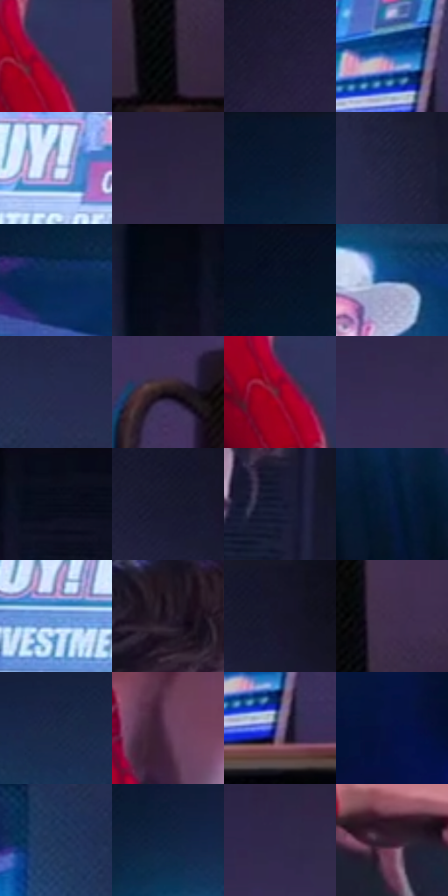

# 电影参考 231

- 状态：常规／活跃；来源世界：peter-b-home。
- 视角：near-level；景别：medium；场景：interior。
- 时段：interior-time-unknown（外观依据，中置信度；具体时间／晨昏未知）；光照：cool-interior。
- 材质候选：skin, fabric, wood, screen, plastic（帧级，不是像素分割）。
- 明暗组：very-dark；L* P5/P50/P95：2.30235 / 15.76049 / 64.10927。
- 资格门禁：无附加门禁。
- 原截图 SHA-256：`ad6119dae9925aaeeffef62353fcb7beb60d4266f36ec264304e72b18037ff9f`；尺寸：2880 × 1206。
- sRGB 像素 SHA-256：`f5877a6223f5f77c7e6306c820d1ecabc7db90f34793ceae9002147ed35f5d53`。

## 观察与迁移

暗室电脑与电视不同显示区，身体为前景暗形。

231／8  /  暗室；屏幕光  /  屏本身、人物脸／衣料受光与桌面暗底不同；杯、灯、纸盒的边与亮面各异。  /  台灯出现不等于正在发光，不给所有物件画青色外圈。

本公开版保存32个128×128原像素色卡上下文；图集格子并非原场景相邻位置。原rect、图集tile和像素SHA见 `data/palette-crops.json`。上下文不足时不得批准替色，不能以小样推断完整构图。

## 实测色卡

颜色比例分母为保留采样像素，不是材料面积；全部 32 色参与全库匹配。表内四舍五入仅用于阅读，原精度在 JSON。

| ID | HEX | Lab | 原图 xy | 像素数 | 比例 | 明度角色 |
| --- | --- | --- | --- | ---: | ---: | --- |
| 231-S01 | #34335E | [23.356986, 12.828491, -25.564549] | [1236, 768] | 10741 | 5.555326% | shadow |
| 231-S02 | #030409 | [1.137319, 0.43365, -1.984124] | [2692, 908] | 8136 | 4.208000% | deep-shadow |
| 231-S03 | #211D36 | [12.405411, 9.142641, -15.695602] | [2068, 192] | 8044 | 4.160417% | deep-shadow |
| 231-S04 | #2862B3 | [41.90615, 10.478864, -48.39592] | [1956, 932] | 7703 | 3.984049% | midtone |
| 231-S05 | #B9C7EC | [80.300833, 2.991777, -19.871681] | [572, 512] | 7605 | 3.933363% | highlight |
| 231-S06 | #2C2440 | [16.34201, 11.146679, -16.476615] | [2520, 244] | 7512 | 3.885263% | deep-shadow |
| 231-S07 | #08172F | [7.854549, 3.713702, -17.960366] | [348, 44] | 7205 | 3.726480% | deep-shadow |
| 231-S08 | #20243F | [15.102555, 6.758442, -17.810237] | [1872, 344] | 7164 | 3.705274% | deep-shadow |
| 231-S09 | #0A2B58 | [17.90271, 7.359954, -30.460181] | [228, 212] | 7053 | 3.647864% | deep-shadow |
| 231-S10 | #070913 | [2.597384, 1.208599, -4.897145] | [1116, 28] | 7004 | 3.622521% | deep-shadow |
| 231-S11 | #0A1124 | [5.354234, 3.299301, -13.646018] | [100, 52] | 6916 | 3.577007% | deep-shadow |
| 231-S12 | #163F77 | [26.895929, 7.753502, -36.085775] | [528, 232] | 6731 | 3.481324% | shadow |
| 231-S13 | #272B4F | [18.900274, 9.513265, -22.736404] | [968, 148] | 6576 | 3.401156% | deep-shadow |
| 231-S14 | #1A121A | [6.565334, 5.648973, -3.981596] | [2224, 832] | 6452 | 3.337023% | deep-shadow |
| 231-S15 | #840528 | [27.210479, 49.428517, 17.804389] | [1208, 784] | 6085 | 3.147208% | shadow |
| 231-S16 | #342C51 | [20.53926, 13.495936, -21.410256] | [2424, 376] | 6080 | 3.144622% | shadow |
| 231-S17 | #0B0D1A | [3.916241, 2.303822, -8.042006] | [1212, 36] | 5992 | 3.099107% | deep-shadow |
| 231-S18 | #19192E | [9.791419, 6.583227, -14.074591] | [1764, 76] | 5736 | 2.966702% | deep-shadow |
| 231-S19 | #181D37 | [11.611586, 6.550471, -17.720496] | [1480, 444] | 5732 | 2.964633% | deep-shadow |
| 231-S20 | #0A1B3F | [10.60965, 8.2732, -25.065154] | [320, 884] | 5497 | 2.843090% | deep-shadow |
| 231-S21 | #699ADC | [62.742671, 2.13345, -38.585618] | [220, 544] | 5447 | 2.817229% | light |
| 231-S22 | #241928 | [10.729985, 9.022089, -8.107329] | [1336, 292] | 5378 | 2.781542% | deep-shadow |
| 231-S23 | #151527 | [7.607561, 5.701141, -12.34508] | [1820, 28] | 5193 | 2.685859% | deep-shadow |
| 231-S24 | #402D4B | [21.853089, 15.31047, -15.227426] | [2728, 792] | 4717 | 2.439668% | shadow |
| 231-S25 | #1B2A49 | [17.319055, 4.724327, -21.229033] | [648, 108] | 4659 | 2.409670% | deep-shadow |
| 231-S26 | #613C58 | [30.58786, 21.079518, -10.039741] | [1224, 536] | 4642 | 2.400877% | shadow |
| 231-S27 | #826DA3 | [49.890688, 19.613782, -26.031807] | [1988, 992] | 4541 | 2.348639% | midtone |
| 231-S28 | #051041 | [7.084763, 16.974809, -32.23462] | [900, 908] | 4252 | 2.199166% | deep-shadow |
| 231-S29 | #1B3459 | [21.615914, 3.929118, -25.148544] | [892, 268] | 4078 | 2.109172% | shadow |
| 231-S30 | #0E2442 | [14.106446, 3.38006, -21.553436] | [448, 104] | 3729 | 1.928667% | deep-shadow |
| 231-S31 | #30284B | [18.600667, 13.101508, -20.448223] | [2444, 320] | 3648 | 1.886773% | deep-shadow |
| 231-S32 | #371D31 | [15.022989, 16.337931, -7.83609] | [1612, 932] | 3098 | 1.602309% | deep-shadow |

## 色阶与空间分布

- 采样 ROI：`[0.01, 0.02, 0.98, 0.94]`；步长：4；样本数：193346。
- 排除区：`[]`。
- 深暗、暗、中、亮、高光五段计数：`[125122, 46119, 10920, 7247, 3938]`。
- RGB 各 256 箱、L* 100 箱、13×5 色相明度表和 3×3 空间统计全部保存在 [总数据](../film-library.json)。
- [可视化档案](../../references/library.html)按需绘制直方图，不存 2,094 张重复图表图片。

## 纹理特征占比

**这是分块图像特征的面积占比，不是波点／排线／丝网／错版的精确语义覆盖率。** 窗格、发丝、织物也会产生方向或周期特征。
原图 ROI 像素 3098546；已测块覆盖 3098546（100.0000%）；未测 0。

| 特征 | 块覆盖像素 | 占已测面积 | 阈值敏感范围 |
| --- | ---: | ---: | --- |
| low-contrast | 515584 | 16.6395% | 8.4478% ~ 22.0098% |
| directional-structure | 529408 | 17.0857% | 9.4227% ~ 30.3874% |
| periodic-structure | 1750706 | 56.5009% | 52.9772% ~ 57.2940% |
| mixed-detail | 302848 | 9.7739% | 8.1876% ~ 11.2734% |

阈值敏感范围不是统计置信区间。逐块坐标、尺度、对比、方向一致性、频谱集中度、频率与角度见 [全量特征记录](../texture-features.jsonl)，以帧号定位。
四种印刷层的真实像素覆盖仍标为 `null`，不能填 0，也不能拿上表代替。不得据这些代理测量删除唯一证据。

[测量方法与保留策略](../../references/library-retention.md) · [分类索引](../archive/README.md)
