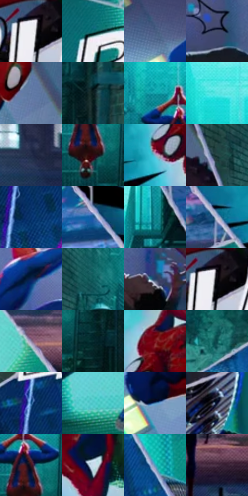

# 电影参考 232

- 状态：条件／活跃；来源世界：peter-b-home。
- 视角：mixed-panels；景别：graphic-or-multipanel；场景：graphic。
- 时段：graphic-no-physical-time（外观依据，中置信度；具体时间／晨昏未知）；光照：graphic-field。
- 材质候选：fabric, paper（帧级，不是像素分割）。
- 明暗组：dark；L* P5/P50/P95：5.40292 / 36.77039 / 91.20931。
- 资格门禁：panel。
- 原截图 SHA-256：`59fb61428b42f5fa5e8745fd4955559655066a50810c1116275364f23912ee3a`；尺寸：2880 × 1208。
- sRGB 像素 SHA-256：`48fedc87283fe884096b9c4ce08b06ad510e1e588e50f8f7c3aebfed3aa8eee5`。

## 观察与迁移

漫画式多格回顾与巨字，不拼入单一原照空间。

232／9  /  多格动作；叙事图形  /  不规则分格、局部冲击放射形和文字是叙事层，格内仍有立体人物与城市。  /  仅条件式参考；不默认加分格、文字、武器或新动作。

本公开版保存32个128×128原像素色卡上下文；图集格子并非原场景相邻位置。原rect、图集tile和像素SHA见 `data/palette-crops.json`。上下文不足时不得批准替色，不能以小样推断完整构图。

## 实测色卡

颜色比例分母为保留采样像素，不是材料面积；全部 32 色参与全库匹配。表内四舍五入仅用于阅读，原精度在 JSON。

| ID | HEX | Lab | 原图 xy | 像素数 | 比例 | 明度角色 |
| --- | --- | --- | --- | ---: | ---: | --- |
| 232-S01 | #EEEEF3 | [94.225551, 0.892435, -2.404791] | [484, 476] | 9408 | 4.865888% | highlight |
| 232-S02 | #0F7174 | [43.020673, -24.388098, -9.158648] | [2036, 456] | 8654 | 4.475914% | midtone |
| 232-S03 | #495D83 | [39.383039, 3.135488, -23.623942] | [84, 156] | 8646 | 4.471776% | shadow |
| 232-S04 | #424966 | [31.537575, 4.946187, -17.829067] | [532, 1000] | 8185 | 4.233343% | shadow |
| 232-S05 | #5E76A1 | [49.385213, 2.750986, -25.872274] | [252, 316] | 7799 | 4.033701% | midtone |
| 232-S06 | #0F2121 | [11.268504, -7.421236, -2.333927] | [1076, 336] | 7581 | 3.920950% | deep-shadow |
| 232-S07 | #19A8B0 | [62.796694, -31.552305, -14.149617] | [832, 316] | 7579 | 3.919916% | light |
| 232-S08 | #5AE2E0 | [82.883398, -36.926391, -10.051894] | [832, 84] | 7574 | 3.917330% | highlight |
| 232-S09 | #212B47 | [17.944975, 4.877792, -18.848842] | [2724, 548] | 7275 | 3.762685% | deep-shadow |
| 232-S10 | #2D0A10 | [7.339605, 18.490877, 4.368876] | [896, 456] | 7059 | 3.650968% | deep-shadow |
| 232-S11 | #89AFCE | [69.776607, -5.359977, -19.854308] | [2172, 272] | 6733 | 3.482358% | light |
| 232-S12 | #274544 | [27.030885, -11.447919, -2.923486] | [540, 276] | 6373 | 3.296163% | shadow |
| 232-S13 | #08346D | [22.341822, 9.906199, -37.061733] | [1312, 832] | 6274 | 3.244960% | shadow |
| 232-S14 | #1B5C9A | [38.232727, 3.137256, -39.471064] | [1844, 72] | 6183 | 3.197894% | shadow |
| 232-S15 | #128391 | [49.982242, -23.697291, -15.831248] | [996, 104] | 6172 | 3.192205% | midtone |
| 232-S16 | #B8B9D1 | [75.755901, 4.383529, -12.161912] | [2024, 280] | 6041 | 3.124450% | light |
| 232-S17 | #0A2153 | [14.267543, 12.668966, -32.977584] | [368, 756] | 5793 | 2.996183% | deep-shadow |
| 232-S18 | #115D5E | [35.508787, -21.12772, -6.952183] | [660, 236] | 5792 | 2.995666% | shadow |
| 232-S19 | #274166 | [27.215818, 2.611288, -24.711025] | [708, 1028] | 5788 | 2.993597% | shadow |
| 232-S20 | #09060C | [1.940917, 1.634316, -2.036546] | [500, 472] | 5695 | 2.945497% | deep-shadow |
| 232-S21 | #8D83A2 | [56.588737, 10.105808, -15.103595] | [2528, 896] | 5640 | 2.917050% | midtone |
| 232-S22 | #0D3336 | [18.882901, -11.966914, -5.82767] | [988, 488] | 5587 | 2.889638% | deep-shadow |
| 232-S23 | #80121E | [27.065565, 45.217003, 24.03804] | [2232, 168] | 5257 | 2.718960% | shadow |
| 232-S24 | #09484B | [27.298096, -17.183104, -7.19913] | [892, 832] | 5233 | 2.706547% | shadow |
| 232-S25 | #0E4881 | [30.186747, 4.95903, -37.084886] | [1292, 708] | 5145 | 2.661033% | shadow |
| 232-S26 | #52CBCE | [75.42534, -32.409486, -11.571645] | [2240, 1080] | 5067 | 2.620690% | light |
| 232-S27 | #3D73A3 | [46.838302, -2.691303, -31.142793] | [68, 540] | 4767 | 2.465528% | midtone |
| 232-S28 | #080D2A | [4.575791, 7.387042, -19.429899] | [1748, 504] | 3992 | 2.064692% | deep-shadow |
| 232-S29 | #42171F | [14.791229, 21.713409, 5.042995] | [896, 392] | 3931 | 2.033143% | deep-shadow |
| 232-S30 | #C9DEED | [87.374645, -3.960579, -9.678798] | [2320, 316] | 3207 | 1.658684% | highlight |
| 232-S31 | #46A5C0 | [63.355631, -19.607809, -22.162273] | [1436, 760] | 3037 | 1.570759% | light |
| 232-S32 | #4F364A | [26.143158, 14.964808, -7.831275] | [2804, 936] | 1879 | 0.971833% | shadow |

## 色阶与空间分布

- 采样 ROI：`[0.01, 0.02, 0.98, 0.94]`；步长：4；样本数：193346。
- 排除区：`[]`。
- 深暗、暗、中、亮、高光五段计数：`[43741, 62982, 41022, 25812, 19789]`。
- RGB 各 256 箱、L* 100 箱、13×5 色相明度表和 3×3 空间统计全部保存在 [总数据](../film-library.json)。
- [可视化档案](../../references/library.html)按需绘制直方图，不存 2,094 张重复图表图片。

## 纹理特征占比

**这是分块图像特征的面积占比，不是波点／排线／丝网／错版的精确语义覆盖率。** 窗格、发丝、织物也会产生方向或周期特征。
原图 ROI 像素 3104134；已测块覆盖 3104134（100.0000%）；未测 0。

| 特征 | 块覆盖像素 | 占已测面积 | 阈值敏感范围 |
| --- | ---: | ---: | --- |
| low-contrast | 0 | 0.0000% | 0.0000% ~ 0.5278% |
| directional-structure | 567808 | 18.2920% | 4.7503% ~ 33.0006% |
| periodic-structure | 2394118 | 77.1268% | 66.4716% ~ 77.1268% |
| mixed-detail | 142208 | 4.5812% | 0.5278% ~ 19.9084% |

阈值敏感范围不是统计置信区间。逐块坐标、尺度、对比、方向一致性、频谱集中度、频率与角度见 [全量特征记录](../texture-features.jsonl)，以帧号定位。
四种印刷层的真实像素覆盖仍标为 `null`，不能填 0，也不能拿上表代替。不得据这些代理测量删除唯一证据。

[测量方法与保留策略](../../references/library-retention.md) · [分类索引](../archive/README.md)
