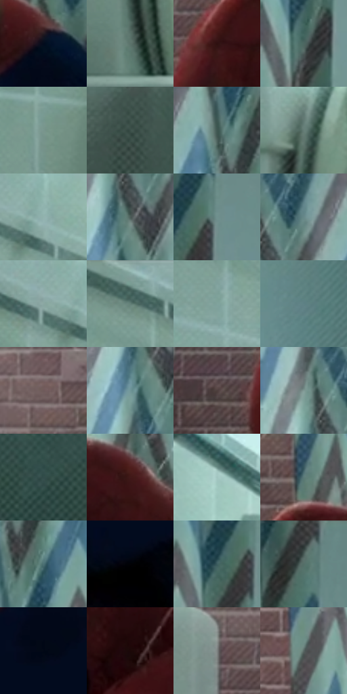

# 电影参考 233

- 状态：常规／活跃；来源世界：peter-b-home。
- 视角：near-level；景别：medium；场景：interior。
- 时段：daylight-time-unspecified（外观依据，中置信度；具体时间／晨昏未知）；光照：neutral-day。
- 材质候选：fabric, ceramic, metal, brick（帧级，不是像素分割）。
- 明暗组：middle；L* P5/P50/P95：2.8015 / 44.93019 / 70.02424。
- 资格门禁：无附加门禁。
- 原截图 SHA-256：`11703b119a2315c40341849a22e880105eb388a0aa957297b637e749cdbf1883`；尺寸：2876 × 1202。
- sRGB 像素 SHA-256：`04bc812af58734bd89fbd41a6a3c565859ffd46532589eb68baa7ad5c0a0385c`。

## 观察与迁移

浴室浅冷瓷面与深暗服装，釉面高光不能等同镜面。

233／10  /  浴室；低彩材质  /  灰青釉面和圆弧浴缸宽亮面、帘布褶皱、砖缝、暗红／深蓝服装分别成立。  /  低彩不等于没风格；帘纹、砖缝和排线不是一层。

本公开版保存32个128×128原像素色卡上下文；图集格子并非原场景相邻位置。原rect、图集tile和像素SHA见 `data/palette-crops.json`。上下文不足时不得批准替色，不能以小样推断完整构图。

## 实测色卡

颜色比例分母为保留采样像素，不是材料面积；全部 32 色参与全库匹配。表内四舍五入仅用于阅读，原精度在 JSON。

| ID | HEX | Lab | 原图 xy | 像素数 | 比例 | 明度角色 |
| --- | --- | --- | --- | ---: | ---: | --- |
| 233-S01 | #030C1C | [3.306942, 1.252157, -10.580497] | [1980, 692] | 9871 | 5.131204% | deep-shadow |
| 233-S02 | #5C726B | [46.138348, -9.669475, 1.193257] | [664, 740] | 8577 | 4.458549% | midtone |
| 233-S03 | #2E1010 | [8.899402, 15.40396, 6.662417] | [1304, 444] | 8322 | 4.325993% | deep-shadow |
| 233-S04 | #4D6761 | [41.439277, -11.009055, 0.251442] | [2324, 584] | 8060 | 4.189799% | midtone |
| 233-S05 | #79968E | [59.734782, -11.858461, 0.858464] | [216, 520] | 7622 | 3.962115% | midtone |
| 233-S06 | #3B4F49 | [31.812831, -9.220714, 1.011253] | [364, 888] | 7517 | 3.907533% | shadow |
| 233-S07 | #3F5751 | [34.937033, -10.546008, 0.537519] | [2148, 96] | 7416 | 3.855031% | shadow |
| 233-S08 | #667E77 | [50.778263, -10.221647, 0.930577] | [696, 384] | 7279 | 3.783815% | midtone |
| 233-S09 | #91B3AE | [70.395935, -12.537135, -1.264857] | [296, 100] | 7133 | 3.707920% | light |
| 233-S10 | #4B5C57 | [37.550177, -7.676299, 0.706152] | [1988, 168] | 7085 | 3.682968% | shadow |
| 233-S11 | #6F908E | [57.345477, -11.920875, -2.715342] | [2380, 244] | 7075 | 3.677770% | midtone |
| 233-S12 | #678888 | [54.310917, -11.53398, -3.787966] | [2040, 80] | 6873 | 3.572765% | midtone |
| 233-S13 | #8AA7A2 | [66.250459, -11.024005, -0.744513] | [228, 96] | 6530 | 3.394465% | light |
| 233-S14 | #6E8980 | [54.828691, -11.559038, 1.650676] | [40, 64] | 6440 | 3.347681% | midtone |
| 233-S15 | #80A39D | [64.33617, -13.255937, -0.829176] | [84, 200] | 6434 | 3.344562% | light |
| 233-S16 | #5E8185 | [51.579403, -11.253843, -6.148654] | [2712, 476] | 5917 | 3.075811% | midtone |
| 233-S17 | #6F5B5B | [40.601453, 8.141951, 3.063163] | [1148, 228] | 5710 | 2.968207% | midtone |
| 233-S18 | #709598 | [59.164161, -11.977845, -5.735013] | [1960, 220] | 5674 | 2.949494% | midtone |
| 233-S19 | #4D3E3D | [27.737107, 6.33194, 3.070919] | [1180, 524] | 5593 | 2.907388% | shadow |
| 233-S20 | #819A95 | [61.608975, -9.813901, -0.309406] | [1952, 72] | 5571 | 2.895952% | light |
| 233-S21 | #314C4A | [30.196056, -10.698476, -2.071914] | [2440, 1072] | 5553 | 2.886595% | shadow |
| 233-S22 | #411919 | [14.896728, 19.44734, 9.493735] | [1504, 424] | 5526 | 2.872559% | deep-shadow |
| 233-S23 | #A1C5BF | [76.842177, -13.202072, -0.975054] | [512, 72] | 5453 | 2.834612% | light |
| 233-S24 | #5B7B78 | [49.185959, -12.06233, -2.072097] | [1356, 316] | 4774 | 2.481650% | midtone |
| 233-S25 | #4D7175 | [45.181226, -11.664071, -6.306975] | [2208, 200] | 4754 | 2.471254% | midtone |
| 233-S26 | #020206 | [0.627494, 0.55614, -1.513628] | [1612, 944] | 4558 | 2.369368% | deep-shadow |
| 233-S27 | #3D5D60 | [37.234092, -10.79886, -5.445541] | [2320, 268] | 4202 | 2.184310% | shadow |
| 233-S28 | #2E3937 | [22.940138, -5.073393, -0.280874] | [2356, 40] | 4030 | 2.094899% | shadow |
| 233-S29 | #020815 | [2.1741, 0.753774, -6.874629] | [1960, 816] | 3485 | 1.811594% | deep-shadow |
| 233-S30 | #1C0808 | [3.957677, 7.912229, 2.788164] | [1516, 620] | 3426 | 1.780924% | deep-shadow |
| 233-S31 | #7E8281 | [54.011903, -1.687401, 0.024704] | [1116, 376] | 2968 | 1.542844% | midtone |
| 233-S32 | #576663 | [41.890894, -6.361334, -0.221765] | [1356, 84] | 2944 | 1.530368% | midtone |

## 色阶与空间分布

- 采样 ROI：`[0.01, 0.02, 0.98, 0.94]`；步长：4；样本数：192372。
- 排除区：`[]`。
- 深暗、暗、中、亮、高光五段计数：`[35196, 45999, 76360, 34030, 787]`。
- RGB 各 256 箱、L* 100 箱、13×5 色相明度表和 3×3 空间统计全部保存在 [总数据](../film-library.json)。
- [可视化档案](../../references/library.html)按需绘制直方图，不存 2,094 张重复图表图片。

## 纹理特征占比

**这是分块图像特征的面积占比，不是波点／排线／丝网／错版的精确语义覆盖率。** 窗格、发丝、织物也会产生方向或周期特征。
原图 ROI 像素 3082950；已测块覆盖 3082950（100.0000%）；未测 0。

| 特征 | 块覆盖像素 | 占已测面积 | 阈值敏感范围 |
| --- | ---: | ---: | --- |
| low-contrast | 319942 | 10.3778% | 8.3600% ~ 14.7705% |
| directional-structure | 655360 | 21.2576% | 6.9087% ~ 38.6871% |
| periodic-structure | 1988608 | 64.5034% | 52.4215% ~ 72.6701% |
| mixed-detail | 119040 | 3.8612% | 0.5314% ~ 5.6507% |

阈值敏感范围不是统计置信区间。逐块坐标、尺度、对比、方向一致性、频谱集中度、频率与角度见 [全量特征记录](../texture-features.jsonl)，以帧号定位。
四种印刷层的真实像素覆盖仍标为 `null`，不能填 0，也不能拿上表代替。不得据这些代理测量删除唯一证据。

[测量方法与保留策略](../../references/library-retention.md) · [分类索引](../archive/README.md)
