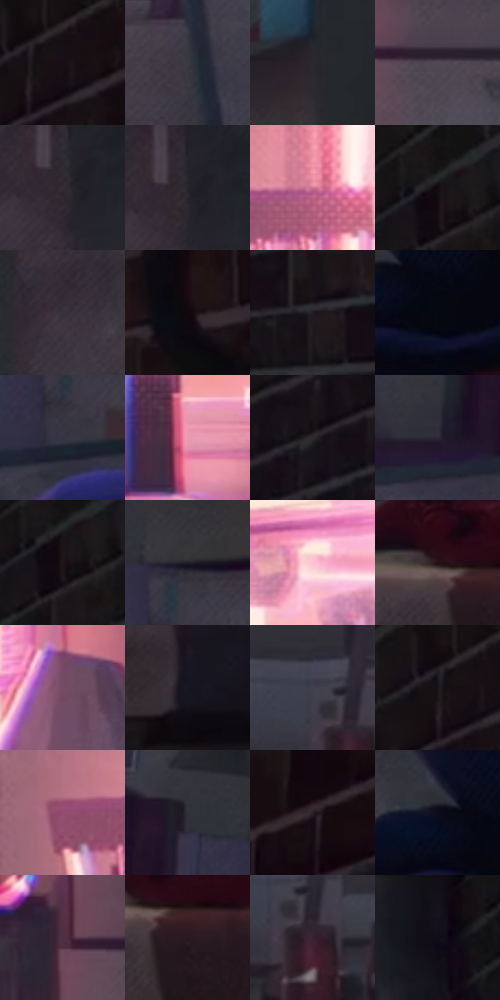

# 电影参考 234

- 状态：常规／活跃；来源世界：peter-b-home。
- 视角：near-level；景别：environment-wide；场景：interior。
- 时段：daylight-time-unspecified（外观依据，中置信度；具体时间／晨昏未知）；光照：warm-day。
- 材质候选：fabric, brick, wood, paper（帧级，不是像素分割）。
- 明暗组：very-dark；L* P5/P50/P95：3.00267 / 17.23201 / 71.76245。
- 资格门禁：无附加门禁。
- 原截图 SHA-256：`f031f2360f662be236a02d7e3ae6c2a573ccf0dffd9d0b9eac1fd45ffb8fc2e5`；尺寸：2880 × 1202。
- sRGB 像素 SHA-256：`31578cdecb34697e42d2dec7346e05712eaf305c543b8383f06688e79bebf6c3`。

## 观察与迁移

卧室暖粉窗光与暗砖墙，人物和床保留遮挡。

234／11  /  窗光室内；明暗布局  /  左窗粉暖光形成局部亮域，右侧砖墙和纸箱深暗，床垫与床布仍柔软有厚度。  /  不把粉光铺满房间，也不把暗部材料全填纯黑。

本公开版保存32个128×128原像素色卡上下文；图集格子并非原场景相邻位置。原rect、图集tile和像素SHA见 `data/palette-crops.json`。上下文不足时不得批准替色，不能以小样推断完整构图。

## 实测色卡

颜色比例分母为保留采样像素，不是材料面积；全部 32 色参与全库匹配。表内四舍五入仅用于阅读，原精度在 JSON。

| ID | HEX | Lab | 原图 xy | 像素数 | 比例 | 明度角色 |
| --- | --- | --- | --- | ---: | ---: | --- |
| 234-S01 | #161015 | [5.377398, 3.509548, -2.026191] | [2452, 48] | 9052 | 4.698725% | deep-shadow |
| 234-S02 | #3D3A43 | [25.024656, 3.383934, -5.069716] | [1064, 688] | 9019 | 4.681595% | shadow |
| 234-S03 | #2C282D | [16.711775, 3.013028, -2.599253] | [1480, 196] | 8952 | 4.646817% | deep-shadow |
| 234-S04 | #504955 | [32.09308, 5.529404, -6.038715] | [868, 624] | 8750 | 4.541963% | shadow |
| 234-S05 | #352E34 | [19.878315, 4.498117, -2.672512] | [1920, 92] | 8678 | 4.504589% | deep-shadow |
| 234-S06 | #26242A | [14.629601, 2.425242, -3.636994] | [1928, 76] | 8164 | 4.237781% | deep-shadow |
| 234-S07 | #CD7792 | [60.114662, 36.879166, 0.096469] | [220, 360] | 8138 | 4.224285% | light |
| 234-S08 | #130D12 | [4.245281, 3.069965, -1.768072] | [2252, 84] | 7908 | 4.104896% | deep-shadow |
| 234-S09 | #39323B | [21.824214, 5.146983, -4.518645] | [1716, 72] | 7315 | 3.797081% | shadow |
| 234-S10 | #10080D | [2.826384, 3.103275, -1.15439] | [2664, 344] | 6945 | 3.605021% | deep-shadow |
| 234-S11 | #201C20 | [10.862793, 2.908473, -2.03969] | [2340, 496] | 6843 | 3.552074% | deep-shadow |
| 234-S12 | #070812 | [2.371106, 1.396944, -4.605894] | [1440, 836] | 6579 | 3.415037% | deep-shadow |
| 234-S13 | #353342 | [22.008715, 4.628968, -9.022749] | [1340, 420] | 6428 | 3.336655% | shadow |
| 234-S14 | #ED99B0 | [72.17832, 34.42824, 1.215706] | [356, 508] | 6355 | 3.298763% | light |
| 234-S15 | #302C2F | [18.518467, 2.49457, -1.281853] | [2316, 240] | 6317 | 3.279037% | deep-shadow |
| 234-S16 | #2E2A38 | [18.01904, 5.328004, -8.308746] | [1148, 420] | 6242 | 3.240106% | deep-shadow |
| 234-S17 | #1E171B | [8.721695, 4.430283, -1.493711] | [2256, 108] | 6119 | 3.176259% | deep-shadow |
| 234-S18 | #201F28 | [12.222935, 2.88279, -5.875232] | [1360, 320] | 5968 | 3.097878% | deep-shadow |
| 234-S19 | #FCC5D0 | [84.578843, 21.196808, 2.061925] | [376, 208] | 5955 | 3.091130% | highlight |
| 234-S20 | #211015 | [6.757727, 9.529398, 0.154982] | [1112, 912] | 5906 | 3.065695% | deep-shadow |
| 234-S21 | #744C62 | [37.416042, 20.5309, -5.89081] | [672, 164] | 5004 | 2.597483% | shadow |
| 234-S22 | #171723 | [8.273543, 3.566353, -8.290486] | [716, 1072] | 4947 | 2.567896% | deep-shadow |
| 234-S23 | #40414E | [27.90082, 2.742816, -7.966002] | [68, 868] | 4806 | 2.494705% | shadow |
| 234-S24 | #181519 | [7.232774, 2.426173, -2.252406] | [2416, 60] | 4672 | 2.425148% | deep-shadow |
| 234-S25 | #A05E79 | [48.084317, 30.542729, -3.543596] | [48, 380] | 4597 | 2.386217% | midtone |
| 234-S26 | #31313B | [20.69418, 2.510982, -6.296226] | [1248, 292] | 4551 | 2.362340% | shadow |
| 234-S27 | #2B2029 | [13.866323, 7.271711, -3.999525] | [2708, 84] | 4314 | 2.239317% | deep-shadow |
| 234-S28 | #0D0E1C | [4.367027, 2.991606, -8.937062] | [1380, 792] | 3722 | 1.932021% | deep-shadow |
| 234-S29 | #4F3142 | [24.489225, 16.571913, -4.98245] | [764, 608] | 3678 | 1.909182% | shadow |
| 234-S30 | #28181F | [10.582316, 9.400123, -1.595102] | [1160, 948] | 2414 | 1.253063% | deep-shadow |
| 234-S31 | #392232 | [16.720517, 14.0269, -5.945638] | [108, 920] | 2168 | 1.125369% | deep-shadow |
| 234-S32 | #151219 | [5.981853, 2.931348, -4.12755] | [2096, 32] | 2142 | 1.111872% | deep-shadow |

## 色阶与空间分布

- 采样 ROI：`[0.01, 0.02, 0.98, 0.94]`；步长：4；样本数：192648。
- 排除区：`[]`。
- 深暗、暗、中、亮、高光五段计数：`[115715, 50374, 10434, 11810, 4315]`。
- RGB 各 256 箱、L* 100 箱、13×5 色相明度表和 3×3 空间统计全部保存在 [总数据](../film-library.json)。
- [可视化档案](../../references/library.html)按需绘制直方图，不存 2,094 张重复图表图片。

## 纹理特征占比

**这是分块图像特征的面积占比，不是波点／排线／丝网／错版的精确语义覆盖率。** 窗格、发丝、织物也会产生方向或周期特征。
原图 ROI 像素 3087370；已测块覆盖 3087370（100.0000%）；未测 0。

| 特征 | 块覆盖像素 | 占已测面积 | 阈值敏感范围 |
| --- | ---: | ---: | --- |
| low-contrast | 32768 | 1.0614% | 1.0614% ~ 2.5995% |
| directional-structure | 704384 | 22.8150% | 10.0829% ~ 38.1508% |
| periodic-structure | 2235530 | 72.4089% | 59.7265% ~ 79.3574% |
| mixed-detail | 114688 | 3.7147% | 1.0614% ~ 7.9602% |

阈值敏感范围不是统计置信区间。逐块坐标、尺度、对比、方向一致性、频谱集中度、频率与角度见 [全量特征记录](../texture-features.jsonl)，以帧号定位。
四种印刷层的真实像素覆盖仍标为 `null`，不能填 0，也不能拿上表代替。不得据这些代理测量删除唯一证据。

[测量方法与保留策略](../../references/library-retention.md) · [分类索引](../archive/README.md)
