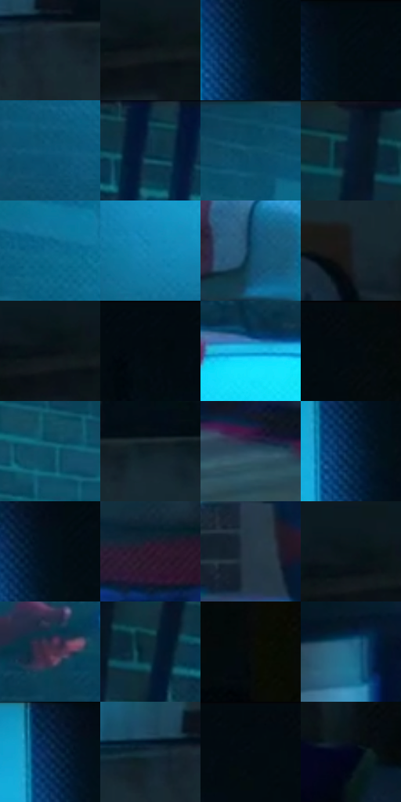

# 电影参考 235

- 状态：常规／活跃；来源世界：peter-b-home。
- 视角：near-level；景别：environment-wide；场景：interior。
- 时段：interior-time-unknown（外观依据，中置信度；具体时间／晨昏未知）；光照：cool-interior。
- 材质候选：skin, fabric, brick, plastic（帧级，不是像素分割）。
- 明暗组：very-dark；L* P5/P50/P95：2.41518 / 14.55037 / 51.36559。
- 资格门禁：无附加门禁。
- 原截图 SHA-256：`5c5fe8392833484ebfa9970f1b72be2bc02fe9c02cfdff700da6f857c6d95b5e`；尺寸：2880 × 1208。
- sRGB 像素 SHA-256：`5bff6ab4f702d9c3233174242e55d40ed20b04fe8debd05d919dab487d87ad80`。

## 观察与迁移

蓝色屏幕照明与深暗周边，非统一夜景滤镜。

235／12  /  屏光室内；冷光材质  /  青蓝受光集中于床面、人体朝光面和邻墙；前景椅、地板、收纳箱保持暗形。  /  亮床面是受光，不是床垫自发光，不把布料画成塑料。

本公开版保存32个128×128原像素色卡上下文；图集格子并非原场景相邻位置。原rect、图集tile和像素SHA见 `data/palette-crops.json`。上下文不足时不得批准替色，不能以小样推断完整构图。

## 实测色卡

颜色比例分母为保留采样像素，不是材料面积；全部 32 色参与全库匹配。表内四舍五入仅用于阅读，原精度在 JSON。

| ID | HEX | Lab | 原图 xy | 像素数 | 比例 | 明度角色 |
| --- | --- | --- | --- | ---: | ---: | --- |
| 235-S01 | #192932 | [15.606028, -3.71947, -7.950959] | [2140, 552] | 13391 | 6.925926% | deep-shadow |
| 235-S02 | #10181D | [7.696929, -1.961671, -4.694473] | [2788, 100] | 9650 | 4.991052% | deep-shadow |
| 235-S03 | #041522 | [6.12039, -1.522574, -10.968211] | [1952, 120] | 8560 | 4.427296% | deep-shadow |
| 235-S04 | #040E14 | [3.526128, -1.544777, -4.210541] | [1996, 52] | 8258 | 4.271099% | deep-shadow |
| 235-S05 | #0E5679 | [34.249043, -7.422995, -25.684152] | [1576, 412] | 7788 | 4.028012% | shadow |
| 235-S06 | #0F3D50 | [23.730302, -7.921464, -15.918178] | [432, 32] | 7662 | 3.962844% | shadow |
| 235-S07 | #11516B | [31.954024, -9.553752, -20.528212] | [1368, 60] | 7123 | 3.684069% | shadow |
| 235-S08 | #071A2C | [8.702416, -0.249494, -14.409698] | [232, 32] | 6839 | 3.537182% | deep-shadow |
| 235-S09 | #0D698F | [41.485826, -10.386842, -27.754051] | [1564, 188] | 6836 | 3.535630% | midtone |
| 235-S10 | #1787B3 | [52.688549, -13.531695, -31.358095] | [1788, 412] | 6766 | 3.499426% | midtone |
| 235-S11 | #0E4160 | [25.915581, -4.157843, -22.959773] | [880, 836] | 6739 | 3.485461% | shadow |
| 235-S12 | #181C22 | [10.108379, -0.107764, -4.737293] | [2224, 812] | 6240 | 3.227375% | deep-shadow |
| 235-S13 | #080F16 | [4.075403, -0.536713, -4.759725] | [2772, 92] | 5994 | 3.100142% | deep-shadow |
| 235-S14 | #030C12 | [2.944265, -1.296407, -3.796931] | [2200, 44] | 5880 | 3.041180% | deep-shadow |
| 235-S15 | #1CBBE8 | [70.60072, -22.541772, -33.111282] | [1356, 732] | 5748 | 2.972909% | light |
| 235-S16 | #040B0C | [2.634762, -1.686197, -1.058349] | [2380, 28] | 5641 | 2.917567% | deep-shadow |
| 235-S17 | #094C64 | [29.778843, -10.022408, -19.492987] | [1056, 132] | 5606 | 2.899465% | shadow |
| 235-S18 | #101E26 | [10.398337, -3.223544, -7.312947] | [2232, 532] | 5524 | 2.857054% | deep-shadow |
| 235-S19 | #2E4E63 | [31.646963, -5.164007, -15.868109] | [740, 1008] | 5482 | 2.835331% | shadow |
| 235-S20 | #092C4E | [17.502807, 2.031554, -24.383815] | [1928, 132] | 5372 | 2.778439% | deep-shadow |
| 235-S21 | #020F1A | [3.875919, -1.049056, -8.161506] | [1964, 76] | 5246 | 2.713271% | deep-shadow |
| 235-S22 | #311B30 | [13.533421, 15.02168, -9.477339] | [1664, 776] | 4982 | 2.576728% | deep-shadow |
| 235-S23 | #263746 | [22.254195, -2.259753, -11.451377] | [812, 636] | 4905 | 2.536903% | shadow |
| 235-S24 | #0A1519 | [6.061173, -2.828151, -4.110461] | [2760, 68] | 4903 | 2.535868% | deep-shadow |
| 235-S25 | #4C3248 | [24.594532, 15.932324, -8.880677] | [1412, 540] | 4787 | 2.475872% | shadow |
| 235-S26 | #0D2B39 | [16.046805, -5.651646, -12.234887] | [316, 84] | 4781 | 2.472769% | deep-shadow |
| 235-S27 | #070C0B | [3.001338, -1.488316, -0.059276] | [2608, 212] | 4464 | 2.308814% | deep-shadow |
| 235-S28 | #226989 | [41.607823, -10.513607, -23.931903] | [340, 732] | 4320 | 2.234336% | midtone |
| 235-S29 | #031D3C | [10.734346, 4.099335, -22.755719] | [1912, 36] | 4038 | 2.088484% | deep-shadow |
| 235-S30 | #172F3D | [18.151775, -4.457149, -11.718575] | [2080, 524] | 3664 | 1.895048% | deep-shadow |
| 235-S31 | #02090F | [2.192727, -0.893754, -3.194548] | [2300, 28] | 3120 | 1.613687% | deep-shadow |
| 235-S32 | #01051B | [1.753183, 3.279447, -12.097845] | [2500, 1060] | 3037 | 1.570759% | deep-shadow |

## 色阶与空间分布

- 采样 ROI：`[0.01, 0.02, 0.98, 0.94]`；步长：4；样本数：193346。
- 排除区：`[]`。
- 深暗、暗、中、亮、高光五段计数：`[120836, 52461, 14217, 5001, 831]`。
- RGB 各 256 箱、L* 100 箱、13×5 色相明度表和 3×3 空间统计全部保存在 [总数据](../film-library.json)。
- [可视化档案](../../references/library.html)按需绘制直方图，不存 2,094 张重复图表图片。

## 纹理特征占比

**这是分块图像特征的面积占比，不是波点／排线／丝网／错版的精确语义覆盖率。** 窗格、发丝、织物也会产生方向或周期特征。
原图 ROI 像素 3104134；已测块覆盖 3104134（100.0000%）；未测 0。

| 特征 | 块覆盖像素 | 占已测面积 | 阈值敏感范围 |
| --- | ---: | ---: | --- |
| low-contrast | 492032 | 15.8509% | 12.2469% ~ 18.1685% |
| directional-structure | 448896 | 14.4612% | 3.3566% ~ 24.5886% |
| periodic-structure | 2163206 | 69.6879% | 62.6367% ~ 73.1968% |
| mixed-detail | 0 | 0.0000% | 0.0000% ~ 5.2781% |

阈值敏感范围不是统计置信区间。逐块坐标、尺度、对比、方向一致性、频谱集中度、频率与角度见 [全量特征记录](../texture-features.jsonl)，以帧号定位。
四种印刷层的真实像素覆盖仍标为 `null`，不能填 0，也不能拿上表代替。不得据这些代理测量删除唯一证据。

[测量方法与保留策略](../../references/library-retention.md) · [分类索引](../archive/README.md)
