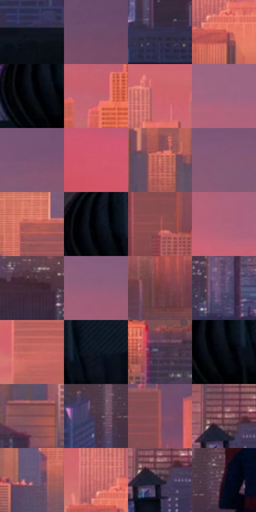

# 电影参考 236

- 状态：常规／活跃；来源世界：peter-b-home。
- 视角：near-level；景别：environment-wide；场景：city。
- 时段：low-sun-time-unspecified（外观依据，中置信度；具体时间／晨昏未知）；光照：warm-day。
- 材质候选：skin, fabric, stone, glass, sky（帧级，不是像素分割）。
- 明暗组：middle；L* P5/P50/P95：3.40244 / 41.04146 / 57.62801。
- 资格门禁：无附加门禁。
- 原截图 SHA-256：`07ca8fed397f5370baa9640ac0fc865f7f22aa7cfa2858cc0029f07cd00c9a35`；尺寸：2880 × 1210。
- sRGB 像素 SHA-256：`7fa3ce1365ca8ac3429b2fc5486356672fd903d69a9af7c47dd289c16f927cbb`。

## 观察与迁移

暖日暮天空与深暗屋顶，远楼减细节但保体量。

236／13  /  夕照城市；远近层次  /  粉橙天空与暖楼面后有灰紫冷暗面，屋顶／人影为暗锚点，远窗不逐格同锐。  /  不把夕照套到所有日光照片，不增加高楼。

本公开版保存32个128×128原像素色卡上下文；图集格子并非原场景相邻位置。原rect、图集tile和像素SHA见 `data/palette-crops.json`。上下文不足时不得批准替色，不能以小样推断完整构图。

## 实测色卡

颜色比例分母为保留采样像素，不是材料面积；全部 32 色参与全库匹配。表内四舍五入仅用于阅读，原精度在 JSON。

| ID | HEX | Lab | 原图 xy | 像素数 | 比例 | 明度角色 |
| --- | --- | --- | --- | ---: | ---: | --- |
| 236-S01 | #10151F | [6.732987, 0.844527, -7.675566] | [860, 964] | 9690 | 4.993713% | deep-shadow |
| 236-S02 | #6E4C67 | [36.861889, 19.178588, -9.926856] | [2600, 124] | 9021 | 4.648946% | shadow |
| 236-S03 | #333150 | [21.870082, 9.385299, -18.657674] | [1616, 896] | 8727 | 4.497434% | shadow |
| 236-S04 | #CF5A56 | [53.225657, 46.047619, 25.456778] | [1204, 556] | 8542 | 4.402094% | midtone |
| 236-S05 | #0B0F17 | [4.28734, 0.504083, -5.160358] | [196, 904] | 8508 | 4.384573% | deep-shadow |
| 236-S06 | #C06371 | [53.303512, 38.587617, 9.322657] | [1656, 472] | 8477 | 4.368597% | midtone |
| 236-S07 | #D1636E | [55.693487, 44.419401, 14.793965] | [1244, 444] | 8176 | 4.213477% | midtone |
| 236-S08 | #A06480 | [49.674831, 28.273398, -5.376464] | [1276, 156] | 7919 | 4.081033% | midtone |
| 236-S09 | #7C5573 | [41.248566, 21.351247, -10.578126] | [2196, 136] | 7825 | 4.032591% | midtone |
| 236-S10 | #D3586E | [53.982277, 50.377106, 12.462081] | [540, 120] | 7299 | 3.761518% | midtone |
| 236-S11 | #DA7C72 | [62.11677, 35.343926, 21.475478] | [432, 536] | 6947 | 3.580116% | light |
| 236-S12 | #865A78 | [43.853994, 23.043086, -9.589069] | [2088, 180] | 6811 | 3.510029% | midtone |
| 236-S13 | #AC5751 | [47.214216, 34.09157, 19.505872] | [260, 480] | 6462 | 3.330173% | midtone |
| 236-S14 | #04070F | [1.917188, 0.430366, -3.582907] | [208, 864] | 6271 | 3.231741% | deep-shadow |
| 236-S15 | #984E4F | [42.292963, 30.921563, 13.562582] | [2564, 532] | 6202 | 3.196182% | midtone |
| 236-S16 | #AE637A | [51.070376, 33.092199, 0.455588] | [1384, 328] | 6031 | 3.108058% | midtone |
| 236-S17 | #402A39 | [20.209219, 13.087661, -5.482443] | [2268, 776] | 5671 | 2.922533% | shadow |
| 236-S18 | #925F7A | [46.580446, 24.945357, -6.569014] | [1788, 172] | 5610 | 2.891097% | midtone |
| 236-S19 | #743D40 | [32.747933, 24.31455, 8.944836] | [2240, 632] | 5564 | 2.867391% | shadow |
| 236-S20 | #534768 | [32.579495, 12.598188, -17.361283] | [2392, 860] | 5473 | 2.820494% | shadow |
| 236-S21 | #CB6D64 | [56.641334, 36.167316, 21.750975] | [960, 448] | 5427 | 2.796788% | midtone |
| 236-S22 | #0A141F | [5.995345, -0.339918, -8.833904] | [320, 872] | 5332 | 2.747830% | deep-shadow |
| 236-S23 | #513C54 | [28.43612, 14.071975, -10.899045] | [1052, 756] | 5299 | 2.730824% | shadow |
| 236-S24 | #080C13 | [3.266009, 0.223305, -3.913807] | [232, 900] | 5161 | 2.659706% | deep-shadow |
| 236-S25 | #7C4A52 | [37.467845, 22.332898, 4.349221] | [508, 700] | 4960 | 2.556121% | shadow |
| 236-S26 | #483448 | [24.644778, 13.023844, -8.851832] | [1232, 872] | 4428 | 2.281957% | shadow |
| 236-S27 | #A65D65 | [48.104863, 30.634498, 8.609395] | [2600, 380] | 4097 | 2.111377% | midtone |
| 236-S28 | #8C5761 | [43.146493, 23.31164, 3.489718] | [600, 832] | 3778 | 1.946981% | midtone |
| 236-S29 | #6E5475 | [39.479568, 17.223996, -14.640716] | [172, 592] | 3508 | 1.807837% | shadow |
| 236-S30 | #C56362 | [53.684669, 38.906726, 18.78746] | [1168, 500] | 3185 | 1.641380% | midtone |
| 236-S31 | #201E2D | [12.123436, 5.119821, -9.661187] | [608, 872] | 2089 | 1.076560% | deep-shadow |
| 236-S32 | #1F0F18 | [6.313575, 9.63085, -2.722412] | [1336, 844] | 1554 | 0.800849% | deep-shadow |

## 色阶与空间分布

- 采样 ROI：`[0.01, 0.02, 0.98, 0.94]`；步长：4；样本数：194044。
- 排除区：`[]`。
- 深暗、暗、中、亮、高光五段计数：`[43223, 49157, 95916, 5743, 5]`。
- RGB 各 256 箱、L* 100 箱、13×5 色相明度表和 3×3 空间统计全部保存在 [总数据](../film-library.json)。
- [可视化档案](../../references/library.html)按需绘制直方图，不存 2,094 张重复图表图片。

## 纹理特征占比

**这是分块图像特征的面积占比，不是波点／排线／丝网／错版的精确语义覆盖率。** 窗格、发丝、织物也会产生方向或周期特征。
原图 ROI 像素 3109722；已测块覆盖 3109722（100.0000%）；未测 0。

| 特征 | 块覆盖像素 | 占已测面积 | 阈值敏感范围 |
| --- | ---: | ---: | --- |
| low-contrast | 731648 | 23.5278% | 21.9472% ~ 24.8849% |
| directional-structure | 161024 | 5.1781% | 2.6343% ~ 10.9736% |
| periodic-structure | 2011008 | 64.6684% | 55.8723% ~ 64.6684% |
| mixed-detail | 206042 | 6.6257% | 3.4646% ~ 16.6086% |

阈值敏感范围不是统计置信区间。逐块坐标、尺度、对比、方向一致性、频谱集中度、频率与角度见 [全量特征记录](../texture-features.jsonl)，以帧号定位。
四种印刷层的真实像素覆盖仍标为 `null`，不能填 0，也不能拿上表代替。不得据这些代理测量删除唯一证据。

[测量方法与保留策略](../../references/library-retention.md) · [分类索引](../archive/README.md)
