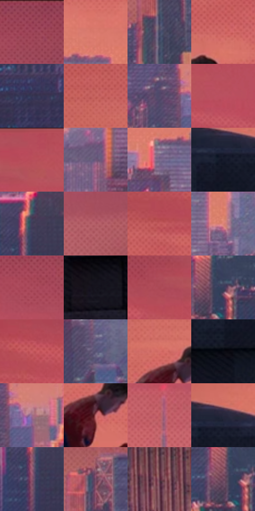

# 电影参考 237

- 状态：常规／活跃；来源世界：peter-b-home。
- 视角：near-level；景别：environment-wide；场景：city。
- 时段：low-sun-time-unspecified（外观依据，中置信度；具体时间／晨昏未知）；光照：warm-day。
- 材质候选：skin, fabric, stone, glass, sky（帧级，不是像素分割）。
- 明暗组：middle；L* P5/P50/P95：6.83818 / 44.56235 / 61.62639。
- 资格门禁：无附加门禁。
- 原截图 SHA-256：`58731f893498a52ca998dfa8c869eea80869c37625c4dd57bf0627ca742e4aaa`；尺寸：2880 × 1208。
- sRGB 像素 SHA-256：`c970513469ec486ce91a7f2b143852592c05cf767e61ef5685604ea0ba37a404`。

## 观察与迁移

暖日暮天空与深暗屋顶，远楼减细节但保体量。

237／14  /  夕照侧景；纹理频段  /  近檐口大折面与阴影排线、远楼细窗组、天空点层分开，人物保持暗剪影。  /  不满图平铺大点，不把原照人物挪到屋顶边缘。

本公开版保存32个128×128原像素色卡上下文；图集格子并非原场景相邻位置。原rect、图集tile和像素SHA见 `data/palette-crops.json`。上下文不足时不得批准替色，不能以小样推断完整构图。

## 实测色卡

颜色比例分母为保留采样像素，不是材料面积；全部 32 色参与全库匹配。表内四舍五入仅用于阅读，原精度在 JSON。

| ID | HEX | Lab | 原图 xy | 像素数 | 比例 | 明度角色 |
| --- | --- | --- | --- | ---: | ---: | --- |
| 237-S01 | #9A4458 | [40.752435, 37.948644, 5.882189] | [2192, 28] | 9803 | 5.070185% | midtone |
| 237-S02 | #DA796D | [61.384114, 36.441258, 23.31867] | [1404, 504] | 9334 | 4.827615% | light |
| 237-S03 | #424664 | [30.540743, 6.311685, -18.099992] | [2728, 756] | 8407 | 4.348163% | shadow |
| 237-S04 | #D06766 | [56.161035, 41.313792, 20.072876] | [680, 280] | 8367 | 4.327475% | midtone |
| 237-S05 | #343451 | [22.930306, 7.962399, -17.66112] | [936, 1064] | 8182 | 4.231792% | shadow |
| 237-S06 | #C76460 | [54.137354, 38.95978, 20.614756] | [384, 260] | 8145 | 4.212655% | midtone |
| 237-S07 | #524869 | [32.806628, 11.864392, -17.650919] | [2148, 688] | 7993 | 4.134039% | shadow |
| 237-S08 | #BB5060 | [48.447844, 44.583295, 12.554526] | [1352, 112] | 7770 | 4.018702% | midtone |
| 237-S09 | #B94D5A | [47.447252, 44.766596, 14.749595] | [1196, 60] | 7478 | 3.867678% | midtone |
| 237-S10 | #6E5779 | [40.429759, 16.278314, -15.645129] | [972, 716] | 7433 | 3.844403% | midtone |
| 237-S11 | #7B6A8D | [47.549266, 13.896059, -16.716769] | [1612, 604] | 7375 | 3.814405% | midtone |
| 237-S12 | #161A2A | [9.612918, 3.312123, -11.434928] | [216, 596] | 7159 | 3.702688% | deep-shadow |
| 237-S13 | #423B59 | [26.755698, 10.422356, -16.875943] | [1340, 924] | 7132 | 3.688724% | shadow |
| 237-S14 | #AF5963 | [48.463294, 35.98184, 10.497958] | [2632, 412] | 6517 | 3.370641% | midtone |
| 237-S15 | #C3595D | [51.313441, 42.768926, 18.47459] | [724, 164] | 6493 | 3.358228% | midtone |
| 237-S16 | #DD8377 | [64.112553, 33.296229, 21.422862] | [1464, 656] | 6420 | 3.320472% | light |
| 237-S17 | #AC4D5D | [45.457027, 40.42972, 9.84906] | [1896, 68] | 6392 | 3.305990% | midtone |
| 237-S18 | #18121C | [6.419224, 5.206249, -5.769639] | [32, 1088] | 6329 | 3.273406% | deep-shadow |
| 237-S19 | #AB4954 | [44.326659, 41.177119, 13.758746] | [996, 80] | 5761 | 2.979632% | midtone |
| 237-S20 | #373D5B | [26.461812, 5.955558, -18.711163] | [1828, 908] | 5542 | 2.866364% | shadow |
| 237-S21 | #CA5C63 | [53.075213, 44.344563, 17.496342] | [820, 116] | 5454 | 2.820850% | midtone |
| 237-S22 | #595375 | [37.104644, 10.425336, -18.464952] | [1688, 772] | 5443 | 2.815160% | shadow |
| 237-S23 | #D56F6A | [58.564136, 39.455029, 21.12563] | [556, 344] | 4923 | 2.546212% | midtone |
| 237-S24 | #090A13 | [2.910079, 1.331037, -4.42655] | [160, 716] | 4794 | 2.479493% | deep-shadow |
| 237-S25 | #9D6E8D | [52.111958, 23.701256, -9.475898] | [2236, 704] | 3997 | 2.067278% | midtone |
| 237-S26 | #C16D70 | [55.530075, 33.570249, 13.055408] | [588, 408] | 3521 | 1.821088% | midtone |
| 237-S27 | #BC5B60 | [50.711596, 39.474026, 15.701241] | [2108, 376] | 3297 | 1.705233% | midtone |
| 237-S28 | #28283D | [17.015336, 5.910316, -13.374753] | [252, 560] | 3273 | 1.692820% | deep-shadow |
| 237-S29 | #8C566D | [43.265463, 25.723493, -3.681793] | [1324, 1000] | 2984 | 1.543347% | midtone |
| 237-S30 | #754A64 | [37.115037, 22.479309, -7.580724] | [2744, 612] | 2914 | 1.507143% | shadow |
| 237-S31 | #623444 | [28.035395, 22.810381, -0.764564] | [2772, 1100] | 2368 | 1.224747% | shadow |
| 237-S32 | #6A4259 | [33.312419, 21.065611, -6.461899] | [1796, 916] | 2346 | 1.213369% | shadow |

## 色阶与空间分布

- 采样 ROI：`[0.01, 0.02, 0.98, 0.94]`；步长：4；样本数：193346。
- 排除区：`[]`。
- 深暗、暗、中、亮、高光五段计数：`[21192, 56475, 100353, 15314, 12]`。
- RGB 各 256 箱、L* 100 箱、13×5 色相明度表和 3×3 空间统计全部保存在 [总数据](../film-library.json)。
- [可视化档案](../../references/library.html)按需绘制直方图，不存 2,094 张重复图表图片。

## 纹理特征占比

**这是分块图像特征的面积占比，不是波点／排线／丝网／错版的精确语义覆盖率。** 窗格、发丝、织物也会产生方向或周期特征。
原图 ROI 像素 3104134；已测块覆盖 3104134（100.0000%）；未测 0。

| 特征 | 块覆盖像素 | 占已测面积 | 阈值敏感范围 |
| --- | ---: | ---: | --- |
| low-contrast | 193792 | 6.2430% | 4.7503% ~ 8.3543% |
| directional-structure | 151046 | 4.8660% | 3.3732% ~ 8.9194% |
| periodic-structure | 2234112 | 71.9722% | 62.7890% ~ 79.6378% |
| mixed-detail | 525184 | 16.9189% | 6.6925% ~ 25.4834% |

阈值敏感范围不是统计置信区间。逐块坐标、尺度、对比、方向一致性、频谱集中度、频率与角度见 [全量特征记录](../texture-features.jsonl)，以帧号定位。
四种印刷层的真实像素覆盖仍标为 `null`，不能填 0，也不能拿上表代替。不得据这些代理测量删除唯一证据。

[测量方法与保留策略](../../references/library-retention.md) · [分类索引](../archive/README.md)
