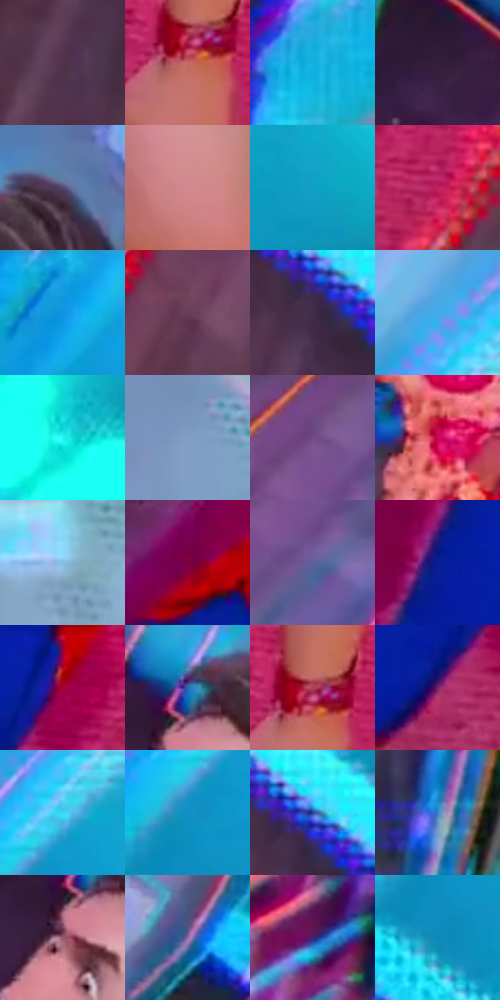

# 电影参考 238

- 状态：条件／活跃；来源世界：peter-b-home。
- 视角：rolled-or-dutch；景别：medium；场景：interior。
- 时段：event-time-unknown（外观依据，中置信度；具体时间／晨昏未知）；光照：event-light。
- 材质候选：skin, fabric, metal, paint（帧级，不是像素分割）。
- 明暗组：middle；L* P5/P50/P95：17.9619 / 44.3018 / 77.55813。
- 资格门禁：glitch。
- 原截图 SHA-256：`9fd6f76b5ca629837dd6405ec3a0bde7e715ec3f39449177c89bedc106a82bf7`；尺寸：2880 × 1206。
- sRGB 像素 SHA-256：`3b15087347bc81396945e770c3fc89fba981fde69140f60addcce21edf7c1782`。

## 观察与迁移

人体和环境异常分色，不能当日常皮肤色卡。

238／15  /  异常事件；稳定体积对照  /  身体／手持物局部碎片错位，环境有高能彩线，稳定躯干仍有暖肤体积。  /  不是常规双彩错版，不给普通照片添加破碎、漂浮或物件。

本公开版保存32个128×128原像素色卡上下文；图集格子并非原场景相邻位置。原rect、图集tile和像素SHA见 `data/palette-crops.json`。上下文不足时不得批准替色，不能以小样推断完整构图。

## 实测色卡

颜色比例分母为保留采样像素，不是材料面积；全部 32 色参与全库匹配。表内四舍五入仅用于阅读，原精度在 JSON。

| ID | HEX | Lab | 原图 xy | 像素数 | 比例 | 明度角色 |
| --- | --- | --- | --- | ---: | ---: | --- |
| 238-S01 | #53324E | [25.774653, 19.934949, -10.990815] | [2268, 976] | 9730 | 5.032429% | shadow |
| 238-S02 | #C56867 | [54.81722, 36.789972, 17.406024] | [1588, 1036] | 9094 | 4.703485% | midtone |
| 238-S03 | #17B1DE | [67.199235, -21.031053, -32.921194] | [2488, 1016] | 9025 | 4.667798% | light |
| 238-S04 | #331E3C | [15.268685, 16.738312, -15.300468] | [1000, 104] | 8560 | 4.427296% | deep-shadow |
| 238-S05 | #51466A | [32.191158, 13.071307, -19.242948] | [1356, 120] | 8486 | 4.389023% | shadow |
| 238-S06 | #D3898D | [64.696658, 28.784562, 9.642873] | [1504, 644] | 8089 | 4.183691% | light |
| 238-S07 | #129FC4 | [60.699764, -20.81185, -28.567809] | [2664, 568] | 7898 | 4.084905% | light |
| 238-S08 | #C11F5E | [42.956926, 64.104408, 6.214202] | [1732, 1092] | 7807 | 4.037839% | midtone |
| 238-S09 | #1398E1 | [59.913682, -6.509284, -45.980577] | [1748, 56] | 7532 | 3.895607% | midtone |
| 238-S10 | #693F58 | [32.399074, 22.316432, -7.20363] | [2000, 880] | 7518 | 3.888366% | shadow |
| 238-S11 | #412C49 | [21.602652, 15.845383, -14.257766] | [2328, 784] | 7512 | 3.885263% | shadow |
| 238-S12 | #46AAE8 | [66.423587, -9.408837, -39.5477] | [2272, 192] | 7512 | 3.885263% | light |
| 238-S13 | #24F4F2 | [87.718171, -45.879218, -12.413295] | [2808, 428] | 6703 | 3.466842% | highlight |
| 238-S14 | #819CC4 | [63.695138, 0.296369, -23.63305] | [108, 824] | 6618 | 3.422879% | light |
| 238-S15 | #704B85 | [38.146704, 27.038596, -26.508781] | [700, 820] | 6582 | 3.404260% | shadow |
| 238-S16 | #C70852 | [42.655708, 68.237754, 13.525342] | [584, 388] | 6277 | 3.246511% | midtone |
| 238-S17 | #84BDE3 | [74.089873, -8.776225, -24.769118] | [284, 1100] | 6223 | 3.218582% | light |
| 238-S18 | #7B003F | [25.476092, 49.67826, -0.612847] | [1076, 728] | 5968 | 3.086694% | shadow |
| 238-S19 | #5D639C | [43.727309, 12.603292, -31.756146] | [724, 912] | 5844 | 3.022561% | midtone |
| 238-S20 | #091D93 | [20.213134, 40.941289, -64.559466] | [1208, 1048] | 5756 | 2.977046% | shadow |
| 238-S21 | #AA0134 | [35.632344, 60.315653, 22.29318] | [1396, 1024] | 5609 | 2.901017% | shadow |
| 238-S22 | #2466B4 | [43.020192, 7.847003, -47.202194] | [1228, 160] | 5474 | 2.831194% | midtone |
| 238-S23 | #AE415B | [43.561573, 46.666212, 8.457939] | [1596, 1004] | 5445 | 2.816195% | midtone |
| 238-S24 | #79226A | [30.035752, 45.663933, -22.184407] | [1320, 1124] | 4270 | 2.208476% | shadow |
| 238-S25 | #39D6F5 | [79.357213, -29.559265, -26.607069] | [2252, 340] | 3772 | 1.950907% | light |
| 238-S26 | #148FC5 | [55.909217, -11.648246, -36.585237] | [2204, 432] | 3288 | 1.700578% | midtone |
| 238-S27 | #304093 | [30.402065, 21.966878, -47.7719] | [2348, 744] | 3214 | 1.662305% | shadow |
| 238-S28 | #4084CB | [53.922768, 1.551854, -43.044159] | [288, 652] | 2839 | 1.468352% | midtone |
| 238-S29 | #9A5C6E | [46.513892, 27.781711, 0.68925] | [1204, 236] | 2824 | 1.460594% | midtone |
| 238-S30 | #906FA8 | [51.978758, 24.120154, -25.606527] | [1504, 88] | 2688 | 1.390254% | midtone |
| 238-S31 | #40216D | [21.138333, 32.344977, -38.828375] | [180, 192] | 2644 | 1.367497% | shadow |
| 238-S32 | #0C8AB8 | [53.721519, -13.990591, -32.618832] | [2204, 520] | 2545 | 1.316293% | midtone |

## 色阶与空间分布

- 采样 ROI：`[0.01, 0.02, 0.98, 0.94]`；步长：4；样本数：193346。
- 排除区：`[]`。
- 深暗、暗、中、亮、高光五段计数：`[14041, 65252, 59801, 46004, 8248]`。
- RGB 各 256 箱、L* 100 箱、13×5 色相明度表和 3×3 空间统计全部保存在 [总数据](../film-library.json)。
- [可视化档案](../../references/library.html)按需绘制直方图，不存 2,094 张重复图表图片。

## 纹理特征占比

**这是分块图像特征的面积占比，不是波点／排线／丝网／错版的精确语义覆盖率。** 窗格、发丝、织物也会产生方向或周期特征。
原图 ROI 像素 3098546；已测块覆盖 3098546（100.0000%）；未测 0。

| 特征 | 块覆盖像素 | 占已测面积 | 阈值敏感范围 |
| --- | ---: | ---: | --- |
| low-contrast | 32768 | 1.0575% | 0.5288% ~ 2.9041% |
| directional-structure | 570624 | 18.4159% | 10.0465% ~ 34.3614% |
| periodic-structure | 2366898 | 76.3874% | 63.5235% ~ 79.9152% |
| mixed-detail | 128256 | 4.1392% | 1.5863% ~ 7.1342% |

阈值敏感范围不是统计置信区间。逐块坐标、尺度、对比、方向一致性、频谱集中度、频率与角度见 [全量特征记录](../texture-features.jsonl)，以帧号定位。
四种印刷层的真实像素覆盖仍标为 `null`，不能填 0，也不能拿上表代替。不得据这些代理测量删除唯一证据。

[测量方法与保留策略](../../references/library-retention.md) · [分类索引](../archive/README.md)
