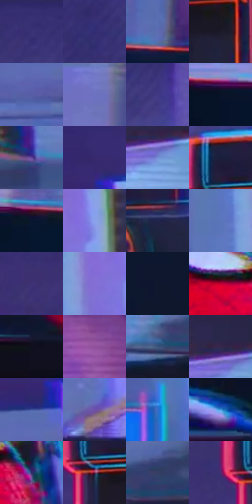

# 电影参考 239

- 状态：条件／活跃；来源世界：peter-b-home。
- 视角：low-angle；景别：detail；场景：detail。
- 时段：interior-time-unknown（外观依据，中置信度；具体时间／晨昏未知）；光照：cool-interior。
- 材质候选：plastic, glass, metal, fabric（帧级，不是像素分割）。
- 明暗组：dark；L* P5/P50/P95：6.31993 / 28.13443 / 62.10802。
- 资格门禁：strong-separation。
- 原截图 SHA-256：`0c39237d3b159f10dfecf783f37751339e5b38174a1d0384f3717f25d60300a6`；尺寸：2880 × 1206。
- sRGB 像素 SHA-256：`5939687f9198e8ad1920983d36451198fe917a08f2cf91d39aae85a72b0548c4`。

## 观察与迁移

相机与面罩边缘分色，稳定实体结构需保留。

239／16  /  异常事件；物件边界  /  相机／闪光灯外缘红青多重线与局部错接醒目，桌面物件仍有实体暗形。  /  不用整物复制边线满足常规错版，不添加参考摄影器材。

本公开版保存32个128×128原像素色卡上下文；图集格子并非原场景相邻位置。原rect、图集tile和像素SHA见 `data/palette-crops.json`。上下文不足时不得批准替色，不能以小样推断完整构图。

## 实测色卡

颜色比例分母为保留采样像素，不是材料面积；全部 32 色参与全库匹配。表内四舍五入仅用于阅读，原精度在 JSON。

| ID | HEX | Lab | 原图 xy | 像素数 | 比例 | 明度角色 |
| --- | --- | --- | --- | ---: | ---: | --- |
| 239-S01 | #383173 | [24.559904, 22.276484, -37.197419] | [1784, 40] | 10837 | 5.604978% | shadow |
| 239-S02 | #312C73 | [22.624927, 24.060427, -40.356273] | [1300, 320] | 9685 | 5.009155% | shadow |
| 239-S03 | #5C6BB1 | [46.927005, 13.77364, -39.073193] | [468, 420] | 9078 | 4.695210% | midtone |
| 239-S04 | #1D1929 | [9.926886, 6.407062, -10.154151] | [1980, 576] | 8734 | 4.517290% | deep-shadow |
| 239-S05 | #595DA5 | [42.259092, 18.018358, -39.433762] | [1040, 756] | 8585 | 4.440226% | midtone |
| 239-S06 | #6F75C2 | [51.832546, 17.611088, -41.054077] | [188, 56] | 8408 | 4.348681% | midtone |
| 239-S07 | #403985 | [28.666545, 24.841138, -41.882757] | [1940, 108] | 8054 | 4.165589% | shadow |
| 239-S08 | #071327 | [5.937566, 2.53064, -15.030865] | [108, 464] | 7748 | 4.007324% | deep-shadow |
| 239-S09 | #5D4394 | [34.961625, 30.225297, -40.844931] | [2600, 928] | 7726 | 3.995945% | shadow |
| 239-S10 | #362A6E | [22.180228, 24.787773, -37.840432] | [1080, 552] | 7607 | 3.934397% | shadow |
| 239-S11 | #788DD6 | [59.794706, 11.459659, -39.799041] | [2740, 316] | 7456 | 3.856299% | midtone |
| 239-S12 | #191D3A | [11.89614, 8.00013, -19.402978] | [1852, 436] | 7419 | 3.837162% | deep-shadow |
| 239-S13 | #0A1731 | [8.119722, 5.072634, -18.997913] | [256, 468] | 7197 | 3.722342% | deep-shadow |
| 239-S14 | #88A2EA | [67.286907, 9.085879, -39.075755] | [2472, 464] | 6612 | 3.419776% | light |
| 239-S15 | #20264C | [16.576902, 10.0968, -24.432679] | [1960, 876] | 6284 | 3.250132% | deep-shadow |
| 239-S16 | #5A75BA | [50.025372, 9.986215, -39.402886] | [2292, 484] | 6099 | 3.154449% | midtone |
| 239-S17 | #3F3175 | [25.374013, 24.632452, -37.126449] | [1636, 548] | 5865 | 3.033422% | shadow |
| 239-S18 | #8470D4 | [53.217996, 31.097187, -49.007215] | [2392, 516] | 5768 | 2.983253% | midtone |
| 239-S19 | #0F172D | [8.162263, 4.561858, -15.96963] | [544, 804] | 5618 | 2.905672% | deep-shadow |
| 239-S20 | #BB0231 | [39.298434, 64.26107, 29.491165] | [1192, 944] | 5592 | 2.892224% | shadow |
| 239-S21 | #10101D | [5.143593, 3.254446, -8.533768] | [688, 1112] | 5106 | 2.640861% | deep-shadow |
| 239-S22 | #91519B | [44.620264, 38.727866, -29.38208] | [708, 160] | 4531 | 2.343467% | midtone |
| 239-S23 | #3D557B | [35.826929, 2.346029, -24.321393] | [2328, 1036] | 4507 | 2.331054% | shadow |
| 239-S24 | #332749 | [18.522102, 14.197565, -19.189095] | [2716, 268] | 4443 | 2.297953% | deep-shadow |
| 239-S25 | #42569E | [38.342816, 14.796997, -41.597188] | [1056, 656] | 4103 | 2.122102% | shadow |
| 239-S26 | #6D4EAD | [40.762116, 34.660607, -46.454766] | [1496, 1020] | 4087 | 2.113827% | midtone |
| 239-S27 | #366AC9 | [46.052193, 15.420391, -54.475126] | [2264, 704] | 3821 | 1.976250% | midtone |
| 239-S28 | #3E98DB | [60.41982, -4.840821, -41.793732] | [404, 1040] | 3730 | 1.929184% | light |
| 239-S29 | #2F2D67 | [21.799479, 18.72557, -33.952889] | [1316, 960] | 2675 | 1.383530% | shadow |
| 239-S30 | #7B2243 | [28.802401, 40.978129, 1.532965] | [1844, 524] | 2366 | 1.223713% | shadow |
| 239-S31 | #383F66 | [27.722429, 8.455321, -23.836659] | [2464, 992] | 2080 | 1.075792% | shadow |
| 239-S32 | #4D286E | [24.389357, 31.762339, -34.143373] | [1768, 504] | 1525 | 0.788741% | shadow |

## 色阶与空间分布

- 采样 ROI：`[0.01, 0.02, 0.98, 0.94]`；步长：4；样本数：193346。
- 排除区：`[]`。
- 深暗、暗、中、亮、高光五段计数：`[51738, 72496, 56094, 12880, 138]`。
- RGB 各 256 箱、L* 100 箱、13×5 色相明度表和 3×3 空间统计全部保存在 [总数据](../film-library.json)。
- [可视化档案](../../references/library.html)按需绘制直方图，不存 2,094 张重复图表图片。

## 纹理特征占比

**这是分块图像特征的面积占比，不是波点／排线／丝网／错版的精确语义覆盖率。** 窗格、发丝、织物也会产生方向或周期特征。
原图 ROI 像素 3098546；已测块覆盖 3098546（100.0000%）；未测 0。

| 特征 | 块覆盖像素 | 占已测面积 | 阈值敏感范围 |
| --- | ---: | ---: | --- |
| low-contrast | 631602 | 20.3838% | 16.9205% ~ 21.7925% |
| directional-structure | 1238400 | 39.9671% | 27.6362% ~ 48.4496% |
| periodic-structure | 1212160 | 39.1203% | 34.6299% ~ 48.4563% |
| mixed-detail | 16384 | 0.5288% | 0.0000% ~ 2.1151% |

阈值敏感范围不是统计置信区间。逐块坐标、尺度、对比、方向一致性、频谱集中度、频率与角度见 [全量特征记录](../texture-features.jsonl)，以帧号定位。
四种印刷层的真实像素覆盖仍标为 `null`，不能填 0，也不能拿上表代替。不得据这些代理测量删除唯一证据。

[测量方法与保留策略](../../references/library-retention.md) · [分类索引](../archive/README.md)
