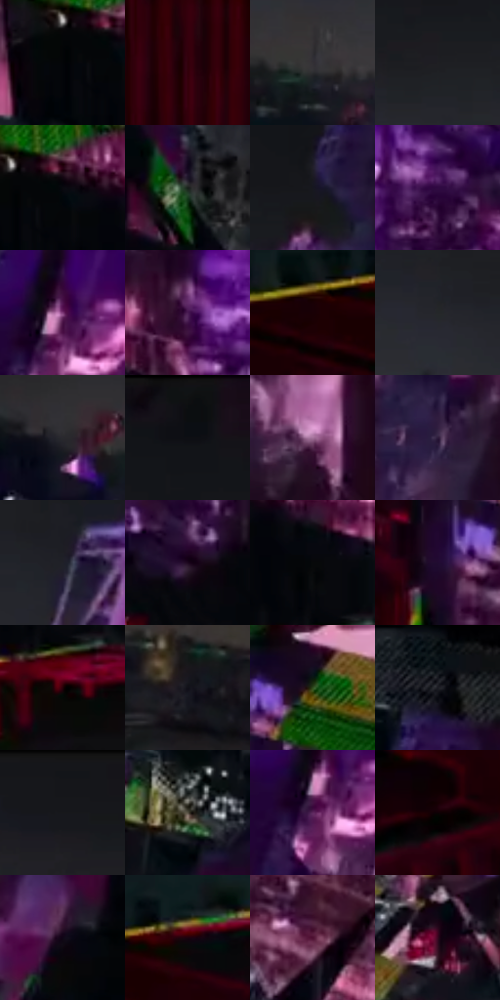

# 电影参考 240

- 状态：条件／仅归档；来源世界：archive-only。
- 视角：high-angle；景别：environment-wide；场景：graphic。
- 时段：event-time-unknown（外观依据，中置信度；具体时间／晨昏未知）；光照：event-light。
- 材质候选：glass, stone, fabric（帧级，不是像素分割）。
- 明暗组：very-dark；L* P5/P50/P95：1.27372 / 8.87171 / 38.47156。
- 资格门禁：archive。
- 原截图 SHA-256：`a68187c865269f91e5b7261f0df901e3afdcbc83ee32159914d69305ab1345cc`；尺寸：2880 × 1204。
- sRGB 像素 SHA-256：`e1811a66539946a722038e731b4400441be1128cfb166fd4ed9996bca54a7338`。

## 观察与迁移

跨世界坍塌与过渡，仅归档不作日常替色来源。

本公开版保存32个128×128原像素色卡上下文；图集格子并非原场景相邻位置。原rect、图集tile和像素SHA见 `data/palette-crops.json`。上下文不足时不得批准替色，不能以小样推断完整构图。

## 实测色卡

颜色比例分母为保留采样像素，不是材料面积；全部 32 色参与全库匹配。表内四舍五入仅用于阅读，原精度在 JSON。

| ID | HEX | Lab | 原图 xy | 像素数 | 比例 | 明度角色 |
| --- | --- | --- | --- | ---: | ---: | --- |
| 240-S01 | #030407 | [1.097746, 0.155563, -1.227277] | [380, 336] | 10912 | 5.664217% | deep-shadow |
| 240-S02 | #31010A | [6.294122, 24.464383, 5.825442] | [772, 792] | 10851 | 5.632553% | deep-shadow |
| 240-S03 | #343035 | [20.444035, 2.932109, -2.533623] | [1324, 280] | 10229 | 5.309684% | shadow |
| 240-S04 | #1F1F22 | [11.869274, 0.773823, -2.032903] | [1420, 96] | 8389 | 4.354574% | deep-shadow |
| 240-S05 | #09090F | [2.600888, 0.936742, -2.549578] | [432, 316] | 8030 | 4.168224% | deep-shadow |
| 240-S06 | #171F19 | [10.793502, -5.247509, 2.912764] | [1668, 908] | 7629 | 3.960072% | deep-shadow |
| 240-S07 | #161720 | [8.017897, 2.172453, -6.429131] | [2760, 172] | 7302 | 3.790333% | deep-shadow |
| 240-S08 | #300A42 | [10.840838, 29.149431, -26.61001] | [796, 232] | 7222 | 3.748806% | deep-shadow |
| 240-S09 | #7F3978 | [35.586775, 39.196241, -22.317613] | [2536, 620] | 7172 | 3.722852% | shadow |
| 240-S10 | #491B53 | [19.329072, 31.249846, -24.494284] | [656, 304] | 7080 | 3.675097% | deep-shadow |
| 240-S11 | #190005 | [1.966419, 9.070394, 1.058851] | [212, 528] | 6843 | 3.552074% | deep-shadow |
| 240-S12 | #242729 | [15.414534, -0.832544, -1.780389] | [2448, 280] | 6588 | 3.419708% | deep-shadow |
| 240-S13 | #29292E | [16.770036, 1.25285, -3.250125] | [1172, 264] | 6490 | 3.368839% | deep-shadow |
| 240-S14 | #0B0E13 | [3.904268, 0.07098, -2.960642] | [2632, 52] | 6344 | 3.293053% | deep-shadow |
| 240-S15 | #A4739B | [54.57598, 25.915678, -13.880593] | [2768, 1024] | 6150 | 3.192351% | midtone |
| 240-S16 | #2E1C3B | [13.98469, 16.027614, -16.65799] | [2688, 832] | 5836 | 3.029359% | deep-shadow |
| 240-S17 | #202029 | [12.609149, 2.442726, -6.0173] | [2640, 288] | 5753 | 2.986275% | deep-shadow |
| 240-S18 | #1D081F | [4.822141, 13.657602, -10.44356] | [940, 492] | 5674 | 2.945268% | deep-shadow |
| 240-S19 | #07090A | [2.370731, -0.384111, -0.562404] | [528, 380] | 5509 | 2.859620% | deep-shadow |
| 240-S20 | #200B31 | [6.938776, 19.759322, -20.764722] | [1020, 844] | 5091 | 2.642644% | deep-shadow |
| 240-S21 | #240008 | [3.547385, 16.311523, 2.327996] | [548, 488] | 5051 | 2.621880% | deep-shadow |
| 240-S22 | #111118 | [5.293338, 1.616139, -4.398771] | [1732, 376] | 5005 | 2.598003% | deep-shadow |
| 240-S23 | #304E1F | [29.852098, -21.001898, 24.032645] | [1128, 732] | 4937 | 2.562705% | shadow |
| 240-S24 | #191C21 | [10.160194, 0.01479, -3.907556] | [100, 52] | 4873 | 2.529484% | deep-shadow |
| 240-S25 | #131519 | [6.729084, 0.167254, -3.051366] | [1664, 28] | 4722 | 2.451103% | deep-shadow |
| 240-S26 | #575145 | [34.683059, 0.175905, 7.957226] | [1632, 712] | 4342 | 2.253852% | shadow |
| 240-S27 | #5E295F | [26.134158, 32.600612, -21.493576] | [2520, 660] | 4264 | 2.213363% | shadow |
| 240-S28 | #0D0104 | [1.04839, 3.623052, -0.005635] | [332, 732] | 3479 | 1.805884% | deep-shadow |
| 240-S29 | #0F0617 | [2.652693, 5.637157, -7.514349] | [1824, 964] | 3020 | 1.567626% | deep-shadow |
| 240-S30 | #1D020C | [2.99211, 11.468311, -0.281384] | [320, 500] | 2928 | 1.519870% | deep-shadow |
| 240-S31 | #4E1032 | [16.60672, 31.954869, -5.757109] | [1188, 1100] | 2667 | 1.384390% | deep-shadow |
| 240-S32 | #37061F | [9.333495, 26.218248, -3.149194] | [1336, 704] | 2266 | 1.176239% | deep-shadow |

## 色阶与空间分布

- 采样 ROI：`[0.01, 0.02, 0.98, 0.94]`；步长：4；样本数：192648。
- 排除区：`[]`。
- 深暗、暗、中、亮、高光五段计数：`[154485, 29784, 6697, 1538, 144]`。
- RGB 各 256 箱、L* 100 箱、13×5 色相明度表和 3×3 空间统计全部保存在 [总数据](../film-library.json)。
- [可视化档案](../../references/library.html)按需绘制直方图，不存 2,094 张重复图表图片。

## 纹理特征占比

**这是分块图像特征的面积占比，不是波点／排线／丝网／错版的精确语义覆盖率。** 窗格、发丝、织物也会产生方向或周期特征。
原图 ROI 像素 3092958；已测块覆盖 3092958（100.0000%）；未测 0。

| 特征 | 块覆盖像素 | 占已测面积 | 阈值敏感范围 |
| --- | ---: | ---: | --- |
| low-contrast | 353792 | 11.4386% | 4.0515% ~ 17.4228% |
| directional-structure | 283392 | 9.1625% | 3.7080% ~ 23.6884% |
| periodic-structure | 2357470 | 76.2206% | 66.2469% ~ 76.2206% |
| mixed-detail | 98304 | 3.1783% | 1.5892% ~ 12.6222% |

阈值敏感范围不是统计置信区间。逐块坐标、尺度、对比、方向一致性、频谱集中度、频率与角度见 [全量特征记录](../texture-features.jsonl)，以帧号定位。
四种印刷层的真实像素覆盖仍标为 `null`，不能填 0，也不能拿上表代替。不得据这些代理测量删除唯一证据。

[测量方法与保留策略](../../references/library-retention.md) · [分类索引](../archive/README.md)
