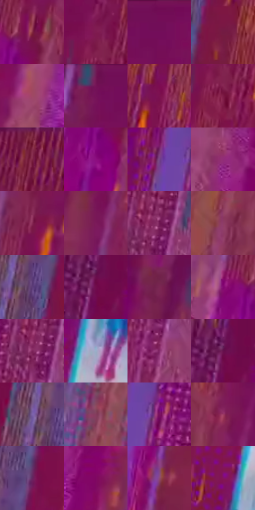

# 电影参考 241

- 状态：条件／仅归档；来源世界：archive-only。
- 视角：graphic-nonphysical；景别：graphic-or-multipanel；场景：graphic。
- 时段：event-time-unknown（外观依据，中置信度；具体时间／晨昏未知）；光照：event-light。
- 材质候选：glass, stone, fabric（帧级，不是像素分割）。
- 明暗组：dark；L* P5/P50/P95：24.46296 / 30.22386 / 44.34026。
- 资格门禁：archive。
- 原截图 SHA-256：`74a783469fb46b93d766ec510126c9788c9f42da3790cc73447838bd255e183a`；尺寸：2880 × 1202。
- sRGB 像素 SHA-256：`413563d87a976ad72537401b66080c85a6d26bc9633da5d24906e6a79bf4c183`。

## 观察与迁移

跨世界坍塌与过渡，仅归档不作日常替色来源。

本公开版保存32个128×128原像素色卡上下文；图集格子并非原场景相邻位置。原rect、图集tile和像素SHA见 `data/palette-crops.json`。上下文不足时不得批准替色，不能以小样推断完整构图。

## 实测色卡

颜色比例分母为保留采样像素，不是材料面积；全部 32 色参与全库匹配。表内四舍五入仅用于阅读，原精度在 JSON。

| ID | HEX | Lab | 原图 xy | 像素数 | 比例 | 明度角色 |
| --- | --- | --- | --- | ---: | ---: | --- |
| 241-S01 | #8C3345 | [34.750595, 39.351189, 9.109666] | [1392, 476] | 12382 | 6.427266% | shadow |
| 241-S02 | #801B51 | [29.332537, 46.625772, -6.868359] | [512, 388] | 9158 | 4.753748% | shadow |
| 241-S03 | #730D57 | [25.628643, 47.909715, -16.731859] | [1588, 32] | 8582 | 4.454757% | shadow |
| 241-S04 | #731B42 | [26.224588, 41.118696, -1.748201] | [368, 852] | 8540 | 4.432955% | shadow |
| 241-S05 | #A04865 | [42.838083, 39.581239, 0.939081] | [2216, 688] | 8522 | 4.423612% | midtone |
| 241-S06 | #741755 | [26.685128, 45.157825, -13.75732] | [1512, 36] | 8141 | 4.225842% | shadow |
| 241-S07 | #7B124F | [27.322702, 47.693984, -8.668107] | [704, 356] | 7459 | 3.871828% | shadow |
| 241-S08 | #7C1A45 | [27.992939, 44.485031, -0.960228] | [524, 464] | 7382 | 3.831859% | shadow |
| 241-S09 | #7E2544 | [29.855539, 40.802004, 2.463512] | [644, 64] | 7362 | 3.821478% | shadow |
| 241-S10 | #8D0F80 | [33.058029, 59.052379, -31.123739] | [1352, 580] | 7186 | 3.730119% | shadow |
| 241-S11 | #754587 | [37.458668, 32.600265, -28.769396] | [960, 104] | 6810 | 3.534945% | shadow |
| 241-S12 | #922C78 | [36.49861, 50.62118, -20.662209] | [2324, 412] | 6695 | 3.475250% | shadow |
| 241-S13 | #8B2E58 | [34.291205, 43.37081, -3.819663] | [1396, 312] | 6609 | 3.430609% | shadow |
| 241-S14 | #7B1A5A | [28.613814, 46.721228, -13.97592] | [1804, 140] | 6360 | 3.301358% | shadow |
| 241-S15 | #6E1650 | [25.164473, 43.190063, -12.862897] | [1204, 92] | 6031 | 3.130580% | shadow |
| 241-S16 | #8E3D65 | [37.894761, 38.933447, -6.671609] | [2052, 288] | 5888 | 3.056351% | shadow |
| 241-S17 | #5D3D77 | [31.799102, 26.106476, -27.954407] | [304, 740] | 5883 | 3.053756% | shadow |
| 241-S18 | #710C4B | [24.584508, 46.10677, -10.333137] | [196, 348] | 5765 | 2.992504% | shadow |
| 241-S19 | #792652 | [29.566818, 40.430575, -7.308471] | [2540, 120] | 5613 | 2.913604% | shadow |
| 241-S20 | #830771 | [29.838852, 56.121351, -26.848074] | [1300, 492] | 5566 | 2.889207% | shadow |
| 241-S21 | #7F255C | [30.899611, 44.037065, -11.720071] | [1180, 116] | 5056 | 2.624476% | shadow |
| 241-S22 | #9AAFC9 | [70.695295, -1.521674, -15.611361] | [848, 664] | 5006 | 2.598522% | light |
| 241-S23 | #832869 | [32.621353, 45.8335, -17.390879] | [1200, 228] | 4771 | 2.476538% | shadow |
| 241-S24 | #65114D | [22.66802, 41.97783, -14.840238] | [196, 324] | 4663 | 2.420477% | shadow |
| 241-S25 | #7A61A5 | [46.181716, 24.790632, -33.049149] | [260, 704] | 4292 | 2.227898% | midtone |
| 241-S26 | #853D5E | [36.239717, 34.815244, -4.868037] | [2036, 644] | 3752 | 1.947594% | shadow |
| 241-S27 | #790F5F | [27.390744, 49.967002, -19.177299] | [1036, 104] | 3514 | 1.824052% | shadow |
| 241-S28 | #9D3B63 | [39.913158, 44.638097, -2.154185] | [2156, 224] | 3398 | 1.763839% | shadow |
| 241-S29 | #632961 | [27.023462, 34.548695, -21.348405] | [372, 600] | 3285 | 1.705183% | shadow |
| 241-S30 | #7F0662 | [28.181622, 53.38873, -19.815224] | [2364, 664] | 3235 | 1.679228% | shadow |
| 241-S31 | #8C4A74 | [40.791821, 33.658728, -11.683497] | [1320, 1072] | 2979 | 1.546344% | midtone |
| 241-S32 | #831460 | [29.840728, 51.290138, -15.87699] | [720, 936] | 2763 | 1.434222% | shadow |

## 色阶与空间分布

- 采样 ROI：`[0.01, 0.02, 0.98, 0.94]`；步长：4；样本数：192648。
- 排除区：`[]`。
- 深暗、暗、中、亮、高光五段计数：`[311, 168869, 18430, 4953, 85]`。
- RGB 各 256 箱、L* 100 箱、13×5 色相明度表和 3×3 空间统计全部保存在 [总数据](../film-library.json)。
- [可视化档案](../../references/library.html)按需绘制直方图，不存 2,094 张重复图表图片。

## 纹理特征占比

**这是分块图像特征的面积占比，不是波点／排线／丝网／错版的精确语义覆盖率。** 窗格、发丝、织物也会产生方向或周期特征。
原图 ROI 像素 3087370；已测块覆盖 3087370（100.0000%）；未测 0。

| 特征 | 块覆盖像素 | 占已测面积 | 阈值敏感范围 |
| --- | ---: | ---: | --- |
| low-contrast | 51072 | 1.6542% | 1.2148% ~ 4.0550% |
| directional-structure | 1904768 | 61.6955% | 29.1334% ~ 77.7153% |
| periodic-structure | 1104778 | 35.7838% | 21.0699% ~ 63.6814% |
| mixed-detail | 26752 | 0.8665% | 0.0000% ~ 3.1302% |

阈值敏感范围不是统计置信区间。逐块坐标、尺度、对比、方向一致性、频谱集中度、频率与角度见 [全量特征记录](../texture-features.jsonl)，以帧号定位。
四种印刷层的真实像素覆盖仍标为 `null`，不能填 0，也不能拿上表代替。不得据这些代理测量删除唯一证据。

[测量方法与保留策略](../../references/library-retention.md) · [分类索引](../archive/README.md)
