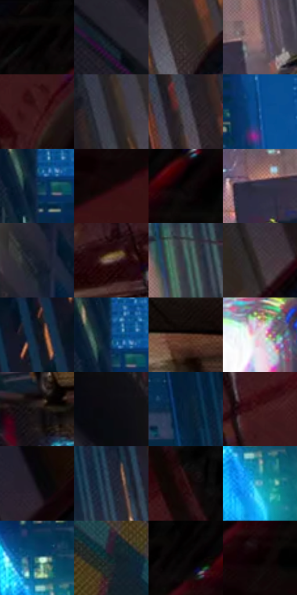

# 电影参考 242

- 状态：常规／活跃；来源世界：miles-home。
- 视角：low-angle；景别：environment-wide；场景：city。
- 时段：night-appearance（外观依据，中置信度；具体时间／晨昏未知）；光照：night-mixed。
- 材质候选：skin, fabric, screen, glass, asphalt, painted-metal（帧级，不是像素分割）。
- 明暗组：very-dark；L* P5/P50/P95：0.39216 / 15.38313 / 62.38192。
- 资格门禁：无附加门禁。
- 原截图 SHA-256：`09ad694cb84c55dee94d53dfd0f6b25a727c144670f8b56efe52b29c5444d7cd`；尺寸：2880 × 1206。
- sRGB 像素 SHA-256：`9c08d808648fe10eb98a833a1ca89fa67dba12e992105ce304be16427f270db5`。

## 观察与迁移

湿夜街谷、人物与大广告屏，显示色与路面映色分开。

242／19  /  夜街；车漆／湿地  /  近车亮漆与大暗面并存，灯芯近白、彩边局部；路面亮条破碎而车身亮带顺曲率。  /  湿地不等于完美镜面；不移植车型、夸张低机位或新路标。

本公开版保存32个128×128原像素色卡上下文；图集格子并非原场景相邻位置。原rect、图集tile和像素SHA见 `data/palette-crops.json`。上下文不足时不得批准替色，不能以小样推断完整构图。

## 实测色卡

颜色比例分母为保留采样像素，不是材料面积；全部 32 色参与全库匹配。表内四舍五入仅用于阅读，原精度在 JSON。

| ID | HEX | Lab | 原图 xy | 像素数 | 比例 | 明度角色 |
| --- | --- | --- | --- | ---: | ---: | --- |
| 242-S01 | #000000 | [0.0, 0.0, 0.0] | [2624, 48] | 10310 | 5.332409% | deep-shadow |
| 242-S02 | #191922 | [9.135629, 2.559268, -6.201755] | [388, 224] | 8774 | 4.537979% | deep-shadow |
| 242-S03 | #342A29 | [18.126141, 4.410527, 2.379704] | [1960, 452] | 8663 | 4.480569% | deep-shadow |
| 242-S04 | #9D7E7D | [55.656091, 11.782433, 5.083265] | [1476, 828] | 8610 | 4.453157% | midtone |
| 242-S05 | #391518 | [12.431304, 18.208471, 6.633384] | [2492, 688] | 8549 | 4.421607% | deep-shadow |
| 242-S06 | #272127 | [13.624022, 4.256031, -2.967997] | [1844, 372] | 8248 | 4.265927% | deep-shadow |
| 242-S07 | #4B4C58 | [32.633102, 2.394658, -7.191487] | [1776, 544] | 7818 | 4.043528% | shadow |
| 242-S08 | #165698 | [36.160559, 5.765991, -41.584589] | [1104, 220] | 7437 | 3.846472% | shadow |
| 242-S09 | #0F2F4C | [18.610306, -0.1399, -21.261342] | [940, 116] | 6946 | 3.592523% | deep-shadow |
| 242-S10 | #190708 | [3.398325, 6.683602, 1.927806] | [2736, 272] | 6935 | 3.586834% | deep-shadow |
| 242-S11 | #0C0706 | [2.197538, 1.197781, 0.849724] | [2816, 76] | 6633 | 3.430637% | deep-shadow |
| 242-S12 | #323344 | [21.810305, 4.037773, -10.701343] | [1352, 856] | 6618 | 3.422879% | shadow |
| 242-S13 | #191F2C | [11.745911, 1.354334, -9.573029] | [724, 296] | 6420 | 3.320472% | deep-shadow |
| 242-S14 | #775E5B | [42.281998, 9.652896, 5.587898] | [2060, 828] | 6273 | 3.244443% | midtone |
| 242-S15 | #2C4F4C | [30.993832, -13.496895, -2.209656] | [1504, 644] | 6237 | 3.225823% | shadow |
| 242-S16 | #413738 | [24.134851, 4.610282, 1.008809] | [2136, 264] | 5993 | 3.099625% | shadow |
| 242-S17 | #0D141F | [6.185422, 0.512526, -8.527606] | [1632, 52] | 5983 | 3.094452% | deep-shadow |
| 242-S18 | #0F3968 | [23.759615, 4.796216, -31.548488] | [940, 76] | 5925 | 3.064454% | shadow |
| 242-S19 | #5A3D2F | [28.686516, 10.785355, 13.727842] | [2204, 988] | 5887 | 3.044801% | shadow |
| 242-S20 | #D5CACE | [82.294739, 4.515995, -0.617012] | [872, 988] | 5852 | 3.026698% | highlight |
| 242-S21 | #191314 | [6.530313, 2.985809, 0.372288] | [1440, 1080] | 5649 | 2.921705% | deep-shadow |
| 242-S22 | #0D0D12 | [3.767446, 0.927004, -2.523138] | [428, 48] | 5589 | 2.890673% | deep-shadow |
| 242-S23 | #0A213A | [12.335674, 1.367137, -18.762687] | [1408, 172] | 5544 | 2.867398% | deep-shadow |
| 242-S24 | #451B1F | [16.247224, 20.64614, 7.151018] | [2404, 564] | 4724 | 2.443288% | deep-shadow |
| 242-S25 | #09080C | [2.333072, 0.833195, -1.46391] | [2344, 68] | 4430 | 2.291229% | deep-shadow |
| 242-S26 | #1E2435 | [14.370872, 2.579251, -11.936589] | [1532, 464] | 4397 | 2.274161% | deep-shadow |
| 242-S27 | #2A0C0F | [7.13428, 15.817205, 4.540801] | [2380, 316] | 4303 | 2.225544% | deep-shadow |
| 242-S28 | #58A9C5 | [65.34119, -16.787267, -21.857144] | [1000, 576] | 4102 | 2.121585% | light |
| 242-S29 | #417979 | [47.207231, -18.399912, -5.743582] | [976, 476] | 3270 | 1.691269% | midtone |
| 242-S30 | #193336 | [19.393411, -8.985812, -5.009402] | [48, 88] | 3193 | 1.651444% | deep-shadow |
| 242-S31 | #040303 | [0.880829, 0.261447, 0.092238] | [2704, 36] | 3024 | 1.564035% | deep-shadow |
| 242-S32 | #070000 | [0.408161, 1.830495, 0.64497] | [2740, 168] | 1010 | 0.522380% | deep-shadow |

## 色阶与空间分布

- 采样 ROI：`[0.01, 0.02, 0.98, 0.94]`；步长：4；样本数：193346。
- 排除区：`[]`。
- 深暗、暗、中、亮、高光五段计数：`[117616, 47833, 17113, 7730, 3054]`。
- RGB 各 256 箱、L* 100 箱、13×5 色相明度表和 3×3 空间统计全部保存在 [总数据](../film-library.json)。
- [可视化档案](../../references/library.html)按需绘制直方图，不存 2,094 张重复图表图片。

## 纹理特征占比

**这是分块图像特征的面积占比，不是波点／排线／丝网／错版的精确语义覆盖率。** 窗格、发丝、织物也会产生方向或周期特征。
原图 ROI 像素 3098546；已测块覆盖 3098546（100.0000%）；未测 0。

| 特征 | 块覆盖像素 | 占已测面积 | 阈值敏感范围 |
| --- | ---: | ---: | --- |
| low-contrast | 108928 | 3.5155% | 2.1977% ~ 4.0442% |
| directional-structure | 562432 | 18.1515% | 8.6337% ~ 31.8085% |
| periodic-structure | 2312626 | 74.6358% | 63.7053% ~ 77.9861% |
| mixed-detail | 114560 | 3.6972% | 2.2886% ~ 9.3360% |

阈值敏感范围不是统计置信区间。逐块坐标、尺度、对比、方向一致性、频谱集中度、频率与角度见 [全量特征记录](../texture-features.jsonl)，以帧号定位。
四种印刷层的真实像素覆盖仍标为 `null`，不能填 0，也不能拿上表代替。不得据这些代理测量删除唯一证据。

[测量方法与保留策略](../../references/library-retention.md) · [分类索引](../archive/README.md)
