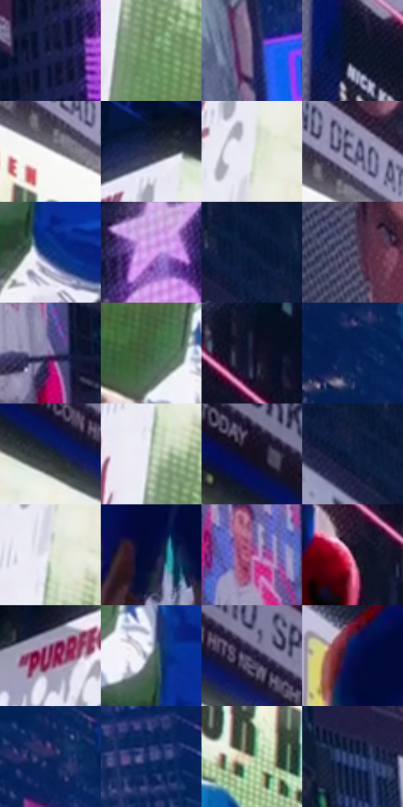

# 电影参考 243

- 状态：常规／活跃；来源世界：miles-home。
- 视角：low-angle；景别：environment-wide；场景：city。
- 时段：night-appearance（外观依据，中置信度；具体时间／晨昏未知）；光照：night-mixed。
- 材质候选：skin, fabric, screen, glass, asphalt, painted-metal（帧级，不是像素分割）。
- 明暗组：dark；L* P5/P50/P95：5.41983 / 26.17557 / 92.85559。
- 资格门禁：无附加门禁。
- 原截图 SHA-256：`590dff0ed11a2a5194788d1ac7f6f2f357bcb678c1b8041cdb650b5438ce3c18`；尺寸：2880 × 1202。
- sRGB 像素 SHA-256：`f1cd4456fb30ac20bbcb14e2f206858a3c4ecb6a4adc2f05ec8af4e0344085e1`。

## 观察与迁移

湿夜街谷、人物与大广告屏，显示色与路面映色分开。

243／20  /  夜城；屏幕照明  /  大屏明面、较暗楼体、人物受光外缘形成三级主次；广告内部仍有图像结构。  /  亮屏不是全场曝光提升理由；不抄广告、人物或建筑。

本公开版保存32个128×128原像素色卡上下文；图集格子并非原场景相邻位置。原rect、图集tile和像素SHA见 `data/palette-crops.json`。上下文不足时不得批准替色，不能以小样推断完整构图。

## 实测色卡

颜色比例分母为保留采样像素，不是材料面积；全部 32 色参与全库匹配。表内四舍五入仅用于阅读，原精度在 JSON。

| ID | HEX | Lab | 原图 xy | 像素数 | 比例 | 明度角色 |
| --- | --- | --- | --- | ---: | ---: | --- |
| 243-S01 | #1A2044 | [13.64935, 9.904867, -23.631794] | [1940, 224] | 8869 | 4.603733% | deep-shadow |
| 243-S02 | #6E9061 | [56.211934, -21.175623, 21.245122] | [324, 508] | 8725 | 4.528986% | midtone |
| 243-S03 | #5A4F77 | [36.171102, 13.821632, -21.139111] | [2456, 832] | 8460 | 4.391429% | shadow |
| 243-S04 | #0E1426 | [6.626167, 3.430572, -13.169055] | [1244, 96] | 8114 | 4.211827% | deep-shadow |
| 243-S05 | #F1F0F4 | [94.972219, 1.041428, -1.802844] | [984, 468] | 7931 | 4.116835% | highlight |
| 243-S06 | #2C2E49 | [19.92482, 6.902455, -17.040531] | [284, 136] | 7880 | 4.090362% | deep-shadow |
| 243-S07 | #E8EAEB | [92.574622, -0.490637, -0.714131] | [308, 252] | 7479 | 3.882210% | highlight |
| 243-S08 | #9493B5 | [62.082437, 7.553718, -17.545622] | [1008, 404] | 7220 | 3.747768% | light |
| 243-S09 | #092E7D | [21.915473, 21.25417, -47.972104] | [768, 1000] | 7153 | 3.712989% | shadow |
| 243-S10 | #D2B6E7 | [77.832047, 18.981964, -20.739295] | [2048, 32] | 7133 | 3.702608% | light |
| 243-S11 | #091939 | [9.389914, 6.938026, -22.76021] | [2232, 32] | 6987 | 3.626822% | deep-shadow |
| 243-S12 | #413B57 | [26.562482, 9.509363, -15.878366] | [960, 36] | 6963 | 3.614364% | shadow |
| 243-S13 | #8972A3 | [51.834163, 18.930953, -22.975476] | [1764, 712] | 6838 | 3.549479% | midtone |
| 243-S14 | #406544 | [39.266045, -20.832577, 14.623729] | [648, 856] | 6761 | 3.509510% | shadow |
| 243-S15 | #181730 | [9.159598, 8.507362, -16.543147] | [1416, 92] | 6610 | 3.431128% | deep-shadow |
| 243-S16 | #061F55 | [13.675471, 14.670734, -35.302752] | [2756, 656] | 6524 | 3.386487% | deep-shadow |
| 243-S17 | #212C32 | [17.249249, -2.938362, -5.408665] | [556, 224] | 6141 | 3.187679% | deep-shadow |
| 243-S18 | #B3BFB0 | [76.05678, -6.937916, 6.149488] | [292, 416] | 5703 | 2.960321% | light |
| 243-S19 | #130D1E | [4.697319, 6.246479, -9.958804] | [468, 112] | 5448 | 2.827956% | deep-shadow |
| 243-S20 | #0D1E42 | [12.005942, 7.779774, -24.918868] | [2280, 144] | 5365 | 2.784872% | deep-shadow |
| 243-S21 | #D9DFD4 | [88.103414, -3.990619, 4.685309] | [300, 348] | 5056 | 2.624476% | highlight |
| 243-S22 | #060E37 | [5.677247, 13.177191, -27.324922] | [1424, 1124] | 5030 | 2.610980% | deep-shadow |
| 243-S23 | #A95390 | [47.799044, 43.166717, -17.636428] | [1720, 520] | 4897 | 2.541942% | midtone |
| 243-S24 | #471F39 | [18.431965, 22.960189, -8.065599] | [1544, 320] | 4753 | 2.467194% | deep-shadow |
| 243-S25 | #7E2450 | [30.102592, 42.584235, -5.096818] | [128, 248] | 4522 | 2.347286% | shadow |
| 243-S26 | #627072 | [46.176738, -4.780759, -2.882508] | [736, 900] | 4512 | 2.342095% | midtone |
| 243-S27 | #261E3D | [13.694565, 12.433247, -18.592452] | [660, 212] | 4440 | 2.304722% | deep-shadow |
| 243-S28 | #05124E | [9.113192, 21.308468, -38.003599] | [1340, 412] | 4336 | 2.250737% | deep-shadow |
| 243-S29 | #1A275C | [17.658919, 14.368208, -33.482138] | [2788, 872] | 3931 | 2.040509% | deep-shadow |
| 243-S30 | #3B4982 | [32.493506, 12.033942, -33.910365] | [2648, 1024] | 3350 | 1.738923% | shadow |
| 243-S31 | #9CAD8D | [68.662808, -11.877269, 14.492405] | [904, 580] | 3135 | 1.627320% | light |
| 243-S32 | #253964 | [24.447101, 6.879952, -27.810016] | [2264, 1052] | 2382 | 1.236452% | shadow |

## 色阶与空间分布

- 采样 ROI：`[0.01, 0.02, 0.98, 0.94]`；步长：4；样本数：192648。
- 排除区：`[]`。
- 深暗、暗、中、亮、高光五段计数：`[80908, 38646, 29920, 19217, 23957]`。
- RGB 各 256 箱、L* 100 箱、13×5 色相明度表和 3×3 空间统计全部保存在 [总数据](../film-library.json)。
- [可视化档案](../../references/library.html)按需绘制直方图，不存 2,094 张重复图表图片。

## 纹理特征占比

**这是分块图像特征的面积占比，不是波点／排线／丝网／错版的精确语义覆盖率。** 窗格、发丝、织物也会产生方向或周期特征。
原图 ROI 像素 3087370；已测块覆盖 3087370（100.0000%）；未测 0。

| 特征 | 块覆盖像素 | 占已测面积 | 阈值敏感范围 |
| --- | ---: | ---: | --- |
| low-contrast | 0 | 0.0000% | 0.0000% ~ 0.0000% |
| directional-structure | 580480 | 18.8018% | 6.8449% ~ 36.7332% |
| periodic-structure | 2325130 | 75.3110% | 62.7361% ~ 79.7513% |
| mixed-detail | 181760 | 5.8872% | 0.5307% ~ 13.4038% |

阈值敏感范围不是统计置信区间。逐块坐标、尺度、对比、方向一致性、频谱集中度、频率与角度见 [全量特征记录](../texture-features.jsonl)，以帧号定位。
四种印刷层的真实像素覆盖仍标为 `null`，不能填 0，也不能拿上表代替。不得据这些代理测量删除唯一证据。

[测量方法与保留策略](../../references/library-retention.md) · [分类索引](../archive/README.md)
