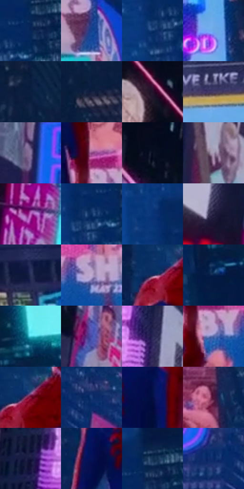

# 电影参考 244

- 状态：常规／活跃；来源世界：miles-home。
- 视角：low-angle；景别：environment-wide；场景：city。
- 时段：night-appearance（外观依据，中置信度；具体时间／晨昏未知）；光照：night-mixed。
- 材质候选：skin, fabric, screen, glass, asphalt, painted-metal（帧级，不是像素分割）。
- 明暗组：dark；L* P5/P50/P95：6.72598 / 21.15752 / 71.14999。
- 资格门禁：无附加门禁。
- 原截图 SHA-256：`925ad45126e608a87efa62b1d24880aeb47a5c0cecd31726556e137ae169b833`；尺寸：2872 × 1190。
- sRGB 像素 SHA-256：`1f42fc7054f46bcd62ff93f709fc69cce39bf233552ac3e985a6362b965c448b`。

## 观察与迁移

湿夜街谷、人物与大广告屏，显示色与路面映色分开。

244／21  /  夜城；人物背面  /  中心背影红蓝固有色没有全被霓虹覆盖，背景高楼的大暗体量承托小窗与亮牌。  /  不把所有暗面统一铺纯蓝，不套角色身材。

本公开版保存32个128×128原像素色卡上下文；图集格子并非原场景相邻位置。原rect、图集tile和像素SHA见 `data/palette-crops.json`。上下文不足时不得批准替色，不能以小样推断完整构图。

## 实测色卡

颜色比例分母为保留采样像素，不是材料面积；全部 32 色参与全库匹配。表内四舍五入仅用于阅读，原精度在 JSON。

| ID | HEX | Lab | 原图 xy | 像素数 | 比例 | 明度角色 |
| --- | --- | --- | --- | ---: | ---: | --- |
| 244-S01 | #072657 | [16.100554, 10.338541, -32.706102] | [2324, 112] | 10546 | 5.530036% | deep-shadow |
| 244-S02 | #134290 | [29.53188, 15.777328, -47.400078] | [2032, 948] | 10349 | 5.426735% | shadow |
| 244-S03 | #0D336B | [21.995599, 10.179401, -36.324958] | [2236, 180] | 8785 | 4.606615% | shadow |
| 244-S04 | #6CA7E7 | [66.969906, -1.234757, -38.040194] | [1988, 412] | 8260 | 4.331320% | light |
| 244-S05 | #091D3E | [11.166138, 6.083495, -23.464341] | [1136, 36] | 7896 | 4.140448% | deep-shadow |
| 244-S06 | #152141 | [13.403453, 6.704711, -21.953738] | [1168, 168] | 7460 | 3.911821% | deep-shadow |
| 244-S07 | #22132B | [8.825877, 13.433558, -13.304881] | [128, 132] | 7326 | 3.841555% | deep-shadow |
| 244-S08 | #483E68 | [28.959593, 14.718353, -23.075658] | [1680, 112] | 7323 | 3.839982% | shadow |
| 244-S09 | #8775A1 | [52.338422, 16.037946, -21.051503] | [912, 908] | 7143 | 3.745595% | midtone |
| 244-S10 | #884380 | [39.255052, 38.232359, -21.478264] | [1568, 832] | 6851 | 3.592478% | shadow |
| 244-S11 | #080D21 | [4.057869, 3.747554, -13.338913] | [320, 220] | 6817 | 3.574650% | deep-shadow |
| 244-S12 | #A598B1 | [64.667958, 9.576859, -11.256577] | [768, 520] | 6746 | 3.537419% | light |
| 244-S13 | #C466C5 | [57.338885, 50.905869, -33.513332] | [184, 1044] | 6180 | 3.240624% | midtone |
| 244-S14 | #0A2D60 | [19.163036, 9.446715, -33.730154] | [2268, 144] | 6178 | 3.239575% | deep-shadow |
| 244-S15 | #0B3579 | [23.661912, 14.635438, -42.588249] | [2204, 52] | 6021 | 3.157249% | shadow |
| 244-S16 | #262242 | [15.219304, 11.186472, -19.677208] | [80, 884] | 5984 | 3.137847% | deep-shadow |
| 244-S17 | #283157 | [21.340694, 8.39815, -24.211309] | [2652, 1060] | 5758 | 3.019339% | shadow |
| 244-S18 | #BDAAD2 | [72.376245, 14.429751, -17.752148] | [1704, 904] | 5719 | 2.998888% | light |
| 244-S19 | #172652 | [16.39149, 10.431004, -28.835404] | [1316, 460] | 5672 | 2.974243% | deep-shadow |
| 244-S20 | #07214B | [13.475464, 8.670932, -28.806058] | [2488, 292] | 5585 | 2.928622% | deep-shadow |
| 244-S21 | #4DD4E4 | [78.614068, -31.258377, -18.620933] | [2540, 176] | 5246 | 2.750860% | light |
| 244-S22 | #424CA8 | [36.277544, 24.773346, -50.893581] | [244, 428] | 4882 | 2.559988% | shadow |
| 244-S23 | #292654 | [17.907484, 15.418862, -27.675125] | [732, 204] | 4643 | 2.434663% | deep-shadow |
| 244-S24 | #5266A5 | [44.250271, 10.621177, -36.311646] | [1596, 920] | 4450 | 2.333459% | midtone |
| 244-S25 | #80143B | [27.863222, 46.523415, 5.685337] | [1360, 448] | 4232 | 2.219146% | shadow |
| 244-S26 | #1D3E79 | [26.979056, 10.215989, -37.200406] | [1172, 936] | 4096 | 2.147831% | shadow |
| 244-S27 | #020F43 | [6.86152, 18.160747, -34.026346] | [1476, 604] | 3968 | 2.080711% | deep-shadow |
| 244-S28 | #4D1539 | [17.506084, 30.465148, -9.379194] | [2028, 748] | 3897 | 2.043481% | deep-shadow |
| 244-S29 | #171940 | [10.902884, 12.874022, -25.255589] | [532, 184] | 3778 | 1.981081% | deep-shadow |
| 244-S30 | #051056 | [9.596737, 26.004526, -42.689155] | [1292, 628] | 3105 | 1.628178% | deep-shadow |
| 244-S31 | #081E46 | [12.104272, 8.831666, -27.563777] | [2344, 36] | 3089 | 1.619788% | deep-shadow |
| 244-S32 | #0A2766 | [17.802459, 16.552574, -39.880863] | [1080, 956] | 2719 | 1.425770% | deep-shadow |

## 色阶与空间分布

- 采样 ROI：`[0.01, 0.02, 0.98, 0.94]`；步长：4；样本数：190704。
- 排除区：`[]`。
- 深暗、暗、中、亮、高光五段计数：`[88794, 54952, 19004, 24496, 3458]`。
- RGB 各 256 箱、L* 100 箱、13×5 色相明度表和 3×3 空间统计全部保存在 [总数据](../film-library.json)。
- [可视化档案](../../references/library.html)按需绘制直方图，不存 2,094 张重复图表图片。

## 纹理特征占比

**这是分块图像特征的面积占比，不是波点／排线／丝网／错版的精确语义覆盖率。** 窗格、发丝、织物也会产生方向或周期特征。
原图 ROI 像素 3050670；已测块覆盖 3050670（100.0000%）；未测 0。

| 特征 | 块覆盖像素 | 占已测面积 | 阈值敏感范围 |
| --- | ---: | ---: | --- |
| low-contrast | 0 | 0.0000% | 0.0000% ~ 0.8350% |
| directional-structure | 651648 | 21.3608% | 8.4126% ~ 33.2238% |
| periodic-structure | 2298926 | 75.3581% | 66.7762% ~ 80.1916% |
| mixed-detail | 100096 | 3.2811% | 0.0000% ~ 10.5608% |

阈值敏感范围不是统计置信区间。逐块坐标、尺度、对比、方向一致性、频谱集中度、频率与角度见 [全量特征记录](../texture-features.jsonl)，以帧号定位。
四种印刷层的真实像素覆盖仍标为 `null`，不能填 0，也不能拿上表代替。不得据这些代理测量删除唯一证据。

[测量方法与保留策略](../../references/library-retention.md) · [分类索引](../archive/README.md)
