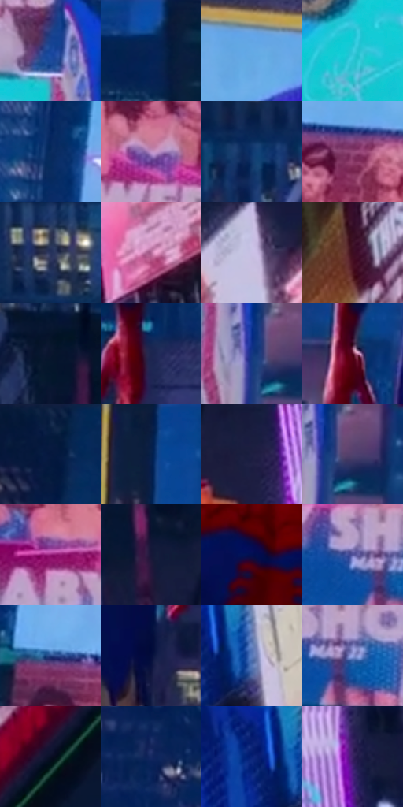

# 电影参考 245

- 状态：常规／活跃；来源世界：miles-home。
- 视角：low-angle；景别：environment-wide；场景：city。
- 时段：night-appearance（外观依据，中置信度；具体时间／晨昏未知）；光照：night-mixed。
- 材质候选：skin, fabric, screen, glass, asphalt, painted-metal（帧级，不是像素分割）。
- 明暗组：dark；L* P5/P50/P95：6.60284 / 23.74959 / 75.42329。
- 资格门禁：无附加门禁。
- 原截图 SHA-256：`ac283380a1b2a49bd3479483850ddcc435c2a1df6a4cf13cb65fe003130067ba`；尺寸：2880 × 1202。
- sRGB 像素 SHA-256：`66f3e5fc078b2c9d59d8956d151adb59f3ef5b5aeb6c1b3735226b06a0ba6da2`。

## 观察与迁移

湿夜街谷、人物与大广告屏，显示色与路面映色分开。

245／22  /  夜城；空间层次  /  换角度后屏幕、交通灯和楼体各自保留遮挡；受光边缘不等于完整发光圈。  /  不让参考的广告密度变成给源照添物件的许可。

本公开版保存32个128×128原像素色卡上下文；图集格子并非原场景相邻位置。原rect、图集tile和像素SHA见 `data/palette-crops.json`。上下文不足时不得批准替色，不能以小样推断完整构图。

## 实测色卡

颜色比例分母为保留采样像素，不是材料面积；全部 32 色参与全库匹配。表内四舍五入仅用于阅读，原精度在 JSON。

| ID | HEX | Lab | 原图 xy | 像素数 | 比例 | 明度角色 |
| --- | --- | --- | --- | ---: | ---: | --- |
| 245-S01 | #18469B | [31.669627, 17.95335, -50.63597] | [1084, 980] | 10627 | 5.516278% | shadow |
| 245-S02 | #072455 | [15.289012, 10.949773, -32.676256] | [1500, 56] | 10429 | 5.413500% | deep-shadow |
| 245-S03 | #63AAE6 | [67.361045, -5.086526, -36.912859] | [696, 144] | 10255 | 5.323180% | light |
| 245-S04 | #37CADE | [75.028109, -31.020649, -20.873025] | [976, 1088] | 8942 | 4.641626% | light |
| 245-S05 | #0A2B5F | [18.444415, 10.484633, -34.232389] | [480, 412] | 8738 | 4.535734% | deep-shadow |
| 245-S06 | #C191C6 | [66.264219, 27.181562, -20.352957] | [968, 824] | 8381 | 4.350421% | light |
| 245-S07 | #0F366D | [23.146927, 9.082189, -35.753935] | [1764, 704] | 7560 | 3.924256% | shadow |
| 245-S08 | #934978 | [41.728716, 37.262136, -12.631269] | [808, 688] | 7321 | 3.800195% | midtone |
| 245-S09 | #27325C | [21.889834, 9.260014, -26.646051] | [1800, 476] | 7130 | 3.701051% | shadow |
| 245-S10 | #B56D9A | [55.170875, 35.006816, -12.204817] | [2724, 968] | 6902 | 3.582700% | midtone |
| 245-S11 | #CAC1E5 | [79.814448, 10.044465, -16.72944] | [2768, 404] | 6623 | 3.437876% | light |
| 245-S12 | #3D0D21 | [11.891066, 25.297766, -0.728696] | [2604, 100] | 6594 | 3.422823% | deep-shadow |
| 245-S13 | #09152E | [7.150181, 4.956578, -18.341199] | [2008, 580] | 6537 | 3.393235% | deep-shadow |
| 245-S14 | #1C264F | [16.490741, 10.273271, -26.627376] | [1616, 952] | 6365 | 3.303953% | deep-shadow |
| 245-S15 | #143683 | [25.029294, 18.89054, -46.654929] | [1148, 1104] | 6324 | 3.282671% | shadow |
| 245-S16 | #60152E | [20.908471, 35.304379, 3.82777] | [1244, 908] | 6273 | 3.256198% | shadow |
| 245-S17 | #071B40 | [10.550099, 8.257965, -25.874855] | [340, 56] | 6241 | 3.239587% | deep-shadow |
| 245-S18 | #062048 | [12.856224, 7.919868, -27.73992] | [1192, 44] | 6118 | 3.175740% | deep-shadow |
| 245-S19 | #1E1F42 | [13.526808, 10.960803, -22.414819] | [2188, 916] | 6000 | 3.114489% | deep-shadow |
| 245-S20 | #52416E | [31.114251, 17.707436, -23.443284] | [1184, 1108] | 5478 | 2.843528% | shadow |
| 245-S21 | #8E1571 | [32.877199, 55.898406, -21.932371] | [620, 828] | 5227 | 2.713239% | shadow |
| 245-S22 | #161738 | [9.551831, 10.974994, -21.733601] | [2064, 800] | 5078 | 2.635896% | deep-shadow |
| 245-S23 | #020F4F | [8.29591, 23.59411, -40.049869] | [1424, 552] | 4780 | 2.481209% | deep-shadow |
| 245-S24 | #5556A0 | [39.788739, 19.871206, -40.408553] | [760, 916] | 4464 | 2.317180% | shadow |
| 245-S25 | #244382 | [29.413202, 11.436373, -38.909065] | [548, 644] | 4399 | 2.283439% | shadow |
| 245-S26 | #040E3C | [6.015773, 15.476621, -30.404592] | [1532, 1120] | 3869 | 2.008326% | deep-shadow |
| 245-S27 | #597BBB | [51.696721, 6.432911, -37.348842] | [2628, 768] | 3630 | 1.884266% | midtone |
| 245-S28 | #919FDF | [66.628331, 10.202913, -34.008458] | [812, 932] | 3335 | 1.731137% | light |
| 245-S29 | #070E24 | [4.395099, 4.116837, -15.143127] | [2812, 124] | 2999 | 1.556725% | deep-shadow |
| 245-S30 | #162961 | [18.448963, 14.307658, -35.522337] | [104, 668] | 2238 | 1.161704% | deep-shadow |
| 245-S31 | #092176 | [17.705585, 27.542907, -50.422045] | [2556, 748] | 2224 | 1.154437% | deep-shadow |
| 245-S32 | #3A2264 | [19.897271, 27.698605, -35.004237] | [2368, 1040] | 1567 | 0.813401% | deep-shadow |

## 色阶与空间分布

- 采样 ROI：`[0.01, 0.02, 0.98, 0.94]`；步长：4；样本数：192648。
- 排除区：`[]`。
- 深暗、暗、中、亮、高光五段计数：`[81340, 55796, 18067, 32493, 4952]`。
- RGB 各 256 箱、L* 100 箱、13×5 色相明度表和 3×3 空间统计全部保存在 [总数据](../film-library.json)。
- [可视化档案](../../references/library.html)按需绘制直方图，不存 2,094 张重复图表图片。

## 纹理特征占比

**这是分块图像特征的面积占比，不是波点／排线／丝网／错版的精确语义覆盖率。** 窗格、发丝、织物也会产生方向或周期特征。
原图 ROI 像素 3087370；已测块覆盖 3087370（100.0000%）；未测 0。

| 特征 | 块覆盖像素 | 占已测面积 | 阈值敏感范围 |
| --- | ---: | ---: | --- |
| low-contrast | 49152 | 1.5920% | 0.5307% ~ 1.5920% |
| directional-structure | 619648 | 20.0704% | 10.6633% ~ 40.3357% |
| periodic-structure | 2315914 | 75.0125% | 57.9313% ~ 78.0515% |
| mixed-detail | 102656 | 3.3250% | 1.2023% ~ 9.6932% |

阈值敏感范围不是统计置信区间。逐块坐标、尺度、对比、方向一致性、频谱集中度、频率与角度见 [全量特征记录](../texture-features.jsonl)，以帧号定位。
四种印刷层的真实像素覆盖仍标为 `null`，不能填 0，也不能拿上表代替。不得据这些代理测量删除唯一证据。

[测量方法与保留策略](../../references/library-retention.md) · [分类索引](../archive/README.md)
