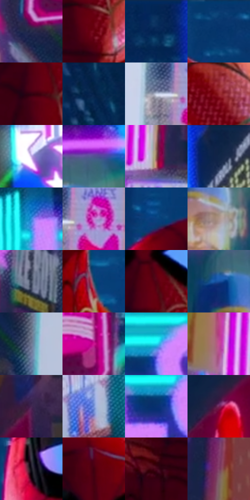

# 电影参考 246

- 状态：常规／活跃；来源世界：miles-home。
- 视角：near-level；景别：close-up；场景：city。
- 时段：night-appearance（外观依据，中置信度；具体时间／晨昏未知）；光照：night-mixed。
- 材质候选：skin, fabric, screen, glass, asphalt, painted-metal（帧级，不是像素分割）。
- 明暗组：dark；L* P5/P50/P95：9.02998 / 28.35438 / 78.81141。
- 资格门禁：无附加门禁。
- 原截图 SHA-256：`720f4d729d8bd26c34ab9b2fbb2a29e7c34b113c0cbc43424b217dd47622ab4f`；尺寸：2880 × 1204。
- sRGB 像素 SHA-256：`1b8f5d06a5ff328059c89662fc90fa1415ea6b8bf5bd28ec305d422fb4de3040`。

## 观察与迁移

湿夜街谷、人物与大广告屏，显示色与路面映色分开。

246／23  /  材质近景；局部彩光  /  面罩结构线、布面细纹、眼片明亮映像、黑色边框性质不同，面部体积先于纹理。  /  服装蛛网图案不是通用排线；白色眼片不是皮肤高光模板。

本公开版保存32个128×128原像素色卡上下文；图集格子并非原场景相邻位置。原rect、图集tile和像素SHA见 `data/palette-crops.json`。上下文不足时不得批准替色，不能以小样推断完整构图。

## 实测色卡

颜色比例分母为保留采样像素，不是材料面积；全部 32 色参与全库匹配。表内四舍五入仅用于阅读，原精度在 JSON。

| ID | HEX | Lab | 原图 xy | 像素数 | 比例 | 明度角色 |
| --- | --- | --- | --- | ---: | ---: | --- |
| 246-S01 | #282D4C | [19.430846, 7.33165, -19.868102] | [416, 232] | 10648 | 5.527179% | deep-shadow |
| 246-S02 | #6C0414 | [21.306815, 42.129786, 22.874109] | [1580, 560] | 10339 | 5.366783% | shadow |
| 246-S03 | #082F5D | [19.53424, 6.441231, -31.156395] | [2028, 44] | 9610 | 4.988373% | deep-shadow |
| 246-S04 | #093A6F | [24.421646, 6.565537, -34.992859] | [1652, 36] | 9296 | 4.825381% | shadow |
| 246-S05 | #330211 | [7.117128, 25.445461, 3.633359] | [1532, 404] | 9258 | 4.805656% | deep-shadow |
| 246-S06 | #05284F | [16.074711, 4.929541, -27.353183] | [1032, 28] | 8770 | 4.552344% | deep-shadow |
| 246-S07 | #C4CEE2 | [82.576423, 0.559403, -11.029453] | [580, 776] | 8494 | 4.409078% | highlight |
| 246-S08 | #942429 | [33.392196, 46.327633, 25.500958] | [2072, 1112] | 8178 | 4.245048% | shadow |
| 246-S09 | #C3A9E4 | [73.27175, 20.692444, -26.180771] | [2696, 508] | 7862 | 4.081018% | light |
| 246-S10 | #535292 | [37.749472, 17.547869, -35.24372] | [2084, 576] | 7604 | 3.947095% | shadow |
| 246-S11 | #886150 | [44.75026, 13.510188, 15.963044] | [308, 992] | 7564 | 3.926332% | midtone |
| 246-S12 | #0D2347 | [14.072387, 6.167609, -25.07626] | [2324, 44] | 7365 | 3.823035% | deep-shadow |
| 246-S13 | #378CDE | [56.918485, 2.306201, -49.01173] | [2592, 876] | 7246 | 3.761264% | midtone |
| 246-S14 | #CC7BD6 | [63.226788, 45.646173, -33.873552] | [664, 772] | 6946 | 3.605540% | light |
| 246-S15 | #0A407C | [27.257541, 8.047262, -38.668764] | [1372, 104] | 6635 | 3.444105% | shadow |
| 246-S16 | #AC938A | [62.905785, 7.847714, 8.220332] | [2100, 760] | 6233 | 3.235435% | light |
| 246-S17 | #414B61 | [31.849584, 1.856928, -14.181815] | [396, 872] | 5865 | 3.044413% | shadow |
| 246-S18 | #1D4866 | [29.042798, -4.079266, -21.875694] | [1672, 712] | 5259 | 2.729849% | shadow |
| 246-S19 | #500212 | [14.361766, 34.513116, 14.21848] | [1568, 344] | 5096 | 2.645239% | deep-shadow |
| 246-S20 | #19509F | [34.894729, 12.869036, -47.829968] | [2008, 652] | 4825 | 2.504568% | shadow |
| 246-S21 | #737C97 | [52.167952, 2.881771, -15.635228] | [604, 348] | 4799 | 2.491072% | midtone |
| 246-S22 | #CF1893 | [47.012171, 73.772802, -20.097049] | [576, 112] | 4779 | 2.480690% | midtone |
| 246-S23 | #21DBF0 | [80.332458, -35.36127, -22.487022] | [2752, 1000] | 4708 | 2.443835% | highlight |
| 246-S24 | #C54E97 | [51.33164, 55.192699, -16.038355] | [156, 924] | 4395 | 2.281363% | midtone |
| 246-S25 | #422651 | [20.590686, 22.148644, -21.217494] | [2564, 164] | 4302 | 2.233088% | shadow |
| 246-S26 | #7590D8 | [60.502002, 9.540605, -39.82069] | [2352, 1024] | 4298 | 2.231012% | light |
| 246-S27 | #0A306F | [21.303148, 13.851439, -40.030046] | [2720, 1048] | 3150 | 1.635107% | shadow |
| 246-S28 | #722557 | [28.352218, 39.404649, -12.553293] | [2452, 284] | 2977 | 1.545305% | shadow |
| 246-S29 | #11101A | [5.097467, 2.723293, -6.251542] | [1316, 308] | 1880 | 0.975873% | deep-shadow |
| 246-S30 | #41000F | [10.248889, 30.772986, 9.71608] | [1536, 192] | 1850 | 0.960301% | deep-shadow |
| 246-S31 | #48051B | [13.020467, 31.595805, 5.715647] | [1440, 656] | 1550 | 0.804576% | deep-shadow |
| 246-S32 | #172251 | [15.061884, 13.003097, -30.302586] | [32, 92] | 867 | 0.450044% | deep-shadow |

## 色阶与空间分布

- 采样 ROI：`[0.01, 0.02, 0.98, 0.94]`；步长：4；样本数：192648。
- 排除区：`[]`。
- 深暗、暗、中、亮、高光五段计数：`[54825, 68428, 34059, 26926, 8410]`。
- RGB 各 256 箱、L* 100 箱、13×5 色相明度表和 3×3 空间统计全部保存在 [总数据](../film-library.json)。
- [可视化档案](../../references/library.html)按需绘制直方图，不存 2,094 张重复图表图片。

## 纹理特征占比

**这是分块图像特征的面积占比，不是波点／排线／丝网／错版的精确语义覆盖率。** 窗格、发丝、织物也会产生方向或周期特征。
原图 ROI 像素 3092958；已测块覆盖 3092958（100.0000%）；未测 0。

| 特征 | 块覆盖像素 | 占已测面积 | 阈值敏感范围 |
| --- | ---: | ---: | --- |
| low-contrast | 102272 | 3.3066% | 1.9037% ~ 6.4849% |
| directional-structure | 679552 | 21.9709% | 11.9973% ~ 35.2801% |
| periodic-structure | 2245598 | 72.6036% | 62.8162% ~ 74.4741% |
| mixed-detail | 65536 | 2.1189% | 0.0000% ~ 7.0436% |

阈值敏感范围不是统计置信区间。逐块坐标、尺度、对比、方向一致性、频谱集中度、频率与角度见 [全量特征记录](../texture-features.jsonl)，以帧号定位。
四种印刷层的真实像素覆盖仍标为 `null`，不能填 0，也不能拿上表代替。不得据这些代理测量删除唯一证据。

[测量方法与保留策略](../../references/library-retention.md) · [分类索引](../archive/README.md)
