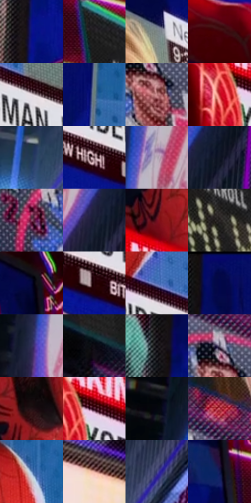

# 电影参考 247

- 状态：常规／活跃；来源世界：miles-home。
- 视角：low-angle；景别：environment-wide；场景：city。
- 时段：night-appearance（外观依据，中置信度；具体时间／晨昏未知）；光照：night-mixed。
- 材质候选：skin, fabric, screen, glass, asphalt, painted-metal（帧级，不是像素分割）。
- 明暗组：dark；L* P5/P50/P95：3.00076 / 24.86213 / 77.59991。
- 资格门禁：无附加门禁。
- 原截图 SHA-256：`01cd1bcb5c21afc5a61b46c59eecb469e8fe4746d54c57e4d48a8a8c579b431d`；尺寸：2880 × 1212。
- sRGB 像素 SHA-256：`67d9effabce3ed9cf6574aa1921850b3183769a633439e0700b4bf6a23584703`。

## 观察与迁移

湿夜街谷、人物与大广告屏，显示色与路面映色分开。

247／24  /  屏幕；场景归属证据  /  前景人物与屏中新闻肖像是不同空间层；亮屏内容有规则细格与边框。  /  屏中脸不计作现场新增人物，不把字幕／播放器箭头收入风格。

本公开版保存32个128×128原像素色卡上下文；图集格子并非原场景相邻位置。原rect、图集tile和像素SHA见 `data/palette-crops.json`。上下文不足时不得批准替色，不能以小样推断完整构图。

## 实测色卡

颜色比例分母为保留采样像素，不是材料面积；全部 32 色参与全库匹配。表内四舍五入仅用于阅读，原精度在 JSON。

| ID | HEX | Lab | 原图 xy | 像素数 | 比例 | 明度角色 |
| --- | --- | --- | --- | ---: | ---: | --- |
| 247-S01 | #0A1482 | [16.38428, 39.983543, -60.267947] | [800, 448] | 10375 | 5.346725% | deep-shadow |
| 247-S02 | #1E1C1E | [10.559362, 1.457915, -1.031317] | [2312, 340] | 9705 | 5.001443% | deep-shadow |
| 247-S03 | #7B8485 | [54.45588, -3.096497, -1.675904] | [1936, 164] | 9444 | 4.866937% | midtone |
| 247-S04 | #420309 | [10.874278, 29.387461, 13.374054] | [1184, 952] | 9288 | 4.786543% | deep-shadow |
| 247-S05 | #E5D8DF | [87.532594, 5.67039, -1.829192] | [1632, 828] | 8671 | 4.468574% | highlight |
| 247-S06 | #6A7E7B | [51.169838, -7.92998, -0.809392] | [968, 140] | 7921 | 4.082064% | midtone |
| 247-S07 | #C08182 | [60.356414, 24.480694, 9.430413] | [2796, 1108] | 7903 | 4.072788% | light |
| 247-S08 | #B81A23 | [39.670928, 59.610685, 38.047207] | [1008, 612] | 7785 | 4.011977% | shadow |
| 247-S09 | #2C5BA9 | [39.378887, 11.698587, -46.55071] | [40, 1128] | 7392 | 3.809445% | shadow |
| 247-S10 | #5A3E45 | [29.535572, 13.441263, 0.638892] | [1460, 896] | 7152 | 3.685762% | shadow |
| 247-S11 | #B4A8B5 | [70.207439, 6.709192, -5.106654] | [252, 444] | 6969 | 3.591453% | light |
| 247-S12 | #111624 | [7.409861, 2.322813, -10.424708] | [392, 596] | 6919 | 3.565686% | deep-shadow |
| 247-S13 | #8A4D6A | [40.82034, 29.639251, -5.491267] | [2624, 1108] | 6793 | 3.500752% | midtone |
| 247-S14 | #1E2039 | [13.256684, 6.925503, -16.511784] | [328, 628] | 6779 | 3.493538% | deep-shadow |
| 247-S15 | #730F22 | [24.009487, 42.295244, 17.030054] | [1256, 512] | 6669 | 3.436849% | shadow |
| 247-S16 | #322E2E | [19.347243, 1.795194, 0.648514] | [2424, 516] | 6341 | 3.267816% | deep-shadow |
| 247-S17 | #050837 | [4.350698, 15.604197, -29.47143] | [2188, 164] | 6023 | 3.103935% | deep-shadow |
| 247-S18 | #260409 | [4.685822, 16.308107, 3.623161] | [1184, 804] | 5966 | 3.074560% | deep-shadow |
| 247-S19 | #4D6EB8 | [47.221156, 10.771462, -42.73391] | [1508, 740] | 5775 | 2.976129% | midtone |
| 247-S20 | #040A54 | [7.973444, 28.900304, -44.018729] | [848, 36] | 5237 | 2.698872% | deep-shadow |
| 247-S21 | #2C2F56 | [20.981147, 10.576784, -24.097296] | [176, 560] | 5069 | 2.612294% | shadow |
| 247-S22 | #0F0E16 | [4.277565, 1.995562, -4.410398] | [2500, 800] | 4716 | 2.430377% | deep-shadow |
| 247-S23 | #0C080D | [2.537265, 1.806656, -1.61125] | [772, 300] | 4594 | 2.367504% | deep-shadow |
| 247-S24 | #5E596E | [38.984859, 6.674243, -11.227964] | [2776, 1028] | 4334 | 2.233514% | shadow |
| 247-S25 | #251216 | [7.984532, 10.536291, 1.318854] | [1288, 400] | 4189 | 2.158789% | deep-shadow |
| 247-S26 | #48172C | [16.368682, 25.768089, -1.937401] | [1068, 600] | 4031 | 2.077364% | deep-shadow |
| 247-S27 | #04070F | [1.917188, 0.430366, -3.582907] | [160, 204] | 3778 | 1.946981% | deep-shadow |
| 247-S28 | #C34855 | [48.128782, 50.080488, 18.969959] | [2728, 904] | 3686 | 1.899569% | midtone |
| 247-S29 | #799CC7 | [63.312838, -1.137016, -25.93878] | [1448, 140] | 3533 | 1.820721% | light |
| 247-S30 | #E1A99E | [74.096801, 19.041761, 13.699758] | [616, 840] | 3068 | 1.581085% | light |
| 247-S31 | #3F407A | [29.733721, 16.32354, -33.302227] | [204, 1044] | 2634 | 1.357424% | shadow |
| 247-S32 | #131A4F | [12.231289, 17.462263, -33.546836] | [2200, 288] | 1305 | 0.672528% | deep-shadow |

## 色阶与空间分布

- 采样 ROI：`[0.01, 0.02, 0.98, 0.94]`；步长：4；样本数：194044。
- 排除区：`[]`。
- 深暗、暗、中、亮、高光五段计数：`[87518, 37094, 43888, 16450, 9094]`。
- RGB 各 256 箱、L* 100 箱、13×5 色相明度表和 3×3 空间统计全部保存在 [总数据](../film-library.json)。
- [可视化档案](../../references/library.html)按需绘制直方图，不存 2,094 张重复图表图片。

## 纹理特征占比

**这是分块图像特征的面积占比，不是波点／排线／丝网／错版的精确语义覆盖率。** 窗格、发丝、织物也会产生方向或周期特征。
原图 ROI 像素 3115310；已测块覆盖 3115310（100.0000%）；未测 0。

| 特征 | 块覆盖像素 | 占已测面积 | 阈值敏感范围 |
| --- | ---: | ---: | --- |
| low-contrast | 62976 | 2.0215% | 1.4956% ~ 2.0215% |
| directional-structure | 585088 | 18.7811% | 8.2627% ~ 44.8346% |
| periodic-structure | 2375680 | 76.2582% | 53.6698% ~ 81.2955% |
| mixed-detail | 91566 | 2.9392% | 0.0000% ~ 8.4203% |

阈值敏感范围不是统计置信区间。逐块坐标、尺度、对比、方向一致性、频谱集中度、频率与角度见 [全量特征记录](../texture-features.jsonl)，以帧号定位。
四种印刷层的真实像素覆盖仍标为 `null`，不能填 0，也不能拿上表代替。不得据这些代理测量删除唯一证据。

[测量方法与保留策略](../../references/library-retention.md) · [分类索引](../archive/README.md)
