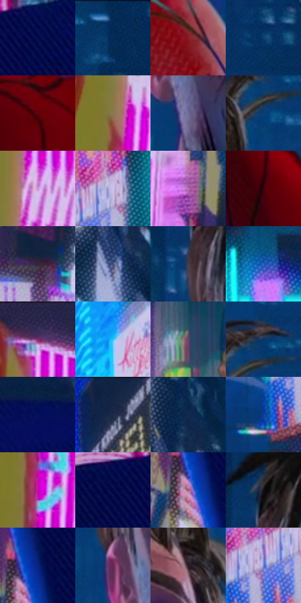

# 电影参考 248

- 状态：常规／活跃；来源世界：miles-home。
- 视角：near-level；景别：close-up；场景：city。
- 时段：night-appearance（外观依据，中置信度；具体时间／晨昏未知）；光照：night-mixed。
- 材质候选：skin, fabric, screen, glass, asphalt, painted-metal（帧级，不是像素分割）。
- 明暗组：dark；L* P5/P50/P95：6.28295 / 25.95574 / 75.62295。
- 资格门禁：无附加门禁。
- 原截图 SHA-256：`1ff0831f2e6c08450c9f183035af4afa96440b5c3a5bcab5800b6afeb8be6435`；尺寸：2880 × 1206。
- sRGB 像素 SHA-256：`f216b71e549c090ab08e28a2c56b7221070c39230734e89eb40caca104067604`。

## 观察与迁移

湿夜街谷、人物与大广告屏，显示色与路面映色分开。

248／25  /  人物受光；排线  /  鼻梁窄暖粉面、冷紫眼窝和侧面大转折共存；表情线／胡茬／服装斜线分层。  /  不移植疲态、眼圈、伤痕、年龄或人物造型。

本公开版保存32个128×128原像素色卡上下文；图集格子并非原场景相邻位置。原rect、图集tile和像素SHA见 `data/palette-crops.json`。上下文不足时不得批准替色，不能以小样推断完整构图。

## 实测色卡

颜色比例分母为保留采样像素，不是材料面积；全部 32 色参与全库匹配。表内四舍五入仅用于阅读，原精度在 JSON。

| ID | HEX | Lab | 原图 xy | 像素数 | 比例 | 明度角色 |
| --- | --- | --- | --- | ---: | ---: | --- |
| 248-S01 | #040C4C | [7.319631, 24.495059, -39.583186] | [712, 120] | 10147 | 5.248104% | deep-shadow |
| 248-S02 | #062C58 | [18.117656, 6.186087, -30.120305] | [1860, 56] | 8896 | 4.601078% | deep-shadow |
| 248-S03 | #881C24 | [29.896159, 45.005429, 23.91859] | [2056, 1132] | 8660 | 4.479017% | shadow |
| 248-S04 | #0D3F6F | [26.120903, 3.406094, -32.265287] | [1896, 392] | 8421 | 4.355404% | shadow |
| 248-S05 | #61020B | [18.408083, 39.192296, 23.780389] | [1244, 976] | 8145 | 4.212655% | deep-shadow |
| 248-S06 | #8D794F | [51.727207, 1.619151, 25.86828] | [224, 604] | 8030 | 4.153176% | midtone |
| 248-S07 | #706A9B | [47.130134, 13.686729, -25.738298] | [1304, 628] | 7851 | 4.060596% | midtone |
| 248-S08 | #093F7A | [26.784418, 7.816918, -38.17372] | [1648, 168] | 7787 | 4.027495% | shadow |
| 248-S09 | #C398DF | [69.0304, 29.01689, -29.959489] | [284, 360] | 7688 | 3.976291% | light |
| 248-S10 | #CAC1E8 | [79.910122, 10.664385, -18.196176] | [2420, 944] | 7353 | 3.803027% | light |
| 248-S11 | #B870B8 | [57.309146, 39.683161, -26.245941] | [420, 656] | 6807 | 3.520631% | midtone |
| 248-S12 | #37040B | [8.336971, 25.33225, 8.56214] | [1060, 828] | 6659 | 3.444085% | deep-shadow |
| 248-S13 | #2F283D | [17.731317, 8.533186, -12.209291] | [460, 1020] | 6596 | 3.411501% | deep-shadow |
| 248-S14 | #3C4D76 | [33.083521, 5.584804, -25.517252] | [1000, 496] | 6559 | 3.392364% | shadow |
| 248-S15 | #463C50 | [27.054308, 8.856125, -10.50059] | [1200, 392] | 6452 | 3.337023% | shadow |
| 248-S16 | #2B66C4 | [44.232623, 14.758491, -54.542544] | [2676, 848] | 6138 | 3.174620% | midtone |
| 248-S17 | #2F2E55 | [20.881394, 11.823347, -23.573381] | [280, 44] | 6131 | 3.170999% | shadow |
| 248-S18 | #2DC4F4 | [73.910385, -21.991413, -34.465161] | [2324, 472] | 6115 | 3.162724% | light |
| 248-S19 | #674767 | [34.741071, 19.625834, -13.223402] | [1960, 724] | 5899 | 3.051007% | shadow |
| 248-S20 | #0B3565 | [22.147159, 5.925212, -32.195251] | [1672, 100] | 5818 | 3.009113% | shadow |
| 248-S21 | #05105B | [10.242667, 27.97091, -45.006303] | [932, 72] | 5707 | 2.951703% | deep-shadow |
| 248-S22 | #112241 | [13.499826, 5.048521, -21.81415] | [2396, 28] | 5553 | 2.872053% | deep-shadow |
| 248-S23 | #11294D | [16.702336, 4.97334, -24.966028] | [1032, 372] | 5067 | 2.620690% | deep-shadow |
| 248-S24 | #0E439E | [30.819216, 20.528591, -53.846502] | [2288, 1084] | 4727 | 2.444840% | shadow |
| 248-S25 | #C50FA4 | [45.490177, 75.001232, -32.804964] | [236, 784] | 4265 | 2.205890% | midtone |
| 248-S26 | #02073F | [4.729518, 20.130757, -34.663922] | [600, 132] | 3637 | 1.881084% | deep-shadow |
| 248-S27 | #9F5479 | [45.762084, 35.670059, -7.004749] | [552, 512] | 3427 | 1.772470% | midtone |
| 248-S28 | #131017 | [5.156803, 2.697424, -3.817797] | [1216, 288] | 3209 | 1.659719% | deep-shadow |
| 248-S29 | #082482 | [19.738292, 30.237143, -54.713145] | [576, 464] | 3008 | 1.555760% | deep-shadow |
| 248-S30 | #642850 | [26.176707, 32.302958, -11.4723] | [1232, 516] | 2892 | 1.495764% | shadow |
| 248-S31 | #291A24 | [11.536239, 9.512867, -3.869315] | [1584, 292] | 2891 | 1.495247% | deep-shadow |
| 248-S32 | #6C82CB | [55.546613, 11.721613, -40.337037] | [2364, 996] | 2811 | 1.453870% | midtone |

## 色阶与空间分布

- 采样 ROI：`[0.01, 0.02, 0.98, 0.94]`；步长：4；样本数：193346。
- 排除区：`[]`。
- 深暗、暗、中、亮、高光五段计数：`[65806, 69613, 33706, 18640, 5581]`。
- RGB 各 256 箱、L* 100 箱、13×5 色相明度表和 3×3 空间统计全部保存在 [总数据](../film-library.json)。
- [可视化档案](../../references/library.html)按需绘制直方图，不存 2,094 张重复图表图片。

## 纹理特征占比

**这是分块图像特征的面积占比，不是波点／排线／丝网／错版的精确语义覆盖率。** 窗格、发丝、织物也会产生方向或周期特征。
原图 ROI 像素 3098546；已测块覆盖 3098546（100.0000%）；未测 0。

| 特征 | 块覆盖像素 | 占已测面积 | 阈值敏感范围 |
| --- | ---: | ---: | --- |
| low-contrast | 60032 | 1.9374% | 0.3511% ~ 5.9899% |
| directional-structure | 666240 | 21.5017% | 10.5753% ~ 39.4714% |
| periodic-structure | 2181298 | 70.3975% | 59.6487% ~ 70.3975% |
| mixed-detail | 190976 | 6.1634% | 0.5288% ~ 14.5286% |

阈值敏感范围不是统计置信区间。逐块坐标、尺度、对比、方向一致性、频谱集中度、频率与角度见 [全量特征记录](../texture-features.jsonl)，以帧号定位。
四种印刷层的真实像素覆盖仍标为 `null`，不能填 0，也不能拿上表代替。不得据这些代理测量删除唯一证据。

[测量方法与保留策略](../../references/library-retention.md) · [分类索引](../archive/README.md)
