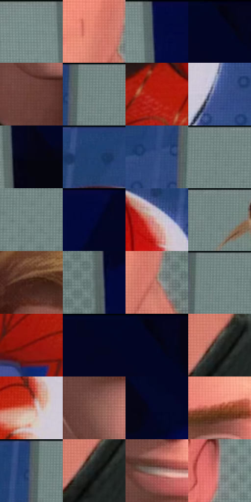

# 电影参考 249

- 状态：条件／活跃；来源世界：miles-home。
- 视角：near-level；景别：close-up；场景：detail。
- 时段：interior-time-unknown（外观依据，中置信度；具体时间／晨昏未知）；光照：cool-interior。
- 材质候选：screen（帧级，不是像素分割）。
- 明暗组：dark；L* P5/P50/P95：2.19811 / 37.5174 / 70.48552。
- 资格门禁：secondary-image。
- 原截图 SHA-256：`b83bbb85e2cab84b70b1e33ca60037de6f4d47e62d2d88f7e5a4e72aa5bf24a3`；尺寸：2880 × 1208。
- sRGB 像素 SHA-256：`2c165b0b7cc12cc7c7826bdd64bfaf935296751a421eab3d4f08ba821b8a09ca`。

## 观察与迁移

屏幕人物及印刷点纹是二次图像，不是现场皮肤。

249／26  /  屏中肖像；规则网格  /  规则细格覆盖整幅屏内肖像及背景，仍保留柔和脸部体块和发束。  /  它是二次图像的表面显示证据，不是日常皮肤毛孔或全脸大波点范本。

本公开版保存32个128×128原像素色卡上下文；图集格子并非原场景相邻位置。原rect、图集tile和像素SHA见 `data/palette-crops.json`。上下文不足时不得批准替色，不能以小样推断完整构图。

## 实测色卡

颜色比例分母为保留采样像素，不是材料面积；全部 32 色参与全库匹配。表内四舍五入仅用于阅读，原精度在 JSON。

| ID | HEX | Lab | 原图 xy | 像素数 | 比例 | 明度角色 |
| --- | --- | --- | --- | ---: | ---: | --- |
| 249-S01 | #7B8D8B | [57.196358, -6.877872, -1.120015] | [2080, 28] | 15319 | 7.923102% | midtone |
| 249-S02 | #DF8171 | [63.82313, 34.536688, 24.441851] | [1640, 776] | 14254 | 7.372276% | light |
| 249-S03 | #030941 | [5.385596, 20.539251, -35.020581] | [2160, 64] | 12993 | 6.720077% | deep-shadow |
| 249-S04 | #030521 | [2.146754, 5.748621, -16.281368] | [2628, 32] | 10662 | 5.514466% | deep-shadow |
| 249-S05 | #693F34 | [31.363214, 16.992008, 14.469488] | [1380, 1060] | 10125 | 5.236726% | shadow |
| 249-S06 | #748684 | [54.478952, -6.934271, -1.123547] | [780, 28] | 9047 | 4.679176% | midtone |
| 249-S07 | #B91C0F | [39.886443, 59.019633, 48.090396] | [80, 836] | 8927 | 4.617111% | shadow |
| 249-S08 | #3A518D | [35.413212, 10.376153, -36.025905] | [424, 552] | 7973 | 4.123695% | shadow |
| 249-S09 | #050612 | [1.862333, 1.675066, -5.362807] | [2204, 368] | 7421 | 3.838197% | deep-shadow |
| 249-S10 | #224074 | [27.482826, 7.643322, -33.223147] | [192, 28] | 7321 | 3.786476% | shadow |
| 249-S11 | #314A82 | [32.171741, 9.113526, -34.459638] | [680, 236] | 7176 | 3.711481% | shadow |
| 249-S12 | #6B7D7B | [50.946744, -7.010779, -1.127718] | [840, 36] | 6896 | 3.566663% | midtone |
| 249-S13 | #667876 | [48.964634, -7.055379, -1.129798] | [964, 148] | 6836 | 3.535630% | midtone |
| 249-S14 | #020939 | [4.548567, 15.655247, -30.620192] | [2288, 52] | 6702 | 3.466325% | deep-shadow |
| 249-S15 | #D9C0BD | [79.685675, 8.341091, 4.754082] | [360, 200] | 6567 | 3.396502% | light |
| 249-S16 | #70817F | [52.594361, -6.621945, -1.011587] | [1040, 48] | 6536 | 3.380468% | midtone |
| 249-S17 | #3E1B13 | [14.708758, 16.258155, 13.308311] | [1280, 100] | 6276 | 3.245994% | deep-shadow |
| 249-S18 | #5E6F6E | [45.461173, -6.552185, -1.573854] | [2164, 828] | 5504 | 2.846710% | midtone |
| 249-S19 | #AA6454 | [49.861035, 26.49803, 21.201238] | [1688, 824] | 5066 | 2.620173% | midtone |
| 249-S20 | #6E807E | [52.129117, -6.984753, -1.126383] | [796, 28] | 4872 | 2.519835% | midtone |
| 249-S21 | #8D150D | [29.985371, 47.837989, 37.586771] | [112, 1052] | 4614 | 2.386395% | shadow |
| 249-S22 | #020624 | [2.443158, 6.201305, -18.181556] | [2520, 28] | 4354 | 2.251921% | deep-shadow |
| 249-S23 | #040515 | [1.702484, 2.478454, -7.549306] | [2652, 32] | 3404 | 1.760574% | deep-shadow |
| 249-S24 | #292D2C | [18.053797, -2.008521, 0.041108] | [1704, 1004] | 2977 | 1.539727% | deep-shadow |
| 249-S25 | #E29E8A | [71.187391, 22.860828, 20.622302] | [384, 872] | 2648 | 1.369565% | light |
| 249-S26 | #875B4F | [43.061035, 16.492953, 14.242852] | [1376, 932] | 2580 | 1.334395% | midtone |
| 249-S27 | #030729 | [2.99298, 8.138293, -21.17748] | [2448, 616] | 1920 | 0.993038% | deep-shadow |
| 249-S28 | #96442A | [39.219902, 32.568575, 31.744101] | [1580, 384] | 1764 | 0.912354% | shadow |
| 249-S29 | #4E5A64 | [37.575245, -2.210927, -7.297267] | [732, 28] | 1084 | 0.560653% | shadow |
| 249-S30 | #1A1E20 | [10.938575, -1.29824, -1.996699] | [1692, 1040] | 645 | 0.333599% | deep-shadow |
| 249-S31 | #9B847C | [57.004329, 7.413013, 7.564055] | [1404, 816] | 529 | 0.273603% | midtone |
| 249-S32 | #A79491 | [62.877587, 6.523289, 4.166116] | [1808, 532] | 354 | 0.183091% | light |

## 色阶与空间分布

- 采样 ROI：`[0.01, 0.02, 0.98, 0.94]`；步长：4；样本数：193346。
- 排除区：`[]`。
- 深暗、暗、中、亮、高光五段计数：`[55996, 45706, 69784, 18664, 3196]`。
- RGB 各 256 箱、L* 100 箱、13×5 色相明度表和 3×3 空间统计全部保存在 [总数据](../film-library.json)。
- [可视化档案](../../references/library.html)按需绘制直方图，不存 2,094 张重复图表图片。

## 纹理特征占比

**这是分块图像特征的面积占比，不是波点／排线／丝网／错版的精确语义覆盖率。** 窗格、发丝、织物也会产生方向或周期特征。
原图 ROI 像素 3104134；已测块覆盖 3104134（100.0000%）；未测 0。

| 特征 | 块覆盖像素 | 占已测面积 | 阈值敏感范围 |
| --- | ---: | ---: | --- |
| low-contrast | 686598 | 22.1188% | 22.1188% ~ 22.4776% |
| directional-structure | 93056 | 2.9978% | 0.3587% ~ 6.6925% |
| periodic-structure | 2095104 | 67.4940% | 66.4178% ~ 69.6052% |
| mixed-detail | 229376 | 7.3894% | 1.5834% ~ 10.7459% |

阈值敏感范围不是统计置信区间。逐块坐标、尺度、对比、方向一致性、频谱集中度、频率与角度见 [全量特征记录](../texture-features.jsonl)，以帧号定位。
四种印刷层的真实像素覆盖仍标为 `null`，不能填 0，也不能拿上表代替。不得据这些代理测量删除唯一证据。

[测量方法与保留策略](../../references/library-retention.md) · [分类索引](../archive/README.md)
