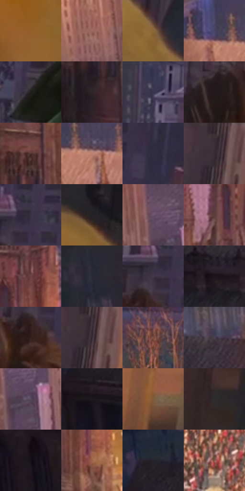

# 电影参考 250

- 状态：常规／活跃；来源世界：miles-home。
- 视角：high-angle；景别：environment-wide；场景：city。
- 时段：daylight-time-unspecified（外观依据，中置信度；具体时间／晨昏未知）；光照：warm-day。
- 材质候选：skin, hair, fabric, stone, brick, glass（帧级，不是像素分割）。
- 明暗组：dark；L* P5/P50/P95：8.07492 / 24.41744 / 51.31781。
- 资格门禁：无附加门禁。
- 原截图 SHA-256：`a7e711e8b4d0a178f230e680f612b9761de3034803ea7ee4dc0dfa5340a6cf04`；尺寸：2880 × 1206。
- sRGB 像素 SHA-256：`7014a5d0fb63d0f39020105faad29faa45ccdcf5acaeca62a6dbe1a89d344b9f`。

## 观察与迁移

暖光建筑与人物，远人群的分布不能被清空；石砌与砖材须实际落点复核。

250／27  /  日光建筑；高低视点  /  建筑阴影在地面和人群上形成大斜向明暗分区；暖石材与冷灰远楼、前景衣料分别读取。  /  不把建筑投影当石材固有色，不拉高原照楼群。

本公开版保存32个128×128原像素色卡上下文；图集格子并非原场景相邻位置。原rect、图集tile和像素SHA见 `data/palette-crops.json`。上下文不足时不得批准替色，不能以小样推断完整构图。

## 实测色卡

颜色比例分母为保留采样像素，不是材料面积；全部 32 色参与全库匹配。表内四舍五入仅用于阅读，原精度在 JSON。

| ID | HEX | Lab | 原图 xy | 像素数 | 比例 | 明度角色 |
| --- | --- | --- | --- | ---: | ---: | --- |
| 250-S01 | #945F29 | [45.139894, 16.547508, 38.687143] | [2716, 1096] | 9343 | 4.832270% | midtone |
| 250-S02 | #9C6A61 | [49.786481, 18.81711, 13.15833] | [440, 120] | 8825 | 4.564356% | midtone |
| 250-S03 | #89673B | [46.090635, 8.197088, 29.877474] | [2492, 656] | 8429 | 4.359542% | midtone |
| 250-S04 | #494565 | [30.907081, 9.609384, -18.120557] | [824, 400] | 8193 | 4.237481% | shadow |
| 250-S05 | #231F1E | [12.16289, 1.679746, 1.375278] | [1912, 784] | 7721 | 3.993359% | deep-shadow |
| 250-S06 | #2F2429 | [15.624393, 6.254736, -1.334738] | [1112, 852] | 7634 | 3.948362% | deep-shadow |
| 250-S07 | #3A364E | [23.959767, 7.817604, -14.027724] | [1904, 48] | 7532 | 3.895607% | shadow |
| 250-S08 | #22191E | [10.023797, 5.585691, -1.767248] | [2032, 180] | 6961 | 3.600281% | deep-shadow |
| 250-S09 | #4D312D | [23.552702, 12.156281, 7.767148] | [1144, 604] | 6864 | 3.550112% | shadow |
| 250-S10 | #BC8471 | [60.23792, 19.121788, 18.876977] | [896, 432] | 6325 | 3.271337% | light |
| 250-S11 | #302E41 | [19.898976, 5.864376, -11.612213] | [2444, 136] | 6214 | 3.213927% | deep-shadow |
| 250-S12 | #3E323A | [22.341006, 7.057424, -3.011533] | [2656, 28] | 6095 | 3.152380% | shadow |
| 250-S13 | #393245 | [22.233825, 7.681987, -10.66688] | [2260, 76] | 5918 | 3.060834% | shadow |
| 250-S14 | #262125 | [13.432, 3.306263, -1.8193] | [2784, 816] | 5917 | 3.060317% | deep-shadow |
| 250-S15 | #6D566D | [39.599249, 13.898103, -9.538914] | [724, 96] | 5874 | 3.038077% | shadow |
| 250-S16 | #5B3D3A | [29.075807, 12.734775, 7.16809] | [1100, 124] | 5866 | 3.033939% | shadow |
| 250-S17 | #6B4543 | [33.537248, 16.090383, 7.943075] | [1196, 268] | 5856 | 3.028767% | shadow |
| 250-S18 | #242835 | [16.253642, 1.914459, -8.994905] | [80, 32] | 5544 | 2.867398% | deep-shadow |
| 250-S19 | #433848 | [25.228022, 8.361669, -8.023869] | [2220, 108] | 5470 | 2.829125% | shadow |
| 250-S20 | #1D1419 | [7.51303, 5.681417, -1.770466] | [480, 556] | 5407 | 2.796541% | deep-shadow |
| 250-S21 | #321F1C | [14.070842, 8.767872, 5.804251] | [2204, 184] | 5346 | 2.764991% | deep-shadow |
| 250-S22 | #382A31 | [18.879411, 7.903097, -2.035721] | [2668, 72] | 5300 | 2.741200% | deep-shadow |
| 250-S23 | #7B4B41 | [37.162138, 19.145338, 14.531156] | [1456, 552] | 5156 | 2.666722% | shadow |
| 250-S24 | #48404F | [28.403858, 6.765708, -7.784001] | [544, 404] | 5147 | 2.662067% | shadow |
| 250-S25 | #58495D | [33.200539, 10.488219, -9.391592] | [768, 152] | 5028 | 2.600519% | shadow |
| 250-S26 | #1B191E | [9.173461, 2.279584, -3.12344] | [152, 648] | 4939 | 2.554488% | deep-shadow |
| 250-S27 | #7D5A39 | [41.16622, 10.232474, 24.617183] | [2788, 212] | 4789 | 2.476907% | midtone |
| 250-S28 | #312C2D | [18.556982, 2.4871, 0.176992] | [2752, 528] | 4688 | 2.424669% | deep-shadow |
| 250-S29 | #151016 | [5.310875, 3.298079, -2.838805] | [348, 812] | 4556 | 2.356397% | deep-shadow |
| 250-S30 | #9D6649 | [48.452912, 18.88335, 25.426157] | [1240, 748] | 4474 | 2.313986% | midtone |
| 250-S31 | #24232B | [14.125256, 2.542704, -5.130812] | [176, 500] | 4367 | 2.258645% | deep-shadow |
| 250-S32 | #8A584B | [42.599937, 19.058237, 16.095824] | [1584, 1056] | 3568 | 1.845396% | midtone |

## 色阶与空间分布

- 采样 ROI：`[0.01, 0.02, 0.98, 0.94]`；步长：4；样本数：193346。
- 排除区：`[]`。
- 深暗、暗、中、亮、高光五段计数：`[70581, 76161, 43996, 2527, 81]`。
- RGB 各 256 箱、L* 100 箱、13×5 色相明度表和 3×3 空间统计全部保存在 [总数据](../film-library.json)。
- [可视化档案](../../references/library.html)按需绘制直方图，不存 2,094 张重复图表图片。

## 纹理特征占比

**这是分块图像特征的面积占比，不是波点／排线／丝网／错版的精确语义覆盖率。** 窗格、发丝、织物也会产生方向或周期特征。
原图 ROI 像素 3098546；已测块覆盖 3098546（100.0000%）；未测 0。

| 特征 | 块覆盖像素 | 占已测面积 | 阈值敏感范围 |
| --- | ---: | ---: | --- |
| low-contrast | 126130 | 4.0706% | 0.9930% ~ 6.1857% |
| directional-structure | 537728 | 17.3542% | 4.5812% ~ 29.9537% |
| periodic-structure | 2140032 | 69.0657% | 64.8273% ~ 74.6136% |
| mixed-detail | 294656 | 9.5095% | 4.2260% ~ 14.6195% |

阈值敏感范围不是统计置信区间。逐块坐标、尺度、对比、方向一致性、频谱集中度、频率与角度见 [全量特征记录](../texture-features.jsonl)，以帧号定位。
四种印刷层的真实像素覆盖仍标为 `null`，不能填 0，也不能拿上表代替。不得据这些代理测量删除唯一证据。

[测量方法与保留策略](../../references/library-retention.md) · [分类索引](../archive/README.md)
