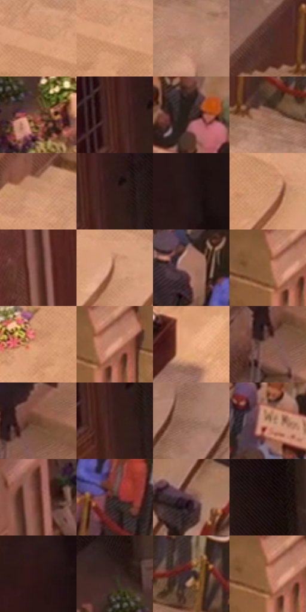

# 电影参考 251

- 状态：常规／活跃；来源世界：miles-home。
- 视角：high-angle；景别：environment-wide；场景：city。
- 时段：daylight-time-unspecified（外观依据，中置信度；具体时间／晨昏未知）；光照：warm-day。
- 材质候选：skin, hair, fabric, stone, metal, wood（帧级，不是像素分割）。
- 明暗组：middle；L* P5/P50/P95：9.19244 / 42.43 / 71.0302。
- 资格门禁：无附加门禁。
- 原截图 SHA-256：`2f72c6870bf88b6047a51c09ce5fc8639f07f80502e2e2dc8e81dcffb76ae596`；尺寸：2872 × 1190。
- sRGB 像素 SHA-256：`b9369d66894f75d458570ff8b72720eb24aba07941395b43b84c724bcf706823`。

## 观察与迁移

原帧复核：台阶与柱体为石砌表面，棕红竖向饰面不当作已证实砖墙；花束与讲台另分。

251／28  /  日光材质；台阶／木材  /  浅暖石阶的踏面、立面和接触暗缝有层级；木讲台较深，衣物、花束不与石材同色。  /  曲线台阶是几何，不是装饰排线；不能给所有边同样粗黑描线。

本公开版保存32个128×128原像素色卡上下文；图集格子并非原场景相邻位置。原rect、图集tile和像素SHA见 `data/palette-crops.json`。上下文不足时不得批准替色，不能以小样推断完整构图。

## 实测色卡

颜色比例分母为保留采样像素，不是材料面积；全部 32 色参与全库匹配。表内四舍五入仅用于阅读，原精度在 JSON。

| ID | HEX | Lab | 原图 xy | 像素数 | 比例 | 明度角色 |
| --- | --- | --- | --- | ---: | ---: | --- |
| 251-S01 | #D79D77 | [69.39527, 16.97753, 28.360914] | [1716, 352] | 9870 | 5.175560% | light |
| 251-S02 | #DCA17A | [70.949154, 17.140053, 28.89015] | [1748, 376] | 9654 | 5.062295% | light |
| 251-S03 | #AF816B | [57.920801, 14.795662, 18.88318] | [2328, 444] | 8557 | 4.487058% | midtone |
| 251-S04 | #4D2F29 | [22.900316, 12.905809, 9.555694] | [1812, 156] | 7828 | 4.104791% | shadow |
| 251-S05 | #7A4D3B | [37.41193, 16.859522, 18.533091] | [1012, 436] | 7799 | 4.089584% | shadow |
| 251-S06 | #4A231E | [19.022097, 17.880674, 11.740879] | [756, 48] | 7704 | 4.039768% | deep-shadow |
| 251-S07 | #291C19 | [11.771309, 5.857015, 4.580396] | [2788, 40] | 7248 | 3.800654% | deep-shadow |
| 251-S08 | #956753 | [47.900074, 15.927206, 18.699293] | [1912, 216] | 6792 | 3.561540% | midtone |
| 251-S09 | #C88F6D | [64.185951, 17.48103, 26.642481] | [1628, 268] | 6692 | 3.509103% | light |
| 251-S10 | #2E1917 | [11.53934, 10.210737, 5.838781] | [804, 36] | 6589 | 3.455093% | deep-shadow |
| 251-S11 | #231514 | [8.517938, 6.990229, 3.435004] | [136, 24] | 6563 | 3.441459% | deep-shadow |
| 251-S12 | #CE9470 | [66.116178, 17.499834, 27.664168] | [1928, 492] | 6496 | 3.406326% | light |
| 251-S13 | #60352B | [27.319415, 18.097207, 14.646658] | [684, 352] | 6251 | 3.277855% | shadow |
| 251-S14 | #BE8667 | [60.763001, 17.718576, 25.23883] | [2052, 492] | 6091 | 3.193955% | light |
| 251-S15 | #A5745E | [53.276158, 16.472667, 19.84768] | [2380, 156] | 6021 | 3.157249% | midtone |
| 251-S16 | #995F44 | [46.14454, 20.714316, 25.261126] | [1296, 28] | 5868 | 3.077020% | midtone |
| 251-S17 | #D49870 | [67.744274, 17.761594, 29.922107] | [1560, 392] | 5866 | 3.075971% | light |
| 251-S18 | #8D533B | [41.479388, 21.650994, 24.277218] | [1336, 24] | 5814 | 3.048704% | midtone |
| 251-S19 | #E8AB83 | [74.776789, 17.502373, 29.35727] | [1644, 556] | 5794 | 3.038216% | light |
| 251-S20 | #845C4E | [42.929808, 14.492275, 14.60758] | [684, 1112] | 5739 | 3.009376% | midtone |
| 251-S21 | #6A412C | [31.869086, 15.399952, 20.163604] | [724, 1072] | 5657 | 2.966377% | shadow |
| 251-S22 | #381B18 | [13.772819, 13.899639, 8.426456] | [792, 108] | 4850 | 2.543208% | deep-shadow |
| 251-S23 | #98705E | [50.772652, 13.321224, 16.204462] | [2564, 572] | 4678 | 2.453016% | midtone |
| 251-S24 | #BF8C71 | [62.530357, 15.90489, 22.041394] | [2664, 124] | 4625 | 2.425224% | light |
| 251-S25 | #5C2A1F | [23.772984, 21.834426, 17.768165] | [744, 684] | 4287 | 2.247986% | shadow |
| 251-S26 | #30201D | [14.117753, 7.229843, 5.108231] | [2476, 260] | 4255 | 2.231206% | deep-shadow |
| 251-S27 | #664444 | [32.650004, 14.68508, 5.960373] | [2508, 1100] | 4219 | 2.212329% | shadow |
| 251-S28 | #1B0D0C | [4.945109, 5.815331, 2.539869] | [916, 56] | 4086 | 2.142587% | deep-shadow |
| 251-S29 | #2D1414 | [9.867121, 12.7579, 5.586157] | [104, 188] | 4038 | 2.117418% | deep-shadow |
| 251-S30 | #382420 | [16.537875, 8.893609, 6.51532] | [944, 340] | 3844 | 2.015689% | deep-shadow |
| 251-S31 | #3D2C2D | [19.975986, 8.026789, 2.410271] | [2032, 180] | 3477 | 1.823244% | deep-shadow |
| 251-S32 | #B47356 | [54.698448, 22.458115, 26.624891] | [1304, 52] | 3452 | 1.810135% | midtone |

## 色阶与空间分布

- 采样 ROI：`[0.01, 0.02, 0.98, 0.94]`；步长：4；样本数：190704。
- 排除区：`[]`。
- 深暗、暗、中、亮、高光五段计数：`[49137, 40697, 47240, 53417, 213]`。
- RGB 各 256 箱、L* 100 箱、13×5 色相明度表和 3×3 空间统计全部保存在 [总数据](../film-library.json)。
- [可视化档案](../../references/library.html)按需绘制直方图，不存 2,094 张重复图表图片。

## 纹理特征占比

**这是分块图像特征的面积占比，不是波点／排线／丝网／错版的精确语义覆盖率。** 窗格、发丝、织物也会产生方向或周期特征。
原图 ROI 像素 3050670；已测块覆盖 3050670（100.0000%）；未测 0。

| 特征 | 块覆盖像素 | 占已测面积 | 阈值敏感范围 |
| --- | ---: | ---: | --- |
| low-contrast | 214784 | 7.0406% | 4.8923% ~ 8.4126% |
| directional-structure | 737280 | 24.1678% | 18.2601% ~ 37.7664% |
| periodic-structure | 1932974 | 63.3623% | 55.1343% ~ 63.3623% |
| mixed-detail | 165632 | 5.4294% | 2.2070% ~ 10.3762% |

阈值敏感范围不是统计置信区间。逐块坐标、尺度、对比、方向一致性、频谱集中度、频率与角度见 [全量特征记录](../texture-features.jsonl)，以帧号定位。
四种印刷层的真实像素覆盖仍标为 `null`，不能填 0，也不能拿上表代替。不得据这些代理测量删除唯一证据。

[测量方法与保留策略](../../references/library-retention.md) · [分类索引](../archive/README.md)
